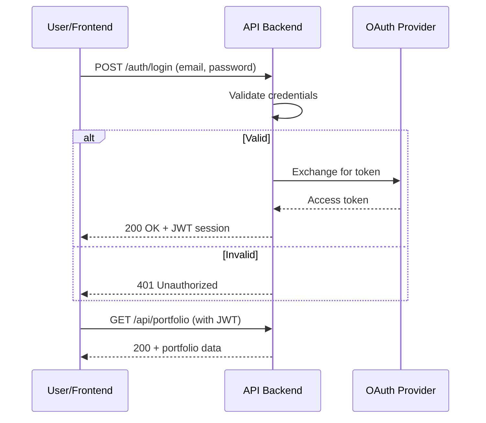

# Mermaid Diagram Generator — Software Development Edition

Generate high-quality Mermaid diagrams for the full software development workflow, from architectural design through implementation and deployment.

**Scope:** This skill focuses on diagrams that drive the **architecture → design → code → deploy** lifecycle. Business analysis, project management, and data visualization are out of scope (though the full Mermaid library includes them).

**Validation:** There's no live Mermaid renderer wired into this skill (no MCP connection to mermaid.ai) — the
workflow below leans on reading the right syntax reference closely and self-checking the output
against it, plus using Artifacts as the actual render check when one is available. That combination
catches the errors a live validator would, without depending on an external service.

## Workflow

1. **Lock the diagram type and scope first.** Before drafting any content, decide: which diagram
   type, which direction (`TD`/`LR`/etc. where applicable), and roughly which nodes/participants/
   entities will appear. Committing to the output shape upfront, rather than describing the content
   generically and figuring out the type as you go, is what keeps the syntax consistent — most
   Mermaid syntax errors trace back to blending conventions from two diagram types.
2. **Read the reference** for that diagram type from the table below before writing code — don't
   rely on remembered syntax, since connector styles, quoting rules, and block-closing keywords
   differ by diagram type in ways that are easy to cross-contaminate.
3. **Keep it to one clear idea per diagram.** Diagrams with more than ~12-15 nodes get hard to read
   and are also where most syntax mistakes creep in. If the real thing being described is bigger
   than that, split it into a few focused diagrams (e.g. one per subsystem, or an overview diagram
   plus detail diagrams) rather than cramming everything into one.
4. **Generate the code**, following the reference's exact syntax for connectors, node shapes, and
   quoting — see the self-check below before treating it as done.
5. **Apply styling only when it aids clarity.** A quick explanatory diagram usually doesn't need
   `classDef`/`style` blocks; reach for [Theming](references/config-theming.md) when the diagram
   is going into a polished doc or dashboard and colors/grouping genuinely help the reader.

## Self-check before returning the diagram

Since nothing here renders the diagram automatically, read the code back against these before
calling it done — most Mermaid errors are one of these five things:

- Does the diagram-type keyword match the reference exactly (e.g. `flowchart TD`, not a guessed
  variant)?
- Does every connector/arrow match one the reference defines for *this* diagram type?
- Is every label containing spaces, colons, quotes, or parentheses actually quoted?
- Is every block that was opened (`subgraph`, composite `state`, `alt`/`opt`/`loop`, etc.) closed
  with a matching `end`?
- Is every node/participant referenced by the same identifier everywhere it appears (a typo'd id
  silently creates a stray extra node instead of erroring)?

**If the diagram is going into an Artifact**, publish it and look at the rendered result —
Artifacts render Mermaid natively (```mermaid fences in Markdown, `<pre class="mermaid">` in HTML),
so that's a real, already-available live-validation path and is worth using for anything non-trivial
or going in front of the user. For diagrams handed back as plain code (chat replies, files written
to a repo), the checklist above is the validation.

## Common pitfalls

| Mistake | Why it bites | Fix |
| --- | --- | --- |
| Picking the diagram type as you go | Syntax from two diagram types gets mixed mid-diagram | Lock the type before writing any content (step 1) |
| Cramming everything into one diagram | Dense diagrams are both unreadable and error-prone | Split at ~12-15 nodes into a few focused diagrams |
| Unquoted labels with punctuation | Parser reads the punctuation as syntax | Quote any label with spaces/colons/parens/quotes |
| Working from a screenshot of a diagram | You're re-deriving syntax you can't see | Work from the requirements/text, not an image of a diagram |
| Wrapping the code in narration | Breaks copy-paste and can break the mermaid fence itself | Keep the code block clean; put explanation before/after it, not inside |

## Core Diagram Types for Software Development

The 11 diagrams below cover the full architecture → design → code → deploy lifecycle. Select the type and read the documentation:

### System & Service Architecture
| Type | Documentation | When to use | Phase |
| ---- | ------------- | ----------- | ----- |
| Architecture Diagram | [architecture.md](references/architecture.md) | Infrastructure, cloud services, deployment topology, service relationships | Architect |
| C4 Diagram | [c4.md](references/c4.md) | System context, container architecture, component dependencies, technology decisions | Architect |

### Code & Object Design  
| Type | Documentation | When to use | Phase |
| ---- | ------------- | ----------- | ----- |
| Class Diagram | [classDiagram.md](references/classDiagram.md) | OOP structure, inheritance, associations, API interfaces, domain models | Architect → Backend/Frontend |
| ER Diagram | [entityRelationshipDiagram.md](references/entityRelationshipDiagram.md) | Database schema, entity relationships, cardinaliy, logical data model | Architect → Backend |

### Behavior & Interaction
| Type | Documentation | When to use | Phase |
| ---- | ------------- | ----------- | ----- |
| Sequence Diagram | [sequenceDiagram.md](references/sequenceDiagram.md) | API flows, microservice communication, authentication flows, error scenarios | Architect → Backend/Frontend |
| State Diagram | [stateDiagram.md](references/stateDiagram.md) | Object lifecycle, business entity states (order, payment, etc), protocol state machines | Architect → Backend |
| Event Modeling | [eventmodeling.md](references/eventmodeling.md) | Event-driven architecture, DDD aggregate roots, CQRS workflows, command/event flows | Architect → Backend |

### Process & Responsibility
| Type | Documentation | When to use | Phase |
| ---- | ------------- | ----------- | ----- |
| Flowchart | [flowchart.md](references/flowchart.md) | Algorithms, business logic, decision trees, control flow | Architect → Backend/Frontend |
| Swimlanes | [swimlanes.md](references/swimlanes.md) | Cross-service workflows, approval chains, multi-actor handoffs, deployment pipelines | Architect → DevOps |

### Requirements & Quality
| Type | Documentation | When to use | Phase |
| ---- | ------------- | ----------- | ----- |
| Requirement Diagram | [requirementDiagram.md](references/requirementDiagram.md) | Spec traceability (req → design → code → test), compliance, acceptance criteria | Architect |

### Collaboration & Deployment
| Type | Documentation | When to use | Phase |
| ---- | ------------- | ----------- | ----- |
| Git Graph | [gitgraph.md](references/gitgraph.md) | Branch strategy, release workflow, merge patterns, team collaboration process | DevOps / Team workflow |

---

### Other Useful References
- [Block Diagram](references/block.md) — alternative to Architecture Diagram for component systems
- [ZenUML](references/zenuml.md) — code-style syntax for Sequence Diagrams (alternative to default)
- [TreeView](references/treeView.md) — package/module hierarchy, file structure
- [Examples Gallery](references/examples.md) — worked examples across all diagram types

**Note:** Task management (Kanban, Gantt), business analysis (Quadrant, Cynefin, Wardley), and data visualization (Charts, Sankey) are excluded from this skill — those live in other contexts.

## Workflow Mapping: How Diagrams Fit the Orchestrator Workflow

Based on `AGENTS.md` task orchestration (Architect → Backend/Frontend → DevOps → Deploy):

```
┌──────────────────────────────────────────────────────────────────────────────┐
│ TASK: Read .task.md, spawn Architect                                         │
├──────────────────────────────────────────────────────────────────────────────┤
│ ARCHITECT PHASE (Design & Contracts)                                         │
│  → Requirement Diagram (spec traceability)                                   │
│  → C4 Diagram (context, containers, components)                              │
│  → Architecture Diagram (deployment topology)                                │
│  → Class Diagram (OOP structure, APIs)                                       │
│  → ER Diagram (DB schema)                                                    │
│  → Sequence Diagram (API flows, handshakes)                                  │
│  → State Diagram (domain entity lifecycle)                                   │
│  → Event Modeling (CQRS/DDD workflows)                                       │
│  Output: diagrams → /docs/architecture/diagrams/, OpenAPI spec, DB schema    │
├──────────────────────────────────────────────────────────────────────────────┤
│ BACKEND/FRONTEND PHASE (Implementation)                                      │
│  → Class Diagram (code structure review)                                     │
│  → Sequence Diagram (integration verification)                               │
│  → State Diagram (stateful behavior)                                         │
│  → Flowchart (algorithm verification)                                        │
├──────────────────────────────────────────────────────────────────────────────┤
│ DEVOPS PHASE (Deployment)                                                    │
│  → Swimlanes (deployment workflow responsibility)                            │
│  → Architecture Diagram (infrastructure as code)                             │
│  → Git Graph (release & branching strategy)                                  │
├──────────────────────────────────────────────────────────────────────────────┤
│ TEAM COLLABORATION                                                           │
│  → Git Graph (branch strategy, merge workflow)                               │
│  → Swimlanes (handoff points, approval chains)                               │
└──────────────────────────────────────────────────────────────────────────────┘
```

## Configuration & Themes

- [Theming](references/config-theming.md) - Custom colors and styles
- [Directives](references/config-directives.md) - Diagram-level configuration
- [Layouts](references/config-layouts.md) - Layout direction and spacing
- [Configuration](references/config-configuration.md) - Global settings
- [Math](references/config-math.md) - LaTeX math support
- [Tidy-tree layout](references/config-tidy-tree.md) - Hierarchical tree layout

## Quick Decision Guide: Which Diagram?

**I need to show...**

| Need | Diagram | Why |
|------|---------|-----|
| How services talk to each other | Sequence Diagram | Shows time-ordered message flows, perfect for API/microservice design |
| What data goes into the database | ER Diagram | Entity relationships and cardinalcy define the DB schema |
| How an object or order flows through states | State Diagram | Lifecycle states (NEW → PAID → SHIPPED) are the source of truth |
| System context and deployment | Architecture Diagram | Shows where code runs, how services/infra connect |
| Code class structure and inheritance | Class Diagram | UML is the standard for OOP design |
| Commands, events, and domain models | Event Modeling | DDD/CQRS workflows map cleanly to commands → events → read models |
| A decision or algorithm | Flowchart | Diamond nodes + paths show branching and loops |
| Responsibility and handoffs | Swimlanes | Each lane = actor; arrows show work transfer |
| Requirements and traceability | Requirement Diagram | Links spec → design → code → test for compliance |
| Multiple architectural levels | C4 Diagram | Context → Containers → Components → Deployment; clearer than one big diagram |
| Git branching strategy | Git Graph | Commits, branches, merges, tags — the team's collaboration model |

**Can't decide?** Start with the question: "Does time matter?" → **Sequence Diagram**. "Do states matter?" → **State Diagram**. "Is it structure?" → **Class Diagram** or **ER Diagram**.

## Output Specification

Generated Mermaid code should:

1. Be wrapped in ```mermaid code blocks
2. Have correct syntax that renders directly
3. Have clear structure with proper line breaks and indentation
4. Use semantic node naming
5. Include styling only when it aids clarity (reference-driven design, not decoration)

## Example: Authentication Flow (Sequence Diagram)



---

User requirements: $ARGUMENTS
