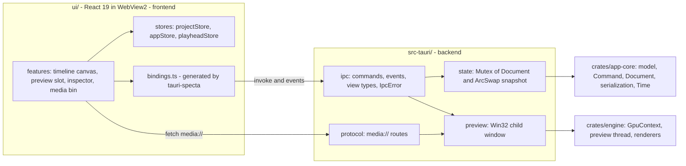
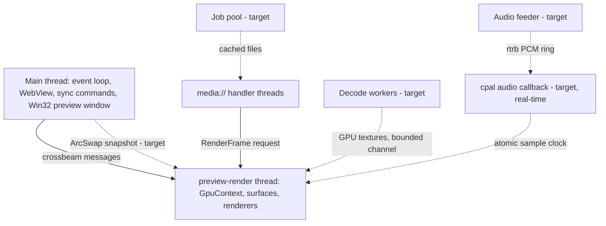
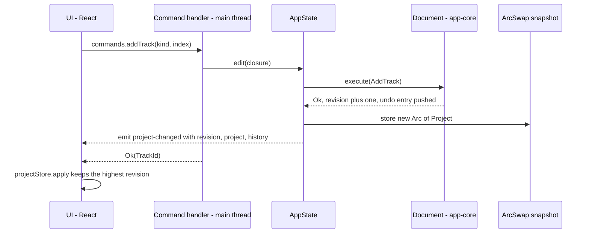
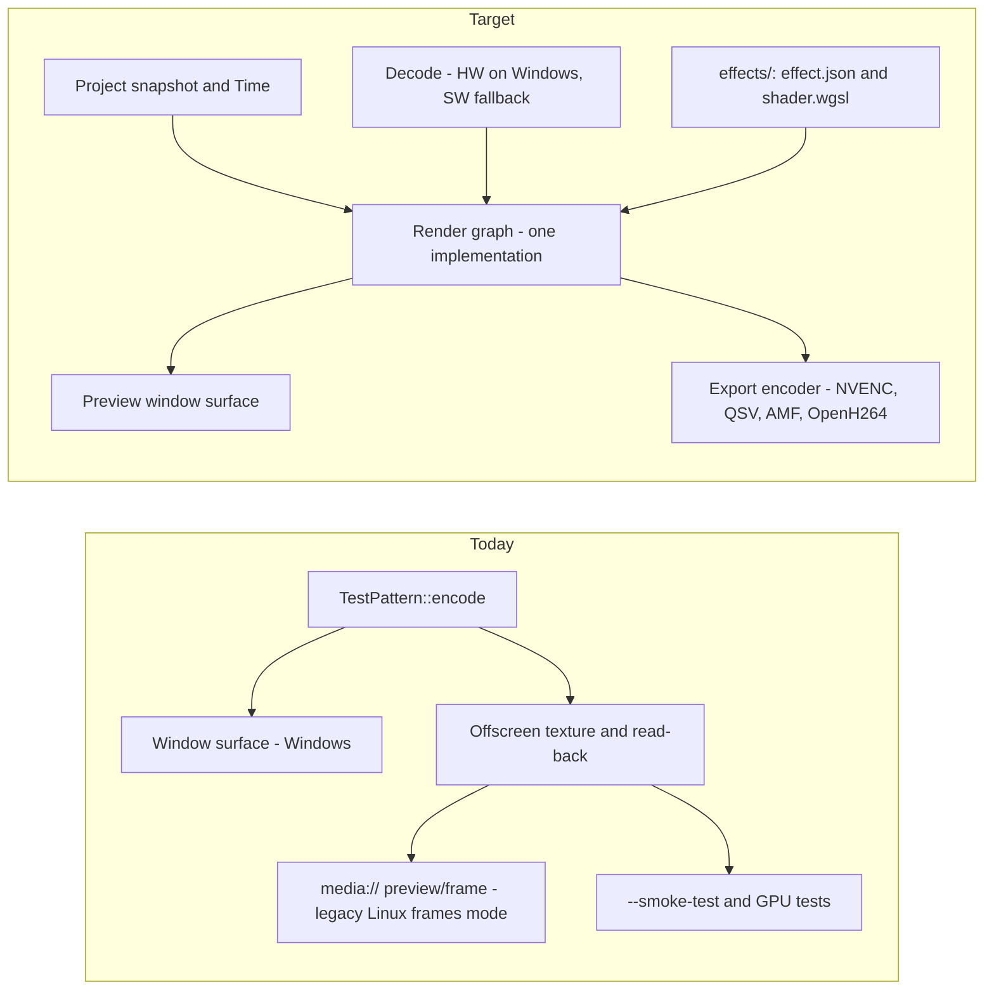
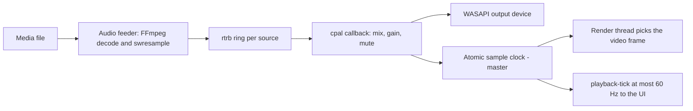
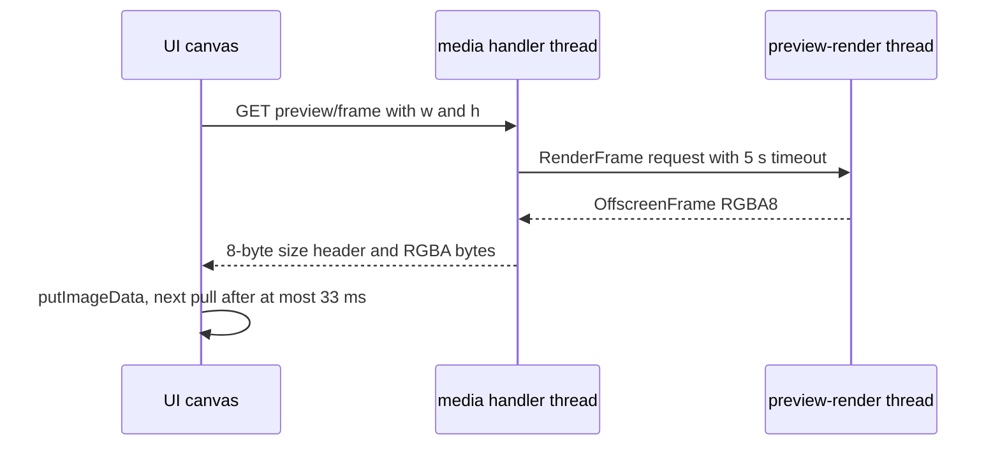
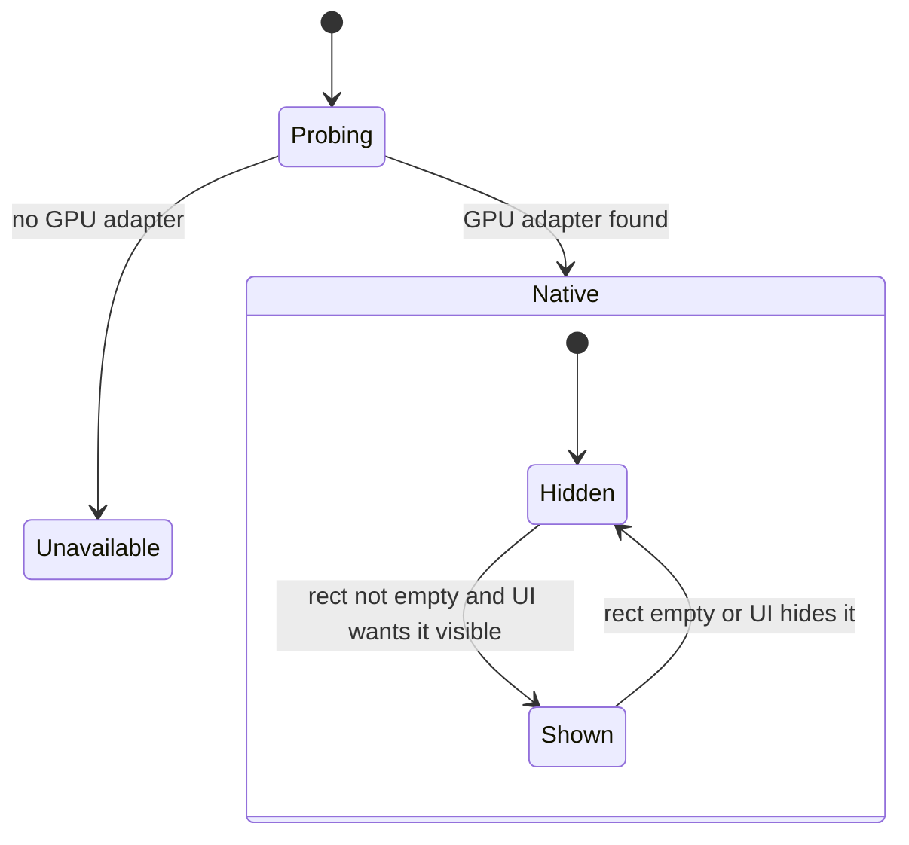

# Architecture overview

One page on how Cutframe fits together. Decisions live in `docs/adr/` (start with ADR-0001). This
page describes the code **as it is today** and marks the **target** wherever the two differ. The
validation report is `docs/architecture-review.md`.

Status: stage 0. That means a project model with undo/redo, typed IPC, an editor layout with a
canvas timeline, and a GPU test pattern in the preview. There is no media, playback, audio, effects
or export yet.

## Modules and ownership

| Module | Owner | Responsibility | Must not |
|---|---|---|---|
| `crates/app-core` | backend | model, `Command` + `Document` (undo/redo), JSON + migrations, `Time` | depend on GPU, media, Tauri or file I/O |
| `crates/engine` | backend | Today: `GpuContext`, preview thread, test-pattern renderer. Target: render graph, decode, audio, export | know about Tauri. Target: reads `app-core` snapshots (ADR-0004) |
| `src-tauri` | backend (devops: `bundle`/updater) | IPC, app state, preview window, `media://` | contain model logic |
| `effects/` (target) | backend | `effect.json` + `shader.wgsl` per effect | contain Rust code |
| `ui` | frontend | rendering state, gestures, sending commands | mutate the model, hand-write IPC types |
| `.github`, `scripts`, `deny.toml` | devops | CI, release, installer, licence policy | — |

## Threads

Solid edges exist today and dotted edges are the target. The rules per thread are in ADR-0004. In
short: the main thread never blocks, the audio callback never allocates, locks or does I/O, and only
edits mutate the model. **Today** `preview-render` draws continuously while the preview is visible.
**Target:** it draws when an input changes, and continuously only during playback.

## Flow 1: command, model, undo stack, events, UI

- **Today:** single commands only (`AddTrack`, `RemoveTrack`, `RenameTrack`, `RenameProject`).
  `undo` / `redo` take the same path. A failed command leaves the project unchanged and returns
  `IpcError { kind: "invalidEdit" }`.
- **Today:** the revision lives in `AppState` and is monotonic for the app session (ADR-0003 §6).
  History labels are `HistoryLabel` keys and the UI translates them and `IpcError.kind`;
  `IpcError.message` is logged, never shown (ADR-0003 §5).
- **Target:** gestures (an `EditPhase` argument plus `cancel_gesture`) and compound edits (`Batch`)
  are one history entry each (ADR-0006). Long operations return a `JobId` and emit `JobProgress`
  (`job-progress`) (ADR-0003).

## Flow 2: decode, render graph, preview and export

Both paths already share one encode function, which is the seed of CLAUDE.md rule 3. The render
graph, decode and export are not built yet. The render graph needs a design doc before playback.

## Flow 3: audio (target only)

There is no audio code today. The playhead is UI-only state (`ui/src/stores/playheadStore.ts`) until
playback moves transport into Rust (ADR-0004).

## Flow 4: `media://`

- **Today:** one route, `/preview/frame` (legacy Linux frames mode only, unmaintained since
  2026-11-22, ADR-0005 amendment), with one OS thread per request.
- **Target:** thumbnail and waveform routes served from a disk cache by a bounded pool, with cache
  misses produced by jobs (ADR-0004). Binary data never goes through JSON IPC (ADR-0003).

## Preview presentation

- **`native` (the only supported mode):** a Win32 child window above WebView2, with wgpu on D3D12
  (WARP as the fallback). The UI reports the slot rectangle in physical pixels. The DOM never draws
  over it.
- **Legacy `frames` (Linux):** the UI pulls frames over `media://` and paints a canvas. Since
  2026-11-22 Windows is the only platform, so this path is unmaintained, untested in CI and may be
  removed later (ADR-0005 amendment).
- **Visibility:** two independent inputs (ADR-0005 §3). The preview starts hidden, is shown only
  while the UI requests it (`set_preview_visible(true)` on mount) and the rectangle is non-empty, and
  `set_preview_rect` never shows a preview the UI hid.

## Contract and build

- **IPC contract:** Rust is the source, and `ui/src/bindings.ts` is generated (`pnpm bindings`) and
  checked in CI. 64-bit values become TS `number`. Only `Time` (flicks) and counters below 2^53 may
  be 64-bit (ADR-0003).
- **Project file:** one JSON file with `schemaVersion` and chained migrations (ADR-0002), extension
  `.cutframe` (`app_core::PROJECT_FILE_EXTENSION`, a working choice). Loading validates invariants
  (`Project::validate`); `src-tauri` saves atomically (tmp + rename) off the main thread. Dirty state
  is the `Document` history position compared with the one at the last save. **Target** until task
  0100 lands; see `docs/design/project-lifecycle.md`.
- **App-level state (target, tasks 0150/0160):** preferences in `app_config_dir()/preferences.json`
  with their own `schemaVersion` and migrations, owned by `src-tauri/src/preferences.rs`, never undoable
  (`docs/design/preferences.md`); window geometry via `tauri-plugin-window-state`; panel layout in
  WebView `localStorage`. Single instance forwards launch paths to the running app as
  `open-file-requested`; GPU loss is recovered on the `preview-render` thread and reported as
  `app-info-changed` (`docs/design/platform-integration.md`).
- **Platform:** Windows 10/11 x64 is the only platform for shipping, development and CI (ADR-0001
  amendment of 2026-11-22). Linux code paths (`frames` mode, lavapipe fallback, `cfg(not(windows))`
  branches) remain but are not maintained or tested.
- **Quality gates:** local `pnpm check` on the Windows development machine is the gate.
  Windows CI (`windows-latest`) runs only when started manually: a clean checkout running the same
  checks plus the CI-only ones listed in `CLAUDE.md`, and the NSIS installer with a silent install
  and `--smoke-test`.
- **Shipping:** NSIS `currentUser` installer built on `windows-latest`. The updater is not configured
  yet; there is no code signing (private use, ADR-0001 amendment).
- **FFmpeg:** there is no FFmpeg in the code yet. **Target:** pinned, checksummed LGPL FFmpeg DLLs,
  used for development, CI and the installer alike.
