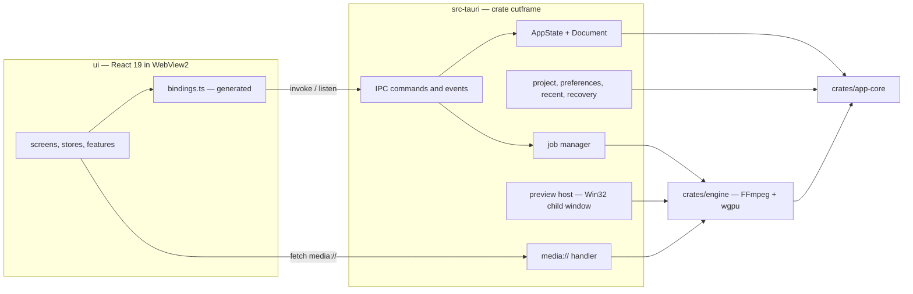

# 00 — Repository and stack

> **Audience:** every agent. What the workspace contains, which crate owns what, which versions are
> pinned, and which checks have to pass before a commit.

---

## 1. What the product is

Cutframe is a Windows desktop video editor for one person's YouTube and Shorts work. The engine and
the project model are Rust; the UI is a web frontend in WebView2 driven by typed IPC, and the preview
is a native wgpu surface. Windows 10/11 x64 is the only supported platform for shipping, development
and CI (ADR-0001 amendment of 2026-11-22).

The repository is a Cargo workspace plus a pnpm workspace:

```
cutframe/
├─ Cargo.toml                 workspace: members, pinned shared dependencies, lint levels, profiles
├─ rust-toolchain.toml        Rust 1.100 + rustfmt + clippy
├─ deny.toml                  cargo-deny: licence allowlist, advisories, source policy
├─ crates/app-core/           project model, edit commands, undo/redo, serialization   (no GPU, no I/O)
├─ crates/engine/             FFmpeg media pipeline, wgpu preview and rendering, audio,
│                             export (`engine::export`: plan, encoders, NV12, AAC, MP4, run)
│                                                                                       (no Tauri)
├─ src-tauri/                 `cutframe` crate: Tauri shell, IPC, preview window, media://
├─ ui/                        React 19 application (`@cutframe/ui`)
├─ effects/                   **Target:** data-only effects, `effect.json` + `shader.wgsl`
├─ scripts/                   `fetch-ffmpeg.ps1` + the FFmpeg pin
└─ .github/workflows/         `ci.yml` (manual), `release.yml` (v* tag)
```



| Crate | May depend on | Must not |
|---|---|---|
| `app-core` | `serde`, `serde_json`, `uuid`, `thiserror`, optional `specta` | GPU, FFmpeg, Tauri, file I/O, clocks, threads |
| `engine` | `app-core`, `rsmpeg`/FFmpeg, `wgpu`, `blake3`, `crossbeam-channel` | Tauri types |
| `cutframe` (`src-tauri`) | `app-core`, `engine`, Tauri plugins, `windows` (Win32 only) | model logic that belongs in `app-core` |
| `@cutframe/ui` | `bindings.ts`, Tauri JS APIs, React, Zustand, Radix | any project/model mutation outside a command |

`app-core` is the seat of rule 1: the model lives in Rust and every change is a `Command`. `engine`
never knows what a project is beyond the `app-core` types it reads. The shell is the only place that
combines Tauri, disk, jobs and the engine.

## 2. Pinned versions

The workspace pins what is shared; update a pin together with the FFmpeg build when the two are
coupled (`rsmpeg`, `rusty_ffmpeg`).

| Layer | What | Version / note |
|---|---|---|
| Toolchain | Rust | `1.100`, edition 2024, `rust-version = 1.100` |
| GPU | `wgpu` | 30; Windows uses D3D12 only, WARP as the software fallback |
| Media | `rsmpeg` / `rusty_ffmpeg` | `rsmpeg =0.17.0` with the `ffmpeg7_1` feature, `rusty_ffmpeg =0.16.4` (FFmpeg 7.1) |
| Shell | `tauri` | 2.12, `tauri-build` 2.7 |
| IPC | `tauri-specta` / `specta` | `=2.0.0-rc.29` / `=2.0.0-rc.28`, `specta-typescript =0.0.15` |
| UI | React / Vite / TypeScript | React 19.3, Vite 8, TypeScript 6 (with a TypeScript 7 alias for checks) |
| UI | Tailwind / Radix / Zustand | Tailwind v4 via `@tailwindcss/vite`, `radix-ui` 1.8, Zustand 5 |
| UI | Panels / icons / fonts | `react-resizable-panels` 4, `lucide-react`, `@fontsource-variable/inter` |
| Tooling | Node / pnpm | Node ≥ 26, `pnpm@12.21.0` (Node 26 ships no corepack) |
| Tests | `proptest`, `tempfile`, Vitest, Testing Library, jsdom | `cargo test`, `vitest run` |

There is no `insta` snapshot crate in the workspace. Format stability is pinned by explicit fixture
tests instead: `serialization.rs` keeps a v1, v2 and v3 project fixture, `preferences.rs` and
`recent.rs` keep one fixture per schema version, and `bindings.ts` itself is the committed contract.

## 3. Profiles and lints

`Cargo.toml` keeps development builds usable for real-time work: `profile.dev` uses `opt-level = 1`
and compiles dependencies at `opt-level = 3`, so decoding and rendering are not 10× slower than
release. `profile.release` uses thin LTO, one codegen unit and strips symbols.

Workspace lint levels:

- `unsafe_op_in_unsafe_fn = "deny"` — the FFmpeg and Win32 bindings are full of `unsafe`; each
  operation stays explicit.
- `missing_debug_implementations = "warn"`, clippy `all = "warn"`, `undocumented_unsafe_blocks =
  "warn"`. CI turns clippy warnings into errors (`-D warnings`).

## 4. FFmpeg: one pinned LGPL build

FFmpeg is LGPL, shared (DLLs) and never vendored as source. The pin is a single file:

- `scripts/ffmpeg.json` holds the version (`7.1.5`, branch `7.1`), the archive name, URL, SHA-256,
  licence (`LGPL-3.0-or-later`), source and build-script links, and the list of DLLs. The build is
  `win64-lgpl-shared` from BtbN's dated autobuild; a `gpl` or `nonfree` variant is never allowed.
- `pnpm setup:ffmpeg` runs `scripts/fetch-ffmpeg.ps1`, which downloads the archive, refuses it on a
  hash mismatch or if any DLL reports a non-LGPL licence, unpacks it into `.ffmpeg/`, and sets the
  user variables `FFMPEG_DIR`, `FFMPEG_INCLUDE_DIR`, `FFMPEG_LIBS_DIR`, `FFMPEG_LINK_MODE` (and
  `LIBCLANG_PATH` when LLVM lives in Program Files). `.ffmpeg/bin` is added to the user `PATH`.
- A build needs LLVM 20.1.8 for `bindgen` (`libclang`). LLVM 21+ makes `rsmpeg` fail to compile
  because `rusty_ffmpeg` 0.16 turns forward-declared structs such as `AVFormatContext` into opaque
  types.
- At run time `src-tauri/src/ffmpeg_check.rs` reads the licence and configure line of every loaded
  library. A release build exits with code `6` when a library is not LGPL or carries
  `--enable-gpl` / `--enable-nonfree`. `engine::media::ffmpeg` exposes the same check to tests, and
  `linked_ffmpeg_is_lgpl` asserts the loaded build in `cargo test`.
- The installer bundles `.ffmpeg/bin/*.dll` next to the executable plus `LICENSE.txt` and
  `NOTICE.txt` under `licenses/ffmpeg/` (`bundle.resources` in `src-tauri/tauri.conf.json`).

Encoder policy is a second, independent guard: export only ever opens the encoders named in the
closed candidate table of `engine::export::encoders` (NVENC, Quick Sync, AMF, Media Foundation,
OpenH264 as the last resort for H.264, export.md decision F28), so a GPL encoder (`libx264`,
`libx265`, ...) is never used even if a linked FFmpeg offered it. Tests assert that the linked
build has none of them and has every encoder and muxer export needs
(`required_encoders_present`, also logged at startup by `ffmpeg_check.rs`).

## 5. Licence policy for Rust crates

`deny.toml` allows permissive licences only (`MIT`, `Apache-2.0`, `BSD-*`, `ISC`, `MPL-2.0`,
`Unicode-3.0`, `Zlib`, `CC0-1.0`, `Unlicense`, `0BSD`). GPL, AGPL and LGPL crates are rejected;
FFmpeg is linked separately as LGPL DLLs, not as a crate. Wildcard dependency versions are denied,
unknown registries and git sources are denied, and yanked advisories are warnings. Only the
`x86_64-pc-windows-msvc` dependency graph is checked (`[graph] targets`), so crates that exist only
for other targets (e.g. wasm32-only `webpki-root-certs`) do not need exceptions. Run it when
dependencies change:

```bash
cargo install cargo-deny@0.22.0 --locked   # once; CI pins this version
cargo deny --all-features check
```

**Third-party notices.** `scripts/gen-licenses.mjs` (`pnpm gen:licenses`) writes
`ui/src/generated/licenses.json` (gitignored) for the About dialog: the Rust crates linked into
the app (normal dependencies of `src-tauri` for `x86_64-pc-windows-msvc`, without dev/build
dependencies and proc-macros), the Rust standard library, the npm packages bundled into the UI
(`pnpm licenses list --prod`) and the FFmpeg notice and source offer from `scripts/ffmpeg.json` and
`.ffmpeg/NOTICE.txt`. Licence texts are taken from each package and deduplicated; a package
without licence files falls back to the SPDX texts in `scripts/licenses/spdx/`. It fails on a
package without a licence expression or text, and on GPL/AGPL/LGPL-only npm packages. `pnpm dev`,
`pnpm build`, `pnpm check` and both workflows run it before the UI is built.

## 6. Quality gates

Local checks on the Windows development machine are the primary gate. `pnpm check` runs the same
steps as CI, in this order:

1. `cargo fmt --all --check`
2. `pnpm --dir ui typecheck` (`tsc --noEmit`)
3. `pnpm --dir ui lint` (ESLint)
4. `pnpm --dir ui exec prettier --check .`
5. `pnpm --dir ui test` (Vitest, jsdom)
6. `pnpm --dir ui build` (`tsc --noEmit && vite build`)
7. `cargo clippy --workspace --all-targets -- -D warnings`
8. `cargo test --workspace` (GPU tests use WARP when no adapter is available)

Extra gates before committing:

| Change | Extra check |
|---|---|
| Any IPC command, event or view type | `pnpm bindings`, then commit `ui/src/bindings.ts` |
| Dependencies | `cargo deny --all-features check` |
| Packaging, installer, CI | the manual CI run below |

`pnpm bindings` is `cargo test -p cutframe export_typescript_bindings`: the test writes
`ui/src/bindings.ts` from `ipc_builder()`. Debug builds also write it at start-up, so `pnpm dev`
never drifts. CI fails when the committed file differs from the generated one.

## 7. CI and release

CI (`.github/workflows/ci.yml`) does **not** run on push or pull request; it is started by hand
(`gh workflow run ci.yml`) when a clean-checkout run is worth the wait. On `windows-latest` it
caches LLVM 20.1.8, provisions the pinned FFmpeg, runs the checks, asserts the bindings are current,
runs `cargo deny`, builds the NSIS installer, installs it silently, runs `--smoke-test`, checks the
installed DLLs are the pinned LGPL build with licence and notice files, verifies the `.cutframe`
association is per-user (`HKCU`, no admin), then uninstalls silently and checks the association is
gone.

Release (`.github/workflows/release.yml`) runs on a `v*` tag, refuses a tag that does not match the
workspace version in `Cargo.toml`, and checks the updater prerequisites first (signing-key secrets
present, `plugins.updater.pubkey` a real minisign key). It builds the NSIS installer with
`--config src-tauri/tauri.updater.conf.json` (`bundle.createUpdaterArtifacts: true`, CI only, so a
local `tauri build` needs no private key), signs the updater artifact with
`TAURI_SIGNING_PRIVATE_KEY`, and uploads `*-setup.exe`, `*-setup.exe.sig` and a `latest.json`
(`windows-x86_64` entry with a `github.com/.../releases/download/<tag>/` URL) to a **draft** release.
Installed copies see the update only after the draft is published. No Authenticode signing.
User steps and the end-to-end test: `docs/updates.md`.

## 8. Packaging facts that constrain code

From `src-tauri/tauri.conf.json`:

- `identifier` is `app.cutframe.editor`. It is a working codename; changing it later breaks updates
  and app-data paths, so it is frozen until the final name is chosen.
- One window, label `main`, 1600×960, minimum 1100×680, `dragDropEnabled: true` (native file
  drag-and-drop is on, which is why internal drags use pointer events — see
  [08](08-ui-architecture.md)).
- CSP allows `media:` and `http://media.localhost` for images and fetches; the `media://` scheme is
  the only way binary data reaches the UI.
- Bundle target is NSIS with `installMode: currentUser` (no admin rights) and one file association
  for `.cutframe`. A test in `src-tauri/src/lib.rs:339` ties the association to
  `app_core::PROJECT_FILE_EXTENSION`, so the two can never drift.

## Links

- [ADR-0001 — Tech stack](../adr/0001-tech-stack.md), with its 2026-11-22 Windows-only amendment
- [ADR-0002 — Project file format](../adr/0002-project-file-format.md)
- [CLAUDE.md](../../CLAUDE.md): rules, agent table, task workflow
- [05 — IPC contract](05-ipc-contract.md): how `bindings.ts` is generated
- [Feature catalog](../feature-catalog.md) - product coverage, not architecture
