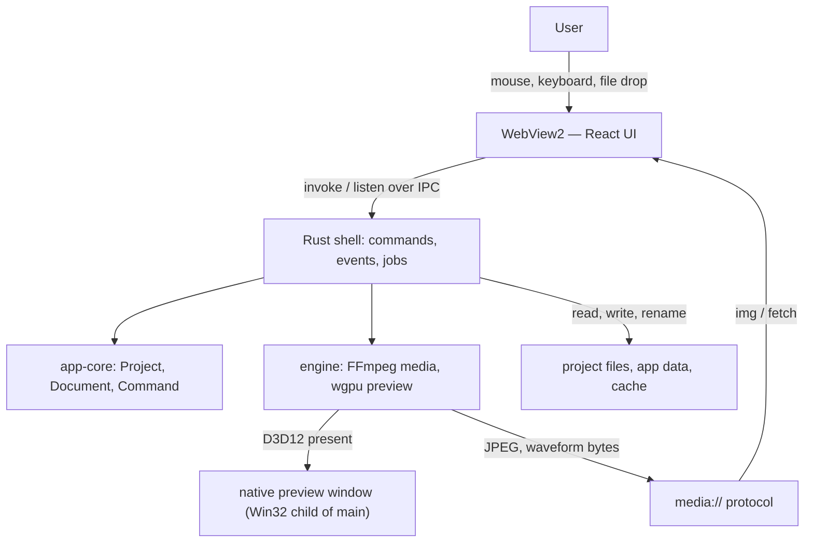
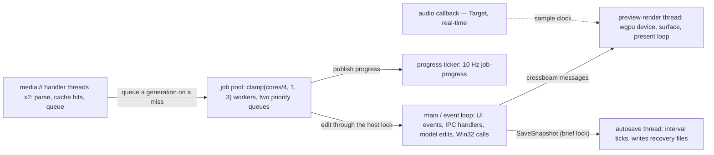
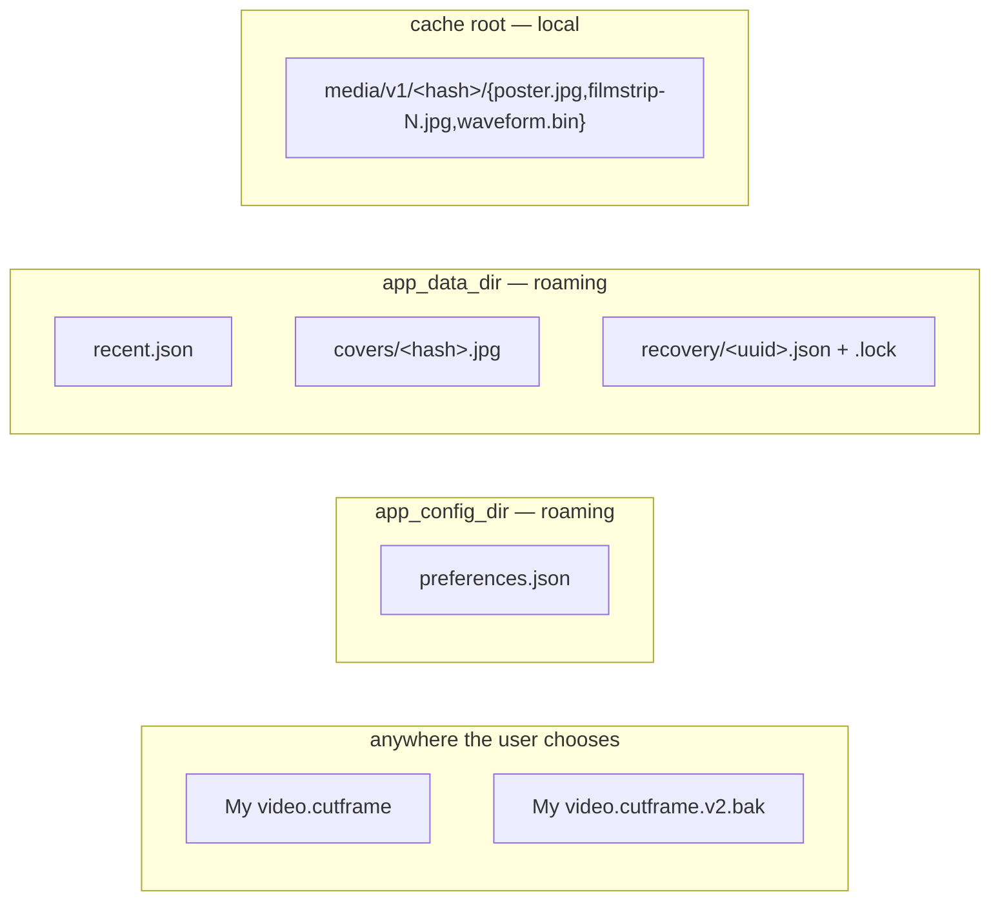
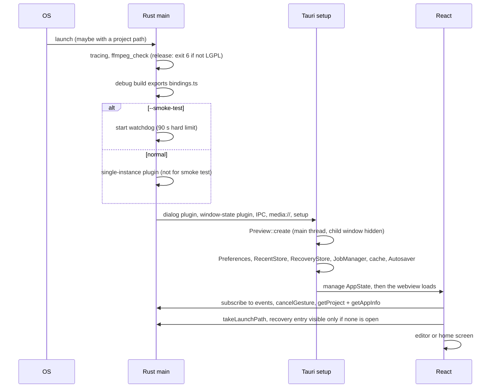

# 01 — System context

> **Audience:** every agent. What runs, on which thread, which window draws what, where state lives
> on disk, and how the app starts and stops.

---

## 1. The running system

Cutframe is a single desktop process. There is no server, no account and no network access at run
time; the only external component is the FFmpeg DLL set shipped next to the executable.

The UI never sees a video frame as JSON. It receives project state as JSON over IPC and pixels as
binary over `media://`; the preview itself is painted by the GPU into a native child window that the
DOM must not cover (ADR-0005).

## 2. Windows

| Window | Created by | Draws | Notes |
|---|---|---|---|
| `main` | `tauri.conf.json` | the whole UI | WebView2; `dragDropEnabled`, size restored by `tauri-plugin-window-state` |
| preview child | `Preview::create` → `preview/windows.rs` | wgpu surface | an owned Win32 child of `main`, hidden until asked, moved to the rectangle the UI reports |

The child window is created during `setup`, on the main thread, before `AppState` exists. It has no
DOM and no menu; it is positioned in physical pixels relative to the webview's top-left corner. DOM
overlays cannot appear above it, which is why every dialog and menu that may overlap the preview
hides it first (`usePreviewOccluder`, [07](07-preview-and-render.md) §6).

## 3. Threads

| Thread | Owns | Rules |
|---|---|---|
| Main | Tauri event loop, `AppState`, the `Document`, all Win32 window calls | never blocks on disk or decode; a model edit must stay in the millisecond range |
| `preview-render` | `GpuContext`, the surface, the render loop | no Tauri types; survives device loss by recreating the context |
| `media://` handlers (2) | request parsing, cache hits, responder wiring | a miss hands the work to the pool and waits on a channel, not on a thread of its own |
| job pool | import, relink, preview prefetch, media check | one job = one `JobId`; progress at most 10 Hz; edits land only when no gesture is open |
| autosave | recovery files | takes a `SaveSnapshot` under a short document lock, writes outside it; a stuck disk delays at most 2 s of shutdown |
| progress ticker | `job-progress` emission | coalesces progress so a fast job cannot flood IPC |
| audio (Target) | `cpal` callback, ring buffer | no allocation, locks or I/O in the callback (ADR-0004) |

Threads exist only for the preview, `media://`, jobs and autosave. Everything the user does to the
project is a synchronous command on the main thread, applied to a clone and swapped in on success
([03](03-edit-model.md)).

## 4. App state and the snapshot chain

One `AppState` is managed by Tauri and holds:

- the `Document` (model + history) behind a `std::sync::Mutex`, together with the session-wide
  revision counter (one lock, so a state and its revision always match);
- `Preview` (handle to the preview thread and the visibility/rect inputs);
- `PreferencesState` (current values, file path, cache root, write lock);
- `RecentStore` (home screen list, covers folder, its own async lock);
- `RecoveryStore` (this session's id and lock);
- `JobManager` (the shared pool) and `Previews` (`Arc`, shared with `media://`);
- the clip clipboard, the media statuses of this session, the launch path and the autosave handle.

Every published state is an `Arc<Project>` stored in an `ArcSwap`. Readers (engine, jobs,
`media://`) take the latest snapshot without locking; the writer (the main thread) swaps it after a
successful edit. The revision grows monotonically for the whole process, never reset by opening or
creating a project ([05](05-ipc-contract.md) §5).

## 5. Files on disk

| Path | Written by | Contents |
|---|---|---|
| `<name>.cutframe` | Save / Save As | the project JSON, current `schemaVersion` ([04](04-persistence-and-lifecycle.md)) |
| `<name>.cutframe.v<n>.bak` | the first save over a file of an older schema | the untouched older file, never overwritten |
| `preferences.json` | Preferences → Save | `schemaVersion`, autosave interval, image/transition defaults, UI language, cache folder |
| `recent.json` | open, save, duplicate | at most 30 entries, newest first |
| `covers/<hash>.jpg` | home screen, on demand | a copy of the first poster, outside the cache so Clear cache never blanks the home screen |
| `recovery/<uuid>.json` | autosave | project snapshot + metadata in one file |
| `recovery/<uuid>.lock` | the running session | held open for the process lifetime; an unlocked lock file marks a crashed session |
| `<cache root>/media/v1/…` | preview generation | content-addressed products; LRU eviction at 2 GiB |

The cache root is `<cacheDir or app_cache_dir>/cutframe-cache`, so Clear cache can only ever delete
inside a folder this app created. Editor panel sizes live in WebView `localStorage`, not on disk in
the Rust sense ([04](04-persistence-and-lifecycle.md) §7).

## 6. Start-up

The order matters and is enforced by `src-tauri/src/lib.rs:143`:

Details that are easy to break:

- The single-instance plugin is registered **first** in the builder, so a second process hands its
  arguments over and exits inside the plugin, before `setup` takes a recovery lock or reads
  preferences. It is skipped for `--smoke-test` and, in debug builds, enabled only with
  `CUTFRAME_SINGLE_INSTANCE=1` (otherwise `pnpm dev` would forward to an installed build).
- A second launch brings the main window forward and emits `open-file-requested` with the path; the
  UI treats it like File → Open, after the unsaved-changes prompt.
- The preview window exists before the UI loads. It starts hidden and 1×1, so it cannot cover a
  start screen drawn by the webview.
- `--smoke-test` replaces a normal session: a watchdog kills the process after 90 s, the engine must
  present 30 frames within 20 s of the window being shown, and the process exits with the outcome
  code CI checks.

## 7. Shutdown

`WindowEvent::CloseRequested` on `main` checks `AppState::is_dirty`. A clean project closes
immediately, even if the webview is unresponsive. A dirty one emits `quit-requested` and prevents the
close; the UI asks Save / Don't save / Cancel and calls `confirm-close` only for the first two. When
the window is destroyed, the autosave thread deletes this session's recovery envelope and lock, and
the process waits at most 2 s for it. A crash skips this, which is exactly what makes the recovery
prompt appear on the next start.

## 8. What exists today

| Area | State |
|---|---|
| Project model, undo/redo, gestures, timeline editing | implemented |
| Media import, probe, posters, filmstrips, waveforms, relink | implemented |
| Native preview of a test pattern | implemented (no decoded project frame yet) |
| Project files, autosave, recovery, recent list, preferences | implemented |
| Playback, audio output, render graph, effects, export | **Target** (`docs/design/playback.md`, `render-graph.md`, `export.md`) |
| Updater and code signing | **Target** (task 0170) |

## Links

- [ADR-0004 — Threading and model ownership](../adr/0004-threading-and-model-ownership.md)
- [ADR-0005 — Preview presentation](../adr/0005-preview-presentation-per-platform.md)
- [diagrams/010 — Start-up and shutdown](diagrams/010-startup-and-shutdown.md)
- [04 — Persistence and lifecycle](04-persistence-and-lifecycle.md)
- [07 — Preview and render](07-preview-and-render.md)
