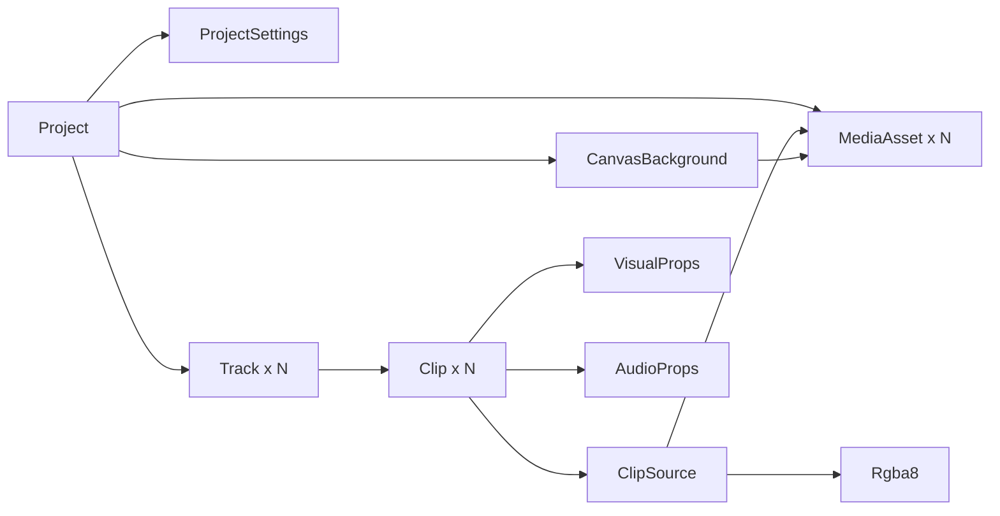
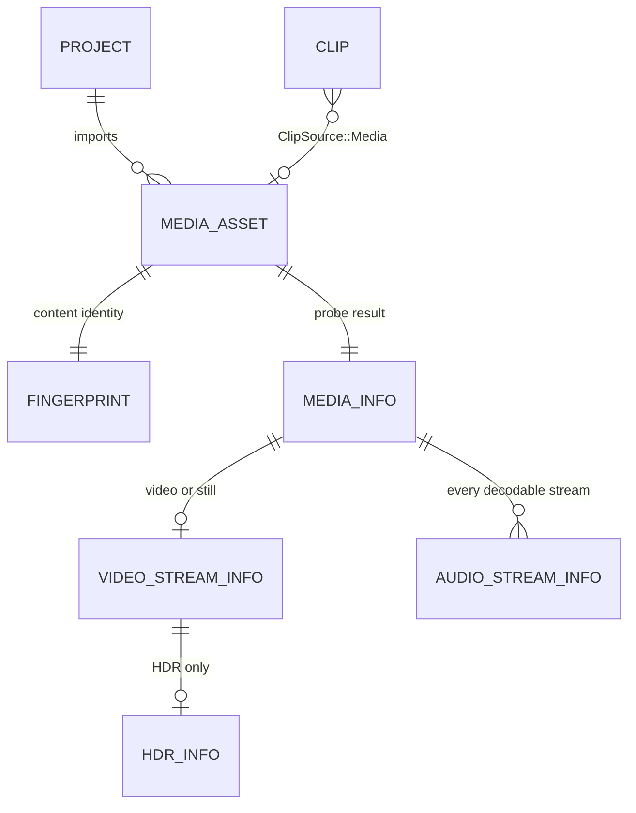

# 02 — Domain model

> **Audience:** `backend` and `architect` first, `frontend` second. The data every other part of the
> system is built on: project, tracks, clips, media, time, properties and the invariants that must
> hold for a project to be valid.

---

## 1. Where it lives and what it may do

The model is `crates/app-core`. It is plain data plus pure rules:

- types derive `Serialize`/`Deserialize` (and `specta::Type` behind the `specta` feature, which is
  what exports `ui/src/bindings.ts`);
- no file I/O, no clocks, no threads, no GPU, no FFmpeg — those are the shell's or the engine's job;
- nothing mutates a `Project` directly: every change goes through a `Command` applied by a
  `Document` ([03](03-edit-model.md)).



## 2. `Project` — the aggregate

`crates/app-core/src/model.rs:60`:

| Field | Type | Meaning and invariant |
|---|---|---|
| `schema_version` | `u32` | Always `CURRENT_SCHEMA_VERSION` (3) in memory; a loaded older file was migrated first ([04](04-persistence-and-lifecycle.md) §4) |
| `id` | `ProjectId` | UUID v7, stable across saves; the home screen and recovery use it |
| `name` | `String` | Not empty (`ValidationError::EmptyName`); shown in the window title |
| `settings` | `ProjectSettings` | Canvas size, frame rate, sample rate — the render/export target, not an edit |
| `background` | `CanvasBackground` | `color`, `blur { amount }` or an image `media`; what fills the canvas behind the main track |
| `main_track` | `TrackId` | Must be an existing **video** track; it cannot be removed, moved or turned into another kind |
| `magnetic` | `bool` | While on, the main track has no gaps: clips are contiguous from time 0 |
| `tracks` | `Vec<Track>` | Top to bottom as drawn: overlays (video and text), then the main track, then audio |
| `media` | `Vec<MediaAsset>` | Import order; the media panel sorts its own view |

`Project::new(name)` creates exactly one magnetic video main track ("Video 1") and one audio track
("Audio 1"), an empty media list and the default settings (1920×1080, 30 fps, 48 kHz).

### Track sections

The order of `tracks` is not cosmetic; it decides where a new track may go and which tracks
composite over which:

```
index 0 .. main_index-1     overlay tracks: TrackKind::Video or TrackKind::Text
index main_index            the main track (always TrackKind::Video)
index main_index+1 .. end   audio tracks: TrackKind::Audio
```

`timeline::section_index` (`crates/app-core/src/timeline.rs:36`) clamps a requested insertion index
into the section that fits the kind, so `AddTrack` can never break the order. Higher tracks
composite over lower ones; the main track is the one the rest of the timeline follows.

## 3. `Track` and `Clip`

`Track` (`model.rs:110`): `id`, `kind`, `name`, `muted`, `hidden`, `locked`, `clips`. Clips are
**sorted by `start` and never overlap**; `locked` means edits skip the track entirely and its clips
never follow the main track.

`Clip` (`model.rs:138`):

| Field | Meaning |
|---|---|
| `id` | `ClipId`, UUID v7, unique across the project |
| `name` | Display name (file name, "Colour", or the text of a title) |
| `start`, `duration` | Timeline position and length in flicks; `end() = start + duration` |
| `source` | What it shows or plays: `media { media, source_in }`, `color { color }`, `text { content }` |
| `link` | `Option<LinkId>`: every clip of one link group moves, trims, splits and deletes together. A group with fewer than two members is normalised away |
| `visual` | Present **exactly** on clips of video and text tracks |
| `audio` | Present on clips that make sound: audio-track clips, and video-track media clips whose media has audio that was not detached |

Two helpers carry rules that must not be duplicated:

- `Clip::source_time(t)` (`model.rs:222`) is the only timeline→source mapping: `source_in + (t -
  start)` for `t` inside the clip, `None` outside and for colour/text.
- `Clip::source_end()` is `source_in + duration`, the end of the used source range; trimming reads
  it to know how much source is left.

`source_in` is a **timestamp**, never a frame index (ADR-0002 §6): a variable-frame-rate source has
no single frame grid, so the renderer seeks by time.

## 4. Time

`crates/app-core/src/time.rs`:

- **Flicks.** `FLICKS_PER_SECOND = 705_600_000` (line 12). A flick divides every common frame
  period (including `30000/1001`) and every audio sample rate, so frame-accurate math stays integer.
- `Time(i64)` is the only time type in the model and in IPC. The UI receives it as a `number`.
- `MAX_IPC_FLICKS = 1 << 53` (line 16): JavaScript numbers are exact only within ±2^53, so the
  model refuses anything later (`CommandError::InvalidResult`, `ValidationError::TimeOutOfRange`).
  That is about 147 days of timeline.
- `Time::from_ticks` / `to_ticks` are the **only** bridge to FFmpeg timestamps: they take a
  `Rational` time base, round halves away from zero and saturate at `i64`.
- `Time::from_frames` / `to_frames` use `FrameRate::frame_duration()`, which is exact by
  construction because `FrameRate::new` rejects a rate whose period is not a whole number of flicks.
- `as_seconds_f64` exists for display and shaders only; it never goes back into the model.

| Type | Where | Rule |
|---|---|---|
| `Time` | model, IPC, commands | `i64` flicks |
| `Rational` | source frame rate, pixel aspect, FFmpeg time base | reduced, `num > 0`, `den > 0`; need **not** be flick-aligned (`2997/100` is fine) |
| `FrameRate` | project setting | reduced, positive, **flick-aligned**; `NTSC_30 = 30000/1001` is allowed, arbitrary values are not |

The split matters: a file may be 29.97 fps with a time base of 1/90000, which is a valid `Rational`
but not a valid `FrameRate`; a project may only use a rate whose frame period fits flicks exactly.

## 5. Identifiers

All ids are UUID v7 wrapped in a newtype (`id_type!`, `model.rs:9`), so they are sortable by creation
time and cheap to copy. `ProjectId`, `TrackId` and `ClipId` share **one id space**, which is why
`ValidationError::DuplicateId` can name a single violation. `MediaId` is an id in the same style, own
namespace. `LinkId` is deliberately **not** a unique id: every member of a link group carries the
same value.

## 6. Properties

`crates/app-core/src/props.rs` stores every animatable value as `Animated<T>` from schema v3 on, so
keyframe editing later needs no migration:

```jsonc
"opacity": { "value": 1.0, "keyframes": [] }        // keyframes omitted when empty
```

`Animated::at(local)` is the single evaluation point (preview, export and tests share it). Today it
returns `value`; task 0520 replaces the body with interpolation.

| Type | Fields | Range checked by `check(duration)` |
|---|---|---|
| `VisualProps` | `position`, `scale`, `rotation`, `opacity`, `crop`, `flip`, `fit` | finite position; scale non-zero and `abs <= 100`; opacity `0..=1`; crop insets `>= 0` with `left+right < 1`, `top+bottom < 1` |
| `AudioProps` | `volume`, `fade_in`, `fade_out` | volume `0..=MAX_VOLUME` (4, i.e. +12 dB); fades `>= 0`, sum `<= duration` |

Keyframes are sorted, unique in `time` and inside `0..=duration` — the same invariant is used when a
trim retimes them (`timeline::retime_keyframes`, [03](03-edit-model.md) §7).

`fit` is `Fit` (contain), `Fill` (cover) or `Stretch`; `visual` is `None` on audio-track clips and
`audio` is `None` on colour and text clips.

## 7. Media assets

`crates/app-core/src/media.rs`:



| Part | Meaning |
|---|---|
| `kind` | `Video` (has duration, may have audio), `Audio` (audio streams only), `Image` (one frame, no duration) |
| `path.absolute`, `path.relative` | UTF-8, no `\\?\` prefix; `relative` is written on save when the media is on the project's drive ([04](04-persistence-and-lifecycle.md) §6) |
| `fingerprint.size`, `.modified`, `.hash` | content identity: BLAKE3 over size (LE u64) + first 1 MiB + last 1 MiB, truncated to 128 bits, 32 lowercase hex chars. The cache key and the relink match |
| `info.container`, `.origin` | FFmpeg demuxer short name; container time of media time zero. Media time `t` is container time `t + origin`, for every stream |
| `info.duration` | `None` for images, otherwise positive |
| `info.video` | size **before** rotation and pixel aspect, sample aspect, `rotation`, informational `frame_rate`, pixel format, `bit_depth`, `color`, optional `hdr` |
| `info.audio` | every decodable stream, default stream first, with codec, sample rate and channels |

`VideoStreamInfo::display_size()` is the upright size on screen (pixel aspect applied, rounded to an
even number, axes swapped for quarter turns). Thumbnails and the future render graph both use it, so
the media panel and the preview cannot disagree about the shape.

`hdr_transfer()` is one rule for the probe and for validation: a Dolby Vision profile 5 record
(`compatibility_id == 0`) is `DolbyVisionOnly` whatever the tags say; otherwise PQ/HLG tags decide;
otherwise the Dolby Vision base layer decides (1 or 6 → PQ, 4 → HLG, 2 → SDR).

## 8. Validation

`Project::validate` (`crates/app-core/src/validate.rs`) is the contract every load, every import and
every command result must satisfy. It returns the first violation, never repairs:

| Group | Variants |
|---|---|
| Identity and names | `DuplicateId`, `EmptyName` |
| Clip geometry | `ClipNotPositive`, `ClipNegativeStart`, `TimeOutOfRange`, `ClipsOutOfOrder`, `ClipsOverlap` |
| Track/clip fit | `ClipTrackMismatch`, `ClipMediaMissing`, `ClipMediaKind` (e.g. audio-only media on a video track) |
| Settings | `CanvasSize` (even, `16..=8192`), `FrameRateRange` (`1..=240`), `SampleRate` |
| Properties | `BadProperty` (first property name out of range), `BadBackground` |
| Media | `Media(MediaProblem)` — `DuplicateId`, `EmptyPath`, `InvalidHash`, `MissingVideo`, `UnexpectedVideo`, `MissingDuration`, `UnexpectedDuration`, `MissingFrameRate`, `MissingAudio`, `UnexpectedAudio`, `EmptySize`, `InvalidBitDepth`, `InvalidAudioStream`, `HdrMismatch` |

Rules worth spelling out because they drive UI behaviour:

- `visual.is_some() == (kind != Audio)`, and an audio-track clip must have `audio`.
- A `Media` clip on a video track is allowed for video and image media; on an audio track only for
  media that actually has audio; a colour clip only on video, a text clip only on text.
- Images have no duration, no frame rate and no audio; audio media has no video stream.
- Media validation runs at import (`AddMedia`, `RelinkMedia`) and at load, so a project can never
  contain a half-probed asset.

## 9. Model vs what the UI receives

`ipc::types` (`src-tauri/src/ipc/types.rs`) defines **views**, not the model:

- `ProjectView` / `TrackView` / `ClipView` / `MediaView` carry what the UI draws. They add derived
  data the model should not store: project `duration`, each clip's `source_duration` for trim
  limits, each media's `used_by` count, session `status`, `preview_version` and `filmstrip` layout.
- They deliberately drop `schema_version`, fingerprints, file size and mtime: none of that is the
  UI's business (design `media-import.md` §4).
- `MediaView.filmstrip` is a layout description, not pixels; pixels come over `media://`
  ([06](06-media-pipeline.md)).

Anything the UI needs but the view lacks is a missing field in `types.rs`, not a reason to parse the
project JSON in TypeScript.

## Links

- [ADR-0002 — Project file format](../adr/0002-project-file-format.md): time, schema, invariants
- [03 — Edit model](03-edit-model.md): commands, gestures, timeline rules
- [04 — Persistence and lifecycle](04-persistence-and-lifecycle.md): migrations and the file on disk
- [05 — IPC contract](05-ipc-contract.md): every view type and stable key
- [06 — Media pipeline](06-media-pipeline.md): how the probe fills `MediaInfo`
- [diagrams/020 — Timeline model](diagrams/020-timeline-model.md)
