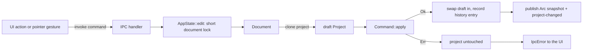
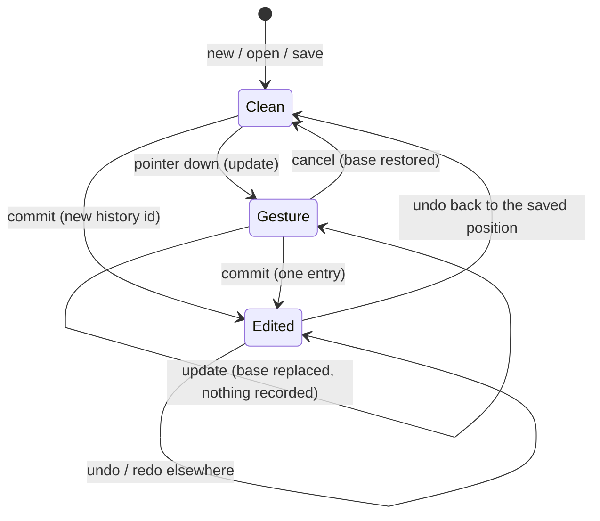

# 03 — Edit model

> **Audience:** `backend` and `frontend`. How a user action becomes a validated, undoable change:
> the command trait, the `Document` that owns history and gestures, and the timeline rules every
> edit preserves.

---

## 1. One way to change a project



Nothing else touches a `Project`: not a job, not the shell, not the UI. A job that wants a model
change (an import finishing, a relink) calls `JobHost::edit`, which runs the same command path under
the same lock and waits while a gesture is open (`jobs::edit_when_idle`).

## 2. `Command`

`crates/app-core/src/command.rs:141`:

```rust
pub trait Command: Send + Sync + Debug {
    fn label(&self) -> HistoryLabel;
    fn apply(&mut self, project: &mut Project) -> Result<(), CommandError>;
    fn revert(&mut self, project: &mut Project);
}
```

- `apply` may remember what it removed so `revert` restores the project exactly; `revert` only runs
  after a successful `apply` and cannot fail.
- `label()` is a **stable key** (`HistoryLabel`), never display text; the UI translates it. Variants
  are never renamed or reused (ADR-0003 §5).
- A command fixes the ids it will create in its constructor or first `apply` (via `timeline::IdPool`),
  so redo recreates the same ids that later history entries may reference.
- `Batch` (`command.rs:153`) applies children in order and reverts them in reverse; if a child
  fails, the already-applied children are reverted and the batch returns that error, so a batch is
  atomic.

Most timeline commands work on a clone of the project, swap `project.tracks` in only when the result
validates, and keep the previous tracks for `revert`. That makes every edit transactional without
each one repeating the "apply to a draft" code.

## 3. Command catalogue

| Command | `HistoryLabel` | What it does | Fails when |
|---|---|---|---|
| `AddTrack` | `addTrack` | inserts an empty track, clamped into its section | — |
| `RemoveTrack` | `removeTrack` | removes a track and its clips | main track |
| `RenameTrack` | `renameTrack` | non-empty name | empty name |
| `RenameProject` | `renameProject` | non-empty name | empty name |
| `SetProjectSettings` | `setProjectSettings` | canvas size, frame rate, sample rate | out-of-range settings |
| `AddMedia` | `importMedia` | one import job's assets, in input order | duplicate id, invalid asset |
| `RemoveMedia` | `removeMedia` | removes assets (the UI removes their clips in the same batch) | asset still used by a clip or the background |
| `RelinkMedia` | `relinkMedia` | points assets at another file (one item, or a whole folder's matches) | kind change, invalid asset |
| `AddClips` | `addClips` | media and colour cards by append / insert / drop | unknown media, wrong or locked track, overlap |
| `MoveClips` | `moveClips` | drag or nudge: time + optional track for a whole selection | locked track, kind mismatch, overlap, invalid result |
| `TrimClip` | `trimClip` | one clip edge, clamped | locked track, invalid result |
| `SplitClips` | `splitClips` | splits at the playhead (each half ≥ 1 frame) | no clip to split, locked member |
| `DeleteClips` | `deleteClips` / `rippleDeleteClips` / `cutClips` | delete, ripple delete, or the delete half of a cut | nothing selected, overlap while rippling, locked track |
| `DeleteGap` | `deleteGap` | closes a gap on one track and pulls followers | no gap there, locked track, overlap |
| `TrimToPlayhead` | `trimToPlayhead` | Q / W: cuts the part of clips left or right of the playhead | nothing changed, locked track |
| `SetMagnetic` | `setMagnetic` | turns the magnetic main track on or off (on = repack) | — |
| `PasteClips` | `pasteClips` / `duplicateClips` | paste at the playhead, or duplicate after the selection | empty clipboard, removed media |
| `Batch` | chosen by caller | several edits as one entry (e.g. remove media + its clips) | first failing child |

Selection is **not** in the model: the UI owns it and passes clip ids to every command. The clipboard
lives in `AppState` as `ClipboardContent` (deep copies, source track, offset from the earliest
clip, `on_main` flag) and never in the project or in history.

## 4. Gestures

A drag or a slider is one history entry but many visual states (ADR-0006 §4). The protocol lives in
`Document` (`crates/app-core/src/document.rs:190`) and the UI drives it through `EditPhase`:

| Phase | `Document` call | Effect |
|---|---|---|
| `Update` | `gesture_update` | applies the command to a clone of the gesture's **base**, replaces the visible project, records nothing; opens the gesture if none is open |
| `Commit` | `gesture_commit` | applies to the base, closes the gesture, records **one** entry; without an open gesture it is a plain `execute` |
| — | `gesture_cancel` | restores the base, records nothing |

Rules that make this safe:

- Every gesture command carries **absolute** values (new start, new edge time), never a delta,
  because each update starts again from the base.
- Updates and the commit must be the same kind of command (`CommandError::GestureMismatch`); a new
  gesture type cancels the open one first.
- While a gesture is open `Document::execute` fails with `GestureInProgress`, so a keyboard command
  cannot interleave with a drag.
- `undo` and `redo` while a gesture is open just cancel it (ADR-0006 §3).
- `Document::committed()` returns the gesture's base, so save and autosave never write a half-drag.
- A job's edit waits for the gesture to close (`edit_when_idle`, 50 ms retries) instead of landing
  inside it.

The UI side (`ui/src/ipc/gesture.ts`) adds the transport rules: at most one update per animation
frame, coalesced to the latest value, never more than one in flight, all gesture traffic on one
queue so a late update can never arrive after its commit, and `cancelGesture` on Escape, window blur
or lost pointer capture.

## 5. History

`Document` keeps two stacks of `Entry { id, command }`:

- `execute` / a gesture commit clears the redo stack and pushes one entry; at most
  `DEFAULT_HISTORY_LIMIT = 500` entries are kept (a batch and a gesture count as one). The dropped
  entry's id becomes the history floor.
- `HistoryPosition` is the id of the newest applied entry (0 for the initial state, or the floor
  after a drop). Two equal positions of one document mean the same committed state, which is how
  "unsaved changes" is decided without comparing projects: save stores the position; a project is
  dirty when the position differs or a gesture is open.
- `undo_label` / `redo_label` are the keys for menu text ("Undo Trim Clip").
- `history_labels`, `history_cursor` and `history_len` feed the history panel; `jump_to(target)`
  performs any number of undo/redo steps as one call, cancels an open gesture first, and fails with
  `HistoryOutOfRange` without changing anything when the target is past the end.

`Document` is owned by one thread. Readers get `Arc<Project>` snapshots; undo/redo use
`Arc::make_mut`, so they clone only while someone else holds a snapshot.



## 6. Magnetic main track and track layout

`project.magnetic` is the "no gaps" switch. While it is on, `timeline::repack_main`
(`crates/app-core/src/timeline.rs:64`) rewrites the main track's starts in list order so its clips are
contiguous from 0. Every command that changes main-track membership, length or order calls it.

Consequences the UI relies on:

- Delete and cut on the magnetic main track close the gap automatically, even without Shift.
- Inserting a clip into the main track uses `nearest_boundary`: the nearest clip start, clip end or
  0, ties to the earlier one (design §4.1). The clip lands at a boundary, never in the middle.
- A start trim on the magnetic main track keeps the clip's start and moves its content instead,
  so later clips ripple.
- With magnetic off, the main track behaves like any other track: gaps stay, and overlaps are
  rejected.

Track sections are described in [02](02-domain-model.md) §2. New tracks are clamped into the
section that fits their kind; a command that empties an overlay or audio track on **commit** removes
it (`remove_emptied_tracks`, F1.28), while a drag keeps the layout stable until the pointer is
released.

## 7. Followers and links

Clips off the main track are attached to it by position, not by a stored relationship. Each one has
an `Anchor` (`timeline.rs:223`) resolved against the main track **before** the edit:

| Anchor | Meaning |
|---|---|
| `Inside { clip, content }` | the time lies in main clip `clip`; `content` is the source time under it |
| `Gap { next }` | the time is in a gap before main clip `next` (only with magnetic off) |
| `AfterEnd` | at or after the end of the main track |

`follow_main(before, after, …)` (`timeline.rs:278`) then moves followers so overlays and audio stay
synchronised with the picture:

- A linked member of a main clip that survives moves by that clip's delta; if it is on a locked
  track the whole edit fails.
- Another link group follows as one unit by the anchor of its earliest member.
- Every other clip follows its own anchor. If the anchor clip was removed it goes to the removal
  point — or is deleted when `delete_inside` is set and it lay entirely inside the removed clip.
- Moved clips are placed per track; a collision bumps the clip to the nearest free track of the same
  kind (overlays search upward first, audio downward first) or to a new track next to its own.

Links are `LinkId` values shared by members (`timeline::expand_links`). A command that removes or
unlinks clips ends with `normalize_links`, which clears a group left with fewer than two members.

## 8. Clip operations in detail

**Add (`AddClips`).** Sources become clips at start 0: a video takes the media's whole duration, an
image `DEFAULT_IMAGE_DURATION` (5 s today; preferences later), an audio file goes to an audio track,
a colour card `DEFAULT_COLOR_DURATION`. `Placement` decides where:

| Placement | Behaviour |
|---|---|
| `Append` | end of the main track; audio-only media at the end of the first unlocked audio track, or a new one |
| `Insert { at }` | main track at the nearest boundary; later main clips ripple and followers follow |
| `Drop { track, start }` | on a given or new track at `start`; on the magnetic main track it is an insert |

**Move (`MoveClips`).** The anchor clip goes to `start`, every other clip keeps its offset. A
vertical move is allowed only when all clips are on the anchor's track (or linked to one that is);
otherwise `track` is ignored and only time changes. A clip that would start before 0 or overlap
fails with `Overlap` — except on the magnetic main track, where insertion order decides.

**Trim (`TrimClip`).** The edge is **clamped**, never rejected: to the source range (`source_in >=
0`, source end `<= media duration`), to at least one project frame, to neighbouring clips (except on
the magnetic main track) and to the same limits of linked members that shared the edge. A start trim
moves `source_in` with the edge so the picture stays put; on the magnetic main track the clip keeps
its start and the content shifts instead. Keyframes are retimed, fades shortened.

**Split (`SplitClips`).** A clip splits only when the playhead lies strictly inside with both halves
at least one project frame long. The right half gets a new id, `source_in` advanced (video and
audio; images keep 0), the same props with keyframes partitioned, no fade-in; the left half loses its
fade-out. Right halves of one link group share one new link. Nothing moves, so nothing follows.

**Delete.** `DeleteClips` removes the selection and its linked members. On the magnetic main track
it repacks; with `ripple` on a non-magnetic main track later clips shift left by the removed length
before them. When the main track closes up, followers follow and those entirely inside a removed
main clip are deleted with it. With only other tracks, `ripple` closes gaps per track.

**Gap (`DeleteGap`).** The gap is the free span containing `at`, including the span before the first
clip. Later clips on the track and their linked members move left by its length; main-track changes
make followers follow.

**Trim to playhead (Q / W).** Same clamping, links, ripple and following as `TrimClip`, applied to
every clip the playhead lies strictly inside; with an empty selection the main-track clip under the
playhead is used. Clips on other tracks trim before main-track clips, so they are not moved away
first.

## 9. Validation and errors

Every command that can change the shape of the timeline validates its result before swapping it in
(`next.validate().map_err(CommandError::InvalidResult)`), so a bug can never leave a broken project
on screen. The error surface is `CommandError`; the IPC layer maps it (`ipc/error.rs:82`):

| `CommandError` | `IpcError.kind` |
|---|---|
| `Overlap` | `overlap` |
| `TrackLocked` | `trackLocked` |
| everything else | `invalidEdit` |

`overlap` and `trackLocked` get their own kinds because the UI treats them differently: during a
drag the last valid state stays visible instead of an error banner, and a locked track says which
gesture is impossible.

## Links

- [ADR-0006 — Edit transactions](../adr/0006-edit-transactions.md): gestures, batches, replacement
  from base
- [ADR-0003 — IPC conventions](../adr/0003-ipc-conventions.md): stable keys and `editPhase`
- [timeline-editing design](../design/timeline-editing.md): the full behavioural spec
- [02 — Domain model](02-domain-model.md), [05 — IPC contract](05-ipc-contract.md)
- [diagrams/030 — Command and gesture](diagrams/030-command-and-gesture.md),
  [diagrams/020 — Timeline model](diagrams/020-timeline-model.md)
