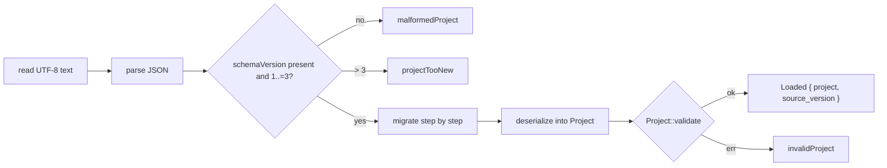
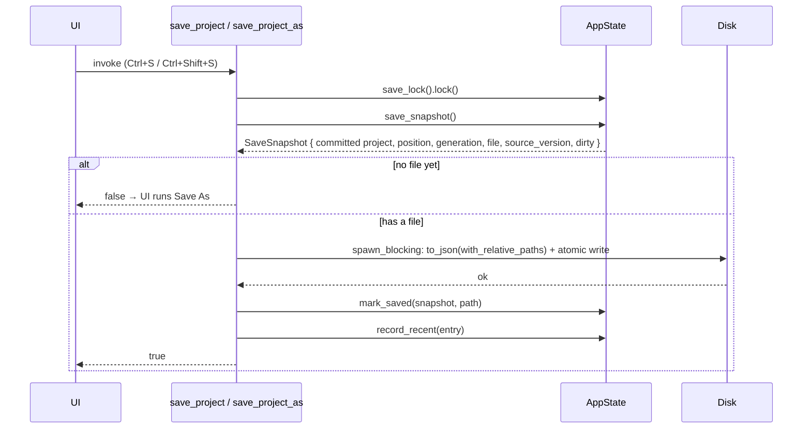

# 04 — Persistence and lifecycle

> **Audience:** `backend` and `frontend`. What is written to disk, how it is written safely, which
> files belong to which schema, and the order of the open/save/autosave/recovery/quit lifecycle.

---

## 1. Files at a glance

| File | Folder | Schema | Written by |
|---|---|---|---|
| `<name>.cutframe` | wherever the user saves | project, `schemaVersion` 3 | Save / Save As |
| `<name>.cutframe.v<n>.bak` | next to the project | the untouched older file | first save over a file loaded from version `n` |
| `preferences.json` | app **config** dir (roaming) | preferences, version 1 | Preferences → Save |
| `recent.json` | app **data** dir (roaming) | recent list, version 1 | open, save, duplicate, rename, remove |
| `covers/<hash>.jpg` | app data dir | a JPEG copy of a project's first poster | home screen, on demand |
| `recovery/<session>.json` + `.lock` | app data dir | one autosave envelope + the live lock | autosave thread |
| `<cache root>/media/v1/…` | `<cacheDir or app_cache_dir>/cutframe-cache` | media cache, layout `v1` | preview generation |

Two rules hold for all of them:

- **Writes are atomic.** `project_file::write_project_file` writes `<name>.tmp`, calls `sync_all`,
  then renames over the target (retrying a `PermissionDenied` rename three times, 100 ms apart,
  because antivirus and sync clients briefly hold new files open). A crash or a full disk leaves the
  old file or the new one, never a mix; a failed write removes the temporary file.
- **Nothing is repaired silently.** A project that breaks an invariant is refused with
  `invalidProject`; a file from a newer app is refused with `projectTooNew`. The only "repair" is
  migration from a version this build understands.

## 2. Project file format

The project is pretty-printed JSON of the model in camelCase, tagged unions for enum payloads:

```jsonc
{
  "schemaVersion": 3,
  "id": "0193…",                     // UUID v7
  "name": "Trip 2026",
  "settings": { "width": 1920, "height": 1080,
                "frameRate": { "num": 30000, "den": 1001 }, "sampleRate": 48000 },
  "background": { "kind": "color", "color": "#000000ff" },
  "mainTrack": "0193…",
  "magnetic": true,
  "tracks": [
    { "id": "0193…", "kind": "video", "name": "Video 1", "muted": false,
      "hidden": false, "locked": false,
      "clips": [
        { "id": "0193…", "name": "clip", "start": 0, "duration": 352800000,
          "source": { "kind": "media", "media": "0193…", "sourceIn": 0 },
          "link": null,
          "visual": { "position": { "value": { "x": 0, "y": 0 } },
                      "scale": { "value": { "x": 1, "y": 1 } },
                      "rotation": { "value": 0 }, "opacity": { "value": 1 },
                      "crop": { "value": { "left": 0, "top": 0, "right": 0, "bottom": 0 } },
                      "flip": { "horizontal": false, "vertical": false }, "fit": "fit" },
          "audio": { "volume": { "value": 1 }, "fadeIn": 0, "fadeOut": 0 } }
      ] }
  ],
  "media": [
    { "id": "0193…", "kind": "video",
      "path": { "absolute": "C:\\media\\a.mp4", "relative": "media/a.mp4" },
      "fingerprint": { "size": 123456, "modified": 1760000000000, "hash": "…" },
      "info": { "container": "mov", "origin": 0, "duration": 352800000,
                "video": { "…": "…" }, "audio": [] } }
  ]
}
```

Key rules:

- Times are `i64` flicks ([02](02-domain-model.md) §4). `Time` is `#[serde(transparent)]`, so it is a
  bare number.
- `schemaVersion` is the **first** thing the loader reads; a file without one is malformed, not v1.
- Keyframe lists are omitted when empty, so the tier-1 file stays readable.
- Fingerprints are stored: they key the media cache and decide whether a file changed since import
  ([06](06-media-pipeline.md) §6).

## 3. Load: parse → migrate → validate

`serialization::load` (`crates/app-core/src/serialization.rs:52`):



`Loaded.source_version` is what the file *was*; the first save over it makes the backup
([04 §5](#5-save-flow)). `open_project` then resolves relative media paths, replaces the open
project, records the recent entry and starts the background media check and preview prefetch.

## 4. Schema history

`CURRENT_SCHEMA_VERSION = 3`. Each step is a function on `serde_json::Value` with a fixture test that
loads a file written by the previous version.

| Step | Adds | Notes |
|---|---|---|
| v1 → v2 | `media: []` | v1 projects have no media list (design `media-import.md` §8) |
| v2 → v3 | the timeline model of design `timeline-editing.md` §3 | track `locked`; `mainTrack`; track sections; clip `source`, `link`, `visual`, `audio`; `background`; `magnetic` |

The v2 → v3 migration encodes decisions worth knowing:

- The main track is the **last** video track, or a new empty one if the file has none.
- Overlay tracks (video and text) keep their relative order above the main track, audio tracks move
  below it.
- Hand-written v1/v2 clips become grey colour cards on video tracks and titles on text tracks; a clip
  on an audio track fails the migration (`LoadError::Migration`) because it has no media to play.
- `magnetic` becomes `true` only when the main track was already contiguous from 0.
- The background becomes opaque black.

Other files have their own independent versions: preferences 1, recent list 1, recovery envelope 1.
A newer **recent list** is not an error: the app starts with an empty list and backs the file up on
the next write.

## 5. Save flow



- `save_lock` serialises saves, so two saves never write one file at once or mark clean out of order.
- A save is **not** an undo step and does not change the project.
- `SaveSnapshot.project` is `Document::committed()`: an open gesture's base, never the live drag.
- `mark_saved` records `(generation, history position)`. Edits made while the write ran leave the
  project dirty; a save that finishes after New/Open belongs to another generation and marks
  nothing.
- Media paths are written in their `relative` form when the file is on the project's drive, but the
  open document keeps the absolute path ([§6](#6-media-paths)).
- `save_project` returns `false` when the project was never saved; the UI then runs Save As with a
  proposed name (`defaultFileName`: invalid Windows characters replaced, trailing dots and spaces
  dropped, `.cutframe` appended).

## 6. Media paths

`src-tauri/src/media_paths.rs`, per ADR-0002 §7:

- On save, each asset's `relative` path is computed from the project file's folder (`relative_to`);
  it is `None` when the media is on another drive or above a path the function cannot express.
- On open, a **relative** path that names an existing file next to the project wins over the stored
  absolute path; otherwise the absolute path stays. Moving a project folder with its media therefore
  just works, and a project opened on another machine relinks by proximity instead of by drive
  letter.
- Path comparison is case-insensitive and separator-insensitive (`path_key`), because Windows is.

## 7. Recent projects and covers

`src-tauri/src/recent.rs`:

- `recent.json` = `{ schemaVersion, entries }`, newest first, at most `RECENT_CAP = 30`.
- `RecentEntry`: absolute path (the key), project name, duration at the last open/save, Unix ms of
  the last open/save/duplicate, and an optional cover hash.
- Every read-modify-write goes through `AppState.recent_lock`, and a broken or newer file starts as
  an empty list (logged); the next write backs the old one up.
- `list()` reports each file's current mtime; a missing file is shown as missing but never removed
  automatically. Only entries the app recorded can be renamed, duplicated, trashed or revealed
  (`guarded`), so the webview cannot point those commands at arbitrary paths.
- The **cover** is the fingerprint hash of the first media asset, in import order, that has a poster
  (`app_core::cover_hash`). `media://cover/<hash>` reads `covers/<hash>.jpg`, copies it from the
  media cache's poster on first use, and writes it atomically. It lives outside the cache so
  Preferences → Clear cache never blanks the home screen. Unreferenced covers are pruned when the
  list is read.
- File actions on a recent project keep the list in sync: rename/duplicate move or copy the file and
  update the entry; trash moves the file to the Recycle Bin.

## 8. Preferences

`src-tauri/src/preferences.rs`, `preferences.json` in the app **config** directory:

| Field | Type | Range / default |
|---|---|---|
| `schemaVersion` | `u32` | must equal 1 when sent or written |
| `autosaveInterval` | `Time` or `null` | whole seconds in 15..=3600; default 60 s; `null` = off |
| `defaultImageDuration` | `Time` | 0.1 s..=600 s; default 5 s |
| `defaultTransitionDuration` | `Time` | 0.1 s..=10 s; default 0.5 s |
| `language` | `UiLanguage` | `en` today |
| `cacheDir` | absolute path or `null` | `null` = the app's cache directory |

- `validate()` rejects out-of-range values with a message naming the camelCase field;
  `sanitize()` is used when reading a file, so a hand-edited value falls back to the default instead
  of blocking start-up.
- A file from another schema version is kept as a backup on the next write, like a project.
- `cache_root()` = `<cacheDir or app_cache_dir>/cutframe-cache`. `CacheInfo` reports the path, size
  as a decimal string (64-bit values do not survive a JS number) and file count; Clear cache only
  ever deletes inside that folder. `cacheDir` must be absolute — a relative one is rejected.
- Preferences are read once on the main thread at start-up; `set_preferences` validates, writes
  atomically and then applies the new interval and cache root to the running app.

## 9. Autosave

`src-tauri/src/autosave.rs`. A dedicated thread wakes on the configured interval (default 60 s) or
on a control message:

| Message | Effect |
|---|---|
| `SetInterval(Some(d))` | next tick after `d` |
| `SetInterval(None)` / `Discard` | disables autosave and deletes this session's envelope |
| `Adopt { old }` | writes the restored project under this session, then deletes the old entry |
| `Shutdown { ack }` | deletes this session's envelope and lock, acknowledges, exits |

Each tick takes a `SaveSnapshot` under a **short** document lock and writes outside it. The decision
is `Autosaver::tick`:

- project not dirty → delete this session's envelope if one was written, record nothing;
- key `(generation, history position)` equal to the last write → do nothing (during a gesture the
  key is the base's, so the base is written once, not per update);
- otherwise write `recovery/<session>.json` (project snapshot + metadata, temporary file then
  rename) and remember the key.

A failed write records nothing, so the next tick retries. The thread is joined with a **2 s**
budget at shutdown (`SHUTDOWN_TIMEOUT`); a stuck disk can delay exit by at most that.

## 10. Recovery

`src-tauri/src/recovery.rs`. The folder is `app_data_dir/recovery`; each session owns
`<session>.json` and holds `<session>.lock` open for the process lifetime.

- An entry is an **orphan** when its lock file can be opened (the previous session is gone) and its
  envelope parses. A file from a newer app is kept, not discarded; a corrupt one is removed.
- `should_offer` decides whether the UI shows it: always when the project was never saved or its
  file is missing; otherwise only when the autosave is newer than the project file's mtime.
- `restore_recovery` loads the project, replaces the open one and tells the autosave thread to
  `Adopt` the old entry: the content is first written under the new session, and only then is the
  orphan deleted.
- `discard_recovery` deletes one orphan.
- On a clean exit the autosave thread deletes this session's envelope and closes the lock. A crash
  skips that, which is exactly what makes the prompt appear on the next start.

The UI offers recovery after the launch path is opened, and only over the view it ends up in (the
editor, or the home screen when nothing was opened).

## 11. Lifecycle

```mermaid
sequenceDiagram
  participant OS
  participant Rust
  participant UI
  OS->>Rust: launch (args may hold a .cutframe path)
  Rust->>Rust: setup: recovery lock, preferences, recent, jobs, cache, autosave
  Rust-->>UI: webview loads, AppState managed
  UI->>Rust: takeLaunchPath()
  alt path present
    Rust-->>UI: path → open it (no unsaved prompt: nothing is open)
  else no path
    UI->>UI: show home screen
  end
  UI->>Rust: listRecovery() → prompt if any
  Note over UI,Rust: File → New / Open: unsaved prompt first
  UI->>Rust: close the window
  Rust->>Rust: CloseRequested: clean and no export? close : emit quit-requested { unsaved, exporting } and cancel
  UI->>UI: Save / Don't save / Cancel; a running export: cancel it and quit?
  UI->>Rust: cancelJob(export), wait for its job-finished (at most 2 s)
  UI->>Rust: confirmClose() only for Save / Don't save (it also cancels a running export)
  Rust->>Rust: window destroyed → autosave Shutdown (≤ 2 s)
```

Details that are easy to break:

- **Unsaved changes** are decided by `HistoryPosition` + `has_gesture()`, not by comparing projects
  ([03](03-edit-model.md) §5). Saving stores the position; undoing back to it makes the project clean
  again.
- **New / Open / Home** all run behind the same prompt (`fileActions.replaceGuarded`), and a second
  file action while one is running is ignored.
- **A double-clicked project while the app runs** arrives as `open-file-requested`; it is handled
  like File → Open, after the prompt.
- **Quit** only needs the UI for a dirty project or a running export. A clean project without an
  export closes even if the webview is unresponsive.
- **The home screen holds a real, empty untitled project.** The model always has one document; Home
  is a view, not the absence of a project.
- **The window title** is `*<name> - Cutframe` while dirty, `<name> - Cutframe` otherwise.

## Links

- [ADR-0002 — Project file format](../adr/0002-project-file-format.md) and its amendments
- [project-lifecycle design](../design/project-lifecycle.md), [autosave-recovery design](../design/autosave-recovery.md),
  [preferences design](../design/preferences.md), [home-screen design](../design/home-screen.md)
- [02 — Domain model](02-domain-model.md), [05 — IPC contract](05-ipc-contract.md)
- [diagrams/040 — Project lifecycle](diagrams/040-project-lifecycle.md)
