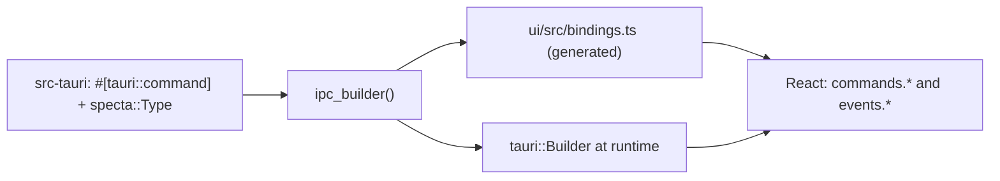

# 05 — IPC contract

> **Audience:** `frontend` first, `backend` second. The complete surface between the webview and Rust:
> how it is generated, every command and event, the shape of state and errors, and the rules that
> keep the two sides from drifting apart.

---

## 1. One generated contract

`src-tauri/src/lib.rs:51` defines `ipc_builder()`. It is the only place the surface is declared:

```rust
Builder::<tauri::Wry>::new()
    .commands(collect_commands![ commands::get_project, … ])
    .events(collect_events![ ProjectChanged, QuitRequested, … ])
    .constant("PROJECT_FILE_EXTENSION", app_core::PROJECT_FILE_EXTENSION)
    .constant("MEDIA_EXTENSIONS", engine::media::MEDIA_EXTENSIONS)
    .constant("MAX_IMPORT_FILES", import::MAX_IMPORT_FILES)
    .constant("FILMSTRIP_FRAME_HEIGHT", …)
    .constant("WAVEFORM_BUCKETS_PER_SECOND", …)
    .constant("POSTER_LONG_SIDE", …)
    .typ::<app_core::EditPhase>()
    .dangerously_cast_bigints_to_number()
    .mocks()
```

- `#[tauri::command]` + `#[specta::specta]` on a function is enough for the builder to see it.
- `export_bindings()` writes `ui/src/bindings.ts`; a test (`export_typescript_bindings`) regenerates it
  and CI fails on a diff. `pnpm bindings` runs the same thing.
- `dangerously_cast_bigints_to_number` maps `i64`/`u64` to `number`. That is safe only because every
  value that crosses IPC is bounded by `MAX_IPC_FLICKS = 2^53` ([02](02-domain-model.md) §4) or is
  the `revision` counter; `CacheInfo.sizeBytes` is a **string** for exactly this reason.
- `.mocks()` generates `commands.*.mock(...)` for Vitest and Storybook; the UI never calls a mock in
  production code.

`ui/src/bindings.ts` is generated — never hand-edit it and never hand-write a TS type for a Rust
command (CLAUDE.md quality gate).



## 2. Call shape

```ts
import { commands } from "@/bindings";

const ids = await commands.addClips(sources, { kind: "append" });
```

- Arguments are **camelCase** and positional in the order of the Rust parameters (after `app` and
  `state`, which are injected by Tauri and never appear in TS).
- Tagged unions serialize as `{ kind: "…", … }` (`Placement`, `TrackTarget`, `ClipSource`,
  `MediaFileOutcome`, `IpcError`, …); plain enums as lowerCamelCase strings (`"video"`,
  `"probing"`, `"invalidEdit"`).
- A fallible command returns `Promise<T>` and rejects with an `IpcError`; an infallible one
  (`getProject`, `getAppInfo`, `getAboutInfo`, `getPreferences`, `takeLaunchPath`, `setPreviewRect`,
  `setPreviewVisible`) returns `Promise<T>` directly.
- Time is always `number` flicks. Never send seconds; never round to frames in TS.

## 3. Project state, revision and dirty

`get_project` returns `ProjectState`; every change afterwards arrives as the `project-changed` event
with the same shape. The UI stores the newest one by `revision`.

| Field | Type | Meaning |
|---|---|---|
| `revision` | `u64` | Bumped whenever something the UI can see changed: an edit, a gesture step, a history jump, a media-status change, a save, a replaced document. Events may arrive out of order, so the UI ignores a state whose revision is not newer |
| `project` | `ProjectView` | The derived view ([§7](#7-view-types)) |
| `history` | `HistoryState` | `canUndo`, `canRedo`, `undoLabel`, `redoLabel`, `entries` (`{ label }[]`), `current` (index into `entries`) |
| `filePath` | `string?` | Absolute path of the open project file; `null` for an untitled project |
| `dirty` | `bool` | Unsaved changes ([03](03-edit-model.md) §5) |

A command that changes nothing (`undo` with an empty history, a rejected edit) returns normally and
**emits no event**; the UI's state stays valid. The event is emitted after the document lock is
released, and `edit` only publishes when the closure reports a change (`state.rs:385`).

## 4. Commands

### 4.1 Timeline editing

| Command | Arguments | Returns | Notes |
|---|---|---|---|
| `getProject` | — | `ProjectState` | Once at start-up |
| `addTrack` | `kind`, `index?: number` | `TrackId` | `index` clamped into the kind's section |
| `addClips` | `sources: NewClipSource[]`, `placement: Placement` | `ClipId[]` | One undo step; ids in source order |
| `moveClips` | `clips`, `anchor`, `start`, `track: TrackTarget`, `phase: EditPhase` | — | Gesture; absolute start |
| `trimClip` | `clip`, `edge: "start" \| "end"`, `time`, `phase` | — | Gesture; clamped, never rejected |
| `splitClips` | `clips`, `at` | `ClipId[]` | Right halves, in track order |
| `deleteClips` | `clips`, `ripple: bool` | — | `ripple` = Shift+Delete |
| `deleteGap` | `track`, `at` | — | Closes the gap containing `at` |
| `trimToPlayhead` | `clips`, `at`, `side: "left" \| "right"` | — | Q / W |
| `setMagnetic` | `on: bool` | — | On repacks the main track |
| `copyClips` | `clips` | — | Clipboard only; not an edit, no event |
| `cutClips` | `clips` | — | Copy + delete as one entry |
| `pasteClips` | `at` | `ClipId[]` | |
| `duplicateClips` | `clips` | `ClipId[]` | Paste after the selection |
| `removeTrack` | `id` | — | Refuses the main track |
| `renameTrack` | `id`, `name` | — | Non-empty |
| `renameProject` | `name` | — | Non-empty |
| `cancelGesture` | — | — | Escape, blur, lost pointer capture |
| `undo` / `redo` | — | `bool` | `false` = nothing to do (no event) |
| `jumpToHistory` | `index` | `bool` | Any number of steps as one revision |

### 4.2 Project files and lifecycle

| Command | Arguments | Returns | Notes |
|---|---|---|---|
| `newProject` | `settings?: ProjectSettings` | — | Prompts are the UI's job |
| `openProject` | `path: string` | — | Parse → migrate → validate → resolve paths → recent |
| `saveProject` | — | `bool` | `false` = never saved; UI runs Save As |
| `saveProjectAs` | `path: string` | — | |
| `setProjectSettings` | `settings` | — | One undo step |
| `listRecovery` | — | `RecoveryEntry[]` | Orphans only |
| `restoreRecovery` | `id: Uuid` | — | Adopts the entry under this session |
| `discardRecovery` | `id: Uuid` | — | |
| `confirmClose` | — | — | Only after Save / Don't save |
| `takeLaunchPath` | — | `string \| null` | Taken once at start-up |
| `getAppInfo` | — | `AppInfo` | `version`, `gpu?`, `previewMode` |
| `getAboutInfo` | — | `AboutInfo` | `version`, `buildProfile` (`debug`/`release`), `commit?`, `ffmpegVersion`, `ffmpegLicense`, `logDir?`; static, for the About dialog |
| `openLogsFolder` | — | — | Opens the log folder in Explorer (created if missing); `unavailable` when logging to a file is off |

### 4.3 Media

| Command | Arguments | Returns | Notes |
|---|---|---|---|
| `importMedia` | `paths: string[]` | `JobId` | Files or folders; ≤ `MAX_IMPORT_FILES` |
| `importMediaDialog` | `filterLabel: string` | `JobId \| null` | Native file dialog; `null` = cancelled |
| `cancelJob` | `id: JobId` | — | Cancels cooperatively |
| `removeMedia` | `ids: MediaId[]` | — | Batch with the clips that use them |
| `relinkMedia` | `id`, `path`, `allowMismatch` | `JobId` | Rejects a kind change |
| `relinkMediaFolder` | `folder: string` | `JobId` | Matches by fingerprint |
| `revealMedia` | `id: MediaId` | — | Explorer / file manager |

### 4.4 Preferences, cache and recent projects

| Command | Arguments | Returns |
|---|---|---|
| `getPreferences` | — | `Preferences` |
| `setPreferences` | `preferences` | `Preferences` (the stored value) |
| `getCacheInfo` | — | `CacheInfo` |
| `clearCache` | — | `CacheInfo` |
| `listRecentProjects` | — | `RecentProject[]` |
| `removeRecentProject` | `path` | — |
| `renameProjectFile` | `path`, `name` | — |
| `duplicateProjectFile` | `path`, `name` | — |
| `trashProjectFile` | `path` | — |
| `revealProjectFile` | `path` | — |

Every recent-project command is **guarded**: it only acts on a path the app recorded and that is not
the open project ([04](04-persistence-and-lifecycle.md) §7), so the webview cannot use these commands
to touch arbitrary files.

### 4.5 Updates (F0.12)

| Command | Arguments | Returns | Notes |
|---|---|---|---|
| `checkForUpdate` | — | `UpdateInfo \| null` | `unavailable` when checks are off (debug build without `CUTFRAME_UPDATER=1`, placeholder or invalid updater key) or the server cannot be reached; while a download runs or is ready it returns that update without a request |
| `installUpdate` | — | — | Starts the download of the checked update and returns at once; progress via `update-progress`; a second call is a no-op (after `ready` it re-sends `ready`); `internal` when nothing was found |
| `restartApp` | — | — (only on failure) | With a `ready` update: re-verifies, starts the NSIS installer (`passive`, `/R` restarts the app) and exits; otherwise a plain restart. No unsaved-changes check: the UI prompts first, as for `confirmClose` |

Backend: `src-tauri/src/updater.rs` (`UpdateSlot`: idle → available → downloading → ready →
installing; a failed download goes back to available, a failed install back to ready). The plugin's
JS API has no capability; the endpoint and key are `plugins.updater` in `tauri.conf.json`.

### 4.6 Preview placement

| Command | Arguments | Returns | Notes |
|---|---|---|---|
| `setPreviewRect` | `rect: PreviewRect` | — | Physical pixels, webview-relative |
| `setPreviewVisible` | `visible: bool` | — | Native window show/hide |

These are called by a `ResizeObserver` in `PreviewArea`, not by a user action, and are infallible.

### 4.7 Playback and transport

The engine owns the playhead (task 0330, playback.md §8). Every handler is synchronous and never
blocks (measured: about 0.2 µs on average); all fail with `unavailable` when there is no preview
engine.

| Command | Arguments | Returns | Notes |
|---|---|---|---|
| `seek` | `time: Time`, `mode: SeekMode` (`exact` / `scrub`) | `u32` seek generation | Clamps to `0..=duration`; `scrub` pauses and plays an 80 ms audio grain, `exact` while playing prerolls again; `invalidEdit` outside ±2^53 flicks |
| `togglePlayback` | — | — | Play at 1x from the playhead, or pause; at the end, play starts at 0 |
| `pausePlayback` | — | — | Pauses on the start of the frame on screen |
| `shuttle` | `key: ShuttleKey` (`reverse` / `pause` / `forward`) | — | J/K/L: rates ±1, 2, 4, 8; only 1x has sound |
| `stepFrames` | `frames: i32` | `u32` seek generation | Pauses, then moves whole frames, clamped |
| `setLoop` | `on: bool` | — | Loops the whole timeline |
| `getPlayback` | — | `PlaybackTick` | The current state (start-up, webview reload); paused at 0 without an engine |

The UI mirrors the transport from `playback-tick` and ignores a tick whose `seek` is older than the
last generation `seek` or `stepFrames` returned; `playheadStore.seekTo` sends `scrub` at most once
per animation frame while the ruler is dragged and `exact` on press, release and jumps.

## 5. Errors

Every fallible command rejects with `IpcError`, serialized as `{ kind, message }`:

| `kind` | Raised when | UI reaction |
|---|---|---|
| `invalidEdit` | Any rejected model command (unknown id, wrong kind, empty name, time out of range, a failed gesture commit) | Banner / tooltip; project unchanged |
| `overlap` | A move, drop or ripple would collide | During a drag: keep the last valid state, no banner |
| `trackLocked` | The edit touches a locked track or a locked linked member | Banner naming the gesture |
| `fileNotFound` | Open: the file is gone; also a recent-project action on a missing file | Offer to remove the recent entry |
| `malformedProject` | Not UTF-8 / not JSON / no `schemaVersion` / wrong shape | "Not a project file" |
| `projectTooNew` | `schemaVersion > CURRENT_SCHEMA_VERSION` | "Update the app" |
| `invalidProject` | The file parses but breaks an invariant; a failed migration | "Damaged project"; never repaired |
| `io` | Permission denied, disk full, file locked, a failed write | Retry / report path |
| `unavailable` | No GPU, file manager cannot start | Feature-specific message |
| `internal` | A bug in the backend | "Report this"; log has the message |
| `cancelled` | Only as a `job-finished` result | Remove the job's UI |
| `updateRejected` | The downloaded update or its signature did not verify (or it is not an installer) | "Could not be verified"; nothing installed |

`message` is English diagnostics for the log. It is **never** shown to the user: the UI translates
`kind` (ADR-0003 §4-5). `ipc/error.rs` has a test that asserts the exact `kind` strings, so renaming
one fails the build rather than silently breaking translations.

**Logged at the boundary.** Every fallible command carries
`#[tracing::instrument(skip_all, err(Debug, level = "warn"))]`, so each failure lands in the log file
as `<command>: … error=<Kind>("<message>")` (the message carries the cause). The gesture commands
`moveClips` and `trimClip` log at `debug`, because a drag over an occupied spot is rejected many
times a second. A test in `commands.rs` fails when a new fallible command lacks the attribute. Failed
jobs are logged in `JobHandle::finish` (`warn`; `cancelled` at `info`). Log files: [01](01-system-context.md).

## 6. Events

| Event | Payload | When |
|---|---|---|
| `project-changed` | `ProjectState` | After any visible change; order by `revision` |
| `job-progress` | `{ jobId, stage, progress? }` | ≤ 10 Hz per job, only when it moved, never after `job-finished` |
| `job-finished` | `{ jobId, result: { Ok: null } \| { Err: IpcError } }` | Once per job; a cancelled job reports `Err` with kind `cancelled` |
| `media-job-report` | `{ jobId, files: MediaFileResult[] }` | Just before `job-finished` for an import or relink; **not** for a cancelled job |
| `open-file-requested` | `{ path }` | A second launch passed a `.cutframe` path |
| `quit-requested` | — | Close was stopped because the project is dirty |
| `app-info-changed` | `AppInfo` | The GPU was lost/restarted or the preview gave up |
| `update-progress` | `{ state: "downloading", downloaded, total? }` \| `{ state: "ready" }` \| `{ state: "failed", error }` | During an `installUpdate` download, ≤ 10 Hz; byte counts are decimal strings; exactly one `ready` or `failed` per download |
| `playback-tick` | `PlaybackTick { time, state, rate, looping, seek, droppedFrames, target }` | From the render thread: at most 60 Hz while playing, and once after every play, pause, shuttle, seek, step, loop toggle, preroll end, end of playback, project replacement and audio device loss |

`quit-requested` and `confirmClose` are one protocol: the window's `CloseRequested` handler closes a
clean project immediately and, for a dirty one, cancels the close and emits the event; the UI asks
Save / Don't save / Cancel and calls `confirmClose` only for the first two
([04](04-persistence-and-lifecycle.md) §11).

## 7. View types

`ipc/types.rs` mirrors the model but is not the model ([02](02-domain-model.md) §9):

| View | Extra over the model | Deliberately absent |
|---|---|---|
| `ProjectView` | `duration` | `schemaVersion` |
| `TrackView` | — | — |
| `ClipView` | `sourceDuration` (trim limit) | — |
| `MediaView` | `fileName`, `displayWidth/Height` (upright), `status`, `usedBy`, `previewVersion`, `filmstrip` | `fingerprint`, `size`, `modified`, `relative` path |
| `HistoryState` | `entries`, `current` for the history panel | command payloads |

`MediaView.status` is `online`, `offline` or `changed`, set by the background media check
([06](06-media-pipeline.md) §9). `MediaView.previewVersion` is the cache-busting key for `media://`
URLs ([06](06-media-pipeline.md) §5). `ClipView.visual` / `.audio` are `null` exactly where the model
has `None`.

## 8. Jobs

Long work is a job, not a blocking command: `importMedia`, `relinkMedia`, `relinkMediaFolder` return a
`JobId` immediately, and the UI tracks it through `job-progress` / `job-finished`.

- A job runs on a pool of `clamp(cores/4, 1, 3)` workers, with `Interactive` and `Background`
  priorities (imports and relinks are interactive; preview generation and media checks are
  background).
- `JobStage` is a stable key: `probing`, `generatingPreviews`, `checkingMedia`, `searchingFolder`.
- `progress` is `null` until the total is known (folder walking) and `0..=1` afterwards.
- `cancel_job` sets a flag; the job checks it between files and finishes with `cancelled`.
- A job that changes the model (an import finishing, a relink) goes through `JobHost::edit`, which
  waits for an open gesture to close (`edit_when_idle`, 50 ms retries) and then runs the normal
  command path ([03](03-edit-model.md) §4).

`MediaFileResult` is per input file, in input order:

| `outcome.kind` | Meaning |
|---|---|
| `added` | A new asset (`media`) |
| `relinked` | The asset now points at this file |
| `alreadyImported` | Same fingerprint already in the project (or earlier in this import) |
| `fingerprintMismatch` | Relink without `allowMismatch`: ask, then retry |
| `notFound` | A folder search found no file with the missing asset's content |
| `failed` | `error: MediaErrorKind` (`fileNotFound`, `accessDenied`, `unsupportedPath`, `unsupportedFormat`, `unsupportedCodec`, `damaged`, `tooManyFiles`, `kindMismatch`) |

## 9. Adding a command

1. Write the `#[tauri::command]` function in `src-tauri/src/ipc/commands.rs` with a doc comment that
   states the arguments, the return value and every `IpcError.kind` it can produce.
2. Add it to `collect_commands![…]` in `lib.rs`.
3. If it changes the model, run the change through `state.edit` / `Document`; never mutate a project
   in the handler ([03](03-edit-model.md) §1).
4. `pnpm bindings` and commit `ui/src/bindings.ts`.
5. Tell the frontend what changed (CLAUDE.md sequencing gate). The frontend then builds against the
   new generated types, not against hand-written ones.
6. If it is a new **kind** string, add its translation key to `ui/src/i18n` in the same change.

## Links

- [ADR-0003 — IPC conventions](../adr/0003-ipc-conventions.md): stable keys, big integers, events
- [ADR-0006 — Edit transactions](../adr/0006-edit-transactions.md): `EditPhase` on the wire
- [02 — Domain model](02-domain-model.md), [03 — Edit model](03-edit-model.md),
  [04 — Persistence and lifecycle](04-persistence-and-lifecycle.md),
  [06 — Media pipeline](06-media-pipeline.md)
- [diagrams/030 — Command and gesture](diagrams/030-command-and-gesture.md)
