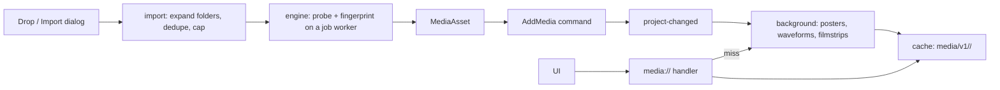

# 06 — Media pipeline

> **Audience:** `backend` (engine + shell) and `frontend`. What happens to a file from the moment it
> is dropped on the window until a poster, filmstrip and waveform appear in the media panel, and how
> a project survives a moved, renamed or edited media file.

---

## 1. The path of one file



Two rules shape all of it:

- **Binary data never crosses JSON IPC** (ADR-0003 §9). Thumbnails, filmstrips and waveforms are
  fetched by URL from the `media://` protocol; JSON carries only ids, sizes and layout numbers.
- **The cache is keyed by content, not by path.** A fingerprint hash names the folder, so moving a
  file keeps its previews and an edited file never shows a stale picture.

## 2. Import

`src-tauri/src/import.rs` starts a job (`JobStage::Probing`, `Priority::Interactive`) and returns a
`JobId` at once.

**Plan (first task).** Input paths are normalised; a folder is walked recursively, a file is taken as
it is.

- The walk keeps files whose extension is in `MEDIA_EXTENSIONS` (`crates/engine/src/media/mod.rs:39`:
  mp4, mov, m4v, mkv, webm, avi, mpg, mpeg, mts, m2ts, 3gp, mp3, wav, m4a, aac, flac, ogg, opus, jpg,
  jpeg, png, webp, bmp, tif, tiff, gif, heic, heif). A file named explicitly is tried whatever its
  extension.
- More than `MAX_IMPORT_FILES = 2000` media files in **one folder** fails that folder with
  `tooManyFiles`; nothing from it is imported. Other inputs still import.
- Symlinked folders are not followed, so there are no loops.
- Paths are deduplicated case-insensitively (`path_key`), keeping the input order; a non-UTF-8 path
  becomes a `failed` entry with `unsupportedPath`.

**Per-file tasks.** One task per file probes it on the pool. Each task reports `progress`
(`stepDone / total`) and the whole job reports per-file results in input order.

**Finish.** The last task to finish builds one `AddMedia` command with every successfully probed
asset, applied through `JobHost::edit` (which waits for an open gesture). Duplicates are resolved by
fingerprint: a file whose content is already in the project, or earlier in the same import, is
`alreadyImported` and not added twice. Then `media-job-report` is emitted, then `job-finished`.

Cancellation: `cancel_job` sets a flag checked between files and inside a slow probe (FFmpeg can
block on a cloud-only file); a cancelled import reports `cancelled` and **no** `media-job-report`.

## 3. Probing

`engine::media::probe` reads the container with FFmpeg and decodes the first frame of every selected
stream (a packet budget guards a corrupt file). The result is `Probed { kind, info }`:

| Question | Rule |
|---|---|
| Kind | a video stream with a duration → `Video`; audio streams only → `Audio`; one decoded picture and no duration → `Image` (stills from FFmpeg's image demuxers; animated GIF and APNG are video) |
| Video stream | not an attached picture (cover art), default disposition first, then the largest picture |
| Audio streams | **every** stream with a decoder, default first, then file order |
| Origin | media time zero = the earliest start of the used streams, else the container start, else 0. Media time `t` is container time `t + origin` for every stream |
| Duration | from stream/container durations; when the container states none (browser WebM, some MKV) the probe seeks to the end; a bad tail in a container that promised data is `damaged`, in one that did not is a truncated recording whose good packets still play |
| Rotation | display matrix; mirroring is ignored and logged; EXIF orientation for JPEG |
| HDR | one rule in `hdr_transfer()` ([02](02-domain-model.md) §7); Dolby Vision profile 5 is imported and badged, not processed |
| Display size | `VideoStreamInfo::display_size()` — pixel aspect applied, even, axes swapped for quarter turns |

A file that no demuxer recognises, or that has no usable stream, fails as `unsupportedFormat`; a
stream this build cannot decode is `unsupportedCodec`; a truncated/corrupt file is `damaged`.

## 4. Fingerprint

`engine::media::fingerprint` (`crates/engine/src/media/fingerprint.rs`):

```
hash = BLAKE3( size as LE u64 ‖ first min(1 MiB, size) ‖ last min(1 MiB, size) )[..16]  // 32 hex
```

It reads at most 2 MiB. `modified` is the file's mtime in Unix milliseconds, a hint only. This is
the cache key, the duplicate test at import and the relink match ([§10](#10-relink)). A change in
the middle of a large file is deliberately not seen by the hash; the size and mtime catch most edits,
and the media check re-hashes when they differ.

## 5. Preview products

One `MediaAsset` has up to three kinds of product, all generated by `engine::media::previews`:

| Product | For | Shape | Constants |
|---|---|---|---|
| `Poster` | video, image | JPEG, upright, long side `POSTER_LONG_SIDE = 320` | poster time `min(1 s, duration/2)`; 0 for images |
| `FilmstripTile(n)` | video | JPEG strip of up to 32 frames side by side, each `frameWidth × 96`, upright and centre-cropped | `FILMSTRIP_FRAME_HEIGHT = 96`, `FILMSTRIP_FRAMES_PER_TILE = 32`, `FILMSTRIP_MAX_FRAMES = 1200`, frame width clamped to 54..=171 |
| `Waveform` | video with audio, audio | binary `CFWF` | `WAVEFORM_BUCKETS_PER_SECOND = 100` |

**Filmstrip layout** is a model value, not pixels (`FilmstripLayout::of`): one frame per second up to
20 minutes, otherwise `duration / 1200` rounded up to a whole millisecond, at most 1200 frames. The
UI draws `layout.frames` tiles of `layout.frameWidth × 96` and requests tile `n` over `media://`.

**Waveform body** (little endian): `"CFWF"`, `u16` version (1), `u16` channels (1, the mix-down),
`u32` buckets per second, `u32` bucket count, then `count × (i8 min, i8 max)` scaled to ±127. The UI
parses it once per media item and draws min/max bars; it never asks Rust to compute peaks per frame.

`MediaView.filmstrip` tells the UI how many tiles exist and how wide each frame is; a `FilmstripTile`
request for a tile past the end is a `404`.

### 5.1 The decode layer

Every product is generated in the calling job worker, in software, with its own FFmpeg contexts; it
stops soon after the job's cancel flag is set.

- `engine::media::decode` opens a decoder for a stream and defines the timing rule shared with the
  future render graph: nothing locates frames by index; a frame carries its own timestamp and the
  frame for media time `t` is the last one with `pts <= t` (sample and hold). Variable-frame-rate
  phone footage therefore stays in sync.
- `engine::media::reader::VideoReader` decodes forward from wherever it last seeked, drops at most
  `MAX_SKIPPED_TO_KEY = 600` frames while looking for a keyframe after a seek, and calls a stream
  damaged after `MAX_BAD_PACKETS = 64` undecodable packets in a row. It is `pub(crate)`: only the
  preview generators use it today.
- `engine::media::still` decodes HEIF tile grids and `engine::media::heif` reads the `irot`/`imir`
  rotation that FFmpeg 7.1 does not expose, so a portrait phone photo comes out upright.
- `engine::media::tonemap` maps HDR thumbnails to SDR on the CPU: HLG and PQ to display light
  against a 203-nit SDR white (BT.2408), a knee at 0.8, BT.2020 → BT.709 and the sRGB curve. It
  exists for posters and filmstrips only; the render graph's WGSL tone map is designed in
  `docs/design/render-graph.md` and must end up sharing this definition.
- `JOB_DECODER_THREADS = 2` per decoder in import and preview jobs, so several probes on the pool do
  not oversubscribe a small machine.

## 6. The cache

`engine::media::cache::PreviewCache`, at `<cache root>/media/v1/`:

```
media/v1/<first 2 hex>/<hash>/poster.jpg
                            filmstrip-0000.jpg, filmstrip-0001.jpg, …
                            waveform.bin
                            used          (mtime = last use, for LRU)
```

- `<hash>` must be 32 lowercase hex characters (`valid_hash`), so a crafted hash cannot escape the
  folder. The two-hex shard keeps folders per directory manageable.
- `put` writes a unique temporary file and renames it, so a crash leaves either the old file or the
  new one. `get` touches `used` at most once per session.
- The cap is `DEFAULT_CACHE_CAP = 2 GiB`. `evict()` deletes whole asset folders, least recently used
  first, until the total is under the cap. It runs at start-up and at the end of a prefetch job.
- `remove_old_versions()` deletes sibling folders named like a cache version (`v0`, `v2`, …) but
  nothing else.
- The **cache root** is `<cacheDir or app cache dir>/cutframe-cache` (preferences, [04](04-persistence-and-lifecycle.md)
  §8). Changing it opens a new cache for the next request and leaves the old folder as it is; Clear
  cache deletes only inside `cutframe-cache`.

## 7. `media://`

`src-tauri/src/protocol.rs`. All routes are `GET` and by **id**, never by path:

| Route | Body | For |
|---|---|---|
| `/poster/<mediaId>?v=<version>` | `image/jpeg` | video, image |
| `/filmstrip/<mediaId>?tile=<n>&v=<version>` | `image/jpeg` | video |
| `/waveform/<mediaId>?v=<version>` | `application/octet-stream` (`CFWF`) | audio, video with audio |
| `/cover/<hash>` | `image/jpeg` | recent-project cover ([04](04-persistence-and-lifecycle.md) §7) |
| `/preview/frame?w=<px>&h=<px>` | `application/octet-stream` (8-byte header + RGBA8) | legacy `frames` preview mode ([07](07-preview-and-render.md)) |

```mermaid
sequenceDiagram
  participant Web as WebView
  participant H as media handler (2 threads)
  participant S as project snapshot
  participant P as Previews
  participant W as job pool
  Web->>H: GET /poster/<id>?v=…
  H->>S: find asset by id
  alt unknown id, stale v, product the kind lacks
    H-->>Web: 404
  else cached
    H-->>Web: 200 + bytes (immutable)
  else miss
    H->>P: attach(waiter); first waiter → produce on the pool
    P->>W: generate (interactive)
    W-->>P: bytes
    P-->>H: answer every waiter
    H-->>Web: 200 / 500 / 503
  end
```

- The request queue holds `QUEUE_CAPACITY = 256`; when it is full the answer is `503` at once.
  `HANDLER_THREADS = 2` parse routes and serve cache hits. **No handler thread ever waits for a
  generation**: the responder is handed to `Previews` and called from a pool worker.
- `v` must equal `preview_version(asset)`, otherwise `404`. That makes a `200` genuinely immutable
  and lets it carry `Cache-Control: max-age=31536000, immutable`.
- `preview_version` = first 16 hex of the content hash + `-` + 8 hex FNV-1a of the normalised path.
  Content alone would be wrong: after a relink to the same content at a new place the UI must fetch
  again, because its earlier requests may have failed while the file was offline. The cache itself
  is still keyed by content only.
- Status codes: `200`, `400` (malformed id/tile, missing `v`, bad cover hash), `404` (unknown id,
  stale `v`, a product the kind does not have, a tile out of range), `503` (queue full, file
  unreachable with nothing cached), `500` (generation failed, remembered for the session).

`ui/src/ipc/media.ts` builds the URLs with `convertFileSrc("", "media")`, which knows whether the
platform serves `http://media.localhost/` or `media://localhost/`, and appends `?v=` from
`previewVersion`.

## 8. Sharing, failures and the prefetch job

`src-tauri/src/previews.rs`:

- `attach(key, waiter)` returns `true` for the first waiter; that caller runs `produce` on a pool
  worker. Every later waiter for the same `(hash, product)` gets the same outcome. Two `` tags
  for one poster therefore generate it once.
- A failure other than "file not reachable" (`damaged`, `unsupportedCodec`, a panicking generator)
  is remembered for the session and answered `500` without retrying, so the UI does not loop.
  `fileNotFound`, `accessDenied` and a cancelled generation are `503` and retried next time.
- A generator that finds the file gone calls the `on_missing` observer, which marks the asset
  `offline` at runtime ([§9](#9-media-status)).
- **Prefetch** (`start_prefetch`, stage `generatingPreviews`, `Priority::Background`) runs after an
  import and after an open: all posters, then all waveforms, then all filmstrip tiles that are not
  cached and have not failed. Ids that left the project meanwhile are skipped. The cache is evicted
  at the end.

## 9. Media status

`src-tauri/src/media_status.rs`. Status is **session state**, not model and not file:

| Status | Meaning |
|---|---|
| `online` | reachable and (as far as known) unchanged |
| `offline` | missing, not a file, or the drive/share is unreachable |
| `changed` | the file at the path has other content than when imported or relinked |

- A status belongs to a `(path, content hash)` pair, not to an asset id, so undoing a relink brings
  the old status back with no bookkeeping, and a relink to a new path starts `online`.
- Opening or restoring a project clears all statuses and starts a `checkingMedia` job. The check is
  cheap: `metadata`; missing → `offline`; size or mtime differ → re-hash; same hash → `online`,
  different → `changed`; an unreadable-but-present file stays `online` (unknown is not "changed").
- One status update is applied at the end of the job, bumping `revision` once if anything changed.
- At runtime a preview generator finding the file gone reports `offline` immediately.
- A `changed` or `offline` asset shows a badge in the media panel and the timeline; the fix is relink
  ([§10](#10-relink)) or remove.

## 10. Relink

`src-tauri/src/relink.rs`, stage `probing` for one file and `searchingFolder` for a folder:

**One file** (`relink_media(id, path, allowMismatch)`):

1. probe the file; a different **kind** (a video where an audio asset was) is `kindMismatch` and
   changes nothing;
2. same content hash → relink, keep `info`, mark `online`;
3. different content without `allowMismatch` → `fingerprintMismatch`, nothing changed; the UI asks
   and retries with `allowMismatch = true`, which also replaces `info` with the new probe;
4. the result must validate as a `MediaAsset` (`damaged` otherwise), then one `RelinkMedia` history
   entry is applied once no gesture is open. An asset removed or relinked elsewhere while the probe
   ran is skipped.

**A folder** (`relink_media_folder(folder)`) fixes every missing asset at once:

- files are grouped by size, so only size-matching candidates are ever hashed;
- a candidate whose fingerprint matches is the file; same file name wins over other candidates,
  otherwise path order;
- assets with no match are reported `notFound`; nothing is guessed.

Both report `media-job-report` (one `MediaFileResult` per file, or per missing asset for a folder)
and then `job-finished`; relinking is one undo step.

## 11. What is not here yet

The pipeline above is the **implemented** import/preview/relink path. Playback, audio output,
decode-on-demand for the preview and export are designed in `docs/design/` but not coded: the decode
layer of §5.1 only serves poster, filmstrip and waveform jobs, there is no render graph reading media
frames per frame yet, and `MediaInfo` is the only decode result stored. The `/preview/frame` route
serves the test pattern of [07](07-preview-and-render.md), not media.

## Links

- [media-import design](../design/media-import.md): import, probing, previews, relink in full
- [ADR-0003 — IPC conventions](../adr/0003-ipc-conventions.md) §9: binary data outside JSON
- [02 — Domain model](02-domain-model.md) §7: `MediaAsset`, `MediaInfo`, `FilmstripLayout`
- [04 — Persistence and lifecycle](04-persistence-and-lifecycle.md): cache folder, recent covers
- [05 — IPC contract](05-ipc-contract.md): media commands, job events
- [diagrams/050 — Media import](diagrams/050-media-import.md),
  [diagrams/060 — media:// request](diagrams/060-media-protocol.md)
