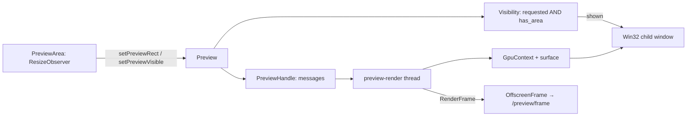
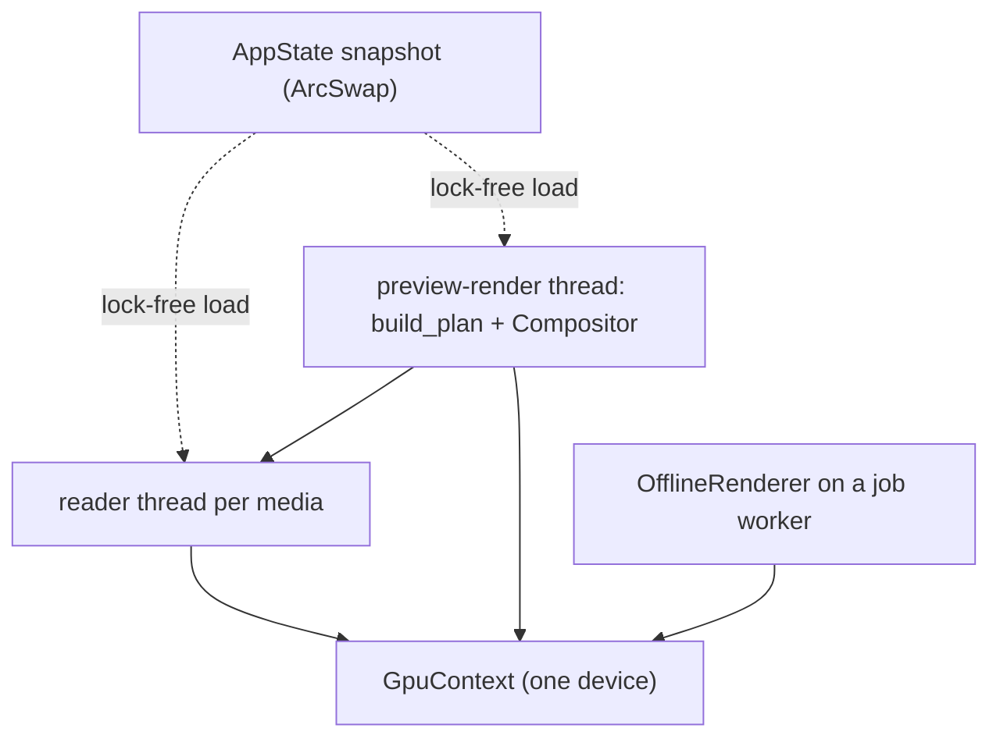

# 07 — Preview and render

> **Audience:** `backend` (engine + shell) and `frontend`. How a frame reaches the screen, what the
> preview thread does today, the rules that keep a native window from covering the UI, GPU fallback
> and device-loss recovery, and the render graph the preview and export will share.

---

## 1. What the preview is today

The engine has a working GPU preview of a **test pattern** — a letterboxed, animated card. It is the
stage-0 renderer: the thread, the window, the surface, the device-loss recovery and the offscreen
read-back all exist and are tested; only the content is a placeholder. Timeline content is designed
in `docs/design/render-graph.md` ([§9](#9-target-the-render-graph)) and not coded yet.

| Piece | Where | State |
|---|---|---|
| Preview thread, messages, device loss | `crates/engine/src/preview.rs` | implemented |
| GPU context, adapter order, WARP fallback | `crates/engine/src/render/gpu.rs` | implemented |
| Test-pattern renderer | `crates/engine/src/render/test_pattern.rs` + `shaders/test_pattern.wgsl` | implemented |
| Offscreen read-back | `crates/engine/src/render/offscreen.rs` | implemented |
| Native child window | `src-tauri/src/preview/windows.rs` | implemented (Windows) |
| Visibility rules, `frames` mode | `src-tauri/src/preview/mod.rs` | implemented |
| Smoke test through the real path | `src-tauri/src/smoke_test.rs` | implemented |
| Render graph, compositor, playback and export decode | `docs/design/render-graph.md` | **target only** |

Job-side software decode already exists for posters and filmstrips (`engine::media::decode`,
`reader`, `still`, `tonemap`, [06](06-media-pipeline.md) §5.1); what is missing is the render graph
that consumes it per frame.

## 2. Two ways to put a frame on screen

`PreviewMode` (`ipc/types.rs`) is decided once at start-up and can change to `unavailable` at runtime:

| Mode | Platform | How the pixels get there |
|---|---|---|
| `native` | Windows | the engine renders into a Win32 child window placed over the preview rectangle; frames never touch IPC |
| `frames` | other platforms (legacy dev) | the UI polls `media://…/preview/frame?w=&h=` and draws the RGBA bytes on a canvas |
| `unavailable` | any | no GPU adapter, or the preview gave up after repeated device losses; the UI shows a placeholder |

The child window is created **hidden** before the engine starts, as a `WS_CHILD | WS_CLIPSIBLINGS`
sibling of the WebView2 controller, on top in z-order. `WM_NCHITTEST` answers `HTTRANSPARENT`, so
clicks pass through to the UI, and the black background brush avoids a white flash. The engine picks
an adapter that can present to that window before the device is created, so there is one device and
no late re-creation.

## 3. Visibility

`Visibility` (`src-tauri/src/preview/mod.rs:174`) is two booleans: the UI's **request** and whether
the rectangle **has area**. The preview is shown only when both are true.

- It starts `{ requested: false, has_area: false }`, so a start screen drawn in the DOM is never
  covered by a leftover native window (ADR-0005 §4).
- `set_rect` records `has_area = width > 0 && height > 0`; an empty rectangle hides the preview even
  while the UI requests it.
- A rectangle update **never** overrides a hide request: while a dialog overlaps the preview area the
  UI asks hidden, and resizing the window underneath does not bring the preview back.
- Every change dispatches only on the shown/hidden **transition**, so repeated reports are cheap.
- On Windows the window is moved **before** it is shown, so it never flashes at the old position.

`PreviewArea` in the UI calls `set_preview_visible(true)` on mount and `false` on unmount, and
reports the rectangle from a `ResizeObserver` in physical pixels (`devicePixelRatio` applied).

## 4. The preview thread

`PreviewHandle` owns a thread named `preview-render`. All communication is a channel; callers never
block on rendering.

| Message | Effect |
|---|---|
| `Resize { width, height }` | new surface configuration (physical pixels); resets the present-rate window |
| `SetVisible(bool)` | pauses/resumes drawing; a pause is not counted as a dropped frame |
| `SetCanvasAspect(f32)` | project width / height, used by the test pattern |
| `RenderFrame { width, height, reply }` | one offscreen frame, answered on the same channel |
| `DeviceLost { generation }` | sent by that context's device-lost callback; stale generations are ignored |
| `Shutdown` | the thread exits; dropping the handle sends it and joins |

The loop blocks on the channel whenever it is not drawing (`!visible` or no window), so a hidden
preview costs no CPU and no presents. When it is drawing it drains pending messages and presents one
frame per iteration.

**Present configuration.** `AutoVsync`, `desired_maximum_frame_latency = 2`, sRGB surface format when
the adapter offers one. `Timeout`/`Occluded` sleeps 16 ms and resets the stats; `Outdated`/`Lost`
reconfigures; `Suboptimal` presents and then reconfigures.

**Present statistics.** Once per `PRESENT_STATS_WINDOW = 5 s` of continuous drawing, the thread logs
`frames`, `avg_fps`, `max_gap`, `p99_gap` and `long_gaps` (an interval above 1.5× the window's
average). Pauses reset the window, so they never look like dropped frames. It is a debug log line,
not an IPC event.

## 5. GPU selection and fallback

`GpuContext` (`crates/engine/src/render/gpu.rs`) creates the surface **first**, then enumerates
adapters and picks one that can present to it, so the device is created once.

- Order: discrete, integrated, other, then software (`WARP` on Windows). `CUTFRAME_GPU=integrated`
  swaps the first two; `WGPU_FORCE_FALLBACK_ADAPTER` forces the software adapter (CI uses it).
- If an adapter cannot present, or its device cannot be created, it is skipped and the next is tried.
- If no adapter can present, the context still renders offscreen and the preview reports
  `presentsToWindow: false`; the UI then has no native picture.
- `FallbackReason` is a stable key: `forcedByEnv`, `preferredCannotPresent`, `noHardwareAdapter`,
  `deviceLost`. `GpuInfoView.software` is true for WARP.

`AppInfo` (`version`, `gpu`, `previewMode`) is fetched once with `get_app_info`; the status bar shows
the adapter. `AppInfoChanged` replaces it after a runtime change.

## 6. Device loss

A driver reset (TDR) or a crash in the device is caught by `set_device_lost_callback`. Our own
`Destroyed` is not a loss. On a loss the thread calls `recover()`, which follows
`after_device_loss(losses)`:

| Loss | Action |
|---|---|
| 1st | recreate on `AdapterMode::Auto` — the (possibly reset) hardware gets another chance |
| 2nd | recreate on `AdapterMode::SoftwareOnly` — WARP |
| 3rd and later | give up: `available = false`, `previewMode = unavailable`, nothing is drawn |

Every successful recovery marks `fallback = deviceLost`, publishes the new `GpuInfo`, and emits
`AppInfoChanged` with `available = true`. Giving up emits it with `available = false`. The surface is
dropped before a new context is created (one swap chain at a time) and recreated at the last known
size. A device-lost message from an old context carries an old `generation` and is ignored.

The preview never panics on a GPU error: uncaptured errors are logged.

## 7. Offscreen frames

`render_frame(width, height)` sends `RenderFrame` and waits up to 5 s. The shell clamps the request
to `MAX_FRAME_SIZE = 1920 × 1080` before it reaches the engine.

`render_offscreen` renders into an `Rgba8UnormSrgb` texture, copies it to a buffer whose rows are
padded to wgpu's 256-byte alignment, polls the device, maps the buffer and strips the padding into a
tightly packed `OffscreenFrame { width, height, rgba }`.

`/preview/frame?w=&h=` returns that as `application/octet-stream`: `u32` width, `u32` height (little
endian), then RGBA8 rows. `Cache-Control: no-store`; it is a live frame, never cached. A missing GPU
or a timed-out render is `503`.

The same read-back is used by golden-frame tests and the smoke test, which is why it is in the engine
and not in the shell.

## 8. Smoke test

`--smoke-test` runs the real preview path against an installed build (CI, on WARP) and exits with a
status code:

1. one offscreen frame (all platforms);
2. Windows: show the native child window through the same calls the UI makes and wait for
   `FRAMES_TO_PRESENT = 30` presents within `PRESENT_TIMEOUT = 20 s`.

A watchdog exits with `Timeout` after `OVERALL_TIMEOUT = 90 s`. Codes: `0` passed, `1` no offscreen
frame, `2` no GPU, `3` no preview surface, `4` too few frames, `5` timeout, `6` the release build
refused a non-LGPL FFmpeg (`ffmpeg_check`).

## 9. Target: the render graph

`docs/design/render-graph.md` specifies the renderer that replaces the test pattern. The parts that
constrain every other document:

- **One graph for preview and export.** A pure `build_plan(project, t, render_size) -> RenderPlan`
  on the CPU; one `Compositor::render(plan, frames, canvas)` on the GPU. Preview, export,
  `--smoke-test` and golden tests call the same two functions and differ only in the frame-fetch
  policy (`BestAvailable` vs `Exact`) and the output pass.
- **Working colour** is `Rgba16Float`, premultiplied alpha, Rec.709, display-referred R'G'B'. HDR
  sources are tone-mapped per layer (BT.2390 EETF to 203 nits, BT.2020 → BT.709) inside the source
  convert pass, so the rest of the graph is SDR.
- **Passes per frame:** background → one source-convert pass per distinct source (YUV → R'G'B',
  tone map, rotation, downscale, cached as `Rgba16Float`) → layer pass per clip bottom to top (crop,
  fit, transform, opacity, premultiplied over) → present pass (scale, letterbox, engine overlays) or
  offline output pass.
- **Time and sampling.** `build_plan` quantises the playhead to the project frame grid and samples a
  video at the **centre** of that frame (`source_time + frame_duration/2`) with sample-and-hold, so
  a 29.97 fps clip in a 30 fps project does not repeat frames. Images have no time.
- **Redraw on change while paused**, vsync-paced while playing, composite only when the project frame
  or the plan changed, never present while hidden.
- **Threads.** The preview thread owns the GPU and the compositor; reader threads decode per media
  with the shared device; `AppState.snapshot` becomes an `Arc<ArcSwap<Project>>` so the engine never
  takes the document lock (ADR-0004). Export runs an `OfflineRenderer` on a job worker with its own
  readers and compositor state on the same device.

> **Drift:** the current `preview.rs` owns the GPU on its own thread and renders the test pattern; the
> design moves `GpuContext` into an `Arc` shared with readers and export. Until task 0320 lands, the
> "one render graph" rule (CLAUDE.md architecture rule 3) holds only in the design, not in code.
> HDR thumbnails are already tone-mapped, but by a CPU operator in `engine::media::tonemap`; the
> render graph's WGSL tone map must be defined once for both when 0320 lands.

## 10. Failure handling summary

| Failure | Behaviour today | Target |
|---|---|---|
| No adapter at all | `Preview::create` returns `None`; `previewMode = unavailable`; the app still runs | same |
| Adapter cannot present | offscreen only, `fallback = preferredCannotPresent` | same |
| Device lost | recover per `after_device_loss`; report via `AppInfoChanged` | same |
| Repeated device loss | give up, `previewMode = unavailable` | same |
| Offscreen render timeout | `503` from `/preview/frame`; `render_frame` returns `None` | same |
| Missing media in a layer | not applicable yet | `Offline` placeholder, one `MediaUnavailable` report |
| Corrupt frame | not applicable yet | hold the previous frame; three failures in 1 s stop that reader |

## Links

- [ADR-0001 — Tech stack](../adr/0001-tech-stack.md): wgpu, one render graph, zero-copy decode
- [ADR-0004 — Threading and model ownership](../adr/0004-threading-and-model-ownership.md)
- [ADR-0005 — Preview presentation per platform](../adr/0005-preview-presentation-per-platform.md)
- [render-graph design](../design/render-graph.md), [playback design](../design/playback.md)
- [05 — IPC contract](05-ipc-contract.md): preview commands, `AppInfo`
- [06 — Media pipeline](06-media-pipeline.md): `/preview/frame`, preview products
- [diagrams/070 — Preview presentation](diagrams/070-preview-presentation.md)
