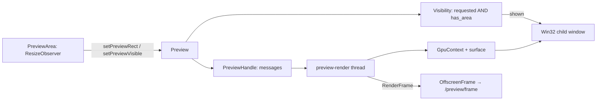
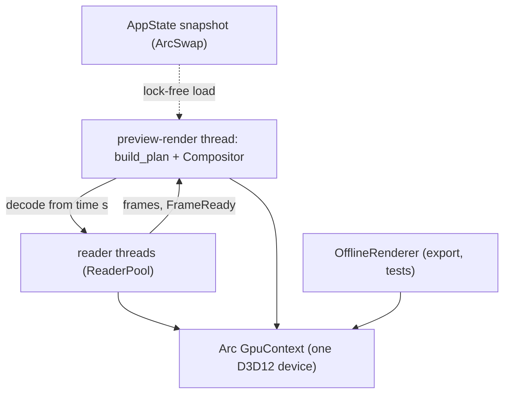

# 07 — Preview and render

> **Audience:** `backend` (engine + shell) and `frontend`. How a frame reaches the screen, what the
> preview thread does, the rules that keep a native window from covering the UI, GPU fallback and
> device-loss recovery, and the render graph that preview, export and tests share.

---

## 1. What the preview is

The preview shows the **composed timeline at the playhead**, drawn by the shared render graph
(task 0320, `docs/design/render-graph.md`, [§9](#9-the-render-graph)): background, main track and
overlays, SDR and HDR sources, decoded in hardware where the GPU can. The engine owns the playhead:
the transport (`crates/engine/src/playback/`) plays, pauses, shuttles, steps, seeks and loops, and the
UI mirrors it from `playback-tick` (task 0330, `docs/design/playback.md`).

| Piece | Where | State |
|---|---|---|
| Preview thread, messages, render on change, device loss | `crates/engine/src/preview.rs` | implemented |
| Transport atomics (state, rate, loop, playhead, shown frame, seek generation) | `crates/engine/src/transport.rs` (`TransportShared`) | implemented |
| Transport state machine, `Playback` front door, audio seam (`AudioSink`, `NoAudio` wall clock), frame pacing, tick throttle, lookahead | `crates/engine/src/playback/` (`EngineAudio` adapts `engine::audio::AudioEngine`) | implemented |
| GPU context, adapter order, WARP fallback, optional `NV12`/`P010`/`16BIT_NORM` | `crates/engine/src/render/gpu.rs` | implemented |
| `build_plan` (pure) | `crates/engine/src/render/plan.rs` | implemented |
| `Compositor`, source cache, layer and present passes | `render/compositor.rs`, `present.rs`, `shaders/layer.wgsl`, `present.wgsl` | implemented |
| Source convert + HDR tone map | `render/convert.rs`, `shaders/convert.wgsl`, `crates/engine/src/color.rs` | implemented |
| Video readers, hardware decode (D3D12VA zero-copy) | `crates/engine/src/media/readers/`, `media/d3d12.rs` | implemented |
| Clip speed, reverse (GOP-reverse reader mode), freeze frames | `render/plan.rs`, `render/frames.rs` (`Pace`), `media/readers/window.rs`, `playback/scheduler.rs` | implemented (task 0370, [§9.1](#91-speed-reverse-and-freeze-frames-task-0370)) |
| `OfflineRenderer` (export entry point) | `render/offline.rs` | implemented; the export loop drives it (`engine::export::run`, [06](06-media-pipeline.md) §11) |
| Offscreen read-back | `crates/engine/src/render/offscreen.rs` | implemented |
| Native child window | `src-tauri/src/preview/windows.rs` | implemented (Windows) |
| Visibility rules, `frames` mode | `src-tauri/src/preview/mod.rs` | implemented |
| Smoke test through the real path | `src-tauri/src/smoke_test.rs` | implemented |
| Golden-frame tests (WARP) | `crates/engine/tests/golden.rs`, `tests/golden/*.png` | implemented |
| Quality, zoom and pan (`preview_render_size`, `present_rect`) | `crates/engine/src/render/view.rs`, `present.rs` | implemented (task 0340, [§4](#4-the-preview-thread)) |
| Skim, source preview (`PlaySource`, `source_project`) | `crates/engine/src/playback/source.rs`, `playback/mod.rs`, `preview.rs` | implemented (task 0340, [09](09-audio-and-playback.md) §8) |

## 2. Two ways to put a frame on screen

`PreviewMode` (`ipc/types.rs`) is decided once at start-up and can change to `unavailable` at runtime:

| Mode | Platform | How the pixels get there |
|---|---|---|
| `native` | Windows | the engine renders into a Win32 child window placed over the preview rectangle; frames never touch IPC |
| `frames` | other platforms (legacy dev) | the UI polls `media://…/preview/frame?w=&h=` and draws the RGBA bytes on a canvas |
| `unavailable` | any | no GPU adapter, or the preview gave up after repeated device losses; the UI shows a placeholder |

The child window is created **hidden** before the engine starts, as a `WS_CHILD | WS_CLIPSIBLINGS`
sibling of the WebView2 controller, on top in z-order. `WM_NCHITTEST` answers `HTTRANSPARENT`, so
clicks pass through to the UI, and the black background brush avoids a white flash. The engine picks
an adapter that can present to that window before the device is created, so there is one device and
no late re-creation.

## 3. Visibility

`Visibility` (`src-tauri/src/preview/mod.rs:174`) is two booleans: the UI's **request** and whether
the rectangle **has area**. The preview is shown only when both are true.

- It starts `{ requested: false, has_area: false }`, so a start screen drawn in the DOM is never
  covered by a leftover native window (ADR-0005 §4).
- `set_rect` records `has_area = width > 0 && height > 0`; an empty rectangle hides the preview even
  while the UI requests it.
- A rectangle update **never** overrides a hide request: while a dialog overlaps the preview area the
  UI asks hidden, and resizing the window underneath does not bring the preview back.
- Every change dispatches only on the shown/hidden **transition**, so repeated reports are cheap.
- On Windows the window is moved **before** it is shown, so it never flashes at the old position.

`PreviewArea` in the UI calls `set_preview_visible(true)` on mount and `false` on unmount, and
reports the rectangle from a `ResizeObserver` in physical pixels (`devicePixelRatio` applied).

## 4. The preview thread

`PreviewHandle` owns a thread named `preview-render`. All communication is a channel; callers never
block on rendering.

| Message | Effect |
|---|---|
| `Resize { width, height }` | new surface configuration (physical pixels); resets the present-rate window |
| `SetVisible(bool)` | pauses/resumes drawing; a pause is not counted as a dropped frame |
| `SetQuality(PreviewQuality)` / `SetView(PreviewView)` | `setPreviewQuality` / `setPreviewView` (the view already clamped); redraw and present on the next frame |
| `SnapshotChanged` | sent by `AppState::publish` after it stores a new project in the shared `ArcSwap` |
| `Seek { generation, mode }` | sent by `Playback` after a seek, step, target change or project reset updated `TransportShared` |
| `Transport` | sent by `Playback` after a play, pause, shuttle, loop toggle, preroll end or end of playback |
| `Skim` | sent by `Playback::set_skim` when the skim time changed; a redraw without a tick |
| `FrameReady` | a reader decoded a frame a lookup was waiting for (coalesced by an `AtomicBool`) |
| `Redraw` | an explicit redraw request (smoke test) |
| `RenderFrame { width, height, reply }` | one offscreen frame through the compositor, answered on the same channel |
| `DeviceLost { generation }` | sent by that context's device-lost callback; stale generations are ignored |
| `Shutdown` | the thread exits; dropping the handle sends it and joins |

**Render on change** (render-graph §7). The loop blocks on the channel; each batch of wake messages
(above, plus device recreation) produces at most one draw: `build_plan` at the playhead (or the skim
time while one is set), the compositor with `FetchPolicy::BestAvailable`, and a present. The project
is what `PlaySource` plays: the timeline snapshot, or a media item's source project. When the plan
and the frame identities
equal the last composite there is no acquire and no present, so a paused, idle preview costs no CPU
and presents nothing (`--smoke-test` logs `idle_presents=0`). A layer whose frame is missing (not
just stale) keeps the previous canvas for up to 250 ms, then is left out. The render thread owns the
compositor and its own `ReaderPool`; `MediaUnavailable` from a reader goes to the shell, which calls
`AppState::report_missing`.

**Playback** (playback.md §5, §7). While `TransportShared` is not paused the loop does not block:
each iteration handles queued messages, then `play_step` acquires the surface (the swap chain's latency
waitable paces it to vsync), asks the `AudioSink` for the audible time, picks the frame
`floor((t_audible + 2 x refresh x rate) / frame)` with `FramePicker` (never backwards within one
generation and loop epoch at positive rates, wrapping while looping), composites (the compositor skips
an unchanged plan) and always presents. Preroll ends when the first frame has no stale or missing
layer and the audio ring is ready, or after 300 ms (`Playback::preroll_done` sets `started`). The end
of the timeline (clock at `duration` forward, at 0 in reverse) pauses on the last frame
(`Playback::end`). Dropped frames are frames skipped at 1x plus frames first composited with a stale or
missing layer; they reset at play start and go into the tick. After each new frame the scheduler's
lookahead (1.5 s x rate, wrapping at the loop end) primes readers for clips that start soon
(`ReaderPool::prime`, A/B readers per media; split points continue the same reader, also the halves
of a reversed clip and a freeze frame at a split point). The pool gets the transport rate
(`ReaderPool::set_rate`) and steers each reader by its layer's `Pace` ([§9.1](#91-speed-reverse-and-freeze-frames-task-0370)):
above 2x transport rate or an effective rate (transport rate x clip speed) above 4x readers decode
keyframes only; below that a reader more than two source frames behind discards non-reference
frames, more than 500 ms behind it jumps 250 ms ahead. With the preview hidden the loop wakes every
16 ms for ticks and end detection and presents nothing. Ticks go through the `on_tick` callback (the
shell emits `playback-tick` and pauses background jobs while playing), at most 60 Hz on average and
always once after a change.

**Present configuration.** `AutoVsync`, `desired_maximum_frame_latency = 2`, a **non-sRGB** surface
format (`Bgra8Unorm`, else `Rgba8Unorm`, else the first non-sRGB one): working values are already
display-referred R'G'B'. The present pass scales the `Rgba16Float` canvas bilinearly into the surface
at `present_rect`: letterboxed at `Fit`; at a zoom percentage the canvas (project pixels) times the
percentage with the panned canvas point at the window centre, black outside the canvas. A failed
acquire is retried after 16 ms (`Timeout`, `Outdated`, `Lost`) or
100 ms (`Occluded`, validation); `Suboptimal` presents and then reconfigures.

**Present statistics.** Once per `PRESENT_STATS_WINDOW = 5 s` of continuous drawing, the thread logs
`frames`, `avg_fps`, `max_gap`, `p99_gap` and `long_gaps` (an interval above 1.5× the window's
average). While playing it adds `dropped`, `skipped`, `late`, `av_offset_ms` (largest |frame start -
t_show|), `underruns`, `ring_min_fill` (from the audio sink) and `refresh_ms`. Pauses reset the window,
so they never look like dropped frames. It is a debug log line, not an IPC event.

## 5. GPU selection and fallback

`GpuContext` (`crates/engine/src/render/gpu.rs`) creates the surface **first**, then enumerates
adapters and picks one that can present to it, so the device is created once.

- Order: discrete, integrated, other, then software (`WARP` on Windows). `CUTFRAME_GPU=integrated`
  swaps the first two; `WGPU_FORCE_FALLBACK_ADAPTER` forces the software adapter (CI uses it).
- If an adapter cannot present, or its device cannot be created, it is skipped and the next is tried.
- If no adapter can present, the context still renders offscreen and the preview reports
  `presentsToWindow: false`; the UI then has no native picture.
- `FallbackReason` is a stable key: `forcedByEnv`, `preferredCannotPresent`, `noHardwareAdapter`,
  `deviceLost`. `GpuInfoView.software` is true for WARP.

`AppInfo` (`version`, `gpu`, `previewMode`) is fetched once with `get_app_info`; the status bar shows
the adapter. `AppInfoChanged` replaces it after a runtime change.

## 6. Device loss

A driver reset (TDR) or a crash in the device is caught by `set_device_lost_callback`. Our own
`Destroyed` is not a loss. On a loss the thread calls `recover()`, which follows
`after_device_loss(losses)`:

| Loss | Action |
|---|---|
| 1st | recreate on `AdapterMode::Auto` — the (possibly reset) hardware gets another chance |
| 2nd | recreate on `AdapterMode::SoftwareOnly` — WARP |
| 3rd and later | give up: `available = false`, `previewMode = unavailable`, nothing is drawn |

Every successful recovery marks `fallback = deviceLost`, publishes the new `GpuInfo`, and emits
`AppInfoChanged` with `available = true`. Giving up emits it with `available = false`. The surface is
dropped before a new context is created (one swap chain at a time) and recreated at the last known
size. A device-lost message from an old context carries an old `generation` and is ignored. The context is
an `Arc<GpuContext>`; recovery publishes a new one (`PreviewHandle::gpu`) and drops the compositor,
readers and caches made on the old device.

The preview never panics on a GPU error: uncaptured errors are logged.

## 7. Offscreen frames

`render_frame(width, height)` sends `RenderFrame` and waits up to 5 s. The shell clamps the request
to `MAX_FRAME_SIZE = 1920 × 1080` before it reaches the engine.

The frame is composited by the same compositor at the playhead, converted to `Rgba8Unorm` R'G'B'
(`OUTPUT_FORMAT`, non-sRGB), copied to a buffer whose rows are padded to wgpu's 256-byte alignment,
read back and stripped into a tightly packed `OffscreenFrame { width, height, rgba }`.

`/preview/frame?w=&h=` returns that as `application/octet-stream`: `u32` width, `u32` height (little
endian), then RGBA8 rows. `Cache-Control: no-store`; it is a live frame, never cached. A missing GPU
or a timed-out render is `503`.

The same read-back is used by golden-frame tests and the smoke test, which is why it is in the engine
and not in the shell.

## 8. Smoke test

`--smoke-test` runs the real preview path against an installed build (CI, on WARP) and exits with a
status code:

1. one offscreen frame (all platforms);
2. Windows: show the native child window through the same calls the UI makes, request redraws until
   `FRAMES_TO_PRESENT = 30` presents within `PRESENT_TIMEOUT = 20 s` (the compositor's output for
   the startup project), then check that nothing is presented while idle (`idle_presents`).

A watchdog exits with `Timeout` after `OVERALL_TIMEOUT = 90 s`. Codes: `0` passed, `1` no offscreen
frame, `2` no GPU, `3` no preview surface, `4` too few frames, `5` timeout, `6` the release build
refused a non-LGPL FFmpeg (`ffmpeg_check`).

## 9. The render graph

`docs/design/render-graph.md` is the spec; §5.4 records the zero-copy spike and its "as built" notes
record where 0320 differs. The parts that constrain every other document:

- **One graph for preview and export.** A pure `build_plan(project, t, render_size) -> RenderPlan`
  on the CPU; one `Compositor::render(plan, frames, canvas)` on the GPU. Preview, `OfflineRenderer`
  (export, 0390), `--smoke-test` and golden tests call the same two functions and differ only in the
  fetch policy (`BestAvailable` vs `Exact`, a `CompositorConfig` setting) and the output pass.
- **Working colour** is `Rgba16Float`, premultiplied alpha, Rec.709, display-referred R'G'B'. HDR
  sources (HLG, PQ, Dolby Vision 8.x base layer) are tone-mapped per source (BT.2390 EETF to 203
  nits, BT.2020 to BT.709) inside the convert pass; 10-bit stays 10-bit up to it. `engine::color`
  holds the reference functions the shader is tested against, and HDR posters use the same operator.
- **Passes per frame:** background, then one convert pass per distinct source frame (YUV to R'G'B',
  tone map, rotation, coded-padding exclusion, downscale; cached as `Rgba16Float` in an LRU keyed by
  frame id, size and `ConvertParams`), then a layer pass per clip bottom to top (fit, opacity,
  premultiplied over; colour clips; striped placeholders for offline and decode error), then the
  present pass or the offline output pass.
- **Time and sampling.** `build_plan` quantises the playhead to the project frame grid and samples a
  video at the **centre** of that frame with sample-and-hold, so a 29.97 fps clip in a 30 fps
  project does not repeat frames. The mapping lives in `app-core`: `Clip::frame_sample_time(t_n,
  frame)` maps the frame centre through the clip's speed and direction and clamps it into the used
  source range (at 1x forward it is `source_time + frame_duration/2`). Images have no time; a
  freeze frame samples its fixed `source_time`.
- **Decode.** One reader thread per (media, stream, direction), at most 8 (4 in hardware, 2 in
  GOP-reverse mode): D3D12VA on wgpu's own `ID3D12Device`, frames sampled in place as
  `NV12`/`P010`; per-stream fallback to hardware decode with download, then software;
  `CUTFRAME_HWDECODE=off` forces software. A sampled hardware frame is transitioned back to `COMMON`
  and released only after its submission completed. Reverse readers always download (§9.1).
- **Threads.** `AppState.snapshot` is an `Arc<ArcSwap<Project>>` shared with the engine, so engine
  threads never take the document lock (ADR-0004). The preview thread owns its compositor and reader
  pool; an `OfflineRenderer` has its own on the same device.

### 9.1 Speed, reverse and freeze frames (task 0370)

`docs/design/clip-speed-audio.md` §5.1–5.2 is the spec. What the render side does:

- **`Pace`** (`render/frames.rs`): `Forward { speed }`, `Reverse { speed }` or `Still`, from the
  clip (`Pace::of`). `LayerContent::Video` carries it and `FrameProvider::video(media,
  sample_time, pace, policy)` receives it. It only steers decoding; the answer is always the last
  frame with `pts <= sample_time`.
- **Freeze frames** (`ClipSource::Freeze`) are video layers at their `source_time` with
  `Pace::Still`: the reader decodes the exact frame and a little ahead (paused steering), and every
  later frame of the freeze is a source-cache hit. `InsertFreezeFrame` takes `source_time` from the
  same `frame_sample_time`, so the freeze shows exactly the frame the preview showed.
- **Steering** (`ReaderPool::steering`): a source moving forward while playing decodes ahead, every
  frame up to an effective rate of 4x (`KEYFRAMES_ONLY_ABOVE`, with catch-up), keyframes only
  above it or above the shuttle's 2x. A reversed clip with the transport paused or playing forward
  goes to a **GOP-reverse reader**; J over a forward clip stays the timed scrub on a forward reader,
  J over a reversed clip runs forward. `FetchPolicy::Exact` (export, golden tests) never skips a
  frame.
- **GOP-reverse mode** (`media/readers/window.rs`, `WindowQueue`): for a sample time no window
  covers, the reader seeks to the keyframe at or before it (`VideoReader::seek_floor`) and decodes
  forward into a CPU ring of at most 160 MB (`REVERSE_WINDOW_BYTES`, newest frames kept) until a
  frame lies past it. Lookups then go downwards through the window. While playing, the reader
  prepares the next earlier window (ending at the current window's first frame) meanwhile, so at
  most two windows (2 x 160 MB) exist per reverse reader. A window being decoded while playback
  moves down ends early at the playhead. Hardware frames are downloaded (`DecodePath::Download`),
  because the decoder's surface pool cannot hold a GOP. A seek that lands on a keyframe past the
  window (MP4 indexes seek by decode time, a few frames before the presentation time) is retried
  0.5 s further back; landing on the same frame twice means the stream starts there. The next
  earlier window's seek starts 250 ms before its end for the same reason. Forward readers retry the
  same way when a seek's first frame comes after the target.
- **Pool binding**: readers serve one media in one direction for their whole life; at most 2 reverse
  readers (`MAX_REVERSE_READERS`), counted against the 8.
- **Scheduler** (`playback/scheduler.rs`): `Need` carries the pace; reversed clips are primed at
  their first sample time near the end of their range on a reverse reader, freeze frames at their
  source time. A clip continues its predecessor (no priming) when, in the direction its reader
  decodes, its first sample time is at most two project frames of source past the previous clip's
  last one (one flick back allowed for split rounding at speeds other than 1x).
- **Measured** (2026-11-27, ignored `tests/playback_hw.rs` with `CUTFRAME_PLAYBACK_SPEED` and
  `CUTFRAME_PLAYBACK_REVERSE`, release, 1280 x 720 composite, 1 s GOPs): on the Iris Xe, 1080p30
  H.264 at 2x, 0.5x and 4x (audio clock) and reversed (30 s) drop no frames; 4K30 HEVC at 2x drops
  0.1 %. Reversed 4K drops 9 % (H.264) to 66 % (HEVC Main 10) on the Iris Xe and 6 % / 65 % on an
  RTX 3070 Ti: a 25 MB P010 frame leaves room for about 6 frames per window, so each GOP is decoded
  and downloaded several times (design §5.2; export stays exact). The known fix, if wanted, is to
  download or keep only the frames a window keeps, or to scale them to the preview size.

## 10. Failure handling summary

| Failure | Behaviour |
|---|---|
| No adapter at all | `Preview::create` returns `None`; `previewMode = unavailable`; the app still runs |
| Adapter cannot present | offscreen only, `fallback = preferredCannotPresent` |
| Device lost | recover per `after_device_loss`; compositor, readers and caches are recreated; report via `AppInfoChanged` |
| Repeated device loss | give up, `previewMode = unavailable` |
| Offscreen render timeout | `503` from `/preview/frame`; `render_frame` returns `None` |
| Missing media in a layer | `Offline` placeholder; one `MediaUnavailable` per media, then `AppState::report_missing` |
| Corrupt frame | the previous frame is held; three failures in 1 s stop that reader (`DecodeError` placeholder) |
| Hardware decoder fails or cannot wrap | that stream reopens with download or software decode, remembered for the session |

## Links

- [ADR-0001 — Tech stack](../adr/0001-tech-stack.md): wgpu, one render graph, zero-copy decode
- [ADR-0004 — Threading and model ownership](../adr/0004-threading-and-model-ownership.md)
- [ADR-0005 — Preview presentation per platform](../adr/0005-preview-presentation-per-platform.md)
- [render-graph design](../design/render-graph.md), [playback design](../design/playback.md)
- [05 — IPC contract](05-ipc-contract.md): preview commands, `AppInfo`
- [06 — Media pipeline](06-media-pipeline.md): `/preview/frame`, preview products
- [diagrams/070 — Preview presentation](diagrams/070-preview-presentation.md)
