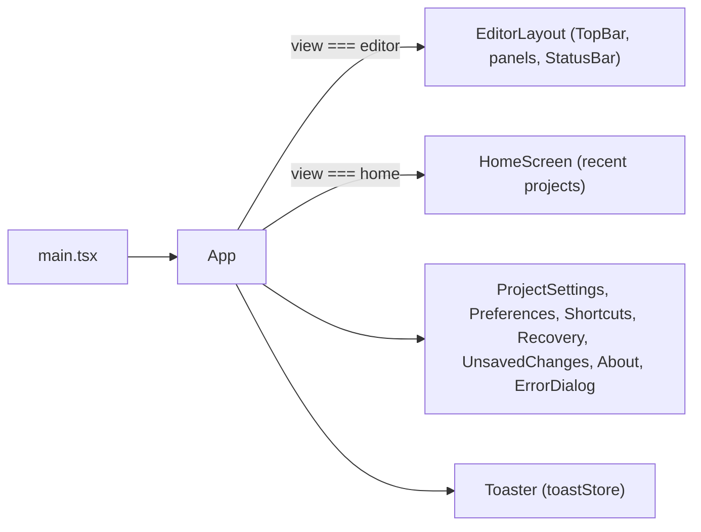
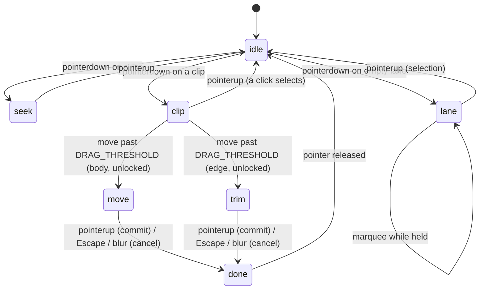

# 08 — UI architecture

> **Audience:** `frontend`, with `backend` for the generated contract. How the React app is put
> together: screens, layout, stores, the sync layer to Rust, the one action registry behind menus and
> shortcuts, and the canvas timeline.

---

## 1. Boot and the two screens

```
ui/src/main.tsx      React root, StrictMode
ui/src/App.tsx       providers, the two views, the global dialogs
```

`App` starts four things once and then renders a view:

| Start | What it does |
|---|---|
| `startJobSync()` | listens to `job-progress`, `media-job-report`, `job-finished`; feeds the import store and `jobResults` |
| `startProjectSync()` | subscribes to `project-changed`, `quit-requested`, `open-file-requested`, `app-info-changed`, cancels a stale gesture, fetches the first state, opens the launch path, then offers recovery |
| `installShortcuts()` | one `keydown` listener that resolves the action registry |
| `loadPreferences()` | fetches preferences, stores them and applies the UI language |



- **Home is a view, not a document.** The Rust model always holds one project; Home shows the recent
  list of an empty untitled project. Opening or creating a project switches `view` to `editor`.
- `started` in `uiStore` is `false` until the launch path has been handled, so a project
  double-clicked in Explorer opens the editor without the home screen flashing first.
- Home **unmounts** the editor, and with it `PreviewArea`, which hides the native preview.

## 2. Editor layout

`EditorLayout` (`ui/src/features/editor/EditorLayout.tsx`) is three rows: `TopBar`, the panel groups,
`StatusBar`.

```
┌ TopBar: logo, project name, menus, undo/redo, Export (disabled) ──────────────┐
│ ┌ MediaBin ─┐ ┌──────── PreviewArea ────────┐ ┌ Inspector ─┐                 │
│ │           │ │                             │ │ + History  │                 │
│ └───────────┘ └─────────────────────────────┘ └────────────┘                 │
├ Timeline (toolbar, track headers, canvas) ────────────────────────────────────┤
└ StatusBar: GPU, preview mode, GPU notice, version ────────────────────────────┘
```

- Panels are `react-resizable-panels`: two groups (rows and columns), media bin and inspector
  collapsible. Sizes live in `localStorage` under `layout.editor.v1.rows` / `.columns` through a
  **safe** storage wrapper: blocked storage or a damaged entry falls back to the default layout
  instead of throwing (`layout.ts`).
- Dragging a panel below its minimum collapses it; `EditorLayout` mirrors that in
  `uiStore.collapsedPanels` for the View menu's check marks.
- View → Reset panel layout removes every saved layout and bumps `layoutVersion`, which remounts the
  groups with default sizes.
- `StatusBar` sits **below** the timeline, so no tooltip from it can reach the native preview. It
  shows the adapter and backend, `previewMode`, a warning for a software adapter, a dismissible
  runtime GPU notice and the version. Failed commands are toasts (§9), not a status-bar line.
- `TopBar` shows the project name, the main menu and undo/redo buttons built from the action
  registry. Export is a disabled placeholder until the export feature lands.

## 3. Stores

Zustand. React components subscribe to slices; the timeline canvas subscribes to the vanilla stores
directly, so a drag or a playhead move does not re-render React.

| Store | File | Kind | Holds |
|---|---|---|---|
| `projectStore` | `stores/projectStore.ts` | `create` | the last `ProjectState` from Rust; `apply` ignores an older `revision` |
| `appStore` | `stores/appStore.ts` | `create` | `AppInfo`, `previewOccluders`, `gpuNotice`; `reportError` logs a failure and shows an error toast; `run()` wraps a command and reports a rejection |
| `toastStore` | `stores/toastStore.ts` | `create` | the shown toasts (oldest first, at most 4; a repeated message moves to the end with a count) |
| `uiStore` | `stores/uiStore.ts` | `create` | `view`, `started`, dialog flags, media panel layout/sort/filter, panel collapse mirror, `layoutVersion`, timeline `snapping` (persisted) |
| `selectionStore` | `stores/selectionStore.ts` | `createStore` | selected clip ids **or** one selected gap; pruned after every `project-changed` |
| `playheadStore` | `stores/playheadStore.ts` | `createStore` | playhead time in flicks (UI-owned until playback) |
| `timelineViewStore` | `stores/timelineViewStore.ts` | `createStore` | timeline viewport (scroll, zoom) and lane width; read by the canvas, the zoom slider and the navigation/zoom actions |
| `importStore` | `stores/importStore.ts` | `create` | running import/background jobs, per-file results, the last import summary |
| `mediaDragStore` | `stores/mediaDragStore.ts` | `create` | the media item being dragged from the panel to the timeline |
| `relinkStore` | `features/media-bin/relinkStore.ts` | `create` | the relink dialog's target and per-file outcomes |
| `preferencesStore` | `features/preferences/preferencesStore.ts` | `create` | the preferences dialog's draft and the applied `Preferences` |
| `useUpdateStore` | `features/updater/updater.ts` | `create` | the update prompt: found release, download progress, ready/failed (pure `reduceUpdate` in `updateState.ts`) |

The two stores outside `stores/` belong to the feature that owns them; the shared ones live in
`stores/` because several features read them.

Rules:

- **The project is read-only in the UI.** Nothing mutates `projectStore.state`; every change is a
  command and comes back as `project-changed` ([03](03-edit-model.md) §1).
- **Selection and the playhead are UI state.** They are not in the model, not in history and not
  saved. Commands receive the ids explicitly.
- `projectStore.apply` drops a state whose `revision` is not newer, because events may arrive out of
  order ([05](05-ipc-contract.md) §3).

## 4. The sync layer

```
ui/src/ipc/projectSync.ts   events → stores, startup sequence
ui/src/ipc/jobSync.ts       job events → importStore + jobResults
ui/src/ipc/jobResults.ts    correlates media-job-report with job-finished for features that await a job
ui/src/ipc/gesture.ts       coalesced gesture transport (ADR-0006)
ui/src/ipc/media.ts         media:// URLs with ?v=previewVersion
ui/src/ipc/errors.ts        kind → translated text; diagnostics only to the console
```

- `startProjectSync` subscribes **before** fetching, so no change is missed in between. It cancels a
  gesture a previous webview may have left open (a reload would otherwise make every edit fail with
  `invalidEdit`/gesture-in-progress), then fetches the project and app info.
- The startup order is: first state → launch path → `started` → recovery prompt. Recovery is offered
  over whichever view ends up showing.
- `describeError` translates only `IpcError.kind`; the English `message` goes to `console.error` for
  developers and is never shown to the user (ADR-0003 §4-5).
- `mediaUrl`, `posterUrl`, `filmstripTileUrl`, `waveformUrl` centralise the `media://` URL shape; no
  component builds one by hand.

## 5. One action registry

`ui/src/features/editor/actions.ts` is the single source for every user command:

```ts
export type Action = {
  id: ActionId;
  label: string;
  menuLabel?: (ctx: ActionContext) => string;   // "Undo Trim Clip"
  shortcuts?: readonly KeyBinding[];            // first shown, all listed in the reference
  blockDefault?: boolean;                       // block the WebView default even when ignored
  scope?: "timeline";                           // ignored inside a panel with data-shortcut-scope
  enabled?: (ctx: ActionContext) => boolean;
  run: () => void | Promise<void>;
};
```

`ACTIONS` is a flat array; everything else is derived from it:

| Derived thing | Function |
|---|---|
| Menu bar contents | `MENUS` references action ids; `menuModel` builds the labels, checks and enabled state |
| Keyboard handling | `findShortcut` / `handleShortcut` |
| Shortcut reference dialog | `shortcutGroups` |
| Tooltips | `actionTooltip` / `shortcutLabel` |

`ActionContext` gathers the flags an action needs: `loaded`, `editorOpen`, `clipsSelected`,
`gapSelected`, panel/dialog state, `magnetic`, `canUndo`, `canRedo`, … `useActionContext()` subscribes
a component to exactly the flags it reads.

Shortcut dispatch rules (`shortcuts.ts`):

- ignored while typing in an input, textarea or contenteditable;
- ignored inside an open menu or dialog (`role="menu"`, `dialog`, `alertdialog`), so Ctrl+Z cannot
  edit the project behind a modal;
- timeline-scoped actions are ignored inside a panel with `data-shortcut-scope` (the media bin has
  its own keys), so keys follow focus;
- `blockDefault` still blocks the WebView default (Ctrl+N new window, Ctrl+O/S file dialogs) even
  when the action itself is ignored;
- an event another handler already consumed (`defaultPrevented`, e.g. Escape cancelling a drag) is
  left alone;
- a disabled action only blocks the default, it does not run.

Actions: File (home, new, open, save, save as, import, project settings, exit), Edit (undo, redo,
cut, copy, paste, duplicate, split, delete, ripple delete, trim left/right, magnetic, select all,
deselect, history panel, preferences), View (media bin, inspector, history panel, zoom in/out/to fit,
go to start/end, previous/next edit point, frame step back/forward by 1 and 10, reset panel layout,
keyboard shortcuts), Help (keyboard shortcuts). An action may appear in several menus but is
registered once.

## 6. The timeline

`ui/src/features/timeline/` splits into pure modules and one canvas component:

| Module | Responsibility |
|---|---|
| `geometry.ts` | time ↔ pixel, zoom limits, viewport, zoom anchor, zoom to fit, logarithmic slider mapping, reveal a time; all time in integer flicks |
| `navigation.ts` | frame step on the project frame grid, last frame, edit points (0, end, clip boundaries on all tracks), previous/next edit |
| `navActions.ts` | the navigation and zoom actions: seek through `setPlayhead`, then scroll the playhead into view |
| `hitTest.ts` | what is under the pointer: ruler, clip body/edge, lane, gap; drag threshold |
| `selection.ts` | click / Ctrl-click / Shift-click / marquee selection, link expansion, pruning |
| `gap.ts` | find the gap under the pointer; describe a selected gap |
| `snapping.ts` | snap candidates (clip edges, playhead, 0) and the nearest within a pixel budget |
| `editDrag.ts` | **pure** move/trim planning: `planMove`, `moveValue`, `planTrim`, `trimValue` |
| `pointer.ts` | the pointer state machine: seek → clip / lane → move / trim → done |
| `drop.ts` | file and media-panel drops: target track, start, placement |
| `addActions.ts` | add media / colour at the playhead, append, drop placement |
| `editActions.ts` | split, delete, ripple delete, trim to playhead, copy/cut/paste/duplicate, magnetic |
| `renderer.ts` | canvas 2D drawing: ruler, lanes, clips (filmstrip, waveform, label shade), gap, offline hatch, drop ghost, snap line, marquee |
| `clipVisuals.ts` | source range → filmstrip frame/tile mapping, waveform zoom levels (`buildPeakLevels`), filmstrip and waveform drawing |
| `productCache.ts` / `clipMedia.ts` | bounded LRU caches of decoded filmstrip tiles (`ImageBitmap`) and waveform levels, keyed by media id + `previewVersion` + tile; loads off the draw path, `503` backoff |
| `Timeline.tsx` | track headers, toolbar, canvas, subscriptions, `ResizeObserver` |



- A press becomes a drag only past `DRAG_THRESHOLD`, so a click never sends a gesture.
- `pointer.ts` computes absolute values with the pure functions and hands them to `beginGesture`
  ([§7](#7-gestures)); it never builds a delta command.
- The canvas redraws on `requestAnimationFrame`; `projectStore`, `selectionStore` and `playheadStore`
  are subscribed imperatively, so a drag does not re-render React components.
- A drop from Explorer is two steps: import (job), then `addClips` at the drop position, as one
  history entry for the placement.
- Tracks are drawn top to bottom as the model orders them; a clip's `visual`/`audio` are `null` where
  the model has none, and offline media is hatched.
- Clip pictures: video clips show filmstrip frames for their source range
  (`sourceIn .. sourceIn + duration`), audio clips and video clips that still play their sound show
  the waveform (under the filmstrip on video clips). The draw path only calls `ProductCache.get`
  (no decoding, no awaiting, no allocation on a hit); a miss queues a load, the most recently drawn
  products load first (at most 4 at once), products scrolled away before loading are dropped from
  the queue, and a finished load requests a redraw. Tiles hold at most 128 MB, waveform levels 48 MB.
- Zoom: Ctrl+wheel anchors at the pointer; the toolbar slider (logarithmic) and `+`/`-` anchor at the
  playhead while it is visible, else the lanes' middle; zoom to fit (Shift+Z, toolbar) shows 0 to the
  timeline end.

## 7. Gestures

`ui/src/ipc/gesture.ts` is the transport half of ADR-0006 ([03](03-edit-model.md) §4):

- at most one `update` per animation frame, coalesced to the latest value;
- never more than one request in flight, so a slow backend gets fewer, fresher updates;
- **all** gesture traffic on one queue, so a pending update can never arrive after its `commit` or
  `cancelGesture`, nor after the next gesture started;
- Escape (capture phase), window blur and lost pointer capture cancel;
- a failed `commit` reports the error and cancels the still-open Rust gesture;
- starting a new gesture cancels the previous one; only one is active at a time.

A keyboard nudge or a typed value is a single `commit` with no updates.

## 8. Media panel, preview and dialogs

**Media bin** (`features/media-bin/`): search, kind filter and sort over `project.media`; grid or
list; poster, filmstrip and waveform drawn from `media://`; drag to the timeline; import jobs with
progress and Cancel; a background-preview indicator with no Cancel; an import result toast that stays
until read (or 4 s when every file was added); a missing-media notice that opens the relink dialog.
`browse.ts`, `selection.ts`, `skim.ts`, `waveformDraw.ts`, `dropTarget.ts` are pure and tested.

**Preview area** (`features/preview/PreviewArea.tsx`): chooses `NativePreviewSlot`, `FramePreview` or
a message by `previewMode`. The native slot reports its rectangle in physical pixels from a
`ResizeObserver` (and on window resize, for DPR changes) and requests visibility; it is the **only**
place that calls `setPreviewVisible`. Dialogs and menus register with `usePreviewOccluder`, and the
preview is hidden while any is open, because a native child window always sits above the DOM
(ADR-0005).

**Project dialogs** (`features/project/`): `fileActions` owns New / Open / Save / Save As / Home and
the unsaved-changes prompt; a second file action while one runs is ignored. `useWindowTitle` keeps the
native title at `*<name> - Cutframe` while dirty, `<name> - Cutframe` when clean, and plain `Cutframe`
on the home screen. `RecoveryDialog` lists orphans and restores or discards them.

**Preferences** (`features/preferences/`): autosave interval, default image/transition duration,
language, cache folder, cache size and Clear cache. The draft is validated by Rust; the applied value
comes back from `set_preferences`.

**Home** (`features/home/`): recent project cards with a cover, rename, duplicate, reveal, delete
(Recycle Bin) and remove-from-list; each is a guarded Rust command ([04](04-persistence-and-lifecycle.md)
§7).

## 9. Text and errors

- `ui/src/i18n/en.ts` is the only table; `t` is a plain object, so a typo is a type error.
- Backend **keys** are looked up at runtime with `historyLabelText`, `errorKindText`,
  `mediaErrorText`, `jobStageText`. An unknown key falls back to a generic string instead of showing
  the raw key, so an older UI build cannot display `addTrack`.
- Adding a new backend key means adding a translation in the same change; a missing one is a bug, not
  a crash.
- `describeError` is the only user-facing error text; diagnostics stay in the console (and Rust
  writes every failed command with its kind and message to the log file).
- **Toasts** (`features/notifications/Toaster.tsx`, F0.08): non-blocking, stacked bottom-right above
  the status bar (the timeline/inspector corner, never over the native preview in the default
  layout, so no occluder). Info and success go after 4 s, errors after 10 s; hover or focus keeps
  one. `errorToast` builds the toast for a failure: the kind's text, and for a failure Rust logged
  (any `IpcError` except the self-explaining `invalidEdit`, `overlap`, `trackLocked`,
  `mediaTooShort`, `cancelled`) "Details are in the log file." with an **Open logs** button.
- **Error dialog** (`features/notifications/ErrorDialog.tsx`) for failures that leave a decision:
  `fileActions` routes a failed **open** (File → Open, a recent project, a double-clicked file) and a
  failed **save** (Save, Save As, the save inside the unsaved-changes prompt) to it; a failed save
  offers Save As…. A failed file picker, New project or close stays a toast.
- **Help** menu: Check for updates…, Open logs folder (`openLogsFolder` → toast on `unavailable`/`io`) and About.
  `AboutDialog` (`features/about/`) shows `getAboutInfo` and the licences from
  `src/generated/licenses.json` (made by `pnpm gen:licenses`, gitignored), loaded through
  `import.meta.glob` so it is its own chunk and a missing file still builds; the package list is
  searchable and paged (50 rows), and a licence text renders only when its row is expanded. URLs are
  shown as text with a copy button: the webview has no permission to open external links.
- **Updates** (`features/updater/`, F0.12): `App` calls `checkForUpdate` once after `started` (a
  failure only reaches the console); Help → Check for updates… shows "You're up to date" or the
  failure as a toast. A found release shows `UpdatePrompt`, a non-modal card at the bottom of the
  toast stack (no preview occluder): version, expandable release notes, Update / Later. Update calls
  `installUpdate`; `update-progress` (subscribed by `startUpdateSync`) drives a progress bar (percent
  with a total, bytes without), then **Restart to update** runs `fileActions.replaceGuarded` (the
  unsaved-changes prompt) around `restartApp`. `failed` shows the reason and Retry. Later hides the
  card; `ready`, `failed` or another check bring it back, and a check during a download keeps it.

## 10. Tests

Vitest (`ui/`), colocated `*.test.ts(x)`:

- pure modules are tested directly: geometry, hit testing, selection, snapping, drag planning, drop,
  gap, navigation, zoom math, filmstrip/waveform mapping, the product cache, browse, skim, waveform drawing, import summaries, relink, layout storage, shortcuts, actions;
- components are tested with Testing Library: `MediaBin`, `HomeScreen`, `PreviewArea`, the dialogs,
  `StatusBar`, `MainMenu`, `HistoryPanel`, `Toaster`, `ErrorDialog`, `AboutDialog`; the toast queue,
  error-toast mapping and licence search/paging are pure and tested directly;
- `bindings.ts` mocks (`commands.*.mock`) come from tauri-specta's `.mocks()`; no test invents a Rust
  type.

`pnpm check` runs typecheck, ESLint, Prettier check, Vitest and a production build
([00](00-repository-and-stack.md) §9).

## 11. Adding UI

1. If it needs a new command or event, the backend defines it and regenerates `bindings.ts` first
   ([05](05-ipc-contract.md) §9). Never hand-write the type.
2. Put deciding logic in a pure module with tests; keep the component about wiring.
3. Add a user command to `ACTIONS` once, then reference its id from `MENUS`; the shortcut reference
   and tooltips follow automatically.
4. Model changes go through a command; the UI never edits `projectStore.state`.
5. New visible strings go in `i18n/en.ts`; new backend keys get a translation in the same change.
6. Anything that can cover the preview area registers a preview occluder.
7. Run `pnpm check` before committing.

## Links

- [ADR-0005 — Preview presentation per platform](../adr/0005-preview-presentation-per-platform.md):
  native window, occluders
- [ADR-0006 — Edit transactions](../adr/0006-edit-transactions.md): the gesture contract
- [timeline-editing design](../design/timeline-editing.md) §8, §12: gestures and the canvas
- [home-screen design](../design/home-screen.md), [preferences design](../design/preferences.md)
- [03 — Edit model](03-edit-model.md), [05 — IPC contract](05-ipc-contract.md),
  [07 — Preview and render](07-preview-and-render.md)
- [diagrams/030 — Command and gesture](diagrams/030-command-and-gesture.md)
