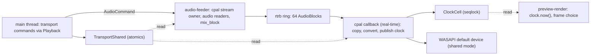

# 09 — Audio and playback clock

> **Audience:** `backend` (engine) and anyone who touches sound, the transport or A/V sync. How
> audio reaches the device, which thread may do what, and how the picture follows the sound. The
> render-thread side of playback (frame choice, preroll, scheduler) is in
> [07](07-preview-and-render.md) §4; the spec is `docs/design/playback.md`.

---

## 1. What exists

Pressing Space plays the timeline with sound (task 0330). The **audio device is the master clock**:
the real-time callback publishes which timeline time reaches the DAC and when, and the render thread
picks the frame for that time. Without an output device the same path runs on wall-clock pacing.

| Piece | Where | State |
|---|---|---|
| Transport atomics | `crates/engine/src/transport.rs` (`TransportShared`) | implemented |
| Transport state machine, `Playback`, audio seam | `crates/engine/src/playback/` ([07](07-preview-and-render.md)) | implemented |
| Clock samples, seqlock, `ClockSource` | `crates/engine/src/playback/clock.rs` | implemented |
| Feeder thread, `AudioEngine` handle, stream lifecycle | `crates/engine/src/audio/feeder.rs` | implemented |
| Ring and `AudioBlock` | `crates/engine/src/audio/ring.rs` | implemented |
| Real-time callback | `crates/engine/src/audio/callback.rs` (`OutputCallback`) | implemented |
| Mixer (shared with export) | `crates/engine/src/audio/mix.rs` (`mix_block`) | implemented |
| Audio readers, `AudioSources` | `crates/engine/src/audio/reader.rs` | implemented |
| Audio pace per voice: `AudioPace`, `TimeStage` (speed, pitch, reverse) | `crates/engine/src/audio/stretch.rs`, `reader.rs` (`PacedVoice`) | implemented (0370) |

## 2. Threads and data flow

| Thread | May | Must not |
|---|---|---|
| `audio-feeder` (above-normal priority on Windows) | allocate, lock, do I/O, decode, mix; create and drop the `cpal` stream (it is not `Send`) | block the main thread |
| cpal callback (WASAPI) | pop blocks, copy, convert channels and sample format, write atomics, read `Instant` | allocate, lock, do I/O or log (CLAUDE.md rule 4) — a counting-allocator test enforces it |
| `preview-render` | read the clock (`ClockSource::now`), set `started` when preroll is done | wait for audio |

## 3. Blocks, ring and callback

- `AudioBlock` is `Copy` and fixed size: 256 stereo `f32` frames plus `seek_gen`, epoch, session,
  timeline `time`, frame count and flags (grain, end). The `rtrb` ring holds `RING_BLOCKS = 64`
  (about 340 ms at 48 kHz); the feeder keeps `TARGET_FILL_BLOCKS = 16` (about 85 ms) queued.
- `OutputCallback::process` writes silence until `started` (except scrub grains), drops blocks of
  an older seek generation or session, converts stereo to the device's channels (mono: average; more
  than two: L, R, zeros) and sample format (`f32`, `i16`, `i32`, `u16`), counts underruns, and
  publishes one `ClockSample` per buffer for its first real frame. Grains never publish the clock.
- Block times come from the block index in integer flicks (14,700 per sample at 48 kHz, 16,000 at
  44.1 kHz; `i128` rounding for other rates), so long playback cannot drift.

## 4. The clock

- `ClockCell` is a seqlock: the callback never waits, the render thread retries a torn read.
- `ClockSource::now()` returns `ClockReading { time, seek_gen, epoch, rate, ended }`: the sample's
  time plus `(now − at_dac) × rate` in integer flicks, clamped to the last real sample, so an underrun
  freezes the picture instead of letting it run ahead of silence. `None` until the first sample of a
  run is audible (preroll).
- `(seek_gen, epoch)` names one continuous run; the epoch changes at every play start, rate change
  and loop wrap and never repeats. An internal session counter separates play after pause from
  stale blocks, so play does not need a new seek generation.
- **No device:** the feeder drives the same callback into a scratch buffer at wall-clock pace (30 ms
  ahead), so loop, end, preroll and underrun behave identically and the render thread keeps one
  clock for the engine's life.

## 5. Stream lifecycle and failures

| Event | Behaviour |
|---|---|
| Feeder start | looks up the default device once (the first lookup costs about 250 ms), opens nothing |
| Play or scrub | opens the default device in shared mode (its mix format and buffer size) if closed |
| 10 s after the last pause or scrub | the stream closes; a new default device is used next time |
| Device removed or invalidated | error flag → `AudioEvent::DeviceLost` → the transport pauses and ticks; next play reopens |
| No output device | null output on wall-clock pacing, one warning |
| Underrun | silence for the gap, clock frozen, `underruns` counted (present-rate log) |
| Offline media or decode error in a voice | that voice is silent, logged once per media |

## 6. Mixer and readers

- `mix_block(project, start, frames, sample_rate, sources, out)` mixes every clip with `audio`
  props on an unmuted track (main-track video clips with audio included; hidden tracks still sound;
  voices faster than 4x, `MAX_SOUNDING_SPEED`, are skipped and not even read):
  gain `volume.at(local) × linear fade`, evaluated at block start and end and ramped per sample,
  sample-accurate clip boundaries, sum then clamp to −1..=1. Playback calls it at the device rate,
  export (0390) at the project rate with `MIX_CHUNK_FRAMES = 1024`.
- `AudioReader` decodes one audio stream with its own `AVFormatContext`, resamples to stereo `f32`
  with `swresample` (mono plays on both channels at full level), seeks sample-accurately (decoding
  from 200 ms before the target, honouring `origin`). `AudioSources` reuses a reader across split
  points and pre-seeks a second one for jump cuts; at most 16 readers, idle ones close after 5 s.
  Both work on any thread.
- Each chunk asks the provider for `n` frames from `clip.source_time(t)` of its first frame at the
  voice's `AudioPace` (section 7). Scrub grains use `mix_scrub`: every voice at 1x forward from its
  source time, no stage.
- Shuttle rates other than 1x produce silent blocks with advancing (or decreasing) time, so the
  clock still runs. Scrub seeks play an 80 ms grain with 5 ms fades, at most one per 40 ms.

## 7. Audio pace and the time stage (0370)

`Voice.pace: AudioPace { speed, reverse, preserve_pitch }` comes from the clip
(`AudioPace::of`; `preserve_pitch` is normalized to true at 1x). Everything below runs on the
feeder or export thread; the callback is unchanged.

| Pace | Path |
|---|---|
| 1x forward | the shared reader pool (section 6), no stage |
| any other | a `PacedVoice` keyed by clip id in `AudioSources`: its own reader (taken from the pool, returned when the clip plays at 1x again), a `TimeStage` if the speed is not 1x, reverse windows if reversed |
| faster than 4x | silent, not read |

- **`TimeStage`** is a `libavfilter` graph `abuffer -> chain -> aformat -> abuffersink`, stereo
  `f32` at the mix rate. Pitch preserved: `atempo` chained so each factor is within 0.5..=2
  (`n = ceil(|log2 s|)`, two instances at 4x, four at 0.1x). Not preserved:
  `asetrate = rate x percent / 100, aresample = rate` (exact for rates divisible by 100). Source
  PCM is pushed in 512-frame chunks as the output FIFO needs it.
- **Alignment.** `atempo` output is early: output frame `y` carries source frame
  `(y + lead) x speed`, lead 7 to 27 ms for one instance (more for chains: about 175 ms at 0.1x).
  `stage_lead` measures it once per (speed, rate) per process on synthetic bursts (7 to 15 ms of
  CPU, cached). After a reset at source time `x` the voice feeds from
  `preroll = (drop + lead) x speed` source frames before `x` and the stage drops `drop` output
  frames (one 2048-frame window at 48 kHz for `atempo`, hiding its fade-in; 64 for the resampler,
  whose lead is 0). Result: content lands at `start + (x - source_in) / speed` within about
  +-4.5 ms for `atempo` (WSOLA places each 21 ms fragment by correlation; measured worst 4.4 ms at
  4x, 3.7 ms at 2x, 1.2 ms at 0.5x) and within 0.05 ms for the resampler and 1x reverse. No drift:
  10 minutes at 1.5x end within 5.6 ms.
- **Reverse.** Windows of 1 s are decoded forward (one seek each, with the reader's 200 ms
  preroll), reversed in place and handed out downwards; the first frame plays the sample that
  contains `source_time`. Sample-exact across window boundaries at 1x.
- **Continuity.** A read continues the voice when it asks within 2 ms of where the previous read
  ended; a seek, jump, pace change or a drifted stage (backlog outside its bounds by more than
  10 ms) re-anchors it: stage reset (graph rebuilt) and reader seek. At a split point the next
  clip takes over the previous clip's voice when it starts within one sample of its end, so it
  plays without a seek or a new graph. `prefetch` builds, positions and primes the voices of
  paced jump cuts within the lookahead.
- **Cost** (dev build, this laptop, one voice, 48 kHz): `atempo` 0.14 to 0.3 % of one core at 0.5x
  to 2x, 0.5 to 0.9 % at 4x (two instances); resampling under 0.2 %. Budget: 2 % per voice.
- **Export** builds its own `AudioSources` and calls the same `mix_block`; 48 kHz in blocks of
  1024 and 96 kHz in blocks of 256 put the content at the same time (within one 48 kHz sample
  for resampling and reverse, 1.3 ms for `atempo`, whose window scales with the rate).
- **Upgrade path:** `signalsmith-stretch` (MIT) can replace the graph inside `TimeStage`.

## Links

- [playback design](../design/playback.md), [export design](../design/export.md) (mixer reuse)
- [ADR-0004 — Threading and model ownership](../adr/0004-threading-and-model-ownership.md)
- [07 — Preview and render](07-preview-and-render.md): transport, frame choice, scheduler, ticks
- [05 — IPC contract](05-ipc-contract.md): transport commands and `playback-tick`
