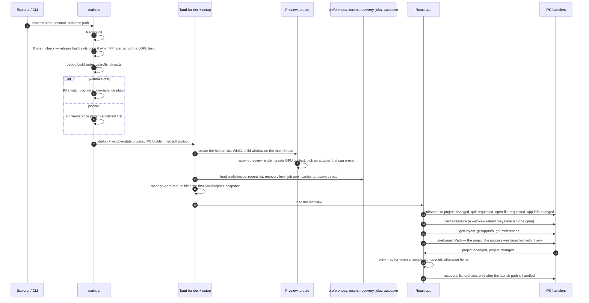
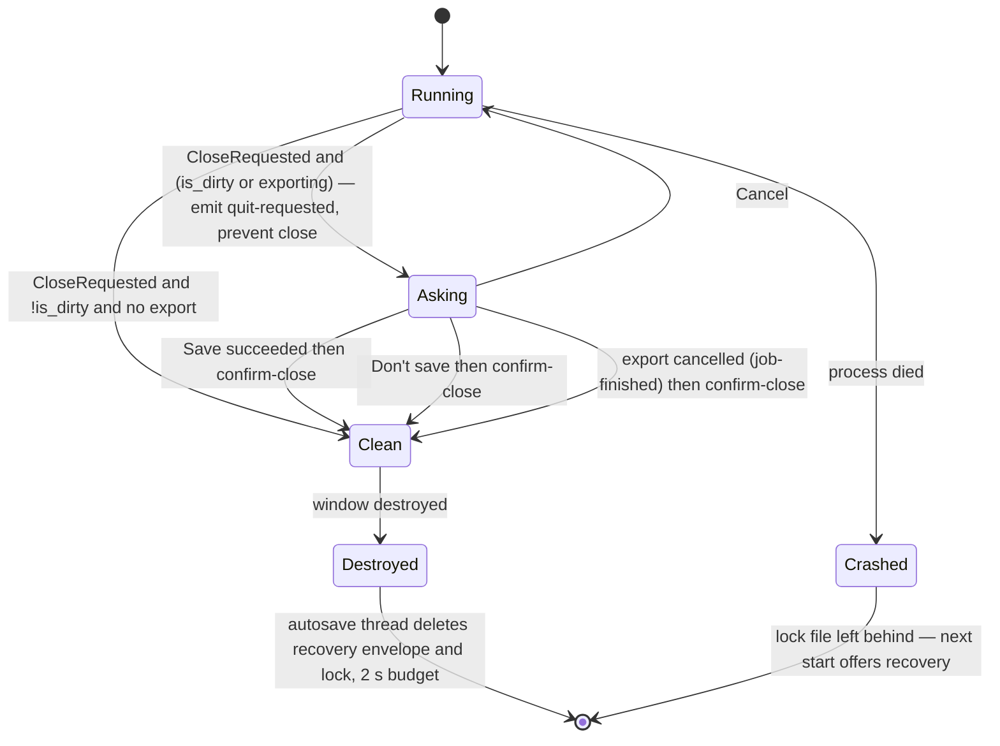

# Diagram 010 — Start-up and shutdown

> **Audience:** `backend`, `devops`. One picture of everything that happens between the process
> starting and the first editable frame, and of the two ways the process can end.

---

## 1. Start-up

The order is fixed by `src-tauri/src/lib.rs`. The preview child window exists before the webview
loads, and the UI never fetches state before it has subscribed to events.

Two failure paths:

- **No GPU adapter.** `Preview::create` returns `None` instead of failing the start; `previewMode`
  is `unavailable` and the app runs with a placeholder in the preview slot.
- **FFmpeg is not LGPL.** Only a release build refuses to start, with exit code 6, before any window
  is created. A debug build logs and continues.

## 2. Shutdown

The window close is the only entry point. A clean project never asks the UI anything, so a hung
webview cannot block exit.

- `confirm-close` is the only way out of `Asking`; the UI calls it for Save and for Don't save.
- A second launch does not reach this path: the single-instance plugin forwards the arguments,
  focuses the main window and emits `open-file-requested`, which the UI handles like File → Open
  behind the same unsaved-changes prompt.
- `--smoke-test` never reaches `Asking`: it exits with an outcome code from the watchdog or from
  `smoke_test::run`.

## 3. Threads that exist during both

| Thread | Started | Stopped |
|---|---|---|
| main / Tauri event loop | process start | process exit |
| `preview-render` | `Preview::create` in `setup` | `Shutdown` message, joined when the handle drops |
| `media://` handlers (2) | protocol registration | process exit |
| job pool workers | `JobManager` creation | process exit, in-flight jobs are abandoned |
| autosave | `Autosaver` creation | window destroyed; the join has a 2 s budget |
| progress ticker | job pool creation | process exit |

A shutdown never waits on decoding or on `media://`: those threads die with the process.

## Links

- [ADR-0004 — Threading and model ownership](../../adr/0004-threading-and-model-ownership.md)
- [01 — System context](../01-system-context.md)
- [04 — Persistence and lifecycle](../04-persistence-and-lifecycle.md): recovery envelope, lock file
- [07 — Preview and render](../07-preview-and-render.md): `Preview::create`, smoke test
