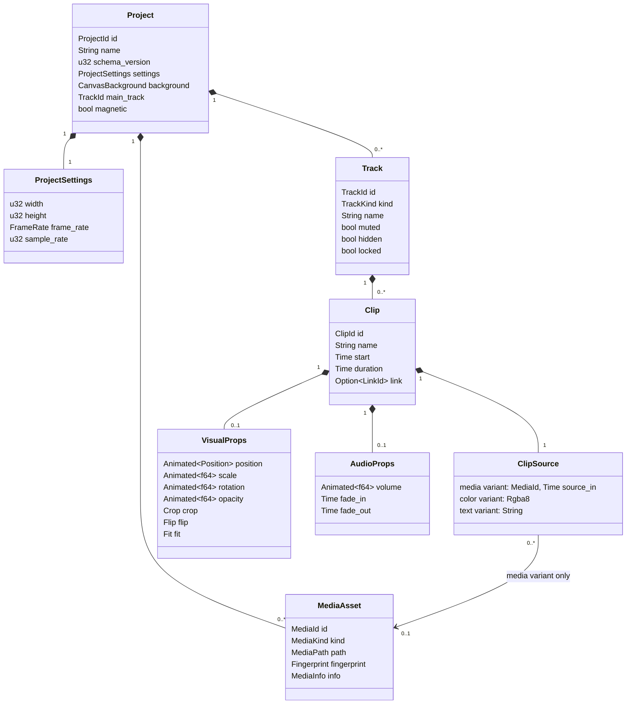
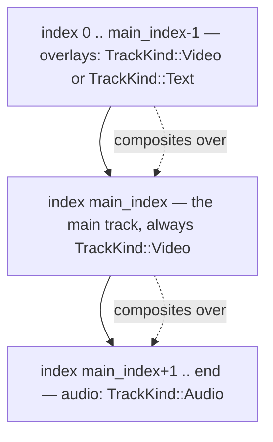

# Diagram 020 — Timeline model

> **Audience:** `backend`, `frontend`. The shape of the document: which object owns what, how tracks
> are ordered, and which invariants every edit must leave intact.

---

## 1. The aggregate

`crates/app-core/src/model.rs`. Ids are UUID v7 newtypes; `Project`, `Track` and `Clip` share one id
space, `MediaId` has its own.

`visual` is present **exactly** on clips of video and text tracks. `audio` is present on every
audio-track clip and on a video-track media clip whose media has audio that was not detached. A
colour or text clip never has `audio`.

## 2. Track order

The order of `Project.tracks` is the compositing order and the rule for where a new track may go.
`timeline::section_index` clamps a requested insertion index into the section that fits the kind, so
`AddTrack` cannot break the layout.

The main track is permanent: it cannot be removed, moved or turned into another kind, and while
`magnetic` is on it has no gaps — clips start at 0 and stay contiguous ([03](../03-edit-model.md) §6).

## 3. What one clip owns

| Field group | Consequence for every edit |
|---|---|
| `start`, `duration` | clips in a track are sorted by `start` and never overlap; `duration > 0` and `start >= 0` |
| `source` + `source_in` | `Clip::source_time(t) = source_in + (t - start)` is the only timeline→source mapping; `source_end()` is how much source a trim may use |
| `link` | all members of a link group move, trim, split and delete together; a group that falls to one member is normalised away |
| `visual`, `audio` | must match the track kind; their `check(duration)` ranges run on every command result |
| `name` | display only: file name, `Colour`, or the text of a title |

## 4. Invariants and where they are enforced

`Project::validate` (`crates/app-core/src/validate.rs`) returns the **first** violation and never
repairs. It runs on every load, every media import and every command result.

| Invariant | Enforced by | On violation |
|---|---|---|
| ids unique across projects, tracks and clips | `validate`, `ValidationError::DuplicateId` | the command fails, the previous state stays |
| clips sorted by `start`, no overlap, `duration > 0` | `timeline` helpers + `validate` (`ClipsOutOfOrder`, `ClipsOverlap`, `ClipNotPositive`) | command fails with `InvalidResult` |
| every time value inside ±`MAX_IPC_FLICKS` (2^53) | `Time` constructors + `validate` (`TimeOutOfRange`) | command fails |
| clip fits its track kind and its media exists and has the right streams | `validate` (`ClipTrackMismatch`, `ClipMediaMissing`, `ClipMediaKind`) | command fails |
| canvas even and `16..=8192`, frame rate `1..=240`, valid sample rate | `validate` (`CanvasSize`, `FrameRateRange`, `SampleRate`) | settings command fails |
| properties inside their ranges (`opacity 0..=1`, `volume <= 4`, crop insets, fades) | `props::check` via `validate` (`BadProperty`) | command fails |
| media fully probed: kind matches its streams, hash valid, duration present exactly when it should be | `validate` (`MediaProblem`) | import or load fails |
| keyframes sorted, unique in `time`, inside `0..=duration` | `retime_keyframes` on trim + `validate` | command fails |
| the main track exists and is a video track | `validate` + `Document` (it cannot be removed) | command fails |

A failed validation is never a partial edit: commands apply to a clone and the clone replaces the
document only after it validates ([03](../03-edit-model.md) §2).

## 5. Where the model stops

- `Project` has no derived values: no project duration, no "used by" counts, no filmstrip layout.
  Those are computed into `ProjectView` / `ClipView` / `MediaView` for the UI
  ([05](../05-ipc-contract.md) §7).
- No pixels, no decoded frames, no thumbnails in the model. Pixels travel over `media://`
  ([06](../06-media-pipeline.md)).
- No selection, no playhead, no zoom: those are UI state and are not saved.

## Links

- [ADR-0002 — Project file format](../../adr/0002-project-file-format.md)
- [02 — Domain model](../02-domain-model.md)
- [03 — Edit model](../03-edit-model.md)
- [timeline-editing design](../../design/timeline-editing.md)
