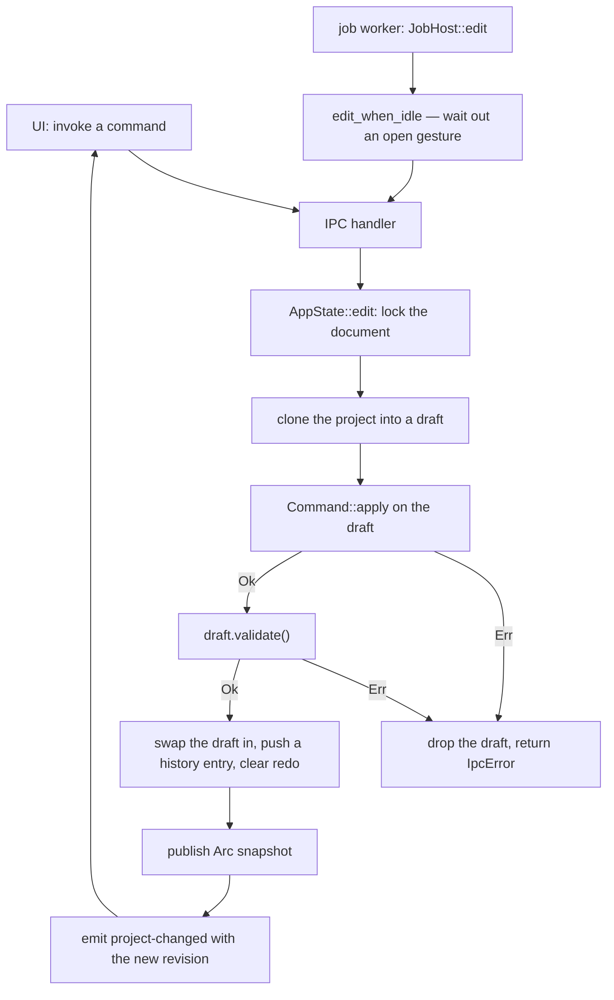
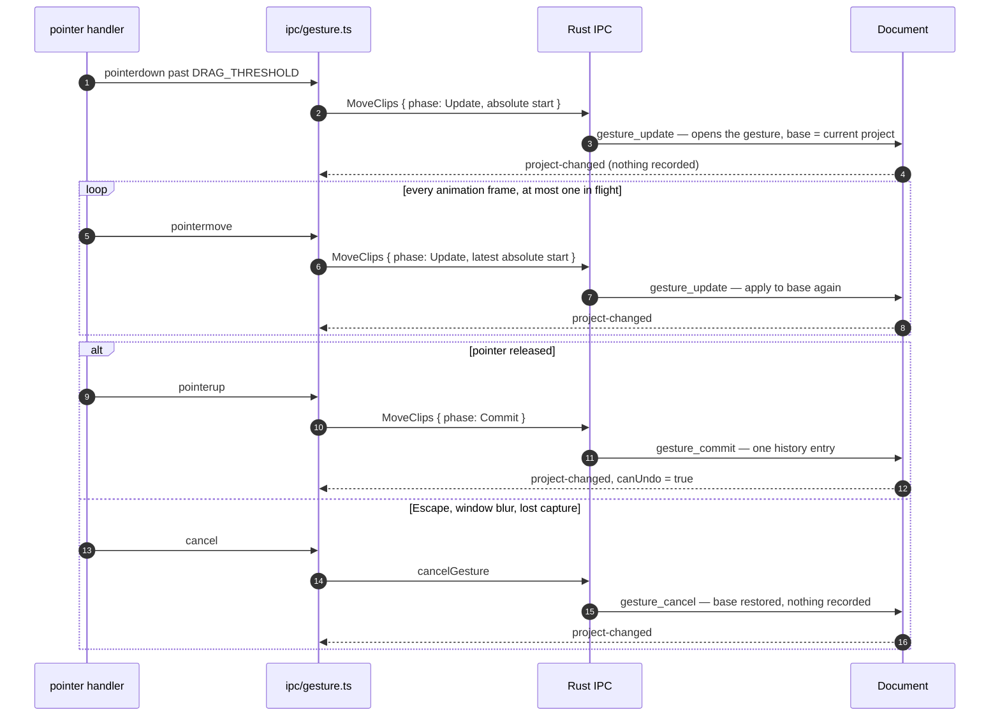
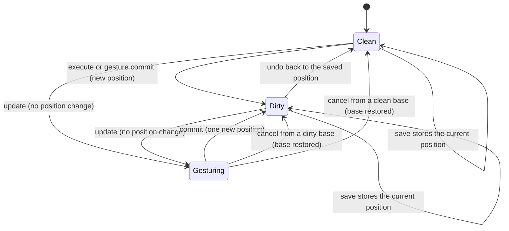

# Diagram 030 — Command and gesture

> **Audience:** `backend`, `frontend`. One picture of the only path that changes a project, and of
> how a continuous drag becomes exactly one history entry.

---

## 1. One path into the document

Every change — a menu item, a keyboard shortcut, a finished import job — enters through the same
`Document` call under the same short lock. A command works on a draft and is recorded only when it
validates.

`reject` leaves the visible project untouched, so a failing command can never leave a half edit.
`publish` also replaces the snapshot the engine, jobs and `media://` read
([01](../01-system-context.md) §4).

## 2. A drag is one history entry

`EditPhase` is carried by the same command type: `update` for every intermediate state, `commit`
once, `cancel` to restore. Every update restarts from the gesture's **base**, so the values are
absolute, never deltas.

Rules the diagram does not show but the code enforces:

- `Document::execute` fails with `GestureInProgress` while a gesture is open, so a keyboard command
  cannot land inside a drag.
- `undo` and `redo` during a gesture cancel it instead of running.
- `Document::committed()` returns the base, so save and autosave never write a half drag.
- `update` and `commit` must be the same command kind (`GestureMismatch`); a new kind cancels the
  old gesture first.
- A failed `commit` leaves the Rust gesture open at its last valid state, so the UI cancels it.

## 3. History and the dirty flag

`Document` keeps two stacks of at most `DEFAULT_HISTORY_LIMIT = 500` entries. `HistoryPosition` is
the id of the newest applied entry, which is all "unsaved changes" needs.

A project is dirty when the position differs from the saved one **or** a gesture is open. Because a
position is an id, two documents that show the same position are the same committed state; nothing
compares projects.

## 4. Batching

`Batch` applies its children in order and reverts them in reverse. If a child fails, the children
already applied are reverted and the batch returns that error, so the batch is atomic and counts as
one history entry. The shell uses it for compound user intents such as removing media together with
the clips that use it.

## Links

- [ADR-0006 — Edit transactions](../../adr/0006-edit-transactions.md)
- [ADR-0003 — IPC conventions](../../adr/0003-ipc-conventions.md)
- [03 — Edit model](../03-edit-model.md)
- [05 — IPC contract](../05-ipc-contract.md)
- [timeline-editing design](../../design/timeline-editing.md)
