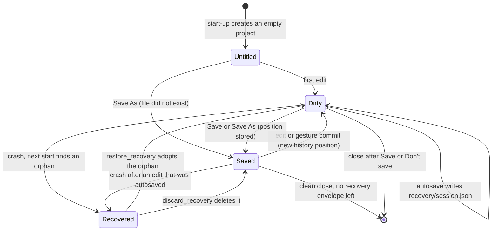
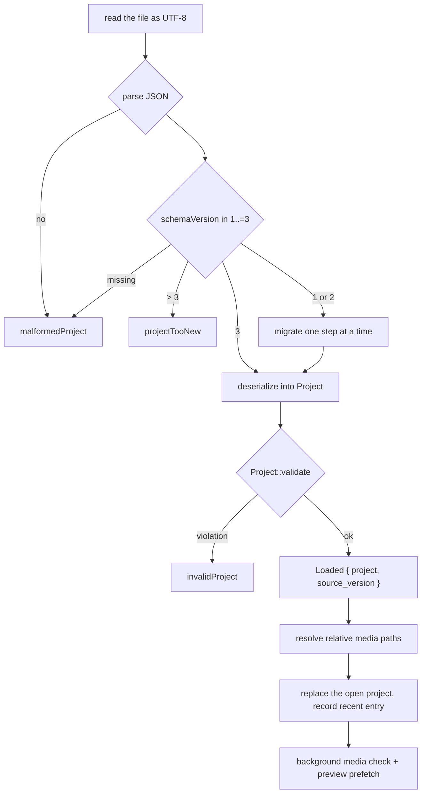
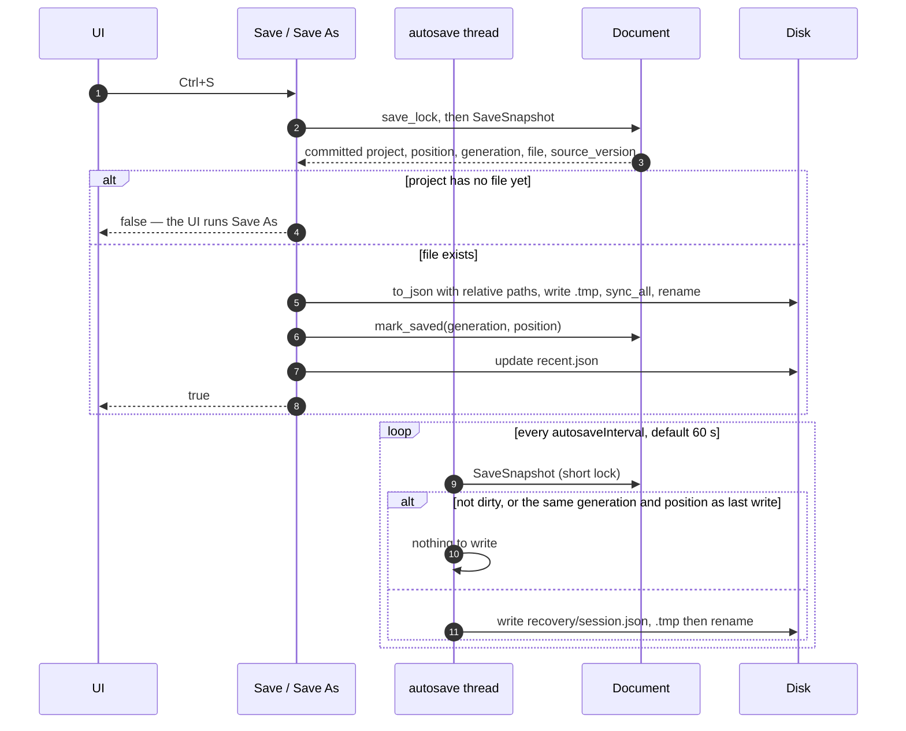
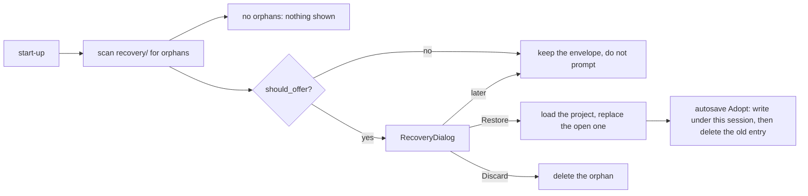

# Diagram 040 — Project lifecycle

> **Audience:** `backend`, `frontend`. How one document moves between never-saved, saved, dirty,
> autosaved and recovered, and what the file on disk looks like at each step.

---

## 1. One document, four durable states

The Rust model always holds exactly one project — the home screen shows an empty untitled one. What
changes is where the current committed state exists on disk.

- "Dirty" is `HistoryPosition != saved position` **or** a gesture is open. Undoing back to the saved
  position makes the project clean without writing anything ([03](030-command-and-gesture.md) §3).
- A clean close deletes this session's recovery envelope and lock. A crash skips that, which is what
  makes the prompt appear on the next start.

## 2. Open: parse, migrate, validate

`serialization::load` reads `schemaVersion` first. A file this build cannot understand is refused,
never repaired.

`source_version` is what the file *was*; the first save over an older file writes
`<name>.cutframe.v<n>.bak` before touching it. A newer **recent list** is not an error — the app
starts with an empty list and backs the file up on the next write.

## 3. Save and autosave

Both take a `SaveSnapshot` under a short document lock and write outside it. They differ in what
they do with the result and in how the file is replaced.

- `SaveSnapshot.project` is `Document::committed()`: an open gesture's **base**, never the live drag,
  so neither a save nor an autosave can persist a half-finished move.
- A save that finishes after New or Open belongs to another generation and marks nothing
  (`mark_saved` compares generations).
- Autosave retries after a failed write because a failed write records no key. A stuck disk delays
  shutdown by at most `SHUTDOWN_TIMEOUT = 2 s`.
- `SetInterval(None)` and `Discard` disable autosave and delete this session's envelope.

## 4. Recovery

An envelope is an **orphan** when its `.lock` can be opened (the previous session is gone) and it
parses. `should_offer` shows it when the project was never saved, its file is missing, or the
autosave is newer than the project file's mtime.

Recovery is offered after the launch path is handled and over whichever view ends up visible, so a
project opened from Explorer never competes with the prompt for the editor. A file written by a newer
app is kept rather than discarded; only a corrupt envelope is removed.

## 5. The two backup rules

| Situation | Written | Never happens |
|---|---|---|
| first save over a file loaded from schema `n < 3` | `<name>.cutframe.v<n>.bak`, once | the backup is not overwritten by a later save |
| save over the same schema | only the project file | no `.bak` churn |
| preferences or recent list from an older version | a backup on the next write | the old file is not deleted first |
| any failed write | the old file, then the temporary file is removed | no mixed or truncated file |

## Links

- [ADR-0002 — Project file format](../../adr/0002-project-file-format.md)
- [04 — Persistence and lifecycle](../04-persistence-and-lifecycle.md)
- [project-lifecycle design](../../design/project-lifecycle.md),
  [autosave-recovery design](../../design/autosave-recovery.md)
- [diagrams/010 — Start-up and shutdown](010-startup-and-shutdown.md)
