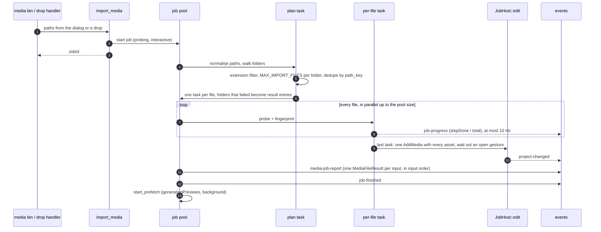
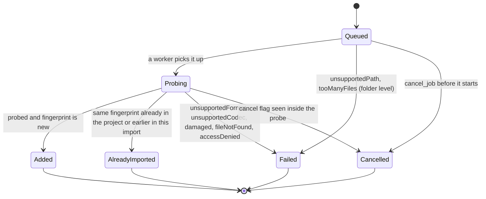

# Diagram 050 — Media import

> **Audience:** `backend`, `frontend`. The job that turns dropped paths into `MediaAsset`s, what the
> UI sees while it runs, and which outcomes one file can have.

---

## 1. The job

`import_media` returns a `JobId` immediately; the work happens on the shared pool as one
`Priority::Interactive` job. Nothing about the project changes until the whole import is probed.

Facts the diagram compresses:

- The extension filter accepts the `MEDIA_EXTENSIONS` list, but a file named **explicitly** is tried
  whatever its extension.
- More than `MAX_IMPORT_FILES = 2000` media files in one folder fails that folder with
  `tooManyFiles`; other inputs still import.
- Symlinked folders are not followed. Duplicate paths are dropped case-insensitively, keeping input
  order.
- Duplicates by content are resolved at the end: a file whose fingerprint is already in the project,
  or earlier in the same import, is `alreadyImported` and added once.
- `cancel_job` sets a flag checked between files and inside a slow probe. A cancelled import reports
  `cancelled` and emits **no** `media-job-report`.

## 2. One file's outcome

Every input ends as exactly one `MediaFileOutcome` in the report, so the media bin can say what
happened to each path.

`Added` and `AlreadyImported` carry the `MediaId`; `Failed` carries a `MediaErrorKind`, which is a
stable key the UI translates (`MediaErrorKind` has seven variants today). A folder-level failure is
reported once, for the folder path.

## 3. What the UI keeps while it runs

The UI does not track the model during an import — the project changes once, at the end.

| UI state | Source | Lifetime |
|---|---|---|
| running jobs with stage and progress | `job-progress` | until `job-finished` |
| per-file results | `media-job-report` | kept for the summary of the last import |
| summary toast | the report, aggregated by kind | until read, or 4 s when every file was added |
| background preview indicator | jobs with `isBackgroundJob` | no Cancel button |

A job started by Rust itself (prefetch, media check) appears in the same list but is never shown as
an import and never summarised; a relink job is tracked for progress only
([08](../08-ui-architecture.md) §8).

## 4. Failure paths that matter

| Failure | Effect |
|---|---|
| a whole folder is unreadable | one `failed` entry for the folder, other inputs continue |
| the probe panics or FFmpeg blocks on a cloud-only file | the cancel flag is checked inside the probe; a stuck file delays that job, not the app |
| the last task finds nothing to add | no `AddMedia` command, no `project-changed`, report still emitted |
| a gesture is open when the import finishes | the edit waits (`edit_when_idle`, 50 ms retries) instead of landing inside the drag |
| the project changed while the import ran | the command adds to the project as it is now; ids come from the project, not from the job |

## Links

- [media-import design](../../design/media-import.md)
- [06 — Media pipeline](../06-media-pipeline.md)
- [03 — Edit model](../03-edit-model.md): `AddMedia`, `JobHost::edit`
- [05 — IPC contract](../05-ipc-contract.md): job events and `MediaErrorKind`
- [diagrams/060 — media:// request](060-media-protocol.md)
