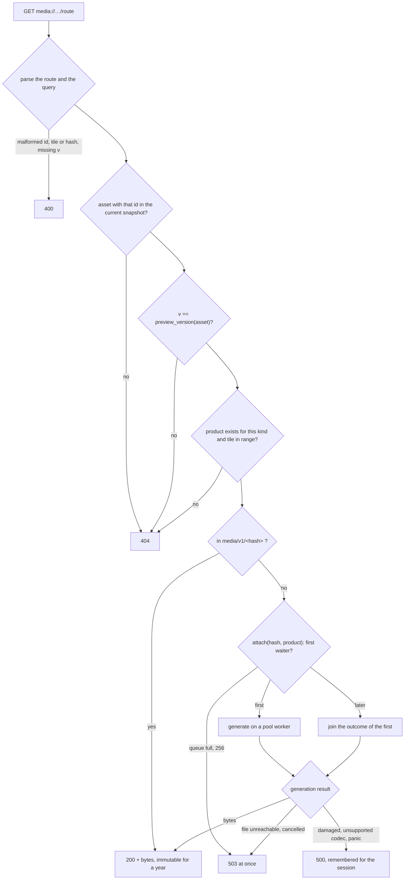
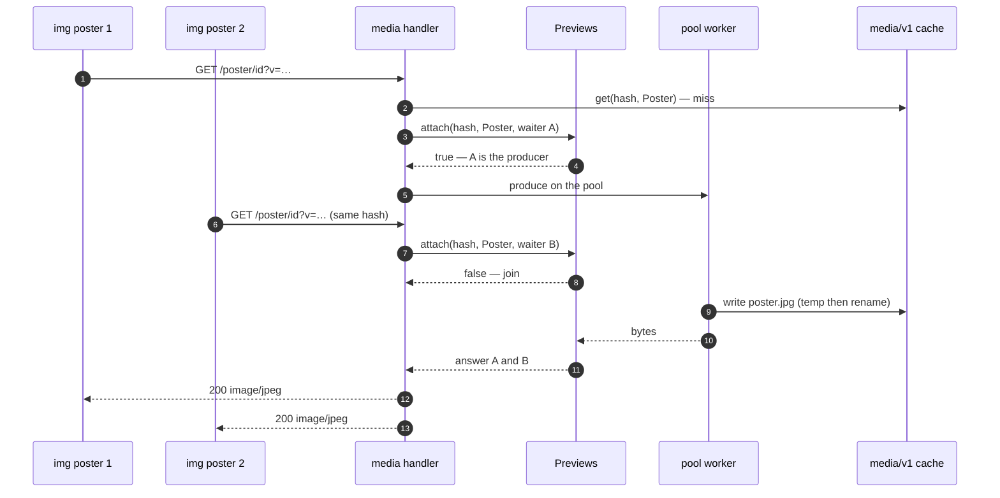

# Diagram 060 — `media://` request

> **Audience:** `backend`, `frontend`. How one `media://` URL becomes bytes, which status code each
> failure produces, and why two `` tags for the same poster generate it only once.

---

## 1. Routing

All routes are `GET` and addressed by **id**, never by path. Two handler threads parse requests and
serve cache hits; a miss is handed to the pool, so a handler never waits for a generation.

| Route | Body | Available for |
|---|---|---|
| `/poster/<id>?v=` | `image/jpeg` | video, image |
| `/filmstrip/<id>?tile=<n>&v=` | `image/jpeg` | video |
| `/waveform/<id>?v=` | `application/octet-stream`, `CFWF` | audio, video with audio |
| `/cover/<hash>` | `image/jpeg` | recent-project covers, no id and no `v` |
| `/preview/frame?w=&h=` | `application/octet-stream`, 8-byte header + RGBA8 | the legacy `frames` preview mode |

`/cover/<hash>` is the one route keyed by a hash rather than an id: the home screen has no project
open and the hash is the only identity it has ([04](../04-persistence-and-lifecycle.md) §7).

## 2. A miss, shared between waiters

`Previews::attach(key, waiter)` returns `true` for exactly one caller per `(hash, product)`. That
caller produces; everyone else receives the same outcome. This is what makes a grid of posters
generate each poster once even though every tile requests it at mount.

A generation failure is shared the same way: `damaged`, `unsupportedCodec` and a panicking generator
are remembered for the session and answered `500` without a retry, so a broken file cannot make the
UI loop. `fileNotFound`, `accessDenied` and a cancelled generation are `503` and are retried on the
next request. A generator that finds the file gone also marks the asset `offline` for the session.

## 3. Why `v` is in the URL

`preview_version` is the first 16 hex of the content hash plus `-` plus 8 hex of an FNV-1a hash of
the normalised path. Content alone would be wrong: after a relink to the same content at a new path
the UI must fetch again, because its earlier requests may have failed while the file was offline.

The cache stays keyed by content only, so a relink to the same bytes reuses every product. The `v`
check is a pure gate in front of that cache: a stale `v` is `404` and the UI re-requests with the new
version from the next `project-changed`.

## 4. Bounds

| Bound | Value | Why |
|---|---|---|
| handler threads | `HANDLER_THREADS = 2` | cache hits are cheap; a miss must not occupy a thread |
| pending request queue | `QUEUE_CAPACITY = 256` | beyond it the answer is an immediate `503`, not a stall |
| poster long side | `POSTER_LONG_SIDE = 320` | a grid tile never needs more |
| filmstrip frame | `FILMSTRIP_FRAME_HEIGHT = 96`, width 54..=171 | fixed height, width follows the source aspect |
| filmstrip frames | at most `FILMSTRIP_MAX_FRAMES = 1200` | bounds the number of tiles for a long file |
| waveform buckets | `WAVEFORM_BUCKETS_PER_SECOND = 100` | dense enough to look smooth, small enough to parse in the UI |
| preview frame | `MAX_FRAME_SIZE = 1920 × 1080` | legacy `frames` mode only |

## Links

- [06 — Media pipeline](../06-media-pipeline.md)
- [ADR-0003 — IPC conventions](../../adr/0003-ipc-conventions.md) §9: binary data outside JSON
- [media-import design](../../design/media-import.md)
- [diagrams/050 — Media import](050-media-import.md)
