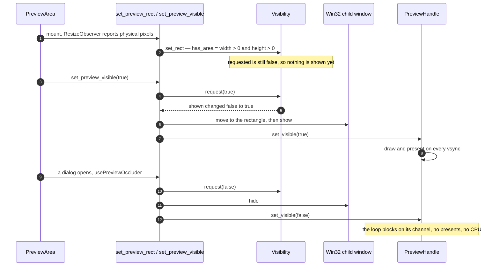

# Diagram 070 — Preview presentation

> **Audience:** `backend`, `frontend`. When the native preview is on screen, what the UI sends to
> make that true, and what happens to it when the GPU device is lost.

---

## 1. Showing and hiding the native window

Two independent inputs decide it: the UI's request and a non-empty rectangle. The preview is on
screen only when both allow it, and a rectangle update never overrides a hide request.



- `Visibility::INITIAL` is `{ requested: false, has_area: false }`, so a start screen drawn in the DOM
  is never covered by a leftover native window (ADR-0005 §4).
- The window is moved **before** it is shown, so it never flashes at the old position.
- Dispatch happens only on the shown/hidden transition, so a resize that keeps the preview visible
  costs one `set_rect`, not a show.
- `PreviewArea` is the only caller of `set_preview_visible`. Everything that can overlap the preview
  registers a preview occluder instead of hiding it directly
  ([08](../08-ui-architecture.md) §8).
- An empty rectangle hides the preview even while the UI requests it, which is what a collapsed
  preview panel produces.

## 2. Which mode is in use

`preview_mode(available)` is computed once at start-up and recomputed only when the engine reports a
GPU change. It is not a user setting.

```mermaid
stateDiagram-v2
  [*] --> Native: Windows, GPU context created
  [*] --> Frames: other platforms, GPU context created
  [*] --> Unavailable: no adapter, or Preview::create failed
  Native --> Unavailable: three device losses
  Frames --> Unavailable: three device losses
  Unavailable --> Native: AppInfoChanged with available = true
  Unavailable --> Frames: AppInfoChanged with available = true
```

| Mode | Pixels reach the screen through | UI component |
|---|---|---|
| `native` | the engine presenting into the child window | `NativePreviewSlot`, an empty slot that only reports geometry |
| `frames` | `media://…/preview/frame?w=&h=`, drawn on a canvas | `FramePreview` |
| `unavailable` | nothing | a placeholder message |

`frames` exists for the unmaintained Linux development path; Windows, the only shipping platform,
always uses `native` when a GPU is available.

## 3. Device loss

A driver reset (TDR) or a device crash arrives through `set_device_lost_callback`. Our own
`Destroyed` is not a loss. Recovery escalates once per loss and then gives up, so a broken driver
cannot spin the process.

```mermaid
stateDiagram-v2
  [*] --> Running: GpuContext on AdapterMode::Auto
  Running --> Recovering: device lost, generation matches
  Running --> Running: stale DeviceLost from an older generation
  Recovering --> Running: 1st loss — recreate on Auto, fallback = deviceLost
  Recovering --> Running: 2nd loss — recreate on SoftwareOnly (WARP)
  Recovering --> GivenUp: 3rd loss — available = false
  GivenUp --> Running: never without a restart
  Recovering --> Running: surface recreated at the last known size
```

- The surface is dropped before the new context is created, so only one swap chain exists at a time.
- Every successful recovery publishes the new `GpuInfo` and emits `app-info-changed` with
  `available = true`; giving up emits it with `available = false`, which turns the UI's mode into
  `unavailable`.
- The preview thread never panics on a GPU error: uncaptured errors are logged and the frame is
  skipped.

## 4. Present outcomes

While the window is visible the loop presents one frame per iteration and reacts to the surface
result:

| Result | Reaction |
|---|---|
| `Success` | draw, present, count the present |
| `Suboptimal` | draw and present, then reconfigure and reset the statistics window |
| `Timeout` / `Occluded` | sleep 16 ms and reset the window |
| `Outdated` / `Lost` | reconfigure the surface and reset the window |
| `Validation` | log an error, sleep 100 ms and reset the window; the frame is skipped |

Present statistics are logged once per `PRESENT_STATS_WINDOW = 5 s` of continuous drawing. A pause
resets the window, so a hidden or occluded preview never looks like dropped frames.

## Links

- [ADR-0005 — Preview presentation per platform](../../adr/0005-preview-presentation-per-platform.md)
- [07 — Preview and render](../07-preview-and-render.md)
- [08 — UI architecture](../08-ui-architecture.md): `PreviewArea`, occluders
- [diagrams/010 — Start-up and shutdown](010-startup-and-shutdown.md): where the window is created
