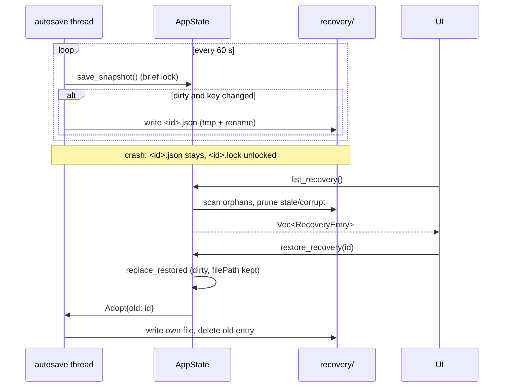

# Design: autosave and crash recovery

- **Status:** Proposed (task 0110). After implementation this file is a record, not a spec.
- **Features:** F0.21 (partial: fixed interval until task 0150), F0.22
- **Builds on:** `docs/design/project-lifecycle.md` (task 0100), ADR-0002 §8, ADR-0003, ADR-0004, ADR-0006

## 1. Goal and non-goals

While the project has unsaved changes, a background thread writes it every 60 s to the app-data
recovery directory, never over the user's file. After a crash, the next start offers to restore
it, losing at most one interval. Out of scope: a configurable interval (task 0150 preferences),
versioned backups or history of autosaves, a single-instance plugin, recovery of the undo history.

## 2. User flow

- Editing: nothing visible (no autosave indicator, YAGNI).
- Startup after a crash: a modal **Recover unsaved work** dialog lists entries, newest first:
  project name, original file path (or "Not saved yet"), autosave time (local format). Each row has
  **Restore** and **Discard**. **Restore** replaces the open (fresh, clean) project through the
  existing `guardUnsaved`, closes the dialog and leaves other entries for the next start.
  **Discard** removes that row; the dialog closes when the list is empty.
- **Later** (button, Escape, ✕): closes the dialog, keeps the files; they are offered on the next
  start. Nothing is deleted without a click.
- After Restore: the title shows `*<name>`, the history is empty (no undo past the restore), and
  Ctrl+S writes to the original file (Save As if it had none). The dialog hides the native preview
  (existing occluder count).

## 3. Model changes (`app-core`)

None. Autosave is not an undo step.

## 4. Recovery store (`src-tauri/src/recovery.rs`, new; plain functions, no Tauri in the core)

**Directory:** `app.path().app_data_dir()?/recovery/`, created at startup (`create_dir_all`).

**Session id:** one `Uuid::now_v7()` per app process, created at startup. One process has one
document, so one file per process: `recovery/<id>.json`, plus a lock file `recovery/<id>.lock`.
New/Open in the same process reuse the id (the file is deleted and later rewritten).

**Envelope** (one file, so content and metadata are replaced together by one rename):

```rust
#[derive(Serialize, Deserialize)] #[serde(rename_all = "camelCase")]
struct RecoveryFile {
    recovery_version: u32,            // 1; a different value → skipped and kept (logged)
    session_id: Uuid,
    saved_at_ms: i64,                 // Unix ms when the snapshot was taken (< 2^53)
    file_path: Option<PathBuf>,       // the session's file_path at that time
    source_version: u32,              // the session's source_version (keeps the .v<N>.bak rule)
    project: Box<serde_json::value::RawValue>, // exactly serialization::to_json(&project)
}
```

Needs the `raw_value` feature of the existing `serde_json` (no new crate). Written with
`project_file::write_project_file(path, &json, None)` (tmp + `sync_all` + rename with retry).
Read with `serde_json::from_str::<RecoveryFile>` then `serialization::load(project.get())`, i.e. the
full open pipeline (migrate, validate).

**Live-instance check:** at startup the process creates `<id>.lock` and holds
`File::try_lock()` (std, exclusive) on it for its lifetime; Windows releases it when the process
dies, also on a crash. An entry is *orphaned* when its lock file is missing or `try_lock` succeeds
(the probe handle is dropped right away). Entries whose lock is held belong to a running instance
and are never listed or touched. The own `session_id` is always excluded.

**Offer rule** (pure function, unit-tested):

```rust
fn should_offer(saved_at_ms: i64, file_path: Option<&Path>, file_mtime_ms: Option<i64>) -> bool
// file_path None → true; file missing (mtime None) → true; else saved_at_ms > file_mtime_ms
```

**Listing** (`list_orphans(dir, own_id) -> Vec<Entry>`), for each orphaned `<id>.json`:
unreadable envelope or `load` error `Json`/`MissingVersion`/`Invalid` → delete file + lock, `warn!`;
`TooNew` or unknown `recovery_version` → skip, keep (a newer app may read it); not offered by the rule
(the user saved the file later) → delete, `info!`. Orphaned lock files without a `.json` → delete.
No error from one entry stops the scan; nothing here panics.

## 5. Autosave thread

One named thread `autosave`, spawned in `setup` after `AppState` is managed. It owns all recovery-file
writes and deletes for its session, so they are serialized without a lock and the main thread does
no I/O (ADR-0004 §3; this is a small dedicated I/O thread, not a job: no `JobId`, no progress).

```rust
pub const AUTOSAVE_INTERVAL: Duration = Duration::from_secs(60); // the only place; 0150 replaces it
enum Msg { Discard, Adopt { old: Uuid }, Shutdown { ack: Sender<()> } }
pub struct AutosaveHandle { tx: Sender<Msg> }                    // crossbeam, in AppState
```

Loop: `rx.recv_timeout(interval)`; on timeout run `tick`; on a message handle it. `tick`:

1. `state.save_snapshot()` (lock held only to clone an `Arc` and a few fields; ADR-0004 §1).
   `SaveSnapshot` gains `pub dirty: bool` and a `pub fn key(&self) -> (u64, HistoryPosition)`
   (generation, position). Not the `ArcSwap` snapshot: that one holds the live gesture value, and
   ADR-0006 §3 says saves write the gesture's base, which `committed()` gives.
2. Skip if `!dirty` or `key == last_written`. During a gesture the key is the base's, so the base
   is written once and not again until the gesture commits.
3. Off-lock: `to_json`, build the envelope (`saved_at_ms` = clock at step 1), write. On success
   `last_written = Some(key)`; on failure `warn!` and retry next tick (never surfaced to the UI).

Messages, sent without blocking by `AppState`:

| Sender | Msg | Thread action |
|---|---|---|
| `mark_saved` (successful explicit save of the current generation) | `Discard` | delete own file, `last_written = None` (still dirty → next tick writes again) |
| `replace_project` (New, Open, after the unsaved prompt) | `Discard` | same |
| `restore_recovery` | `Adopt { old }` | write own file now (tick without the skip rules), then delete `old.json` + `old.lock` |
| main window `WindowEvent::Destroyed` (clean close or `confirm_close`) | `Shutdown` | delete own file and lock, ack, exit |

Shutdown waits for the ack at most 2 s (`recv_timeout`) so a stuck disk cannot hang the exit. A
crash or kill leaves `<id>.json` (if anything was dirty) and an unlocked `<id>.lock`.

**Testability:** the decisions live in `struct Autosaver { last_written, … }` with
`fn tick(&mut self, snap: &SaveSnapshot, now_ms: i64, store: &RecoveryStore) -> io::Result<bool>`
and `fn handle(&mut self, msg, …)`; the thread loop only calls them. Tests drive `tick` directly
(the trigger) and pass `now_ms` (the clock); `RecoveryStore` wraps a directory path (tempdir).

**Restored sessions are dirty:** `Session.saved_at` becomes `Option<HistoryPosition>`;
`dirty = saved_at != Some(position) || has_gesture`. `replace_restored(project, file_path,
source_version)` = `replace` with `saved_at = None`, so no undo/redo can make it look clean;
the first explicit save sets `Some(position)` as today.

## 6. IPC changes

```rust
#[derive(Serialize, Deserialize, specta::Type)] #[serde(rename_all = "camelCase")]
pub struct RecoveryEntry {           // view type (types.rs)
    pub id: Uuid,                    // session id of the crashed instance
    pub project_name: String,        // model data, not translated
    pub file_path: Option<String>,   // original file; None = never saved
    pub saved_at_ms: i64,            // Unix ms; the UI formats it
}

/// Orphaned recovery entries that are newer than their project file, newest first. Prunes
/// corrupt and stale entries as a side effect. A missing directory gives an empty list.
#[tauri::command] #[specta::specta]
pub async fn list_recovery(state: State<'_, AppState>) -> Result<Vec<RecoveryEntry>, IpcError>;
/// Loads entry `id` as the open project: history empty, dirty, filePath = original path.
/// Emits project-changed. Ask about unsaved changes first.
#[tauri::command] #[specta::specta]
pub async fn restore_recovery(app: AppHandle, state: State<'_, AppState>, id: Uuid) -> Result<(), IpcError>;
/// Deletes entry `id`. Unknown or already deleted ids are Ok; a live instance's entry is never touched.
#[tauri::command] #[specta::specta]
pub async fn discard_recovery(state: State<'_, AppState>, id: Uuid) -> Result<(), IpcError>;
```

All file work runs in `spawn_blocking`. Errors reuse existing kinds: `fileNotFound` (no orphaned
entry with that id: gone, own session or live), `malformedProject` / `invalidProject` /
`projectTooNew` (via the existing `From<ReadError>`), `io` (directory unreadable, delete failed).
No new kinds, no new events. `AppState` gains `recovery: RecoveryStore` (dir + own id) and
`autosave: OnceLock<AutosaveHandle>` (set in `setup`; tests run without it).

## 7. Engine impact

None; the preview gets restored settings through the existing `publish`.

## 8. UI impact

- `ui/src/features/project/RecoveryDialog.tsx` (new) + `recovery.ts` (new, pure logic): on startup,
  after `startProjectSync` has applied the first state, call `commands.listRecovery()` once per
  webview load; an empty list or an error (logged) shows nothing. Restore →
  `guardUnsaved(() => commands.restoreRecovery(id))`; errors shown with the translated kind and the
  row stays. Discard → `discardRecovery(id)`, row removed. Uses `usePreviewOccluder(open)`.
- `i18n/en.ts`: dialog title, column labels, Restore / Discard / Later, "Not saved yet".
- Time: `new Intl.DateTimeFormat(undefined, { dateStyle: "medium", timeStyle: "short" })`.

## 9. Project file

No `schemaVersion` change or migration. Envelopes are app-private; `recoveryVersion` lets a later
format skip old ones instead of misreading them.

## 10. Performance budget

A tick on a 1,000-clip, 20-track project: document lock < 1 ms (an `Arc` clone), write < 50 ms off
the main thread; no UI frame drop while it runs. `list_recovery` with 5 entries < 200 ms. Measured
with the existing ignored release timing test in `src-tauri`, extended with one tick.

## 11. Test plan

- **src-tauri unit (tempdir):** `tick` writes when dirty, skips when clean, skips an unchanged key,
  writes again after an edit, writes the gesture base (not the live value) once; failed write keeps
  `last_written` so the next tick retries. `Discard` deletes and the next dirty tick rewrites.
  `Adopt` writes own file then deletes the old one. `Shutdown` deletes file and lock.
  `should_offer`: no path, missing file, older/newer/equal mtime. `list_orphans`: excludes own id,
  skips a held lock (second handle in the test), deletes corrupt JSON, invalid project and stale
  entries, keeps `TooNew`, removes lock-only leftovers, envelope round-trip (`savedAtMs`,
  `filePath`, `sourceVersion`). Never writes outside the directory: a tick with `file_path = Some`
  leaves that file untouched. `Session::replace_restored` is dirty, stays dirty after undo/redo,
  clean after save; `IpcError` mapping for restore errors.
- **Vitest:** `recovery.ts`: empty list → no dialog; sorting; Restore calls `guardUnsaved` then
  `restoreRecovery` and closes; a failed restore keeps the row; Discard removes the row and closes on
  the last; Later closes without calls; path/"not saved" and time formatting.
- **Manual (`pnpm dev`, Windows):** edit, wait > 60 s, kill `cutframe.exe` in Task Manager, start:
  the dialog offers it; Restore shows the edits, `*` title, Ctrl+S writes the original file. Also: a
  clean close leaves `recovery/` empty; a second running instance does not see the first one's entry.
- **devops:** none.

## 12. Diagram



## 13. Task breakdown

**backend**
1. `recovery.rs`: envelope, `RecoveryStore` (write, delete, lock, `list_orphans`, `should_offer`),
   `serde_json` `raw_value` feature; tempdir tests.
2. `Session.saved_at: Option<…>`, `replace_restored`, `SaveSnapshot.dirty` + `key()`; `Autosaver` +
   thread + `AutosaveHandle`; messages from `mark_saved`, `replace_project`, `Destroyed`; tests.
3. Commands `list_recovery`, `restore_recovery`, `discard_recovery`, `RecoveryEntry`; `pnpm bindings`;
   tell frontend what changed.

**frontend** (after 3)
4. `recovery.ts` + `RecoveryDialog.tsx` + i18n + Vitest.

**Feature catalog:** F0.21 → *partial* ("fixed 60 s interval in `AUTOSAVE_INTERVAL`; configurable
in task 0150"); F0.22 → *done* after the manual kill test.

## Risks

- A disk-full or locked recovery directory silently disables autosave (logged only). Accepted for
  a hobby app; revisit with an indicator if it happens.
- The offer rule compares wall-clock time with the file's mtime: a clock moved backwards can make
  an entry look older than the file and prune it. Accepted (rare; the user's file is untouched).
- "Don't save" on close also discards the recovery file (the user chose to drop the changes).
