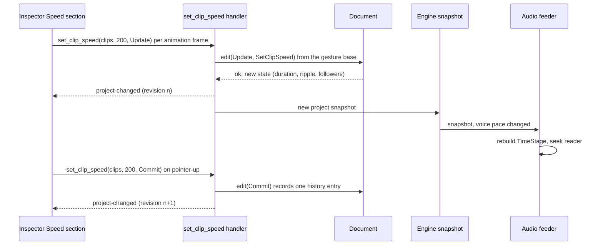
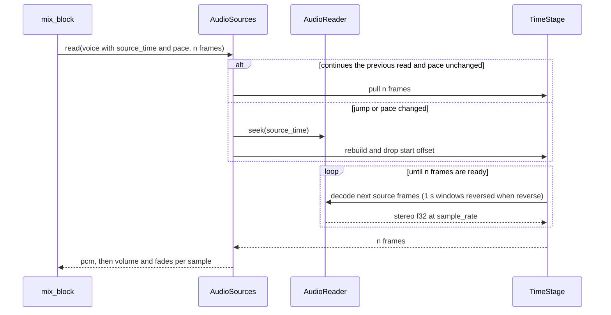
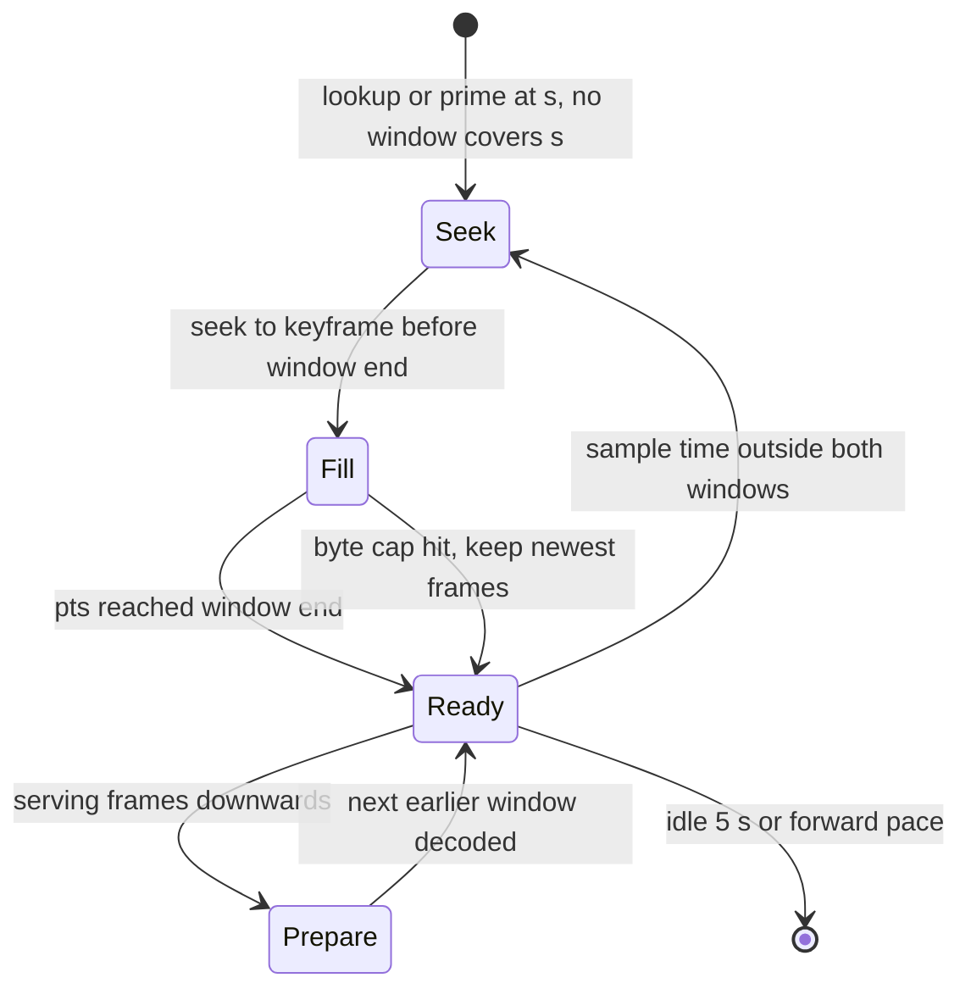

# Design: clip volume, fades, speed, reverse, freeze frame and still duration

- **Status:** Proposed (task 0370). After implementation this file is a record, not a spec.
- **Date:** 2026-11-26
- **Features:** F1.77 (volume), F1.78 (fades), F1.79 (constant speed), F1.80 (preserve pitch),
  F1.81 (reverse), F1.82 (freeze frame), F1.83 (default still duration, image duration change).
- **Builds on:** `timeline-editing.md` (§3.2 source mapping, §3.4 invariants, §3.6 props, §3.7
  following, §4.10 `SetClipProperty`), `playback.md` (§6.3 mixer, §6.4 audio readers, §7
  scheduler), `render-graph.md` (§4.1 sampling, §5.3 readers), `export.md` §4.5, `preferences.md`,
  ADR-0002 (schema versions), ADR-0003 (IPC), ADR-0006 (gestures).
- **ADR:** none. Nothing here changes a `CLAUDE.md` rule: time stays integer flicks, the audio
  callback is untouched, preview and export share every new code path, and the time-stretcher is
  FFmpeg's own `libavfilter` (LGPL, already shipped as `avfilter-10.dll`, dynamically linked).

## Decisions

| Topic | Decision | Rejected (why) |
|---|---|---|
| Speed type | `Speed`: an integer **percent** (`u16`, 10 ..= 10,000 = 0.1× ..= 100×). All mapping is `i128` integer math on flicks | `f32`/`f64` factor (rounding differs by path, breaks "integer time"); a general rational `num/den` (no tier-1 use: conform-to-fps and fit-to-duration are not features); thousandths (0.001× steps are meaningless in a UI, and percent makes `sample_rate × percent / 100` an exact integer for every standard rate: 44.1, 48, 88.2, 96, 176.4, 192 kHz, which the non-pitch-preserving resampler needs) |
| Where speed and reverse live | Fields of `ClipSource::Media` next to `source_in`, because they *are* the source mapping. `preserve_pitch` lives in `AudioProps` (how the sound is played; it moves with the props on detach audio, reset restores it) | A separate `TimeProps` on `Clip` (meaningless on colour and text clips, one more `Option`); `preserve_pitch` on the source (meaningless on a video clip whose audio was detached) |
| Which edge stays on a speed change | **The start.** The used source range stays the same; the duration becomes `floor(span × 100 / percent)` | Keeping the end (unexpected on a left-to-right timeline); keeping the duration and changing the source range (that is a different feature, "fit to duration") |
| Speed change runs into a neighbour (non-magnetic track) | Fails with `Overlap`; during a slider drag the last valid state stays (ADR-0006) | Bumping the clip to another track (a direct edit moving the clip the user is editing); clamping the speed (a typed 0.5× silently becoming 0.73×) |
| Freeze frame | A new source kind **`ClipSource::Freeze { media, source_time }`**: the video reader shows the frame at that time, held | A PNG exported through the `OfflineRenderer` and imported as an image asset (a job, a file in the media or cache folder that can go missing, a new asset in the media bin, colour conversions twice, more code for the same picture) |
| Freeze length | The **default still duration** preference (the existing `default_image_duration`, 5 s), snapped to the project frame grid | A fixed 3 s constant (one more number the user cannot set); a second preference (YAGNI) |
| Time-stretch (pitch preserved) | **FFmpeg `atempo`** (WSOLA) in a per-voice `libavfilter` graph on the feeder or export thread; factors chained within 0.5–2 | Rubber Band (GPL, and `librubberband` is not in the LGPL build); SoundTouch (LGPL-2.1 C++ that the `soundtouch` crate builds statically: relinking obligations or a second DLL to ship, same WSOLA class as `atempo`); `signalsmith-stretch` (MIT, better on music, but a new C++ build dependency; kept as the upgrade path behind the same `TimeStage` type); an own WSOLA (maintenance, no quality gain) |
| Speed without pitch preservation | `asetrate=sample_rate × percent / 100, aresample=sample_rate` in the same per-voice graph (plain resampling, "chipmunk") | `rubato` (MIT; no gain over FFmpeg's resampler, which is already linked) |
| Sound at high speed | Voices faster than **4×** are silent (`MAX_SOUNDING_SPEED`), in preview and export. The inspector says so | Stretching 100× (decoding 100 s of audio per second for noise nobody keeps) |
| Reverse video | A **GOP-reverse reader mode**: decode one window of frames forward into a bounded CPU stack, hand them out backwards, then the next earlier window. Budget: realtime for 1080p; 4K preview is best effort; export is exact | A pre-rendered reversed proxy file (CapCut's approach: a job, disk space, invalidation on trim; the task asks for the reader mode); holding decoder surfaces (the D3D12VA pool is a handful of surfaces, a GOP is 30–120 frames) |
| Reverse audio | Decode 1 s windows backwards, reverse each in place, then the same time stage | `areverse` (buffers the whole stream) |
| Image duration change | The existing `TrimClip` (images have no source limit) plus a **Duration** field in the inspector for images, colour and freeze clips | A `SetClipDuration` command (duplicates trim) |
| `SetClipProperty` | Built by **0370** (all `PropertyValue` kinds, visual ones included, as model command and IPC with gesture phases), because volume and fades are edited through it. 0350 keeps the render-graph use of `VisualProps`, `ResetClipProperties` and the Transform section (orchestrator decision, 2026-11-26) | Splitting the command between two tasks |
| Inspector | A **selection-driven inspector shell** with sections; 0370 adds Audio, Speed and Duration, 0350 adds Transform | A separate speed dialog (CapCut-style panel is the same thing in the inspector) |

## 1. Goal and non-goals

Afterwards the user selects a clip and, in the inspector, sets its volume in percent (with a dB
readout) and its fade-in and fade-out; sets a constant speed between 0.1× and 100× (the clip gets
shorter or longer and the timeline ripples), keeps the voice's pitch or not, and plays the clip
backwards. They put a still of the frame under the playhead into the timeline (freeze frame), set how
long new images and freeze frames are, and change an image's duration by number or by trim.
2× and 0.5× clips play in sync, with the pitch preserved when the toggle is on, and export the same
way.

**Non-goals** (hobby scope, `CLAUDE.md`): speed curves and ramps (F2.95, task 0640), frame blending
or optical flow at slow speed (F3.36), audio pitch shift without speed change (F2.84), keyframed
volume (0520 adds keyframe editing; the stored shape already has keyframes), pitch-corrected shuttle
audio (J/K/L stays silent off 1×), sound above 4×, a reversed-proxy cache, per-clip custom freeze
lengths at insert time (trim afterwards).

## 2. User flow

| Action | Input | Result | History |
|---|---|---|---|
| Volume | Inspector → Audio: slider 0–400 % (detent at 100 %), number field in %, dB readout | `setClipProperty(volume)` on every selected clip that sounds | one entry per drag or typed value |
| Fade in / out | Inspector → Audio: two sliders and seconds fields (one decimal) | `setClipProperty(fadeIn / fadeOut)`, clamped per clip to the room left by the other fade | one entry each |
| Speed | Inspector → Speed: slider (log scale 0.1×–100×), number field (×, two decimals), presets 0.25 / 0.5 / 1 / 2 / 4 | `setClipSpeed` on the selection and its linked members; duration updates, the main track ripples | one entry per drag, typed value or preset |
| Preserve pitch | Inspector → Speed: toggle (default on) | `setClipProperty(preservePitch)` | one entry |
| Reverse | Inspector → Speed: toggle; clip context menu **Reverse** | `setClipReverse` on the selection and its linked members | one entry |
| Freeze frame | Clip context menu **Freeze frame**, `Shift+F`, Edit menu | splits the video clip under the playhead and inserts a still of the shown frame; later content ripples | one entry |
| Still duration default | Preferences → Editing → "Image and freeze-frame duration" (exists, relabelled) | used by the next add or freeze | none (not the model) |
| Image duration | Inspector → Duration field (images, colour cards, freeze frames); or trim the edge | `trimClip(end)` with `Commit` | one entry |

Slider drags are ADR-0006 gestures: `Update` per animation frame, `Commit` on pointer-up, Escape or
lost capture cancels. Typed values and buttons are a single `Commit`. Undo during a drag cancels the
drag. Controls of clips on locked tracks are disabled (the commands fail with `TrackLocked`).
`Shift+F` goes into the shortcut registry, inactive while a text field has focus.

## 3. Model changes (`app-core`)

### 3.1 Types

```rust
// crates/app-core/src/time.rs (or model.rs)
/// Playback speed in percent of normal: 100 = 1x. Always within MIN..=MAX: deserialization
/// rejects anything else, so no code ever divides by an invalid speed.
#[derive(Debug, Clone, Copy, PartialEq, Eq, Hash, Serialize, Deserialize)]
#[cfg_attr(feature = "specta", derive(specta::Type))]
#[serde(try_from = "u16", into = "u16")]          // TS: number (percent)
pub struct Speed(u16);

impl Speed {
    pub const NORMAL: Speed = Speed(100);
    pub const MIN: u16 = 10;                       // 0.1x
    pub const MAX: u16 = 10_000;                   // 100x
    pub fn new(percent: u16) -> Option<Speed>;
    pub fn percent(self) -> u16;
    /// Source length played in timeline length `d`: floor(d x p / 100) (i128, div_euclid, so
    /// negative `d` floors too).
    pub fn source_floor(self, d: Time) -> Time;
    /// ceil(d x p / 100).
    pub fn source_ceil(self, d: Time) -> Time;
    /// Longest timeline length whose source length fits in `s`: floor(s x 100 / p).
    pub fn timeline_floor(self, s: Time) -> Time;
}

/// Voices faster than this are silent (§5.3).
pub const MAX_SOUNDING_SPEED: Speed = Speed(400);

pub enum ClipSource {
    #[serde(rename_all = "camelCase")]
    Media {
        media: MediaId,
        source_in: Time,
        /// NEW. Always NORMAL on image media.
        speed: Speed,
        /// NEW. Plays the used source range backwards. Always false on image media.
        reverse: bool,
    },
    /// NEW (F1.82). A still of video `media` at media time `source_time`: the frame a
    /// sample-and-hold lookup at that time returns. Video tracks only; no audio.
    #[serde(rename_all = "camelCase")]
    Freeze { media: MediaId, source_time: Time },
    Color { color: Rgba8 },
    Text { content: String },
}

pub struct AudioProps {
    pub volume: Animated<f32>,
    pub fade_in: Time,
    pub fade_out: Time,
    /// NEW (F1.80). With a speed other than 1x: keep the pitch (time-stretch) or play faster and
    /// higher like tape (resample). Default true. Not animatable.
    pub preserve_pitch: bool,
}
```

`ClipSource::media()` returns the media of `Freeze` too, so `media_users`, `RemoveClipsOfMedia`,
relink and offline status cover freeze clips without changes.

### 3.2 Source mapping (the only place it lives)

For a media clip with `p = speed.percent()`, `a = source_in`, `d = duration`, local offset
`o = t - start`:

```
span        = ceil(d x p / 100)                 Speed::source_ceil(d)
source_end  = a + span                          exclusive end of the used range
k(o)        = floor(o x p / 100)                Speed::source_floor(o)
forward:    source_time(t) = a + k(o)
reverse:    source_time(t) = source_end - 1 - k(o)   (start shows the end of the range; the last
                                                      instant of the clip maps to >= source_in)
```

Both stay inside `[a, source_end)` for every `t` in `start..end()` (because `floor((d-1)p/100) <=
span - 1`). With `p = 100` and `reverse = false` the formulas equal today's code exactly (regression
test). Images keep `speed = 1×`, so `source_time` and `source_end` are unchanged for them.
`Freeze`: `source_time(t) = Some(source_time)` inside the clip, `source_end() = None`,
`source_in() = 0`.

New pure helpers on `Clip`, used by every command and by the engine (no command or engine code
computes source times by itself):

```rust
impl Clip {
    /// As today, with speed and reverse (above).
    pub fn source_time(&self, t: Time) -> Option<Time>;
    pub fn source_end(&self) -> Option<Time>;
    /// Media time a video layer samples for project frame `t_n` (render-graph §4.1): the source
    /// time at the frame centre, `t_n + frame / 2`, clamped into the used range; `Freeze`:
    /// `source_time` itself. Shared by build_plan and InsertFreezeFrame, so a freeze shows exactly
    /// the frame the preview showed.
    pub fn frame_sample_time(&self, t_n: Time, frame: Time) -> Option<Time>;
    /// `source_in` of the part of this clip that starts `offset` after its start and lasts
    /// `duration` (a negative offset or a longer duration extends it), keeping every content
    /// moment where it is on the timeline:
    ///   forward: a + floor(offset x p / 100)
    ///   reverse: source_end - floor(offset x p / 100) - ceil(duration x p / 100)
    /// Split (both halves), trim (both edges) and trim-to-playhead use it.
    pub fn sub_source_in(&self, offset: Time, duration: Time) -> Time;
    /// How far each edge can be extended (timeline flicks) before the used range leaves
    /// `0..media_len`: start room = timeline_floor(a) forward / timeline_floor(len - end) reverse,
    /// end room the other way round. Trim clamps use it.
    pub fn extend_room(&self, media_len: Time) -> (Time, Time);
    /// Anchor content (timeline-editing §3.7): the source time for video and audio media, the
    /// offset from the start for images, colour, text and freeze clips; and its inverse,
    /// clamped to 0..=duration (forward: (c - a) x 100 / p, reverse: (end - 1 - c) x 100 / p).
    pub fn content_at(&self, t: Time) -> Time;
    pub fn offset_of_content(&self, content: Time) -> Time;
}
```

Rounding is 1 flick (1.4 ns) at worst per split or speed change; nothing accumulates within a
gesture, because updates re-apply to the gesture's base (ADR-0006). The reverse split formula
cannot go below `a`, because `floor(x) + ceil(y) <= ceil(x + y)`.

**Who changes:** `split_clip` (right half `sub_source_in(at - start, rest)`, the left half of a
reversed clip moves its `source_in` instead), `TrimClip` and `TrimToPlayhead` clamps
(`extend_room`) and source updates (`sub_source_in`), `anchor_of` / `Follow::resolve`
(`content_at` / `offset_of_content`), `ReplaceClipMedia` (`source_end()` against the new length;
a `Freeze` keeps `source_time` if it is inside the new video, else 0; the new media must be video),
`has_source_in` (false for `Freeze`), `DetachAudio` and paste (copy the source, so the pair keeps
speed and reverse). `timeline::main_changed` keeps its key: a reverse toggle moves nothing, so
nothing follows it.

### 3.3 Invariants (amends timeline-editing §3.4)

- **3 (amended).** A video or audio source satisfies `0 <= source_in` and `source_end() <=
  media.duration` (`i128`, no overflow). An image source has `source_in == 0`, `speed == 1×` and
  `reverse == false`.
- **8 (new).** A `Freeze` source is on a video track, references a `Video` asset with a video
  stream, has `0 <= source_time < media.duration` (`source_time == 0` when the duration is unknown),
  `visual` is `Some` and `audio` is `None`.
- `Speed` is in range by construction (deserialization). Validation still requires only a positive
  duration; commands keep at least one project frame.
- Linked clips are **not** required to share speed or reverse (a user may unlink, change one, and
  link again); the commands keep link groups in step (§4).

### 3.4 Commands (all in `crates/app-core/src/command/`, one history entry each)

`G` = ADR-0006 gesture (`EditPhase`). Every command checks locked tracks (`TrackLocked`) the same
way as §3.3 of timeline-editing, records the previous `tracks` for an exact `revert` where it
ripples, and returns `InvalidResult` if validation of the result fails.

| Command (`HistoryLabel`) | G | Parameters | Behaviour |
|---|---|---|---|
| `SetClipProperty` (`setClipProperty`) | G | `clips`, `value: PropertyValue` | timeline-editing §4.10, built now. Sets `Animated.value` (or the plain field) on every listed clip that has the property (visual or audio). No link expansion (props are per clip; the UI selects the whole group anyway). `PropertyNotApplicable` if no listed clip has it. Non-finite or out-of-range values: `InvalidValue` (volume 0..=4, opacity 0..=1, scale, crop as `VisualProps::check`). **Fades clamp** per clip to `0..=duration - other fade` (a drag stops at the limit, like trim); a negative fade is `InvalidValue`. Changing nothing records nothing |
| `SetClipSpeed` (`setClipSpeed`) | G | `clips`, `speed: Speed` | Expands links. Targets the video and audio media clips among them (images, colour, text, freeze are skipped; none left: `PropertyNotApplicable`). Per target: start stays, source range `[source_in, source_end)` stays, `duration = timeline_floor(span)`; under one project frame: `InvalidValue`. Fades are clamped (`retime_keyframes`); keyframe offsets scale with the duration (0520 implements; tier 1 lists are empty). Main track: magnetic repacks, and `follow_main` moves followers, which keeps B-roll over the same content moment of a sped-up clip (`content_at`). Elsewhere, after following, a target overlapping a clip on its track fails with `Overlap` |
| `SetClipReverse` (`setClipReverse`) | | `clips`, `reverse: bool` | Expands links; targets the video and audio media clips. Start, duration and the used source range stay; nothing ripples or follows. Nothing changes: records nothing |
| `InsertFreezeFrame` (`insertFreezeFrame`) | | `clip: Option<ClipId>` (None = the main-track clip under `at`), `at: Time`, `duration: Time` | `at` is quantised down to its project frame `t_n`; the clip must contain `t_n` and be a video media clip on a video track (else `PropertyNotApplicable`; nothing there: `NothingToEdit`). `source_time = clip.frame_sample_time(t_n, frame)`. If `t_n` is at least one frame inside both ends, the clip and its linked members split at `t_n` (the `SplitClips` helper), else the freeze goes before the clip (`t_n` at its first frame) or after it (last frame). A new clip `{ start: t_n, duration, source: Freeze { media, source_time }, visual: clip.visual.clone(), audio: None, link: None, name: clip.name }` is inserted. Main track: inserted into the list at that boundary, repacked when magnetic, then `follow_main` (linked right halves, such as detached audio, shift by `duration` through the link and leave silence under the freeze). Other tracks: the clips of that track from `t_n` on and their linked members shift right by `duration`; a shifted member that overlaps on its own track fails with `Overlap`. Returns the freeze clip's id |
| `AddClips` (changed) | | `+ image_duration: Time` | Images get `image_duration` instead of `DEFAULT_IMAGE_DURATION` (the constant stays as the default of tests and of `Preferences`). Media clips get `speed: 1×, reverse: false`, audio props `preserve_pitch: true` |

```rust
// command.rs: PropertyValue / PropertyKey (timeline-editing §4) gain one variant each
#[serde(tag = "property", content = "value", rename_all = "camelCase")]
pub enum PropertyValue {
    Position(Vec2), Scale(Vec2), Rotation(f32), Opacity(f32), Crop(CropInsets),
    Flip(Flip), Fit(FitMode), Volume(f32), FadeIn(Time), FadeOut(Time),
    PreservePitch(bool),                                         // NEW
}
pub enum PropertyKey { /* same list */ PreservePitch }       // used by 0350's reset

// New CommandError variants (timeline-editing §4 listed them; not in the code yet)
PropertyNotApplicable, InvalidValue,
```

New `HistoryLabel`s: `setClipProperty`, `setClipSpeed`, `setClipReverse`, `insertFreezeFrame` (the
UI adds translations).

**Why speed is its own command and not a property:** it changes the duration and therefore ripples
and moves followers, which property commands never do. Reverse is its own command because it
belongs to the source mapping and must keep link groups in step; it could have been a property, but
then `SetClipProperty` would need link expansion for one key.

## 4. IPC changes (`src-tauri`)

```rust
// Properties (0370 builds it; was listed under 0350): gestures for sliders, Commit for typed values
fn set_clip_property(clips: Vec<ClipId>, value: PropertyValue, phase: EditPhase) -> Result<(), IpcError>;
// Speed slider is a gesture; presets and typed values are one Commit
fn set_clip_speed(clips: Vec<ClipId>, speed: Speed, phase: EditPhase) -> Result<(), IpcError>;
fn set_clip_reverse(clips: Vec<ClipId>, reverse: bool) -> Result<(), IpcError>;
/// `duration` is not an argument: the handler reads `default_image_duration` from preferences
/// and snaps it to the project frame grid (nearest frame, at least one).
fn insert_freeze_frame(clip: Option<ClipId>, at: Time) -> Result<ClipId, IpcError>;
// add_clips keeps its signature; the handler passes the snapped preference as image_duration.
```

- Handlers are thin (ADR-0003 §1): `Time` values within ±2^53, then `AppState::edit`. Errors:
  `Overlap` and `TrackLocked` map to their existing `IpcError` kinds; everything else (including
  `PropertyNotApplicable`, `InvalidValue`) is `InvalidEdit` with a log message. No new error kind.
- An out-of-range `Speed` fails argument deserialization; the UI clamps before sending.
- **Types for bindings:** `Speed` (TS `number`, percent), the `ClipSource` variants with `speed`,
  `reverse` and `freeze { media, sourceTime }`, `AudioProps.preservePitch`, `PropertyValue` with
  `preservePitch`. `ClipView` gains `sourceEnd: Option<Time>` (`Clip::source_end()`), so the
  filmstrip and waveform draw the used range without computing the mapping. `sourceDuration`
  stays (media length). `freeze` clips report the media's length there too.
- **No new events.** Everything goes out as `project-changed`. Payload grows by about 40 bytes per
  clip.

## 5. Engine impact

### 5.1 Render graph (preview and export)

- `build_plan` takes the sample time from `clip.frame_sample_time(t_n, frame)` instead of adding
  half a frame itself. `Freeze` clips become `LayerContent::Video` at their `source_time`, with the
  clip's visual props like any video layer.
- `LayerContent::Video` gains `pace: Pace`, and `FrameProvider::video` takes it:

  ```rust
  pub enum Pace { Forward { speed: Speed }, Reverse { speed: Speed }, Still }
  fn video(&mut self, media: MediaId, sample_time: Time, pace: Pace, policy: FetchPolicy) -> FrameLookup;
  ```

- **Slow speeds** need nothing new: sample and hold shows each source frame for several project
  frames, and the source-texture cache (render-graph §6) converts it once.
- **Fast speeds:** the reader's steering uses the **effective rate** `|transport rate| × speed`.
  Up to 4× it decodes every frame with the existing catch-up (discarding non-reference frames when
  behind); above 4× it decodes keyframes only and sample and hold shows the latest
  (`KEYFRAMES_ONLY_ABOVE = 4×`). The shuttle's own rule (keyframes only above 2× transport rate)
  is unchanged. `FetchPolicy::Exact` ignores both and decodes the exact frame (export, golden
  tests): deterministic, slower at 100×.
- **`Still`:** steering as when paused (exact frame, nothing ahead). Every frame of a freeze clip
  is a cache hit after the first. A freeze inserted at a split point needs no seek: the left half
  ends there and the right half starts there.

### 5.2 Reverse video: GOP-reverse reader mode

A reader serving a `Pace::Reverse` clip runs in reverse mode (a reader is in one mode at a time;
the pool binds per media and direction; at most **2** reverse readers, counted against the 8).

1. A lookup or prime at sample time `s` with no window covering it starts a window that ends at
   `e = s + one source frame` (or at the previous window's start when continuing downwards).
2. Seek to the keyframe at or before `e - 1` (`AVSEEK_FLAG_BACKWARD`), decode forward until a pts
   reaches `e`, and keep the decoded frames in a ring of at most `REVERSE_WINDOW_BYTES = 160 MB`
   (the existing `CPU_QUEUE_BYTES`). Hardware frames are downloaded (`av_hwframe_transfer_data`)
   into pooled CPU frames, because the decoder's surface pool cannot hold a GOP. If the ring
   overflowed, the window covers only its newest frames and the next window re-decodes from the
   same keyframe up to them.
3. The window is the reader's queue: the lookup rule is unchanged (the last frame with
   `pts <= sample_time`), and requests now go downwards through it.
4. While the window is in use, the reader prepares the next earlier window (a second buffer of the
   same size), so playback crosses a GOP boundary without a stall. Memory per reverse reader:
   at most 2 × 160 MB.
5. `Exact` lookups use the same windows and wait; the result does not depend on timing.

Cost: 1080p NV12 (3.1 MB per frame) fits a 2 s GOP in one window: one decode pass and one seek
per GOP, realtime. 4K P010 (25 MB) fits about 6 frames per window, so a 60-frame GOP is decoded
about 4–5 times over: preview shows stale frames (counted as late, playback §5.4), export is exact.
If 4K reverse preview proves annoying, the known fix is to scale window frames down to the preview
render size on the reader thread (preview only); it is not built until needed.

The scheduler (playback §7) computes a reversed clip's first sample time near `source_end` and
primes a reverse reader there. Two halves of a split reversed clip play without a seek (the reader
continues downwards).

### 5.3 Audio: pace per voice

- `mix_block` is unchanged except that `Voice` gains `pace: AudioPace { speed, reverse,
  preserve_pitch }` (from the clip). Voices with `speed > MAX_SOUNDING_SPEED` are skipped (not
  even read). Each chunk still asks for `clip.source_time(t)`; n output frames consume about
  n × speed source frames (forward or downward). The callback is untouched.
- **`AudioSources` (the `PcmProvider`)** keeps per-voice state keyed by `ClipId`: its reader slot,
  a `TimeStage` and the source time the next read should continue from. A read that continues the
  previous one (within 2 ms) feeds the stage on; otherwise, or when the pace changed (a speed
  gesture), the stage is rebuilt and the reader seeks. Stages are built in `prefetch` before the
  voice starts, so a jump cut to a sped-up clip does not build a graph in the block that plays it.
- **`TimeStage`** (`crates/engine/src/audio/stretch.rs`, new): an `AVFilterGraph`
  `abuffer → … → abuffersink` at `sample_rate`, stereo `f32`, built on the feeder or export thread
  (it may allocate there, never in the callback):
  - `speed == 1×`: no stage (bypass, today's path).
  - `preserve_pitch`: `atempo` chained so each factor is within 0.5–2 (`n = ceil(|log2 s|)`,
    factor `s^(1/n)`; at most 2 instances below 4×).
  - not preserved: `asetrate=sample_rate × percent / 100,aresample=sample_rate` (exact integer
    rate for every standard rate, §Decisions).
  - Output is pulled until n frames are ready; surplus stays in a small FIFO of the stage.
  - **Latency and sync:** the stage's start offset after a reset is measured once per graph kind in
    a unit test and discarded after each reset, so the output for source time `x` lands at
    timeline `start + (x - source_in) / speed` within 5 ms. Long-term drift of `atempo`'s output
    count is checked against the requested source time every chunk; more than 10 ms off rebuilds
    the stage at the requested time (a tiny gap, logged at debug).
- **Reverse audio:** the voice reads 1 s windows downwards: seek to 200 ms before the window start
  (the existing preroll), decode the window, reverse its frames in place, feed them to the stage
  (or straight out). One seek per second of source.
- **Scrub grains** play the source at 1× forward from the clip's source time (no stage); good
  enough to find a word.
- **Export** builds its own `AudioSources` on the export thread and calls the same `mix_block`
  (`export.md` §4.5), so speed, pitch, reverse and the 4× mute are identical. Sample-exact equality
  with the preview is not required (it is not today either).

### 5.4 Library check (2026-11-26)

| Option | Licence | Status | Notes |
|---|---|---|---|
| FFmpeg `atempo`, `asetrate`, `aresample` | LGPL-2.1+, in the pinned `win64-lgpl-shared` 7.1 build (`ffmpeg -filters` lists them; `atempo` range 0.5–100) | **chosen** | WSOLA; good on speech, audible smearing on music below 0.75× and above 1.5×; low CPU; one window of latency |
| `signalsmith-stretch` crate 0.1.3 (wrapper of Signalsmith Stretch, MIT) | MIT | upgrade path | Better on music; bundles C++ sources (build method not checked); the upstream notes it sounds best within 0.75×–1.5× |
| `soundtouch` crate 0.5.4 | LGPL-2.1 | rejected | static C++ build by default |
| Rubber Band | GPL / commercial | rejected | not LGPL |
| `rubato` 5.1.0 | MIT or Apache-2.0 | not needed | resampler only |

## 6. UI impact

- **`ui/src/features/inspector/`** becomes a shell driven by `selectionStore`: no selection →
  the project info shown today; one or more clips → clip sections for the **primary** clip (the
  last clicked; values shown are its values, edits go to every selected clip that has the
  property). Sections are components registered in one list, each with a `visible(clip, media)`
  rule: **Audio** (clip has `audio`), **Speed** (video or audio media clip), **Duration** (image,
  colour, freeze), and 0350's **Transform** (clip has `visual`).
- **Shared slider + number field** component (also 0350's): drag sends `Update` per animation
  frame and `Commit` on release, Escape cancels (`cancel_gesture`), typing sends one `Commit`;
  `InvalidValue` shows the translated error on the field.
- **Audio:** volume in % (0–400, linear, detent at 100), dB readout `20·log10(v)` ("−∞ dB" at 0,
  "+12.0 dB" at 400 %); fade in / fade out in seconds (converted with
  `Math.round(s × FLICKS_PER_SECOND)`), slider max = duration − the other fade (display only;
  Rust clamps).
- **Speed:** number field in × (two decimals, clamped to 0.1–100, sent as `Math.round(x × 100)`),
  log-scale slider, preset buttons 0.25 / 0.5 / 1 / 2 / 4, preserve-pitch toggle, reverse toggle,
  the resulting duration (read from the model), and the note "Muted above 4×" when it applies.
- **Duration:** a timecode field; Enter sends `trimClip(clip, end, start + value, Commit)`.
- **Timeline** (`renderer.ts`): a speed badge ("2×", "0.5×") when the speed is not 1×, a reverse
  marker, a freeze marker; filmstrips and waveforms map the clip width linearly onto
  `sourceIn..sourceEnd`, mirrored when reversed; a freeze clip repeats one thumbnail at its
  `sourceTime`.
- **Freeze frame:** clip context menu, Edit menu and `Shift+F`; sends `insert_freeze_frame(the
  selected clip if exactly one video clip is selected and under the playhead, else null,
  playhead)`, then selects the returned clip.
- **Preferences:** the existing field is relabelled "Image and freeze-frame duration".
- Nothing draws over the preview.

## 7. Project file

- `CURRENT_SCHEMA_VERSION` **3 → 4**. Migration `v3_to_v4` (`serde_json::Value`): every
  `source` with `kind == "media"` gains `speed: 100, reverse: false`; every non-null `audio` gains
  `preservePitch: true`. Nothing else changes; no clip can be invalid after it.
- Fixtures: `project-v3.json` stays and loads through the chain (insta snapshot of the migrated
  project). New `project-v4.json` written by the new code: a 2× clip with `preservePitch: false`,
  a reversed 0.5× clip with linked detached audio, a freeze clip, an image of non-default length.
- Example v4 media source: `{ "kind": "media", "media": "019a…", "sourceIn": 0, "speed": 200,
  "reverse": false }`; freeze: `{ "kind": "freeze", "media": "019a…", "sourceTime": 1411200000 }`.

## 8. Performance budget

Reference laptop (Iris Xe, release), measured with the ignored harness of playback.md "As built"
plus new scenarios, and `cargo bench`-style ignored tests:

| Scenario | Budget |
|---|---|
| 1080p30 H.264 with AAC at 2× and at 0.5×, pitch preserved, plus a music track, 60 s | 0 dropped frames, \|A/V\| ≤ 1 frame, 0 underruns |
| Same clip at 4× | ≤ 5 % dropped (catch-up), sound plays |
| 4K30 HEVC at 2× | ≤ 5 % dropped |
| Reverse 1080p30 H.264 (2 s GOP), 30 s | 0 dropped after the first window; RSS growth ≤ 2 × 160 MB per reverse reader |
| Reverse 4K30 HEVC | preview: recorded, not gated; export: exact, recorded |
| `TimeStage` (atempo 1.5×, 48 kHz stereo) | ≤ 2 % of one core per voice; 8 stretched voices at once without underruns |
| `SetClipSpeed` update and `InsertFreezeFrame` on the ADR-0003 benchmark project | ≤ 4 ms including `ProjectState` and JSON |
| `mix_block` callback side | unchanged (no new work in the callback) |

## 9. Test plan

- **`app-core` unit:** `Speed` bounds and serde (`100` round-trips, `9` and `10001` fail); the
  mapping at 1× equals the old formula; reverse maps `start` to `source_end - 1` and the last
  instant to `>= source_in`; `frame_sample_time` equals today's `source_time + half` at 1×;
  `SetClipSpeed` (start stays, duration, ripple on magnetic main, followers keep their content
  moment, linked pair changes together, `Overlap` on a full overlay track, under one frame is
  `InvalidValue`, images skipped); `SetClipReverse` (nothing moves, link pair); `SetClipProperty`
  per kind incl. fade clamping and `PropertyNotApplicable`; `InsertFreezeFrame` (split + insert on
  magnetic main, at the first and last frame, detached audio right half shifts and leaves silence,
  overlay track ripple, image clip rejected, one undo restores exactly); `AddClips` uses
  `image_duration`.
- **proptest:** random clips (source_in, duration, speed, reverse, media length): `source_time`
  stays in `[source_in, source_end)` and is monotonic (non-increasing when reversed); split at any
  interior point keeps every content moment within 1 flick; trim clamps keep `source_end <= media`;
  1× → s → 1× changes the duration by at most `ceil(100 / p)` flicks. The existing sequence gate
  (random command sequences keep the invariants, undo restores exactly) gains the four commands.
- **Migration:** `project-v3.json` → v4 (snapshot), `project-v4.json` round-trips, the canonical
  insta snapshot covers the new fields.
- **Mixer (fake provider):** a 2× voice asks for chunk source times twice as fast; a reversed
  voice asks downwards; voices above 4× are not read; volume and fades unchanged.
- **`TimeStage` (FFmpeg, no device):** a 1 kHz sine at 2× with pitch preserved stays 1 kHz
  (Goertzel or zero crossings within 1 %) and lasts half as long; without preservation it becomes
  2 kHz; same at 0.5× (1 kHz / 500 Hz); a click at source 1.0 s in a 2× clip starting at 0 is heard
  at 0.5 s ± 5 ms (both modes); 10 minutes at 1.5× stay within 10 ms; a reversed ramp comes out
  descending.
- **Export parity:** the same project mixed through `AudioSources` at 48 kHz (export) and 96 kHz
  (device) has the click at the same time within one sample period of the lower rate.
- **Golden frames (`OfflineRenderer`, WARP, `Exact`):** on a numbered test clip (frame index
  encoded in the picture): 2× shows source frame 2n at project frame n; 0.5× holds each frame
  twice; reversed shows the last frame of the range first, across a GOP boundary; a freeze clip
  equals the frame the source clip showed at the playhead; one image per case.
- **Reader:** reverse mode with a tiny window cap re-decodes a long GOP in windows and returns the
  same frames as forward decoding; hardware frames are downloaded; ignored hardware test for the
  budget rows.
- **Vitest:** dB formatting, % and × conversion and clamping, log slider mapping, section
  visibility rules, gesture phases of the slider component (Update, Commit, Escape cancels),
  speed badge text, filmstrip range mapping (reversed), freeze action target selection.

## 10. Diagrams

### 10.1 Speed slider drag



### 10.2 One voice chunk on the feeder (or export thread)



### 10.3 Reverse reader



## 11. Task breakdown

Backend first in every step; after the IPC step the backend regenerates `ui/src/bindings.ts`
and tells the frontend what changed.

1. **backend — model:** `Speed`, the `ClipSource` fields and `Freeze`, `AudioProps.preserve_pitch`,
   the `Clip` helpers of §3.2, invariants 3 and 8, `v3_to_v4` with fixtures; switch split, trim,
   trim-to-playhead, anchors, replace media, detach and paste to the helpers; unit tests and
   proptest. (`cargo test -p app-core`)
2. **backend — commands + IPC:** `SetClipProperty` (all kinds, gesture), `SetClipSpeed` (gesture),
   `SetClipReverse`, `InsertFreezeFrame`, `AddClips.image_duration` from preferences, the
   `CommandError` and `HistoryLabel` variants, `ClipView.sourceEnd`, `pnpm bindings`.
3. **backend — render:** `frame_sample_time` in `build_plan`, `Pace` in `LayerContent::Video` and
   `FrameProvider::video`, freeze layers, effective-rate steering; golden frames for speed and
   freeze.
4. **backend — reverse reader:** window mode, hardware download, pool binding by direction,
   scheduler priming; reader tests, reverse golden frames, ignored hardware test.
5. **backend — audio:** `AudioPace`, `TimeStage` on `libavfilter` (`atempo`, `asetrate`),
   reverse windows, 4× mute, prefetch builds stages; mixer, stage, sync and parity tests; the
   playback harness scenarios of §8. Update `docs/architecture/02`, `03`, `07`, `09` and the
   feature catalog rows.
6. **frontend — inspector shell + Audio** (after step 2): section registry, shared slider/number
   component with gesture phases, Audio section, Duration section.
7. **frontend — Speed, timeline, freeze:** Speed section, speed/reverse/freeze badges, filmstrip
   and waveform ranges from `sourceEnd`, freeze action and `Shift+F`, Preferences label; Vitest.

## Risks

- **`atempo` on music.** WSOLA smears sustained notes. Speech, the main YouTube case, is fine. If
  the user dislikes it, `signalsmith-stretch` (MIT) replaces the graph inside `TimeStage` with no
  other change.
- **`atempo` latency and long-term count** are assumed small and stable; the sync tests (§9) gate
  this, and the stage re-anchors on more than 10 ms drift.
- **4K reverse preview** drops frames on the iGPU (§5.2). Export stays exact.
- **`rsmpeg`'s `avfilter` wrappers** are unused in the code so far; if they lack something,
  a thin `unsafe` FFI call is fine (FFmpeg is already linked).
- **Followers after a speed change** move to the same content moment of the main clip, so a
  caption may land somewhere new when the clip gets shorter. That matches trim; one undo reverts.
- **Link groups** that join unrelated clips (music linked to a video) change speed together. That
  is what "linked clips edit together" means; unlink first to change one.

## Open questions for the user

1. Sound above 4× is muted. Keep that, or play it stretched up to 100×?
2. Freeze frames take the image default duration (5 s). Keep that, or use a fixed 3 s?
3. Preserve pitch defaults to on. Keep?
