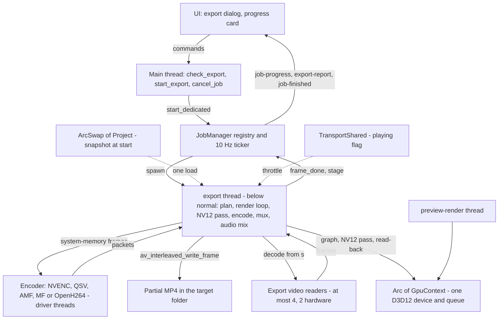
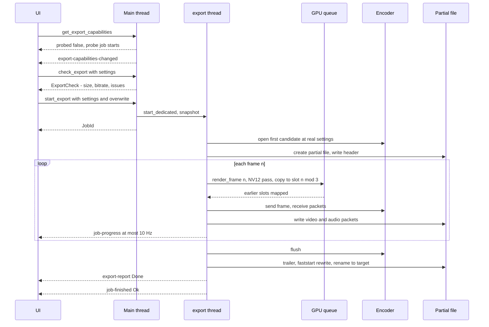
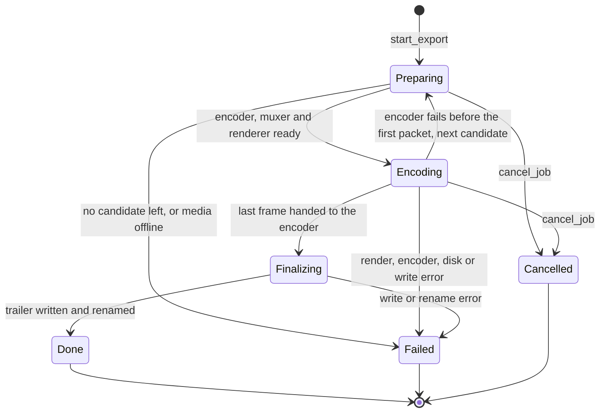

# Design: export pipeline and encoder selection

- **Status:** Proposed (task 0380). Implemented by task 0390 (video export) and task 0400 (audio
  only, still frame, after-export actions). After implementation this file is a record, not a
  spec.
- **Date:** 2026-11-22
- **Features:** prepares F1.86–F1.99, and F2.102 (estimated file size, shown in the dialog's
  summary line by 0390). Leaves F2.100 (range), F2.101 (saved presets), F2.104 beyond the Shorts
  preset and F2.105 (cover) to task 0650, which builds on §4.1 and §6. F3.32 (HDR export) and
  F3.65–F3.73 are `n/a`.
- **Builds on:** `docs/design/render-graph.md` §4.5 (`OfflineRenderer::render_frame`,
  `OutputFormat::GpuCanvas`), §5 (working space, Rec.709, HDR tone map per layer) and §10;
  `docs/design/playback.md` §6.3–6.4 (`mix_block`, audio readers); `docs/design/media-import.md`
  §6.1 (job manager) and §6.6 (media status), on the in-flight branch of PR #2, whose
  `src-tauri/src/jobs.rs` this design reuses; ADR-0001 (one render graph, LGPL FFmpeg), ADR-0003
  (jobs, events, keys), ADR-0004 (threads, one GPU device; amended 2026-11-22), ADR-0005 §4 (nothing
  draws over the preview). Review findings F28 (OpenH264) and F48 (reused render targets).
- **No new ADR.** Nothing here changes a `CLAUDE.md` rule: export is a job (ADR-0003 §8) on its own
  thread with the shared device (ADR-0004 §3, §6), it uses the shared graph (rule 3) and only LGPL
  FFmpeg plus OS and driver encoders (rule 7). §13 lists the small follow-ups in other documents.

## Decisions

Picked as the de facto standard for one hobbyist who edits phone footage (4K HEVC, often HLG HDR,
VFR, portrait) on a Windows laptop and uploads the result to YouTube.

| Topic | Decision | Rejected (why) |
|---|---|---|
| Default codec | **H.264 High, 8-bit 4:2:0**, for every preset. HEVC Main 8-bit is an option in the custom section, hardware encoders only | HEVC by default (Windows' built-in player often needs the paid HEVC Video Extensions, so "play the file" (F1.98) can fail on a stock PC; there is no patent-licensed software HEVC encoder for the fallback; YouTube re-encodes every upload anyway, so HEVC only saves upload size). AV1, VP9, ProRes, DNxHR (`n/a`, F3.65–F3.67). 10-bit HEVC (F3.32 is `n/a`; banding is a 0750 dither topic) |
| Container | **MP4** (`mp4` muxer), `+faststart`, `hvc1` tag for HEVC | MOV (no benefit for YouTube; F1.91's "MOV" is dropped). MKV (some players and the Windows Photos app do not open it). Fragmented MP4 (only useful for live streaming) |
| Audio | **AAC-LC stereo, 384 kbps** (YouTube's recommendation), FFmpeg's native `aac` encoder, at the project sample rate (48 kHz default, 44.1 kHz if the project says so) | `aac_mf` (Media Foundation AAC caps at 192 kbps). `libfdk_aac` (nonfree, not in the LGPL build). Always resampling to 48 kHz (ignores an explicit project setting; both rates are accepted by YouTube) |
| Video encoder order | H.264: **NVENC → Quick Sync → AMF → Media Foundation hardware MFT → Media Foundation software (Microsoft's H.264 MFT) → OpenH264**. HEVC: NVENC → Quick Sync → AMF → Media Foundation hardware. All six are in the pinned build (§4.4) | Matching the encoder to the render adapter (the read-back path of §4.3 makes any encoder usable; matching matters only for zero-copy, task 0700). `libkvazaar` (BSD HEVC software encoder, in the build: far below real time at 4K, and no patent licence). D3D12VA and Vulkan encoders (in FFmpeg 7.1 for HEVC only, or young and driver-dependent; see §4.3 for 0700) |
| F28: OpenH264 | **Kept as the last resort**, after Microsoft's patent-licensed MF encoder. It only runs on machines without Media Foundation (Windows N without the Media Feature Pack, Server, some VMs) and in CI. The pinned BtbN build links OpenH264 statically into `avcodec-61.dll`, so it is not Cisco's binary and Cisco's patent coverage does not apply; for one person's private, non-commercial use (ADR-0001 private-use amendment) this is accepted | Cisco's runtime download (needs a custom FFmpeg build that loads `openh264-2.x.dll` dynamically, and a download and hash check in the app, for a case the user does not have). Dropping the software fallback (CI and N editions could not export). Dropping it from the candidate list alone changes nothing about distribution: the code is in the DLL either way. **Revisit before any public release**, together with the final product name |
| Encoder probing | **Real test encodes**: on the first export-dialog open of a session, each candidate is opened at 1280×720 and must turn 8 frames into at least one packet; the result is cached for the session. At export start the chosen encoder is opened at the real settings, and a failure **before the first packet is muxed** moves on to the next candidate automatically | `avcodec_find_encoder` only (finds NVENC on a PC without an NVIDIA GPU). Probing at app start (wakes the discrete GPU of a hybrid laptop on every start). A persisted probe cache (invalidation on driver updates is more code than a one-second probe). Switching encoders after packets were muxed (one MP4 track has one decoder configuration) |
| Rate control | **VBR with a target bitrate** from YouTube's upload table times a quality factor (§4.1); `maxrate` 1.5×, `bufsize` 2×; GOP of half the frame rate, closed, 2 B-frames where supported | Constant quality (CQ, ICQ, QVBR and `quality` have different scales per encoder, and the file size could not be estimated for the disk check). Two-pass (hardware encoders do not do it; the gain at YouTube bitrates is small) |
| GPU → encoder (tier 1) | **GPU pass to NV12 (BT.709, limited range) + read-back through a ring of 3 staging buffers**, then system-memory frames to the encoder. 4K NV12 is 12.4 MB per frame, well inside the budget (§10) | Zero-copy (D3D12 texture shared into a D3D11 device for NVENC/QSV/AMF, or `hevc_d3d12va` on wgpu's device): saves about 2–4 ms per 4K frame, needs per-vendor interop and cross-API fences; it is task 0700's option if read-back is the measured bottleneck. Read-back of RGBA and `sws_scale` on the CPU (2.7× more bytes and 10+ ms of CPU per 4K frame) |
| Frame timing | **CFR at the export frame rate**: frame `n` has `pts = n` in a `1/fps` time base. VFR sources are mapped by the render graph's sample-and-hold at the frame centre. A different export rate renders on a copy of the snapshot with `settings.frame_rate` replaced | Passing source timestamps through (VFR output: YouTube and editors handle it badly). Frame blending for rate conversion (a look, not a need) |
| Job | One export at a time, as a job in the shared `JobManager` (same `JobId`, `job-progress`, `cancel_job`, `job-finished`) but on a **dedicated thread**, plus an `export-report` event before `job-finished` (the `media-job-report` pattern) | A task on the pool (1–3 workers: a ten-minute export would block imports and previews on a 4-core laptop). A second job system for export. An export queue (F3.70 `n/a`) |
| Editing during export | Export renders the `Arc<Project>` snapshot taken at start, with its own readers and renderer state on the shared device; it runs below normal priority and throttles to 20 frames/s while the preview plays | Locking the editor (F1.94 asks for the opposite). Pausing export during playback (surprising; it would never finish while the user watches their edit) |
| Output file | Write to `<stem>.cutframe-partial.mp4` in the target folder, rename over the target at the end; the partial file is deleted on cancel and failure. Overwriting needs an explicit `overwrite` flag after the UI asked | Writing to the final name (a crash or a cancel leaves a broken file with the final name, and a failed overwrite destroys the old file). A temp file in `%TEMP%` (another volume: the rename becomes a copy, and the disk check would look at the wrong drive) |
| Missing media | **Blocking** before start (`check_export` lists every offline media id, the UI offers relink); a file that disappears during export fails the export with its id | Exporting with placeholders or silence (never wanted in a YouTube upload; the preview already shows them for drafts) |
| Presets | Three presets plus custom: **YouTube 1080p, YouTube 4K, Shorts (1080 × 1920)**; custom: resolution, frame rate, codec, quality (low, recommended, high, custom bitrate), encoder. Presets are UI data; every derived number comes from Rust | Platform presets for other sites, square or 4:5 presets (F2.104, task 0650), saving presets (F2.101, 0650) |

## 1. Goal and non-goals

Afterwards the user presses **Export** (or Ctrl+E), picks a preset, a file name and a folder, and
gets an MP4 that YouTube accepts and that plays in the Windows player. The file looks exactly like
the preview at full quality, including HDR phone clips tone-mapped to SDR, with sound in sync. The
export runs in the background with progress, an ETA and Cancel while the user keeps editing. If the
GPU has a hardware encoder it is used; otherwise Windows' own encoder, otherwise OpenH264. Failures
say what went wrong: a missing file, a full disk, no usable encoder.

**Non-goals:** HDR or wide-gamut output (F3.32, F3.33 `n/a`: output is SDR Rec.709); 10-bit
output; ProRes, DNxHR, AV1, VP9, GIF, image sequences, transparency, stems, chapters
(F2.103, F3.65–F3.73 `n/a`); an export queue (F3.70); range export, saved presets, social presets
beyond Shorts and covers (task 0650); smart rendering or stream copy of unchanged segments;
zero-copy encode and a render cache (task 0700); subtitles (F3.06, later).

## 2. User flow

1. **Export** button in the editor header, menu *File → Export…* or **Ctrl+E** opens the export
   dialog. The dialog overlaps the preview, so the preview is hidden while it is open (ADR-0005 §4).
   With an empty timeline the button is disabled.
2. **Preset** (default from the canvas): portrait canvas → *Shorts*, canvas short side ≥ 2160 →
   *YouTube 4K*, else *YouTube 1080p*. Changing any custom field switches the preset label to
   *Custom*.
3. **File name** (default: the project name) and **folder** (default: the last export folder, else
   the user's Videos folder; *Browse…* opens the native folder picker). `.mp4` is implied.
4. **Custom section** (collapsed): resolution (480p, 720p, 1080p, 1440p ("2K"), 2160p ("4K"),
   project size; always the project's aspect), frame rate (project, 24, 25, 30, 50, 60), codec
   (H.264, HEVC; HEVC is disabled without a hardware HEVC encoder), quality (low, recommended,
   high, custom Mbps), encoder (automatic, or one of the available ones).
5. A summary line under the fields, recomputed by Rust on every change: `1920 × 1080 · 30 fps ·
   H.264 12 Mbps · AAC 384 kbps · about 540 MB`, plus warnings and blockers from `check_export`:
   offline media (with *Relink…*), file exists, file in use, low disk space, Shorts longer than
   3 minutes or not vertical (UI rule on the returned size and duration).
6. **Export** (Enter): if the file exists, a confirmation ("Replace?") first. The dialog closes, the
   preview comes back, and a progress card in the header shows percent, ETA and Cancel. Editing,
   playback, undo and saving all keep working; the export does not see those changes.
7. **Done:** a toast with the file name and, from task 0400, *Show in folder* and *Play*.
   **Failed:** a toast with the reason. **Cancelled:** the card disappears, no file is left.
8. Closing the app while an export runs asks first ("An export is running. Cancel it and quit?").

Nothing here is an edit: no history entry, no `project-changed`, no dirty flag. The dialog's last
choices (preset, custom fields, folder) are UI preferences (task 0150), not project data.

## 3. Model changes (`app-core`)

None, and no schema change. Export reads the snapshot through the same pure functions as the
preview (timeline-editing.md §7, render-graph.md §3) and `ProjectSettings` (canvas, frame rate,
sample rate). The timeline duration is the end of the last clip on any track (timeline-editing.md).

## 4. Export pipeline (engine)

New module `crates/engine/src/export/`: `plan.rs` (pure), `encoders.rs`, `nv12.rs` and
`shaders/nv12.wgsl` (engine-internal, not an effect), `audio.rs`, `mux.rs`, `output.rs` (file rules),
`run.rs`. The engine stays Tauri-free: it reports through an observer that `src-tauri` implements
over the job context.

### 4.1 Export plan (pure, no GPU, no FFmpeg)

```rust
// crates/engine/src/export/plan.rs

pub enum VideoCodec { H264, Hevc }
pub enum ExportResolution { Project, P480, P720, P1080, P1440, P2160 }
pub enum ExportQuality { Low, Recommended, High, Custom { kbps: u32 } }

pub struct VideoExportSettings {
    pub codec: VideoCodec,
    pub resolution: ExportResolution,
    /// `None`: the project rate, or 60 fps if the project rate is above 60.
    pub frame_rate: Option<FrameRate>,
    pub quality: ExportQuality,
    /// `None`: automatic (§4.4). `Some`: only this encoder, no fallback.
    pub encoder: Option<EncoderKind>,
}

/// Everything the loop needs, derived once at start and shown in the dialog (`check_export`).
pub struct ExportPlan {
    pub width: u32,
    pub height: u32,
    pub frame_rate: FrameRate,
    /// Frames `0..frames`; task 0650 makes this a sub-range.
    pub frames: u32,
    pub sample_rate: u32,
    /// Audio samples per channel, matching `frames` exactly (below).
    pub samples: u64,
    pub video_kbps: u32,
    pub audio_kbps: u32,          // 384
    pub gop: u32,                 // round(fps / 2), at least 1
    pub estimated_bytes: u64,
}

pub fn plan_video_export(project: &Project, settings: &VideoExportSettings)
    -> Result<ExportPlan, PlanError>; // EmptyTimeline, InvalidFrameRate, InvalidBitrate
```

- **Size.** `Project` keeps the canvas. Otherwise the target short side is 480, 720, 1080, 1440 or
  2160 px; `scale = target / min(canvas_w, canvas_h)`; both sides are `canvas × scale` rounded to
  the nearest even number (integer arithmetic), at least 16. A 1920 × 1080 canvas at 2160p gives
  3840 × 2160, a 1080 × 1920 canvas at 1080p stays 1080 × 1920. Upscaling is allowed (a 1080p edit
  uploaded as 1440p or 4K gets a higher YouTube bitrate) and the dialog says "upscaled".
- **Frame rate.** Allowed: the project rate if it is at most 60 fps, and 24, 25, 30, 50, 60.
  Anything else is `InvalidFrameRate`. F3.71 (above 60 fps) is `n/a`.
- **Frames and samples.** `F = frame_duration`, `D` = timeline duration. `frames = ceil(D / F)`;
  frame `n` shows the timeline at `n × F` (render-graph.md §4.1). `samples = floor(frames × F ×
  sample_rate / FLICKS_PER_SECOND)` in `i128`, so audio ends with the last video frame (within one
  sample) instead of at `D`. `D = 0` is `EmptyTimeline`.
- **Bitrate.** YouTube's SDR upload table, in kbps, for a 16:9 frame of each class:

  | Class (short side) | ≤ 30 fps | > 30 fps |
  |---|---|---|
  | 2160 | 45,000 | 68,000 |
  | 1440 | 16,000 | 24,000 |
  | 1080 | 8,000 | 12,000 |
  | 720 | 5,000 | 7,500 |
  | 480 | 2,500 | 4,000 |

  `video_kbps = base × quality × codec × (w × h) / (class_w × class_h)`, rounded to the nearest
  500 kbps (halves up). The class is the largest one whose short side is at most the output's
  (480 below that), `class_w × class_h` is its 16:9 frame (1920 × 1080 for 1080),
  `quality` = Low 1.0, Recommended 1.5, High 2.5 (hardware encoders need more bits than the x264
  YouTube assumes, and YouTube re-encodes, so the upload should be better than its minimum), and
  `codec` = H.264 1.0, HEVC 0.6. Recommended 1080p30 is therefore 12 Mbps, 4K30 67.5 Mbps, Shorts
  1080 × 1920 at 30 fps 12 Mbps. `Custom` takes 500..=200,000 kbps as given (else
  `InvalidBitrate`).
- **Estimate.** `estimated_bytes = (video_kbps + audio_kbps) × 125 × duration_s × 1.05` (container
  overhead and VBR overshoot). Used for the disk check and shown in the dialog (F2.102).
- **Snapshot for the loop.** If the export rate differs from the project rate, the job clones the
  snapshot once with `settings.frame_rate` replaced. `build_plan` then quantises and centre-samples
  on the export grid (render-graph.md §4.1); clip times need not lie on the frame grid, so the
  clone is valid.

### 4.2 Render loop

One dedicated thread (`export`), below normal priority, runs the whole pipeline. Readers decode
ahead on their own threads (render-graph.md §5.3); the encoder drivers have their own threads.

```rust
// crates/engine/src/export/run.rs

pub struct ExportRequest {
    pub project: Arc<Project>,         // snapshot at start, rate-adjusted (§4.1)
    pub media: MediaPaths,             // as for the preview: resolved, absolute
    pub plan: ExportPlan,
    pub codec: VideoCodec,
    pub candidates: Vec<EncoderCandidate>, // §4.4, already filtered by the probe
    pub output: PathBuf,               // final path, validated (§5.2)
    pub overwrite: bool,
}

/// Implemented by `src-tauri` over the `JobContext`; a fake in tests.
pub trait ExportObserver: Send + Sync {
    fn cancelled(&self) -> bool;
    fn stage(&self, stage: ExportStage);        // Preparing, Encoding, Finalizing
    fn set_total(&self, frames: u32);
    fn frame_done(&self);
    /// The preview transport is playing (reads `TransportShared::state`).
    fn playback_active(&self) -> bool;
}

pub fn run_export(gpu: Arc<GpuContext>, req: ExportRequest, obs: &dyn ExportObserver)
    -> Result<ExportSummary, ExportError>;

pub struct ExportSummary { pub path: PathBuf, pub bytes: u64, pub encoder: EncoderKind, pub elapsed: Duration }
```

Per export:

1. **Preparing.** Delete a stale `<stem>.cutframe-partial.mp4` of the same target; create the
   `OfflineRenderer` (render-graph.md §4.5, reader limits in §4.7); open the first candidate
   encoder at the real settings, the AAC encoder, and the MP4 muxer on the partial file; write the
   header.
2. **Encoding,** for `n` in `0..frames`:
   1. stop if `cancelled()`; if `playback_active()`, wait until 50 ms have passed since the
      previous frame started (at most 20 frames/s while the user plays the preview);
   2. `render_frame(&project, n, (w, h), OutputFormat::GpuCanvas)` (blocks until every source
      frame is decoded, `FetchPolicy::Exact`);
   3. record the NV12 pass into staging slot `n % 3` and submit; `map_async` the slot (§4.3);
   4. for every slot that is mapped, in frame order: copy into an encoder `AVFrame` with `pts = k`,
      `avcodec_send_frame`, drain `avcodec_receive_packet` into `av_interleaved_write_frame`, then
      encode audio up to `(k + 1) × F` (§4.5); `frame_done()`;
   5. every 2 s: free space on the output volume; below 64 MiB → `DiskFull`.
3. **Finalizing.** Drain the slots, flush the video encoder (`send_frame(NULL)`) and the audio
   encoder, `av_write_trailer` (with `+faststart` this rewrites the file to put `moov` first:
   one read and write of the file, in place), close, rename (§5.2).

Frames are rendered strictly in order, so readers decode forward and only seek at jump cuts
(render-graph.md §4.5). The loop owns nothing that the preview uses except the device and queue.

### 4.3 GPU → encoder hand-off

```rust
// crates/engine/src/export/nv12.rs

pub struct Nv12Converter {
    /// `R8Unorm` w × h (Y') and `Rg8Unorm` w/2 × h/2 (Cb, Cr), reused per size (F48).
    luma: wgpu::Texture,
    chroma: wgpu::Texture,
    /// Three `MAP_READ | COPY_DST` buffers, each holding the Y' rows then the CbCr rows, every row
    /// padded to `COPY_BYTES_PER_ROW_ALIGNMENT` (256 bytes).
    slots: [StagingSlot; 3],
}

impl Nv12Converter {
    /// Records two render passes (canvas → luma, canvas → chroma) and the two
    /// `copy_texture_to_buffer` calls into `slot`.
    pub fn encode(&mut self, encoder: &mut wgpu::CommandEncoder, canvas: &wgpu::TextureView, slot: usize);
}
```

- **Conversion** (`nv12.wgsl`, `f32`, `textureLoad` only, so it is deterministic): the canvas is
  premultiplied R'G'B'A over black, so R'G'B' are used as they are, clamped to 0..=1. BT.709
  limited range: `Y' = 0.2126 R' + 0.7152 G' + 0.0722 B'`, code `16 + 219 Y'`;
  `Cb = (B' − Y') / 1.8556`, `Cr = (R' − Y') / 1.5748`, code `128 + 224 C`; written to `unorm`
  as `code / 255` (rounding to the nearest code value). No dithering (render-graph.md §5.1).
- **Chroma siting: left** (MPEG-2/H.264 default). Chroma sample `(i, j)` filters R'G'B' with
  horizontal weights 1/4, 1/2, 1/4 on luma columns `2i − 1, 2i, 2i + 1` (clamped at the edge) and
  1/2, 1/2 on rows `2j, 2j + 1`; the matrix is linear, so filtering R'G'B' first equals filtering
  Cb and Cr. The stream is tagged `AVCHROMA_LOC_LEFT`.
- **Read-back.** Each frame's work goes into its own submission after the render graph's
  submission on the same queue, so wgpu orders the canvas reuse correctly. Before slot `n % 3` is
  reused, the loop waits (`device.poll` with wait) until frame `n − 3` was copied out. While one
  slot is being filled on the GPU, the CPU copies the previous one and the encoder works on the one
  before: GPU, CPU and encoder overlap.
- **CPU copy.** From the mapped slot into an `AVFrame` from `av_frame_get_buffer`: rows of Y' and
  interleaved CbCr (`nv12`) for every encoder except OpenH264, which only takes `yuv420p`, so for
  it the CbCr rows are de-interleaved into U and V while copying (about 1 ms at 1080p). Encoders
  upload system-memory frames themselves (NVENC, QSV and AMF all accept them), so any encoder works
  regardless of which adapter renders: NVENC is used even when the preview renders on the iGPU.
- **Faster path for task 0700 (not built now):** render NV12 straight into a D3D12 texture that
  is shared with a D3D11 device (`CreateSharedHandle` / `OpenSharedResource1`, fence sync) and wrap
  it as `AV_PIX_FMT_D3D11` frames for NVENC, QSV or AMF; or, for HEVC, give FFmpeg 7.1's
  `hevc_d3d12va` encoder `AV_PIX_FMT_D3D12` frames on wgpu's own device (the H.264 D3D12 encoder
  arrives with FFmpeg 8.0). Worth it only if §10 measures read-back as the bottleneck.

### 4.4 Encoders: candidates, options, probing, fallback

**What the pinned build contains.** Checked on `ffmpeg-n7.1.5-12-g1fdbca85aa-win64-lgpl-shared-7.1.zip`
(SHA-256 `0f376f96…c5d0`, the pin in `scripts/ffmpeg.json` of PR #2): the configure line has
`--enable-ffnvcodec --enable-libvpl --enable-amf --enable-libopenh264 --enable-libmp3lame`, no
`--enable-gpl` or `--enable-nonfree`, and `avcodec-61.dll` contains the encoders `h264_nvenc`,
`hevc_nvenc`, `h264_qsv`, `hevc_qsv`, `h264_amf`, `hevc_amf`, `h264_mf`, `hevc_mf`, `libopenh264`
(statically linked), `aac`, `libmp3lame`, `pcm_s16le`, `png` and `mjpeg`; `avformat-61.dll` has
the `mp4`, `ipod`, `mp3` and `wav` muxers and the `faststart` flag. `avcodec-61.dll` loads
`mfplat.dll`, `nvEncodeAPI64.dll` and the AMF runtime at run time, not as imports, so it loads on
machines without them. **No build change is needed.**

```rust
// crates/engine/src/export/encoders.rs

pub enum EncoderKind { Nvenc, Qsv, Amf, MfHardware, MfSoftware, OpenH264 }

pub struct EncoderCandidate { pub kind: EncoderKind, pub codec: VideoCodec, pub options: OptionSet }

/// `Full` first; `Safe` (no B-frames, no look-ahead or multipass) if `Full` fails to open on an
/// older GPU. Which one works is part of the probe result.
pub enum OptionSet { Full, Safe }

pub fn candidates(codec: VideoCodec) -> &'static [EncoderKind];
pub fn probe(kind: EncoderKind, codec: VideoCodec) -> Result<OptionSet, ProbeError>;
```

| Kind | H.264 / HEVC | `Full` options (intent; names checked against the build) | `Safe` changes |
|---|---|---|---|
| `Nvenc` | `h264_nvenc` / `hevc_nvenc` | `preset=p5`, `tune=hq`, `rc=vbr`, `multipass=qres`, `spatial-aq=1`, `bf=2` | `bf=0`, no `multipass` |
| `Qsv` | `h264_qsv` / `hevc_qsv` | `preset=slower`, `b`, `maxrate > b` (selects VBR), `bf=2` | `preset=medium`, `bf=0` |
| `Amf` | `h264_amf` / `hevc_amf` | `usage=transcoding`, `quality=quality`, `rc=vbr_peak`, `bf=2` (H.264) | `bf=0` |
| `MfHardware` | `h264_mf` / `hevc_mf` | `hw_encoding=1`, `rate_control=pc_vbr`, `scenario=archive` | none |
| `MfSoftware` | `h264_mf` / none | `hw_encoding=0`, `rate_control=pc_vbr`, `scenario=archive` | none |
| `OpenH264` | `libopenh264` / none | `rc_mode=bitrate`, profile High, `coder=cabac`, `allow_skip_frames=0`, `threads = cores / 2` | profile Main |

Common to all: `b = video_kbps`, `maxrate = 1.5 b`, `bufsize = 2 b`, `g = gop`, closed GOP,
profile High (H.264) or Main (HEVC), level chosen by the encoder, `framerate` and `time_base =
1 / fps`, the colour tags of §4.6, `AV_CODEC_FLAG_GLOBAL_HEADER` (MP4 needs out-of-band parameter
sets). The backend confirms each option name with `ffmpeg -h encoder=<name>` of the pinned build
when it writes the table, and a test asserts every named encoder exists (§11).

**Probe.** Started by the first `get_export_capabilities` of a session (the dialog opening), as a
short interactive job (stage `probingEncoders`). For each codec and each candidate in order: open
at 1280 × 720, 30 fps, 4 Mbps with `Full`; send 8 grey frames; flush; at least one packet and no
error means available. On failure, the same with `Safe`. The thread first calls
`CoInitializeEx(COINIT_MULTITHREADED)` (Media Foundation needs COM; FFmpeg's own `MFStartup` is
unaffected). The result is cached in `AppState` for the session and sent as
`export-capabilities-changed`. All candidates take about 1–3 s together. `CUTFRAME_ENCODERS=<list>`
(e.g. `openH264` or `mfSoftware,openH264`) limits the candidate list for CI and debugging, like
`CUTFRAME_HWDECODE`.

**Selection at export start.** `encoder: Some(kind)` → only that kind (if the probe found it
unavailable, `check_export` reports `codecUnavailable`). `None` → the available candidates of the
codec in the order of the table. If `avcodec_open2` fails at the real size and rate, or
`send_frame`/`receive_packet` returns an error **before the first video packet was written to the
muxer**, the loop closes the encoder, the muxer and the partial file, logs the reason, and starts
again from frame 0 with the next candidate (the re-rendered frames are at most the encoder delay,
under one second of work). This catches size limits the probe cannot see (a 4K portrait frame on
the MF software encoder, whose documented limit is 4096 × 2304; HEVC 4K60 on an old iGPU). After the first
packet, an encoder error is `EncoderFailed`: one MP4 track cannot change its decoder configuration.
No candidate left → `NoEncoder`. Before the session's probe has finished, `check_export` does not
report `codecUnavailable` and returns `encoder: None`; a `start_export` in that window waits for
the probe in `exportPreparing`.

### 4.5 Audio

- **Mix.** The export thread owns its own audio readers (playback.md §6.4) and calls the shared
  `mix_block(project, start, 1024, sample_rate, readers, out)` (playback.md §6.3) at the project
  sample rate, in blocks of 1024 frames (the AAC frame size). Block `i` starts at
  `i × 1024` samples, converted to flicks exactly (14,700 flicks per sample at 48 kHz, 16,000 at
  44.1 kHz), never accumulated. Muted tracks are silent, hidden tracks sound, the same voices and
  gains as playback.
- **Encode.** Native `aac`, `aac_low`, stereo, `fltp`, 384 kbps. The interleaved `f32` block is
  de-interleaved into the two planes. The last block is short (the encoder accepts a small last
  frame). The encoder's priming delay is written as the MP4 edit list (FFmpeg's default), so audio
  and video start together in players and on YouTube.
- **Silent timelines** still get an AAC track of silence: every file has the same shape, and
  YouTube and players never see a video-only MP4 by surprise.
- **Interleaving.** After video frame `k` is handed to the encoder, audio is encoded up to
  `(k + 1) × F`, so `av_interleaved_write_frame` never buffers more than about one frame of each.

### 4.6 Container and colour tagging

- MP4 via `avformat_alloc_output_context2(.., "mp4", ..)` on the partial path, `movflags=+faststart`.
  HEVC uses `codec_tag = hvc1` (QuickTime, iOS and some TVs refuse `hev1`). Streams: video
  `time_base = 1/fps`, `pts = n`, duration 1; audio `time_base = 1/sample_rate`, `pts` = sample
  index. `creation_time` = now (UTC). No rotation, no other metadata.
- **Colour, on the encoder context and therefore in both the bitstream VUI and the MP4 `colr`
  (nclx) box:** `color_primaries = BT709`, `color_trc = BT709`, `colorspace = BT709`,
  `color_range = MPEG` (limited), `chroma_sample_location = LEFT`. An encoder that does not write
  VUI colour (some MF encoders) is covered by the container tag. A test reads both back (§11).
- Output is always upright: rotation and pixel aspect were applied by the render graph, so the
  sample aspect is 1:1.

### 4.7 Concurrency with editing and the preview

- **Snapshot.** `start_export` loads the `Arc<Project>` from the `ArcSwap` once (render-graph.md
  §4.5). Edits, undo, opening another project or saving do not affect the file being written.
- **Own resources, shared device.** The export's `OfflineRenderer` has its own `Compositor` state,
  source cache (2 frames per source, render-graph.md §6), canvas and readers on the shared
  `Arc<GpuContext>` (ADR-0004 §6). Readers: at most 4 video readers, of which at most 2 use
  hardware decode, so the preview keeps its own decoder budget (render-graph.md Risks: pools).
- **GPU share.** wgpu has one queue: an export frame (2–8 ms of GPU work at 4K) can delay one
  preview present. While the preview transport plays, export throttles to 20 frames/s (§4.2);
  paused edits and scrubbing are light and need no throttle.
- **CPU.** The export thread and its readers run at `THREAD_PRIORITY_BELOW_NORMAL`, so the UI,
  the preview thread and the audio feeder win under load (software encoding uses all cores).
- **Background jobs** (posters, filmstrips) keep running; they are bounded by the pool.
- **Sleep.** While an export runs, `SetThreadExecutionState(ES_CONTINUOUS | ES_SYSTEM_REQUIRED)`
  keeps the laptop from going to sleep; cleared when it ends. The display may still turn off.

## 5. Job, files and failures (`src-tauri` + `engine::export::output`)

### 5.1 Job model

PR #2's `jobs.rs` is reused, with two small additions that 0390 makes after PR #2 is merged:

```rust
impl JobManager {
    /// Like `start`, but runs `body` on a new named thread instead of the pool, for long jobs
    /// (export). Registered in the same map: `cancel`, the 10 Hz ticker and `finish` work as usual.
    pub fn start_dedicated(&self, stage: JobStage, thread_name: &str,
                           body: impl FnOnce(JobContext) + Send + 'static) -> JobId;
}
impl JobContext {
    /// Changes the stage reported by the next `job-progress`.
    pub fn set_stage(&self, stage: JobStage);
}
```

- **Stages** (new `JobStage` keys): `probingEncoders`, `exportPreparing`, `exportEncoding`,
  `exportFinalizing`. Progress is `frames handed to the encoder / frames` during encoding and
  `None` in the other stages.
- **One export at a time.** `start_export` returns `IpcError::Busy` while one runs.
- **ETA** is computed in the UI from the `job-progress` stream (elapsed × (1 − p) / p over a
  sliding 5 s window, shown after 3 s), which is view math. Rust sends no time estimate.
- **End.** Success: `export-report` with `Done`, then `job-finished` `Ok(())`. Failure:
  `export-report` with `Failed`, then `job-finished` with `Err` (`io` for `diskFull` and
  `writeFailed`, `internal` otherwise; the UI words the error from the report). Cancel: no report,
  `job-finished` `Err(cancelled)` (as in media-import.md §4). Nothing after `job-finished`.
- **Cancel** is checked before every frame and inside FFmpeg's interrupt callback on the output
  and the readers, so `job-finished` follows `cancel_job` within 500 ms even at 4K.
- **Quit while exporting.** The close guard also stops a close while an export runs:
  `QuitRequested` gains `{ unsaved: bool, exporting: bool }`; the UI asks, calls `cancel_job`, waits
  for `job-finished` (at most 2 s), then `confirm_close`.

### 5.2 Output file rules

- **Path** (from the UI: folder + name): absolute; the file name has no reserved characters
  (`<>:"/\|?*`, control characters), is not a reserved device name (`CON`, `NUL`, `COM1`, ...),
  does not end in a dot or space; `.mp4` is appended when there is no extension, any other
  extension is `invalidPath` (0400 adds `.wav`, `.mp3`, `.m4a`, `.png`, `.jpg` for its targets).
  The parent folder must exist. These rules also stop the webview from writing arbitrary files
  such as `.exe` or `.dll` through this command.
- **Never a source.** A path equal (case-insensitively, after `std::path::absolute`) to any media
  asset's path is `outputIsSource`, even with `overwrite`.
- **Overwrite.** An existing target needs `overwrite = true` (the UI confirms first); otherwise
  `IpcError::FileExists`. Before starting, an existing target is opened for writing with no sharing
  and closed again; if that fails (open in a player) the issue is `fileLocked`.
- **Partial file.** Everything is written to `<stem>.cutframe-partial.mp4` in the target folder
  (same volume, so the rename is atomic and the disk check sees the right drive).
- **Finish.** `std::fs::rename` (replaces the target on Windows), retried for up to 2 s because
  scanners briefly lock new files. If it still fails, the complete partial file is kept and the
  report is `Failed { error: writeFailed, kept_path }`, so a finished export is never lost.
- **Cancel, failure, fallback restart:** the partial file is deleted. A partial file left by a
  crash is deleted by the next export to the same target.

### 5.3 Error taxonomy

| `ExportErrorKind` (key) | Raised when | Carries |
|---|---|---|
| `mediaOffline` | a source file is missing at open, or disappears during export (`RenderError::MediaOffline`) | `media` |
| `decodeFailed` | a reader fails persistently on a source (`RenderError::Decode`); single corrupt frames are held instead (render-graph.md §10) | `media` |
| `noEncoder` | no candidate opened at the real settings | — |
| `encoderFailed` | an encoder error after the first packet was muxed, or the explicitly chosen encoder failed | — |
| `diskFull` | `ENOSPC` from a write, or free space below 64 MiB during export | — |
| `writeFailed` | any other output error: access denied, folder gone, USB drive removed, final rename failed | `kept_path` when the finished file was kept |
| `gpu` | device lost or another GPU error (`RenderError::Gpu`) | — |
| `internal` | anything else (a bug); the detail goes to the log | — |

Rust sends keys and ids only (ADR-0003 §5); `detail` is English for the log. Checks before start
are not errors but `ExportIssue`s (§6), so the dialog can show all of them at once.

### 5.4 Failure handling

| Failure | Behaviour |
|---|---|
| Offline media at dialog time | `check_export` lists each id as a blocking `mediaOffline` issue; the dialog offers *Relink…* (task 0240) |
| Media disappears during export | Fails with `mediaOffline { media }`; the engine also reports `MediaUnavailable`, so the media panel shows it offline |
| Hardware encoder fails to open or fails before the first packet | Next candidate from frame 0, logged once; the summary shows the encoder that was used |
| Encoder error later | `encoderFailed`; partial file deleted |
| No usable encoder for HEVC | HEVC is disabled in the dialog after the probe; an explicit start returns the blocking issue `codecUnavailable` |
| Disk full or nearly full | Warning `lowDiskSpace` before start when free space < 1.2 × estimate; during export `diskFull` at < 64 MiB or `ENOSPC`; partial file deleted |
| Target open in another program | Blocking `fileLocked` before start; at the end the rename retry, then `writeFailed` with the kept file |
| Device lost | `gpu`; the preview recovers on its own (render-graph.md §10); the user starts the export again |
| App closed | Confirmation, cancel, cleanup (§5.1) |
| Crash or power loss | A `.cutframe-partial.mp4` without `moov` may remain; it never has the final name; the next export to that target removes it |
| User edits, undoes or opens another project during export | No effect on the export (snapshot) |
| Playback during export | Export slows to 20 frames/s; playback keeps its budget (§10) |
| A second export | `IpcError::Busy`; the UI disables Export while one runs |

## 6. IPC changes

View types in `src-tauri/src/ipc/types.rs`, camelCase, registered in `ipc_builder()`. All sizes in
bytes are decimal strings (ADR-0003 §3). No frames, no pixels.

```rust
#[derive(Clone, Copy, Serialize, Deserialize, specta::Type)]
#[serde(rename_all = "camelCase")]
pub enum VideoCodec { H264, Hevc }                       // "h264" | "hevc"

#[derive(Clone, Copy, Serialize, Deserialize, specta::Type)]
#[serde(rename_all = "camelCase")]
pub enum EncoderKind { Nvenc, Qsv, Amf, MfHardware, MfSoftware, OpenH264 }

#[derive(Clone, Copy, Serialize, Deserialize, specta::Type)]
#[serde(rename_all = "camelCase")]
pub enum ExportResolution { Project, P480, P720, P1080, P1440, P2160 }

#[derive(Clone, Copy, Serialize, Deserialize, specta::Type)]
#[serde(tag = "kind", rename_all = "camelCase")]
pub enum ExportQuality { Low, Recommended, High, Custom { kbps: u32 } }

#[derive(Clone, Serialize, Deserialize, specta::Type)]
#[serde(rename_all = "camelCase")]
pub struct VideoExportSettings {
    pub codec: VideoCodec,
    pub resolution: ExportResolution,
    pub frame_rate: Option<FrameRate>,
    pub quality: ExportQuality,
    pub encoder: Option<EncoderKind>,
}

/// 0400 adds `Audio { format }` and `Still { format, time }`.
#[derive(Clone, Serialize, Deserialize, specta::Type)]
#[serde(tag = "kind", rename_all = "camelCase")]
pub enum ExportTarget { Video(VideoExportSettings) }

#[derive(Clone, Serialize, Deserialize, specta::Type)]
#[serde(rename_all = "camelCase")]
pub struct ExportSettings {
    /// Absolute path of the output file, user data (not user-facing text).
    pub path: String,
    pub target: ExportTarget,
}

#[derive(Clone, Serialize, Deserialize, specta::Type)]
#[serde(rename_all = "camelCase")]
pub struct EncoderStatus { pub codec: VideoCodec, pub encoder: EncoderKind, pub hardware: bool, pub available: bool }

/// event: export-capabilities-changed (once, when the session's probe finishes)
#[derive(Clone, Serialize, Deserialize, specta::Type, tauri_specta::Event)]
#[serde(rename_all = "camelCase")]
pub struct ExportCapabilities {
    /// `false` until the probe finished; `encoders` is empty until then.
    pub probed: bool,
    /// Every candidate in priority order, H.264 first.
    pub encoders: Vec<EncoderStatus>,
}

#[derive(Clone, Serialize, Deserialize, specta::Type)]
#[serde(tag = "kind", rename_all = "camelCase")]
pub enum ExportIssue {
    EmptyTimeline,                      // blocking
    InvalidPath,                        // blocking
    FolderMissing,                      // blocking
    OutputIsSource { media: MediaId },  // blocking
    MediaOffline { media: MediaId },    // blocking, one per media
    CodecUnavailable,                   // blocking (after the probe)
    FileLocked,                         // blocking
    FileExists,                         // needs overwrite = true
    LowDiskSpace,                       // warning
}

#[derive(Clone, Serialize, Deserialize, specta::Type)]
#[serde(rename_all = "camelCase")]
pub struct ExportCheck {
    pub width: u32,
    pub height: u32,
    pub frame_rate: FrameRate,
    pub duration: Time,
    pub frames: u32,
    pub video_kbps: u32,
    pub audio_kbps: u32,
    pub sample_rate: u32,
    pub estimated_bytes: String,
    /// Free space on the target volume; `None` if the folder does not exist or cannot be queried.
    pub free_bytes: Option<String>,
    /// The encoder automatic selection would try first; `None` before the probe or if none.
    pub encoder: Option<EncoderKind>,
    pub issues: Vec<ExportIssue>,
    /// No blocking issue: `start_export` accepts these settings now (with `overwrite` if
    /// `FileExists` is listed).
    pub can_start: bool,
}

#[derive(Clone, Copy, Serialize, Deserialize, specta::Type)]
#[serde(rename_all = "camelCase")]
pub enum ExportErrorKind { MediaOffline, DecodeFailed, NoEncoder, EncoderFailed, DiskFull, WriteFailed, Gpu, Internal }

#[derive(Clone, Serialize, Deserialize, specta::Type)]
#[serde(tag = "kind", rename_all = "camelCase")]
pub enum ExportOutcome {
    Done { path: String, bytes: String, encoder: EncoderKind, elapsed_ms: u32 },
    Failed {
        error: ExportErrorKind,
        media: Option<MediaId>,
        /// A finished file kept under its partial name because the final rename failed.
        kept_path: Option<String>,
        detail: String, // English, for the log only
    },
}

/// event: export-report. Emitted once just before the export's `job-finished`; not for a
/// cancelled export.
#[derive(Clone, Serialize, Deserialize, specta::Type, tauri_specta::Event)]
#[serde(rename_all = "camelCase")]
pub struct ExportReport { pub job_id: JobId, pub outcome: ExportOutcome }
```

```rust
/// Cached probe result; the first call of a session starts the probe and returns
/// `probed = false`. Never blocks.
#[tauri::command] #[specta::specta]
pub fn get_export_capabilities(app: AppHandle, state: State<AppState>) -> ExportCapabilities;

/// Plan and issues for `settings` against the current snapshot. Async (file-system queries:
/// existence, lock test, free space); never touches the `Document`. Invalid enum combinations or
/// a frame rate or bitrate outside the allowed values -> `invalidEdit`.
#[tauri::command] #[specta::specta]
pub async fn check_export(state: State<'_, AppState>, settings: ExportSettings) -> Result<ExportCheck, IpcError>;

/// Re-checks, takes the snapshot, starts the export job and returns at once.
/// Errors: `invalidEdit` (bad settings or any blocking issue), `fileExists` (target exists and
/// `overwrite` is false), `busy` (an export is running).
#[tauri::command] #[specta::specta]
pub fn start_export(app: AppHandle, state: State<AppState>, settings: ExportSettings, overwrite: bool) -> Result<JobId, IpcError>;

// cancel_job (media-import.md §4) cancels an export as well.
```

- **`IpcError` gains** `FileExists` (`kind: "fileExists"`) and `Busy` (`kind: "busy"`); the
  existing `kinds_serialize_as_stable_keys` test gets both.
- **`JobStage` gains** `probingEncoders`, `exportPreparing`, `exportEncoding`, `exportFinalizing`.
- **`QuitRequested`** becomes `{ unsaved: bool, exporting: bool }` (§5.1).
- **Events and rates:** `job-progress` at most 10 Hz (existing ticker), `export-report` once per
  export, `export-capabilities-changed` once per session.
- If specta's TypeScript for the internally tagged newtype `ExportTarget::Video(..)` is awkward,
  the variant becomes `Video { settings: VideoExportSettings }`; the shape is the backend's call.
- `FrameRate`, `Time` and `MediaId` already derive `specta::Type`. `elapsed_ms`, `frames`, `kbps`
  are `u32`, far below 2^53.
- No constants are exported; the dialog's numbers all come from `check_export`.

## 7. UI impact (`ui/src/features/export/`, frontend)

- `ExportDialog.tsx`: presets, name, folder (native folder picker through the dialog plugin's
  `open({ directory: true })`, already allowed), the collapsed custom section, the summary line and
  issues from `check_export` (debounced 150 ms), the overwrite confirmation, Export / Cancel. It
  hides the preview while open and shows it after (ADR-0005 §4). HEVC is disabled until
  `ExportCapabilities` lists an available HEVC encoder; with HEVC selected a hint says the Windows
  player may need the HEVC extension.
- `presets.ts`: three presets as `VideoExportSettings` values and the default-preset rule (§2).
  Pure data and a choice function, no derived numbers.
- `exportStore.ts`: the running job id, stage, progress samples, ETA (`eta.ts`, pure, tested), the
  last report; listens to `job-progress`, `job-finished`, `export-report`,
  `export-capabilities-changed`.
- `ExportProgress.tsx`: a compact card in the editor header (never over the preview): percent,
  ETA, stage, Cancel. A toast on done or failure with the error key's text (`ui/src/i18n`).
- Actions: *File → Export…*, Ctrl+E (`actions.ts`), the header Export button (enabled when the
  timeline is not empty and no export runs).
- The quit confirmation gets the "export running" case.
- Persisted UI preferences (task 0150): last preset, custom fields, last folder.
- Nothing draws over the preview; no new `media://` route.

## 8. Project file

No change. `schemaVersion` stays; no migration, no fixture. Export settings are UI preferences.

## 9. Diagrams

### 9.1 Threads



### 9.2 Export from start to finish



### 9.3 Export job states



`Failed` and `Cancelled` delete the partial file (except a finished file whose rename failed).

## 10. Performance budget

Reference machine: the hybrid laptop of ADR-0005 (Iris Xe and RTX 3070 Ti, 4 performance cores),
plugged in. Measurement: one `info` log line per export (frames, elapsed, average fps, encoder,
option set, average ms per frame for render, read-back wait, CPU copy, `send_frame`, mux) plus
`tracing` spans per stage; the 1-minute fixtures of §11.

| Scenario | Budget |
|---|---|
| 1080p30 project: 1080p H.264 main track, image overlay, colour clip, music. Export YouTube 1080p, QSV, render on the iGPU | ≥ 3× real time (≥ 90 frames/s) |
| The same, NVENC, render on the iGPU (read-back crosses to the dGPU encoder) | ≥ 3× real time |
| 4K30 HEVC 10-bit HLG iPhone clip, cut every 3 s, in a 4K30 project. Export YouTube 4K, NVENC | ≥ 1× real time (≥ 30 frames/s) |
| The same on the iGPU with QSV | ≥ 0.75× real time |
| 1080p30 project, MF software encoder (`CUTFRAME_ENCODERS=mfSoftware`) | ≥ 1× real time |
| 1080p30 project, OpenH264 | ≥ 1× real time |
| Encoder probe, all candidates, first time in a session | ≤ 3 s; later calls ≤ 1 ms |
| `start_export` to the first `job-progress` with progress > 0 | ≤ 1.5 s (1080p), ≤ 3 s (4K HEVC) |
| `cancel_job` to `job-finished`, partial file gone | ≤ 500 ms |
| Preview while exporting, paused edits (opacity slider) | new frame presented ≤ 2 refreshes after `project-changed` |
| Playback of the 1080p30 scenario while a 1080p export runs | 0 dropped frames over 60 s (playback.md §11 measurement) |
| Main thread per export command | ≤ 1 ms (`start_export`), `check_export` off the main thread |
| Extra GPU memory during a 4K export | ≤ 700 MB (2 hardware reader pools, canvas, NV12 targets, 3 × 12.4 MB staging) |
| Exported frame vs the NV12 planes of the offline render of the same frame | PSNR-Y ≥ 40 dB at High quality on the golden scenes (§11) |

If the 4K NVENC budget fails and the log shows read-back wait or CPU copy as the largest share,
that is the trigger for the zero-copy path of §4.3 (task 0700).

## 11. Test plan

**Pure engine tests (no GPU, no FFmpeg):**

- `plan_video_export`: sizes for landscape, portrait and square canvases at every class and at
  `Project`; even rounding of odd ratios; upscaling; the frame-rate rules (project rate > 60 → 60;
  29.97 allowed only as the project rate); `frames = ceil(D / F)` at exact and fractional ends;
  `samples` for 24, 25, 29.97, 30, 50, 60 fps at 44.1 and 48 kHz never exceeds the video length by
  a sample; bitrate table and factors (1080p30 Recommended = 12,000 kbps, 4K30 = 67,500,
  1080 × 1920 = 12,000, 1080 × 1080 = 7,000 (6,750 rounded half up), HEVC 1080p30 = 7,000); custom range; estimate; `EmptyTimeline`.
- Candidate lists per codec and `CUTFRAME_ENCODERS` parsing; selection order with a fake probe.
- Path rules (§5.2): reserved names and characters, extensions, `outputIsSource` with different
  case and `..` segments.
- Audio block timing: block start times in flicks over 10 minutes are exact.

**Engine tests with FFmpeg, no GPU:**

- `required_encoders_present`: `avcodec_find_encoder_by_name` finds every name in §4.4 plus
  `aac`, `libmp3lame`, `pcm_s16le`, `png`, `mjpeg`, and `av_guess_format` finds `mp4`, `ipod`,
  `mp3`, `wav`. This is the guard for a future pin update in `scripts/ffmpeg.json`.
- Probe of `OpenH264` succeeds on every machine; probe of an unavailable kind fails cleanly.
- AAC path: a 1 kHz sine voice through `mix_block` and the AAC encoder decodes back with peak
  0.5 ± 0.02 and correct length.
- Fallback: a test-only candidate that fails at open, and one that fails on the first
  `send_frame`, before `OpenH264`: the export completes with `OpenH264`, the file is valid and
  only one partial file ever existed at a time. A candidate failing after the first packet gives
  `encoderFailed` and no file.
- `diskFull`: the muxer writes through a fault-injecting `AVIOContext` that fails with `ENOSPC`
  after N bytes (faststart off in this test) → `diskFull`, partial file deleted.

**GPU tests on WARP** (as render-graph.md §12, so CI runs them; encoder forced to `OpenH264`):

- **NV12 parity:** `Nv12Converter` on synthetic ramps and colour bars against a CPU reference
  (`engine::color::rgb_to_ycbcr709_limited` with the same chroma filter): every code value within
  ±1; black, white and the 128/255 grey exactly 16/128/128, 235/128/128 and 126/128/128.
- **End-to-end golden export:** the golden scenes of render-graph.md §12 as 2 s projects at
  640 × 360 and 30 fps, exported at High quality. Each decoded output frame (software decode) is
  compared in Y'CbCr with the `Nv12Converter` planes of the offline render of the same frame:
  PSNR-Y ≥ 40 dB, PSNR-Cb/Cr ≥ 38 dB. Together with the NV12 parity test (converter = reference
  conversion of the `Rgba8` render) this is F1.93's evidence that export equals the preview. A
  direct RGB comparison with the `Rgba8` golden PNG (PSNR ≥ 30 dB, chroma subsampling included)
  is the sanity check.
- **Container checks** by demuxing the output with FFmpeg: one H.264 High video stream and one
  AAC-LC stereo stream at the project rate; `moov` before `mdat`; `colr` nclx 1/1/1 limited and
  the same in the bitstream VUI; frame count `frames`; constant `pts` step; audio duration equal
  to video duration within one AAC frame; HEVC exports (hardware test below) carry `hvc1`.
- **VFR source → CFR:** the portrait HEVC VFR fixture exports with a constant step and the
  orientation marker upright.
- **A/V sync:** a colour clip that turns white at 1.000 s and a 1 kHz tone clip starting at
  1.000 s: in the decoded output the first white frame's time and the first audible sample (after
  the edit list) differ by less than one frame.
- **Rate conversion:** a 60 fps project exported at 30 fps shows every second source frame of the
  frame-counter fixture.
- **Snapshot:** an edit applied to the live document during export does not change the output.
- **Cancel:** cancel after 10 frames → `job-finished` cancelled within 500 ms, no partial file.
- **Offline media:** delete a fixture copy before export → `mediaOffline { media }`, no file.

**Hardware tests** (`#[ignore]`, run with `--ignored` on the Windows machine): every available
encoder of the probe exports the 1080p golden scene with PSNR ≥ 38 dB at Recommended; HEVC via
NVENC and QSV; a 4K portrait export (2160 × 3840) completes on the automatic list; the budgets of
§10 with the timing log.

**src-tauri:** `start_export` rejects bad settings, blocking issues, an existing file without
`overwrite` (`fileExists`) and a second export (`busy`); `check_export` lists offline media,
`outputIsSource`, `fileLocked` (a file held open by the test) and `lowDiskSpace` (fake free-space
source); `export-report` precedes `job-finished` and nothing follows it; stages arrive in order;
`get_export_capabilities` starts the probe once; `QuitRequested { exporting: true }` while an
export runs; the new `IpcError` kinds serialize as stable keys.

**UI (Vitest):** default preset from the canvas aspect and size; preset to settings mapping;
custom fields switch the label to *Custom*; issues to messages and the disabled Export button;
the overwrite confirmation flow; HEVC disabled until the capabilities list it; ETA estimator
(constant rate, a slow start, a pause); progress card and toasts per error kind; Ctrl+E; the
preview is hidden while the dialog is open; Shorts warnings for a non-vertical canvas and for
more than 3 minutes.

**Manual (0390 done-check):** a 1-minute 1080p30 phone edit exported with NVENC, QSV and
`CUTFRAME_ENCODERS=mfSoftware`, and on a machine without a discrete GPU; each plays in the Windows
Media Player and in VLC; one 4K HLG export uploaded to YouTube as private shows correct colours and
sound in sync after processing.

**devops:** no CI change: the WARP and OpenH264 tests run inside `cargo test --workspace` on
`windows-latest` (Windows Server images may lack Media Foundation, which is why CI forces
`OpenH264`).

## 12. Task breakdown

**0390 backend, in order (after PR #2 is merged):**

1. `jobs.rs`: `start_dedicated`, `set_stage`; the `JobStage` keys; `IpcError::FileExists` and
   `Busy`.
2. `engine::export::plan` and the path rules, with their unit tests.
3. `engine::export::encoders`: candidate table, option sets (option names checked against the
   pinned build), probe, `CUTFRAME_ENCODERS`, `required_encoders_present`; the probe job,
   `get_export_capabilities` and `export-capabilities-changed`.
4. `engine::export::nv12` (shader, staging ring, CPU reference) with the WARP parity test.
5. `engine::export::audio` and `mux` (AAC from `mix_block`, MP4, faststart, colour tags, `hvc1`,
   interleaving).
6. `engine::export::run` and `output`: the loop, fallback before the first packet, cancel,
   throttle, disk floor, thread priority, partial file and rename; the WARP end-to-end tests.
7. `check_export`, `start_export`, `export-report`, sleep prevention, `QuitRequested` fields;
   `pnpm bindings`; tell frontend what changed.

**0390 frontend:** export dialog with presets, name and folder, custom section, summary and issues,
overwrite confirmation; Ctrl+E and the menu entry; progress card with ETA and Cancel; toasts per
error kind; quit confirmation while exporting.

**0400 backend:** `ExportTarget::Audio { format: Wav | Mp3 | Aac }` (WAV `pcm_s16le`, MP3
`libmp3lame` 320 kbps CBR, AAC 256 kbps in `.m4a` via the `ipod` muxer with faststart), the same
mix path and job without video; `ExportTarget::Still { format: Png | Jpeg, time }` rendered with
`OutputFormat::Rgba8` at the canvas size through the same `OfflineRenderer` and encoded with
FFmpeg's `png` (RGB24) or `mjpeg` (`yuvj444p`, quality about 95) encoders, as a short job on the
pool; `reveal_exported_file(path)` and `open_exported_file(path)`, accepted only for paths that an
export of this session produced (the webview cannot open arbitrary files), reusing the helper
behind `reveal_media`. **0400 frontend:** audio and frame options in the dialog (frame at the
playhead), *Show in folder* and *Play* on the done toast and card.

**devops:** nothing for 0390/0400. For task 0140 (licence notices): the pinned BtbN build links
third-party libraries statically into the DLLs (OpenH264 BSD-2, libvpl MIT, LAME LGPL, and more,
see its configure line); the installer's notice should name them, OpenH264's BSD-2 text at least,
because export uses it.

## 13. Changes to other designs

None of these change a decision; they make the hand-offs explicit. Items 1, 2, 4, 5 and 6 were
applied with this design on 2026-11-22. Items 3 and 7 are done by task 0390.

1. **render-graph.md §4.5:** `RenderedFrame` borrows the renderer, so the canvas cannot be
   overwritten while it is in use:

   ```rust
   pub enum RenderedFrame<'a> {
       /// Tight RGBA8 rows, `size.0 * 4` bytes each.
       Rgba8(&'a [u8]),
       /// The canvas; its commands are already submitted. Valid until the next `render_frame`.
       Gpu(&'a wgpu::TextureView),
   }
   ```

   `OfflineRenderer::new` takes reader limits (`max_readers: 4, max_hw_readers: 2` for export) and
   runs its readers at below-normal priority when asked (`OfflineOptions`). The "0380 (architect)"
   line in §14 becomes "0390 (backend): the NV12 pass of export.md §4.3".
2. **playback.md §6.3–6.4:** the audio reader and `PcmProvider` must be constructible and usable
   on any thread (export owns its own on the export thread), not only on the feeder. `mix_block`
   is called with `frames = 1024` by export. `TransportShared` exposes a cheap `is_playing()` for
   the export throttle.
3. **media-import.md §6.1 / `jobs.rs` (PR #2):** long jobs run on a dedicated thread registered
   with the same manager (`start_dedicated`), and a job can change its stage (`set_stage`). Built
   by 0390, so PR #2 merges unchanged.
4. **ADR-0001** ("Licensing" bullet: "Encoding goes through NVENC/QSV/AMF, with OpenH264 as the
   fallback"): the chain is now NVENC → QSV → AMF → Media Foundation (hardware, then Microsoft's
   software encoder) → OpenH264. A one-line dated amendment would keep the ADR accurate.
5. **docs/architecture-review.md F28:** resolved by this design (Decisions, "F28: OpenH264").
6. **docs/architecture/:** add `engine::export` to `00-repository-and-stack.md` and the export
   thread to `01-system-context.md` §3 when the pipeline lands.
7. **docs/feature-catalog.md** (by 0390 when it updates the rows): F1.91 becomes "HEVC export in
   MP4" (MOV dropped, hobby scope); F1.87's "2K" is 1440p.

## Risks

- **Media Foundation encoder quirks.** FFmpeg's `h264_mf` with some hardware MFTs has had timestamp
  and async-event bugs. The probe and the fallback before the first packet catch failures, and the
  native SDKs come first; if MF hardware misbehaves in practice it is removed from the list.
- **Hardware encoder artefacts** (driver bugs, green frames) that do not fail the encode: the user
  can choose an explicit encoder in the custom section; the hardware tests compare PSNR per encoder.
- **Read-back at 4K60 on the iGPU** may be the bottleneck: measured by the timing log; task 0700
  has the zero-copy path (§4.3).
- **Shared queue.** A heavy export frame delays a preview present; the throttle during playback
  bounds it. If paused editing feels sluggish during a 4K export, the throttle also applies to
  `SnapshotChanged` bursts (a one-line change in the loop).
- **YouTube changes its recommendations.** The table in §4.1 is constants in one place.
- **OpenH264 patents** (F28): accepted for private use only; revisit before a public release.
- **NVENC session limits** on consumer GPUs (currently 8 concurrent sessions): the probe and one
  export use one session each; other apps (OBS) may hold the rest, which the fallback handles.

## Open questions

None that block the implementation. One for later: if the installer is ever distributed publicly,
F28 must be reopened (custom FFmpeg build without OpenH264, or Cisco's runtime download).
