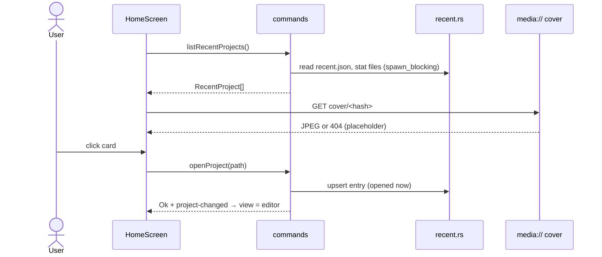

# Design: home screen and recent projects

- **Status:** Proposed (task 0120). After implementation this file is a record, not a spec.
- **Features:** F0.16, F0.23, F0.20 (recent-list part)
- **Builds on:** `project-lifecycle.md`, `autosave-recovery.md`, `preferences.md` (app-data file
  pattern), `media-import.md` (preview cache, `media://`), `platform-integration.md` (launch path)

## 1. Goal and non-goals

The app starts on a **Home** screen: New project, Open…, and a grid of recent projects (cover, name,
duration, modified date). One click opens a project. Rename, duplicate, delete (to the Recycle Bin)
and remove-from-list work from a card. A moved or deleted file shows as **Missing** with *Remove
from list*. Non-goals: search, sorting options, pinning, folders/tags, templates, cover choice,
reading project files to refresh name/duration (the entry keeps what the app last wrote or read).

## 2. User flow and decisions

- **Startup:** Home, unless a launch path was passed (Explorer double-click): then the editor opens
  directly (existing `takeLaunchPath` path). The recovery dialog is still offered on top of either
  view; **Restore** switches to the editor.
- **Home closes the project.** The model always has one document (ADR-0004), so Home is not a
  second document view: **File → Home** (action `go-home`, no shortcut) runs `replaceGuarded` (the
  existing Save / Don't save / Cancel prompt), then `new_project` (fresh, clean, untitled, no file),
  then shows Home. Consequences: no recent entry is ever the open document, so rename, duplicate and
  delete never touch an open file; there is no "back to editor" button (click the card instead; the
  undo history is gone, as with any reopen). Accepted for a one-person app.
- **On Home:** *New project* → `new_project` → editor. *Open…* → existing `openProject` → editor on
  success. A card click → `openPath(path)` → editor; `fileNotFound` marks the card missing.
  `openFileRequested` (second instance) works the same from Home. Home never shows the native
  preview (`PreviewArea` is unmounted, so `setPreviewVisible(false)`); window title is `Cutframe`.
- **Card menu** (right-click and a `⋯` button, same items): Open, Rename…, Duplicate, Show in
  Explorer, Delete…, Remove from list. Missing cards: Remove from list only. **Delete** asks
  "Move <name> to the Recycle Bin?"; Escape/Cancel does nothing. **Rename** is a small dialog
  (prefilled, Enter applies). None of these is an undo step (they act on files, not the model).
- **Recorded in the list:** successful `open_project` (also from the launch path),
  `save_project`, `save_project_as` (the new path; the old file's entry stays), and duplicate.
  **Not** `restore_recovery` (nothing on disk changed; the next save records it) and not autosave.
- **Pruning:** the task text says "pruned when files are missing", but its done-when wants a
  visible *missing* state. Decision: listing never prunes. Entries leave the list only by *Remove
  from list*, *Delete*, or the cap (30, oldest `openedAtMs` dropped).

## 3. Model changes (`app-core`)

None. Pure helper in `app-core` (testable, no I/O): `pub fn cover_hash(project: &Project) ->
Option<&str>` = fingerprint hash of the first media asset (import order) with `has_poster()`.
Clips do not reference media yet; task 0260 changes the rule to "media of the first clip on the
top video track" inside this one function.

## 4. Recent store (`src-tauri/src/recent.rs`, new; plain functions, no Tauri)

**File:** `app_data_dir()/recent.json`, the preferences pattern: `schemaVersion` (1), `load(text)`
→ parse → version (missing = error, newer = `TooNew`) → `migrate` (no steps at v1) → deserialize.
Broken or newer file → empty list (`warn!`); the next write passes `backup_of_version` so the
original survives once as `recent.json.v<n>.bak`. Writes use `project_file::write_project_file`.

```rust
pub const CURRENT_RECENT_VERSION: u32 = 1;
pub const RECENT_CAP: usize = 30;
#[derive(Serialize, Deserialize)] #[serde(rename_all = "camelCase")]
struct RecentFile { schema_version: u32, entries: Vec<RecentEntry> }   // newest first
#[derive(Clone, Serialize, Deserialize)] #[serde(rename_all = "camelCase")]
pub struct RecentEntry {
    pub path: String,          // absolute; the key, compared case-insensitively (Windows)
    pub name: String,          // project name at the last open/save
    pub duration: Time,        // Project::duration() at that time, flicks
    pub opened_at_ms: i64,     // Unix ms of the last open/save/duplicate by this app
    pub cover: Option<String>, // cover_hash(project): 32 lowercase hex chars
}
pub struct RecentStore { file: PathBuf, covers: PathBuf }   // in AppState, with recent_lock
```

Pure, unit-tested functions: `upsert(&mut Vec<RecentEntry>, entry)` (dedupe by key, move to
front, truncate to cap), `remove(&mut Vec, path) -> bool`, `same_path(a, b)`,
`project_path_for(dir, name) -> PathBuf` (`<stem>.cutframe`; stem = name with `<>:"/\|?*` and
control chars → `_`, trailing dots and spaces trimmed, empty → `Untitled`; same rule as the UI's
`defaultFileName`), `free_project_path(dir, name, exists: impl Fn(&Path) -> bool)` (that path,
then `<stem> (2).cutframe`, `(3)` …).
All read-modify-write goes through `recent_lock: tauri::async_runtime::Mutex<()>` in
`spawn_blocking`. A failed recent write after open/save is `warn!` only; it never fails that command.

**Cover:** no new generation and no frames over JSON. New `media://` route
`/cover/<hash>` (no `?v=`: the hash is the content key; 400 unless 32 lowercase hex). Served from
`app_data_dir()/covers/<hash>.jpg`; on a miss, from the preview cache's `poster.jpg` for that hash,
copied into `covers/` first; otherwise `404` (UI shows a placeholder). Covers live outside the
cache root so *Clear cache* and LRU eviction do not blank the home screen. `list` deletes cover
files no entry references. About 30 × 20 KB.

## 5. IPC changes

```rust
#[derive(Serialize, Deserialize, specta::Type)] #[serde(rename_all = "camelCase")]
pub struct RecentProject {            // view type (types.rs)
    pub path: String,
    pub name: String,                 // model data, not translated
    pub duration: Time,
    pub opened_at_ms: i64,
    pub modified_ms: Option<i64>,     // file mtime; None = missing or unreachable
    pub cover: Option<String>,        // hash for media://cover/<hash>
}
/// Recent projects, newest first; stats every file. Never prunes. Missing file → empty list.
pub async fn list_recent_projects(state) -> Result<Vec<RecentProject>, IpcError>;
/// Removes the entry; an unknown path is Ok.
pub async fn remove_recent_project(state, path: String) -> Result<(), IpcError>;
/// Renames the file to project_path_for(dir, name) and sets the project name inside it.
pub async fn rename_project_file(state, path: String, name: String) -> Result<(), IpcError>;
/// Copies the project to free_project_path(dir, name) with a new ProjectId; adds it first.
pub async fn duplicate_project_file(state, path: String, name: String) -> Result<(), IpcError>;
/// Moves the file to the Recycle Bin and removes the entry.
pub async fn trash_project_file(state, path: String) -> Result<(), IpcError>;
/// Explorer at the file, selected (tauri_plugin_opener::reveal_item_in_dir, like reveal_media).
pub async fn reveal_project_file(state, path: String) -> Result<(), IpcError>;
```

All are `#[tauri::command] #[specta::specta]`, file work in `spawn_blocking`, no events (the home
screen relists after each call). **Guards** (all but list/remove): `path` must be an entry of the
list (the webview cannot point these at arbitrary files) and must not be the session's `file_path`;
both → `invalidEdit`.
**Rename:** name trimmed, non-empty (`invalidEdit`); `read_project_file` (full load pipeline) →
set `name` → target `project_path_for(dir, name)`; differing only in case means the same file,
otherwise it must not exist (`invalidEdit`; the UI says "A project with this name already exists
or the name is empty") → `fs::rename(old, new)` → `write_project_file
(new, json, backup)` with `backup = Some(source_version)` when older than current (the existing
`.v<n>.bak` rule) → on write failure rename back (best effort) and return `io`. Entry: path and
name updated, `openedAtMs` kept. **Duplicate:** the UI passes the name (`t.home.copyName(name)`,
"<name> copy"; Rust sends no user text); new `ProjectId`, other ids kept (they are project-scoped);
written in the current schema, no backup. **Trash:** `trash::delete(path)`; `.v<n>.bak` siblings
are left alone. **Errors** reuse existing kinds: `fileNotFound`, `malformedProject` /
`projectTooNew` / `invalidProject` (via `From<ReadError>`), `invalidEdit`, `io` (rename, write,
trash), `unavailable` (reveal). No new kinds.

**Recording:** `open_project` (after `replace_project`) and `write` (after `mark_saved`) call
`state.record_recent(&project, &path)`: builds the entry (`duration`, `cover_hash`, now) and
upserts it. `restore_recovery` does not call it.

**New dependency:** `trash = "5.4"` (MIT; Windows via `IFileOperation` with
`FOFX_RECYCLEONDELETE`, COM apartment-threaded on the calling blocking thread). Allowed by
`deny.toml`. Known limit: Windows deletes permanently on drives without a Recycle Bin (network
shares); accepted, the dialog text says Recycle Bin. No capability changes (no fs/opener JS API).

## 6. Engine impact

None. The route reads the existing `PreviewCache` (`get(hash, Product::Poster)`; `valid_hash`
becomes `pub` for the route's check).

## 7. UI impact

- `stores/uiStore.ts`: `view: "home" | "editor"` (UI state only), `"home"` at start.
  `App.tsx` renders `HomeScreen` or `EditorLayout`; dialogs stay mounted for both.
- `projectSync.ts`: a launch path opens and sets `editor`; `fileActions` (`newProject`, `openPath`,
  `openProject`, recovery restore) set `editor` after success; `goHome()` =
  `replaceGuarded(() => commands.newProject(null))` → `home`.
- `features/home/` (new): `HomeScreen.tsx` (header with New project / Open…, responsive grid),
  `ProjectCard.tsx` (cover ``, placeholder on error or no hash;
  name; duration `formatDuration(flicks)` (m:ss / h:mm:ss); date `Intl` medium of `modifiedMs`,
  "Missing" badge when null), `RenameDialog.tsx`, `DeleteConfirmDialog.tsx`, `recent.ts`
  (store + deps-injected actions like `recovery.ts`: load, open, rename, duplicate, trash, remove;
  errors via `describeError`). Context menu from the existing `context-menu.tsx`/`dropdown-menu.tsx`.
- `actions.ts`: `go-home` in the File menu (first item). `i18n/en.ts`: home strings.

## 8. Project file

`schemaVersion` unchanged. `recent.json` has its own version; fixture
`src-tauri/tests/fixtures/recent-v1.json`, kept forever.

## 9. Performance budget

`list_recent_projects` with 30 entries on a local SSD < 20 ms (30 `metadata` calls); a dead network
path may block its own blocking thread, never the main thread. Recording adds < 5 ms to open/save.

## 10. Test plan

- **app-core:** `cover_hash`: no media, image/audio-only, first poster asset wins.
- **src-tauri (tempdir):** `upsert` dedupes case-insensitively, moves to front, caps at 30;
  `remove`; `free_project_path` (invalid chars, trailing dots, `(2)`, `(3)`); `load` of every
  `recent-v*.json` fixture, broken JSON and `TooNew` → empty + backup on next write; list reports
  `modifiedMs: None` for a deleted file and keeps the entry; rename: file moved, name inside
  changed, existing target refused, old-schema file gets `.v<n>.bak`, path not in list refused,
  open file refused; duplicate: new file loads, different `ProjectId`, `(2)` on collision; cover
  route: bad hash 400, covers hit, cache-hit copy, miss 404; unused covers pruned. Trash is tested
  only through a `fn trash(path)` seam (fake in tests; real Recycle Bin checked manually).
- **Vitest:** `formatDuration`; card shows Missing and only Remove; delete needs confirmation;
  rename validation (empty); `go-home` runs the unsaved prompt and Cancel stays in the editor;
  startup with a launch path skips Home.
- **Manual (`pnpm dev`):** save, Home, card reopens; move the file in Explorer → Missing → Remove;
  Delete → file in the Recycle Bin and restorable; Explorer double-click skips Home.

## 11. Diagram



## 12. Task breakdown

**backend:** (1) `cover_hash` + tests; (2) `recent.rs` store, pure helpers, fixture, tests;
(3) recording in open/save, the six commands, `RecentProject`, `/cover/` route, `trash` dep;
`pnpm bindings`; tell frontend. **frontend** (after 3): (4) `view` + startup/launch/recovery
wiring + `go-home`; (5) `features/home/` with dialogs, i18n, Vitest. **devops:** none (`cargo deny`).

**Feature catalog:** F0.16 → done; F0.23 → done; F0.20 → done (recent list added).
