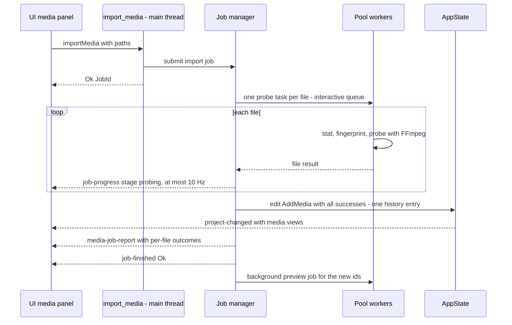
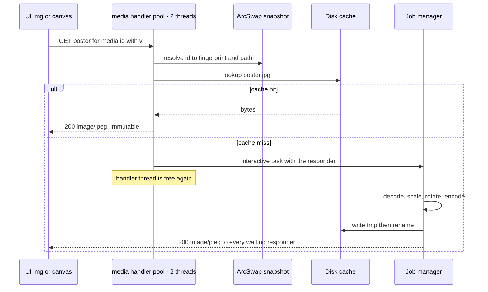
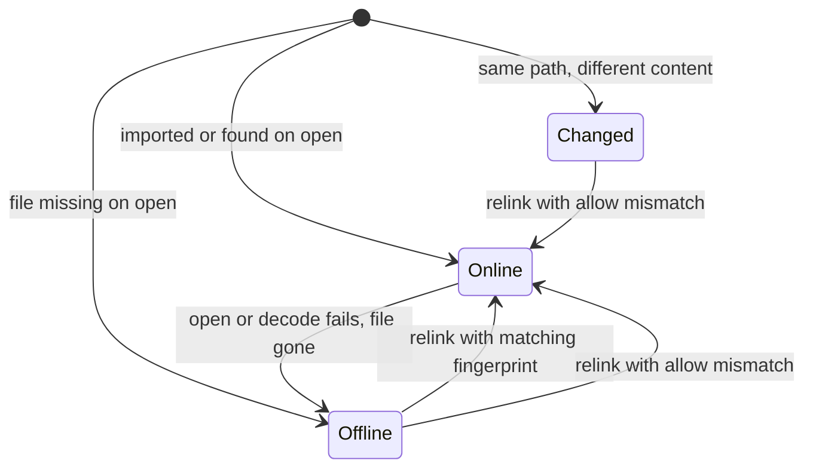
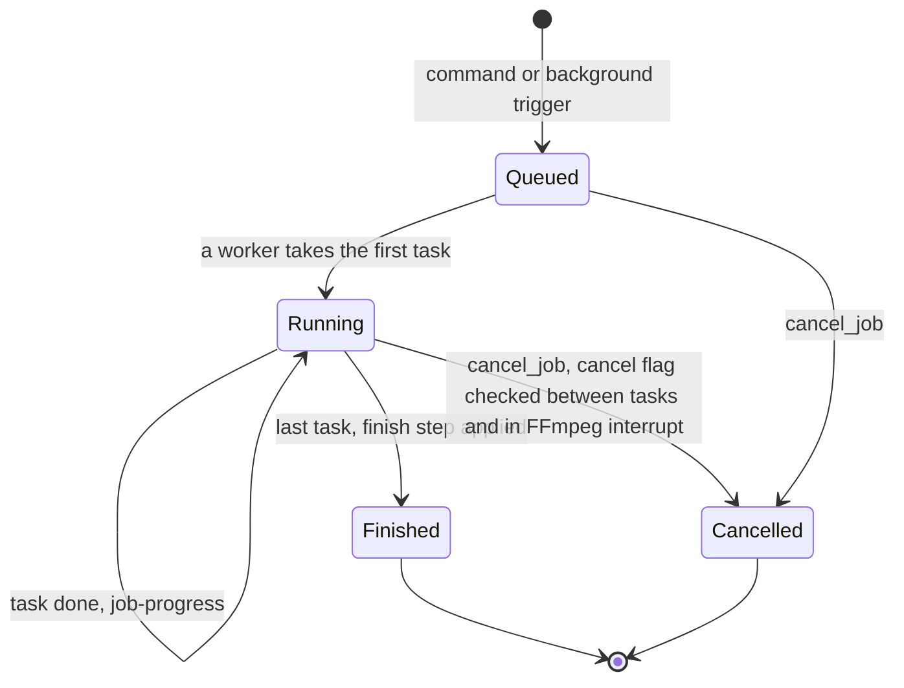

# Design: media assets, import, decode and `media://` assets

- **Status:** Proposed (task 0210); open questions answered by the user on 2026-11-22 (see Decisions). Implemented by tasks 0220, 0230 and 0240; the HDR and hardware-decode parts by 0310–0330.
- **Date:** 2026-11-22
- **Relates to:** ADR-0002 (project file), ADR-0003 (IPC, jobs), ADR-0004 (threads), ADR-0006 (edit
  transactions), review P1 #1, F12, F13, F16. Feature rows F1.01–F1.23, F0.25.

This design is sized for the stated purpose: one person cutting YouTube videos and Shorts on Windows.
The footage that matters most is phone video (portrait, HEVC, often VFR, sometimes HDR), screen
recordings (long GOP, sometimes several audio tracks) and phone photos.

### Decisions (user, 2026-11-22)

The three open questions from the first draft were answered:

1. **HDR phone footage: tone map in Tier 1.** The user's phone records HDR. Tier 1 gets a basic
   HDR→SDR tone map (HLG and PQ, one simple operator) inside the shared render graph, so preview and
   export match (feature F3.31 moves to Tier 1, tasks 0310/0320). This design makes the probe record
   everything that operator needs (§3 `VideoStreamInfo`, `HdrInfo`).
2. **Hardware decode in Tier 1.** Much of the footage is 4K HEVC. D3D11VA/D3D12VA decode for HEVC,
   H.264 and AV1 with a software fallback moves from task 0700 into Tier 1 (feature F3.45): 0310
   decides the zero-copy path, 0320 builds the decode path, 0330 proves real-time playback (§5).
3. **Settled as designed:** re-importing identical content is skipped (`AlreadyImported`), and
   removing media that the timeline uses warns, then removes its clips too, in one undo step.

## 1. Goal and non-goals

**After this design is implemented the user can:**

- import video, audio and image files with a file dialog or by dropping files and folders from
  Explorer onto the media panel; a busy import shows progress and can be cancelled;
- see per-file failures in plain words ("unsupported format", "file is damaged", "already
  imported"), while the good files of the same import are still added;
- undo an import with one Ctrl+Z (all files of that import disappear) and redo it;
- browse the media panel with posters, filmstrip skimming, durations and waveforms, which fill in
  progressively in the background and survive a restart;
- remove media, reveal a file in Explorer, and relink media that moved (single file or a whole
  folder).

Portrait phone videos and photos show upright, anamorphic sources show with the right shape and
VFR sources keep audio and video in sync.

**Non-goals (explicitly out of scope):**

- proxies and the render cache (task 0700); interchange formats (EDL, XML, AAF);
- copying or "collecting" media into a project folder, media bins/folders, ratings, tags, metadata
  editing; renaming media items (the name is the file name);
- selecting a non-default audio stream of a multi-track recording (the model records all audio
  streams now, so that choice can come later without a migration);
- rendering HDR: this design only records the HDR metadata; the tone map itself is in the render
  graph (0310/0320). HDR export stays out of scope (F3.32 `n/a`);
- previewing a media item in the player (F1.17) and the "used in timeline" badge (F1.18): both
  need clips or playback and move to later tasks (see §11).

## 2. User flow

1. **Import button** in the media panel (shortcut **Ctrl+I**): a native multi-select file dialog
   filtered to the supported extensions. Choosing files starts an import job.
2. **Drop from Explorer** onto the media panel: files and folders. Folders are expanded
   recursively; inside a folder only files with a supported extension are taken, silently. Files
   that were named explicitly (dropped or picked) are always tried and reported if they fail.
3. While the job runs, the media panel shows a slim progress bar with **Cancel** (Esc while the
   panel has focus). Cancel adds nothing.
4. When the job ends, all successfully probed files appear at once, in the order given. If any file
   failed or was skipped, one toast summarises it ("2 files could not be imported") with a details
   list (file name + translated reason).
5. Posters appear within about a second; filmstrips and waveforms fill in afterwards. A small
   indicator shows background generation progress (F1.23).
6. **Undo/redo:** one import job = one history entry `importMedia`. Remove media = one entry
   `removeMedia`. Relink (one file or a folder) = one entry `relinkMedia`. Background generation,
   missing-media detection and job progress record nothing.

Internal drags (media panel to timeline, later tasks) must use pointer events, not HTML5
drag-and-drop: with Tauri's native file-drop handling enabled (needed to receive Explorer paths),
WebView2 does not deliver HTML5 drag-and-drop events inside the page.

## 3. Model changes (`app-core`)

New module `crates/app-core/src/media.rs`; `Project` gains one field.

```rust
id_type!(
    /// Identifies a media asset within a project.
    MediaId
);

pub struct Project {
    // ...existing fields...
    /// In import order. The media panel sorts and filters its own view of this list.
    pub media: Vec<MediaAsset>,
}

#[serde(rename_all = "camelCase")]
pub struct MediaAsset {
    pub id: MediaId,
    pub kind: MediaKind,
    pub path: MediaPath,
    pub fingerprint: Fingerprint,
    pub info: MediaInfo,
}

#[serde(rename_all = "camelCase")]
pub enum MediaKind {
    /// Has a video stream with a duration (includes animated GIF). May have audio.
    Video,
    /// Audio streams only.
    Audio,
    /// A still picture: a video stream with one frame and no duration.
    Image,
}

#[serde(rename_all = "camelCase")]
pub struct MediaPath {
    /// Absolute path, UTF-8, without the `\\?\` prefix.
    pub absolute: String,
    /// Relative to the project file's directory. Written on save (task 0100), `None` before the
    /// project has a location or when the media is on another drive.
    pub relative: Option<String>,
}

/// Content identity: the cache key and the relink match. Never sent over IPC.
#[serde(rename_all = "camelCase")]
pub struct Fingerprint {
    /// File size in bytes.
    pub size: u64,
    /// Last-modified time, milliseconds since the Unix epoch. Only a hint for "unchanged" checks.
    pub modified: i64,
    /// 32 lowercase hex chars: BLAKE3 over `size` (LE u64) + the first 1 MiB + the last 1 MiB,
    /// truncated to 128 bits.
    pub hash: String,
}

#[serde(rename_all = "camelCase")]
pub struct MediaInfo {
    /// FFmpeg demuxer short name of the first format name, e.g. `mov`, `matroska`, `mp3`.
    pub container: String,
    /// Container time, in flicks, of media time zero (the earliest start of the used streams).
    /// Media time `t` is container time `t + origin` for every stream.
    pub origin: Time,
    /// `None` only for `MediaKind::Image`.
    pub duration: Option<Time>,
    pub video: Option<VideoStreamInfo>,
    /// Every decodable audio stream, default stream first. Attached pictures and data streams
    /// are not listed.
    pub audio: Vec<AudioStreamInfo>,
}

#[serde(rename_all = "camelCase")]
pub struct VideoStreamInfo {
    pub stream_index: u32,
    /// FFmpeg codec name, e.g. `h264`, `hevc`, `vp9`, `prores`.
    pub codec: String,
    /// Decoded picture size before rotation and pixel-aspect correction.
    pub width: u32,
    pub height: u32,
    /// Sample (pixel) aspect ratio; 1/1 when the file has none.
    pub sample_aspect: Rational,
    /// Clockwise quarter turns that make the picture upright (display matrix or EXIF).
    pub rotation: Rotation,
    /// Average frame rate as reported by the demuxer. Informational (bin display, a suggested
    /// project rate). Never used to locate frames. `None` for images.
    pub frame_rate: Option<Rational>,
    /// FFmpeg pixel format name, e.g. `yuv420p10le`.
    pub pixel_format: String,
    /// Bits per luma sample from the pixel format descriptor (8, 10, 12). The render graph needs
    /// it to upload 10-bit HDR planes without truncating them to 8 bits before the tone map.
    pub bit_depth: u8,
    pub color: ColorInfo,
    /// `Some` when the stream is HDR: transfer is PQ (`smpte2084`) or HLG (`arib-std-b67`), or a
    /// Dolby Vision configuration record is present. `None` for SDR.
    pub hdr: Option<HdrInfo>,
}

#[serde(rename_all = "camelCase")]
pub struct HdrInfo {
    /// Which curve the decoded base layer uses. This is what the tone map keys on.
    pub transfer: HdrTransfer,
    /// From `AV_PKT_DATA_MASTERING_DISPLAY_METADATA`: peak luminance of the mastering display in
    /// whole cd/m2 (nits), when present. Optional input for the PQ operator.
    pub mastering_max_nits: Option<u32>,
    /// From `AV_PKT_DATA_CONTENT_LIGHT_LEVEL`: MaxCLL in nits, when present.
    pub max_cll_nits: Option<u32>,
    /// From `AV_PKT_DATA_DOVI_CONF` (stream side data), when present.
    pub dolby_vision: Option<DolbyVisionInfo>,
}

#[serde(rename_all = "camelCase")]
pub enum HdrTransfer {
    Pq,
    Hlg,
    /// Dolby Vision without a compatible base layer (profile 5): the base layer is not plain PQ or
    /// HLG, so the simple tone map shows wrong colours. Imported, logged, badged; no DV processing.
    DolbyVisionOnly,
}

#[serde(rename_all = "camelCase")]
pub struct DolbyVisionInfo {
    pub profile: u8,          // e.g. 8 for iPhone footage
    pub level: u8,
    /// `bl_signal_compatibility_id`: 1 = HDR10 (PQ), 2 = SDR, 4 = HLG (iPhone 8.4), 0 = none.
    pub compatibility_id: u8,
}

#[serde(rename_all = "camelCase")]
pub struct AudioStreamInfo {
    pub stream_index: u32,
    pub codec: String,
    pub sample_rate: u32,
    pub channels: u16,
}

/// FFmpeg's own names (`av_color_*_name`), `None` when unspecified. Strings, not enums, so new
/// values never need a migration. Read by the render graph (0310) and colour management (0750).
#[serde(rename_all = "camelCase")]
pub struct ColorInfo {
    pub primaries: Option<String>,
    pub transfer: Option<String>,
    pub matrix: Option<String>,
    pub range: Option<String>,
}

#[serde(rename_all = "camelCase")]
pub enum Rotation { None, Cw90, Cw180, Cw270 }

/// An exact positive ratio such as 30000/1001 or a 4:3 pixel aspect. Unlike `FrameRate` it need
/// not be flick-aligned: source rates like 2997/100 are valid here.
pub struct Rational { pub num: u32, pub den: u32 } // num > 0, den > 0, stored reduced
```

`time.rs` gains `Time::from_ticks(ticks: i64, time_base: Rational) -> Time` and
`Time::to_ticks(self, time_base) -> i64`: i128 arithmetic, rounding to nearest. These are the only
places where FFmpeg timestamps become flicks.

**Invariants** (checked by `Project::validate`, ADR-0002 §3; task 0100 adds `validate`, this design
adds the media rules to it):

- media ids are unique;
- `Video` ⇒ `video` is `Some`, `duration` is `Some(> 0)`, `video.frame_rate` is `Some`;
  `Audio` ⇒ `video` is `None`, `audio` not empty, `duration` is `Some(> 0)`;
  `Image` ⇒ `video` is `Some`, `duration` is `None`, `audio` is empty;
- `width`, `height` > 0; every `Rational` has `num > 0` and `den > 0`; `bit_depth` in 8..=16;
- `hdr.transfer` equals `app_core::media::hdr_transfer(color.transfer, dolby_vision)`, the single
  rule used by the probe and by `validate`: Dolby Vision with compatibility id 0 →
  `DolbyVisionOnly`; else transfer `smpte2084` → `Pq`, `arib-std-b67` → `Hlg`; else Dolby Vision
  compatibility id 1 → `Pq`, 4 → `Hlg`; anything else (SDR, or Dolby Vision with an SDR-compatible
  base layer, id 2) → `hdr = None`;
- `fingerprint.hash` is 32 lowercase hex chars; `path.absolute` is non-empty;
- once clips reference media (design 0250), every reference resolves to an asset in `media`.

**Derived values** (methods, not stored): `MediaAsset::file_name()` (from `path.absolute`) and
`VideoStreamInfo::display_size()`: first the stored width is scaled by `sample_aspect` (rounded
to even), because the pixel aspect describes the coded picture before any rotation; then a quarter
turn swaps width and height. The opposite order gives the wrong shape for a rotated anamorphic
source. Thumbnails and the render graph both use `display_size`.

**Commands** (each is one history entry):

| Command | `HistoryLabel` | Apply | Revert |
|---|---|---|---|
| `AddMedia { assets: Vec<MediaAsset> }` | `importMedia` | appends assets whose ids are new; fails on a duplicate id | removes those ids |
| `RemoveMedia { ids }` | `removeMedia` | removes the assets, remembers their indices; fails with `MediaInUse` if a clip references one | re-inserts at the original indices |
| `RelinkMedia { id, path, fingerprint, info }` | `relinkMedia` | replaces `path`, `fingerprint` and `info`, keeps `id` | restores the old values |

The ids in `AddMedia` are created when the job builds the command, so redo recreates the same ids
(as `AddTrack` does). A folder relink is a `Batch` of `RelinkMedia` with label `relinkMedia`.
Removing media that is used by clips is, from task 0260 on, a `Batch` of the clip deletions and
`RemoveMedia` under `removeMedia`, after a warning in the UI.

## 4. IPC changes

Rust signatures; all registered in `ipc_builder()`. Paths are user data, not user-facing text, so
sending them is consistent with ADR-0003 §5.

```rust
/// Starts probing `paths` (files or folders). Returns at once. Empty `paths` -> InvalidEdit.
#[tauri::command] #[specta::specta]
pub fn import_media(app: AppHandle, state: State<AppState>, paths: Vec<String>) -> Result<JobId, IpcError>;

/// Opens the native multi-select file dialog (Rust side, no dialog permission in the webview)
/// and starts an import. `None` if the user cancelled the dialog. Async: it does not touch the
/// Document while the dialog is open (ADR-0003 rejected-options note). `filter_label` is the
/// translated name of the file-type filter ("Media files"): the UI supplies it, because a label
/// chosen in Rust would be user-facing text from Rust (ADR-0003 §5).
#[tauri::command] #[specta::specta]
pub async fn import_media_dialog(app: AppHandle, filter_label: String) -> Result<Option<JobId>, IpcError>;

/// Idempotent: unknown or finished ids are ignored.
#[tauri::command] #[specta::specta]
pub fn cancel_job(state: State<AppState>, id: JobId) -> Result<(), IpcError>;

/// Fails with InvalidEdit (`MediaInUse`) while a clip uses one of them (until 0260 adds the batch).
#[tauri::command] #[specta::specta]
pub fn remove_media(app: AppHandle, state: State<AppState>, ids: Vec<MediaId>) -> Result<(), IpcError>;

/// Opens Explorer with the file selected. By id, so the webview never handles raw paths for this.
#[tauri::command] #[specta::specta]
pub fn reveal_media(state: State<AppState>, id: MediaId) -> Result<(), IpcError>;

// Task 0240
#[tauri::command] #[specta::specta]
pub fn relink_media(app: AppHandle, state: State<AppState>, id: MediaId, path: String, allow_mismatch: bool) -> Result<JobId, IpcError>;
#[tauri::command] #[specta::specta]
pub fn relink_media_folder(app: AppHandle, state: State<AppState>, folder: String) -> Result<JobId, IpcError>;
```

`IpcError` gains `Cancelled` (`kind: "cancelled"`), used only as a `JobFinished` result.

**Jobs** follow ADR-0003 §8 exactly: `JobId` (UUID v7), `JobProgress { job_id, stage, progress }`
throttled to 10 Hz per job, and `JobFinished { job_id, result: Result<(), IpcError> }`. New
`JobStage` keys: `probing` (0220), `generatingPreviews` (0230), `checkingMedia` and
`searchingFolder` (0240). Each key is added by the task that first emits it. Background
jobs that Rust starts by itself (preview generation, media check) use the same events, so the UI
shows their progress by stage without having started them.

Per-file results travel in one extra typed event, emitted just before `JobFinished` of the job it
belongs to. As with the stages, each variant below is added by the task that first produces it:
0220 has `Added`, `AlreadyImported` and `Failed` with the import error kinds; `Relinked`,
`FingerprintMismatch`, `NotFound` and `KindMismatch` arrive with 0240.

```rust
/// event: media-job-report
pub struct MediaJobReport {
    pub job_id: JobId,
    pub files: Vec<MediaFileResult>,
}
pub struct MediaFileResult {
    pub path: String,
    pub outcome: MediaFileOutcome,
}
#[serde(tag = "kind", rename_all = "camelCase")]
pub enum MediaFileOutcome {
    Added { media: MediaId },
    Relinked { media: MediaId },
    /// The same content (fingerprint) is already in the project.
    AlreadyImported { media: MediaId },
    /// relink_media with allow_mismatch = false and a different fingerprint: the UI asks the user
    /// and calls relink_media again with allow_mismatch = true.
    FingerprintMismatch { media: MediaId },
    /// relink_media_folder found no file with the same fingerprint for this offline asset.
    NotFound { media: MediaId },
    Failed { error: MediaErrorKind, detail: String /* English, for the log only */ },
}
#[serde(rename_all = "camelCase")]
pub enum MediaErrorKind {
    FileNotFound, AccessDenied, UnsupportedPath, // e.g. not valid UTF-8
    UnsupportedFormat, // no demuxer, or no video/audio stream
    UnsupportedCodec,  // a stream exists but this FFmpeg build cannot decode it
    Damaged,           // demuxer or decoder fails on the first frames, the tail cannot be read,
                       // or the duration is unknown
    TooManyFiles,      // a folder holds more than MAX_IMPORT_FILES media files; skipped whole
    KindMismatch,      // relink to a file of another kind (video -> audio), task 0240
}
```

**State:** `ProjectView` gains `media: Vec<MediaView>` in project order. It is part of the full
`ProjectState` snapshot (ADR-0003 §6), so no separate media event is needed.

```rust
pub struct MediaView {
    pub id: MediaId,
    pub kind: MediaKind,
    pub file_name: String,
    pub path: String,                    // absolute, for the list view and tooltips
    pub duration: Option<Time>,
    pub display_width: Option<u32>,      // after rotation and pixel aspect
    pub display_height: Option<u32>,
    pub frame_rate: Option<Rational>,
    pub video_codec: Option<String>,
    pub hdr: Option<HdrTransfer>,        // HDR badge in the panel; `dolbyVisionOnly` gets a warning
    pub audio: Option<AudioSummary>,     // default stream: sample rate, channels, stream count
    pub status: MediaStatus,             // online | offline | changed (session state, §6.6)
    pub used_by: u32,                    // clips referencing it; 0 until design 0250
    /// Appended as `?v=` to media:// URLs so a relink never shows stale images.
    pub preview_version: String,         // first 16 hex chars of fingerprint.hash
    pub filmstrip: Option<FilmstripLayout>, // added by 0230 with the generators
}
pub struct FilmstripLayout {
    pub interval: Time,       // media time between frames
    pub frames: u32,
    pub frames_per_tile: u32, // 32
    pub frame_width: u32,     // physical px; height is FILMSTRIP_FRAME_HEIGHT
}
```

Constants exported with `Builder::constant` (ADR-0003 §3): `MEDIA_EXTENSIONS` (lowercase, without
dots, for the drop filter) and `MAX_IMPORT_FILES` (2000) from 0220; `FILMSTRIP_FRAME_HEIGHT` (96),
`WAVEFORM_BUCKETS_PER_SECOND` (100) and `POSTER_LONG_SIDE` (320) from 0230, together with
`MediaView.filmstrip`. No fingerprint, size or mtime crosses IPC.

### `media://` routes

All by id (ADR-0003 §9), all `GET`, all with `?v=<previewVersion>`:

| Route | Body | Exists for |
|---|---|---|
| `/poster/<mediaId>` | JPEG, long side 320 px, upright, frame at `min(1 s, duration / 2)` | video, image |
| `/filmstrip/<mediaId>?tile=<n>` | JPEG strip of `frames_per_tile` frames side by side, each `frame_width x 96` | video |
| `/waveform/<mediaId>` | binary, see below | video with audio, audio |

Waveform body (little endian): magic `CFWF`, `u16` version = 1, `u16` channels = 1, `u32` buckets
per second = 100, `u32` bucket count, then `bucket count x (i8 min, i8 max)`: a mono mix-down of
the default audio stream, scaled to ±127. One hour is about 720 KB. The UI reduces it further for
zoomed-out views (drawing math, not model logic).

Filmstrip frames: frame `i` shows media time `i x interval`, where `interval = 1 s` for media up to
20 minutes, else `duration / 1200` rounded up to a whole frame of 1/1000 s; at most 1200 frames.
`frame_width = round(96 x display_width / display_height)` clamped to 54..=171. Hover-scrub in the
panel (F1.16) and clip filmstrips on the timeline (F1.34, later) use the same tiles.

Status codes: `200` with `Cache-Control: max-age=31536000, immutable`; `404` for an unknown id, a
product the kind does not have, or a tile out of range; `503` when the media is offline and nothing
is cached, or the request queue is full; `500` when generation failed (remembered for the session,
so the UI does not retry in a loop). Offline media whose previews are cached still shows them,
because the cache is keyed by content.

## 5. Engine impact

New module `crates/engine/src/media/`. `engine` now depends on `app-core` (already the target in
ADR-0004 §2) and on `rsmpeg` (task 0200).

- **`probe(path) -> Result<MediaInfo, MediaError>`:** `avformat_open_input` + `find_stream_info`
  with a bounded `probesize`/`analyzeduration`; best video stream (ignoring
  `AV_DISPOSITION_ATTACHED_PIC`), all audio streams with an available decoder; a decoder is opened
  for each chosen stream and one frame decoded, so that "probes fine, cannot decode" is reported as
  `UnsupportedCodec` or `Damaged` at import instead of on the timeline. Then the probe always seeks
  to the last keyframe before the end and reads the tail: up to 32 packets when the duration is
  known, or on to the end of the file when the container states none (browser-recorded WebM, some
  MKV), taking the end of the last packet as the duration. A read error or a packet flagged
  corrupt in the tail makes the file `Damaged`, which catches truncated MP4s whose index points
  past the data. When the duration is known and the seek itself fails, the tail check is skipped.
- **`fingerprint(path)`:** reads at most 2 MiB; `blake3` crate (CC0/Apache-2.0, passes
  `deny.toml`).
- **Rotation:** from the stream's display matrix (`AV_PKT_DATA_DISPLAYMATRIX` in
  `codecpar.coded_side_data`), snapped to the nearest quarter turn; for JPEG from EXIF
  orientation, for HEIC from the `irot` box (see HEIC below). Whether FFmpeg 7.1 exposes EXIF orientation for JPEG (frame
  metadata) or a small permissive EXIF crate is needed is settled in 0220 with a fixture. Mirroring
  is ignored and logged.
- **Pixel aspect:** `sample_aspect_ratio` of the stream, else of the codec parameters, else 1/1.
- **VFR:** nothing in the engine locates frames by index. Every decoded frame carries its
  `pts` converted with `Time::from_ticks` minus `origin`. A seek goes to the keyframe at or before
  the target and decodes forward. The frame shown for media time `t` is the last frame with
  `pts <= t` (sample and hold). Audio uses its own timestamps against the same `origin`, so A/V sync
  holds for VFR phone footage. Trims snap to the project frame grid (design 0250), never to source
  frames, so no per-frame index is built at import.
- **Still images:** opened through FFmpeg's image demuxers (`image2`, `png_pipe`, `webp_pipe`, ...).
  Animated GIF probes as `Video`. Animated WebP decodes only its first frame in FFmpeg 7.1 and is
  imported as `Image`.
- **HEIC/HEIF:** supported without `libheif`, using FFmpeg's HEVC decoder. Phone HEIC files are
  tile grids, which FFmpeg 7.1 exposes as a tile-grid stream group
  (`AV_STREAM_GROUP_PARAMS_TILE_GRID`). The probe reports the grid's full size as `width` x
  `height`, `kind = image`, and decodes the first tile to prove the file decodes. FFmpeg 7.1 does
  not export the HEIF `irot` box, so `engine/src/media/heif.rs` reads it (a small bounded box
  parser over untrusted input). Stitching the tiles into one picture is shared engine code built
  by 0230 for posters and reused by 0320 for image clips.
- **Preview generation (`media::previews`):** decode → `sws_scale` to the target size with the
  stream's colour matrix and range → rotate quarter turns in Rust → JPEG encode (FFmpeg's `mjpeg`
  encoder or a permissive Rust encoder; backend picks, cargo-deny decides). Filmstrips decode
  keyframes only (`skip_frame = NONKEY`); when the keyframe before a sample time is more than one
  `interval` away (long-GOP screen recordings), it decodes forward to the sample. Waveforms decode
  the default audio stream once and reduce it with `swresample` to mono. Previews decode in
  software (no GPU needed in job workers).
- **HDR probe:** `hdr` is filled from the stream's colour properties and its side data
  (`coded_side_data`: mastering display, content light level, `DOVI_CONF`). Dolby Vision profile 8.4
  (iPhone) has an HLG-compatible base layer and is treated as `Hlg`, ignoring the RPU; profile 8.1
  is treated as `Pq`; profile 5 becomes `DolbyVisionOnly`. Nothing is decoded for this, the probe
  only reads metadata.
- **HDR previews:** posters and filmstrips of HDR sources are converted with `sws_scale` to 16-bit
  RGB and tone-mapped on the CPU with a lookup table built from the same operator constants as the
  render graph (0310), then written as 8-bit JPEG. They only need to look right, not match the
  preview pixel for pixel; no golden test compares the two.
- **Cancellation:** every `AVFormatContext` gets an `AVIOInterruptCB` that checks the job's cancel
  flag, so a slow USB stick, a network share or a cloud-only OneDrive file can be cancelled.
- **Paths:** passed to FFmpeg as UTF-8. FFmpeg's `file` protocol converts to UTF-16 on Windows, so
  non-ASCII names (Polish diacritics) work. A fixture with such a name is part of the tests.
- **Decode threads (ADR-0004):** job tasks open their own FFmpeg contexts and close them when the
  task ends; contexts are never shared between threads. Job decoders use `thread_count = 2`. The
  long-lived decode workers for playback (one per active source) are designed in 0310 and reuse
  this module's open/seek/decode code.
- **Render graph / export parity:** not touched here. The render graph (0310/0320) reads
  `rotation`, `sample_aspect`, `color`, `bit_depth`, `hdr` and `origin` from the model; preview and
  export share that code, and thumbnails reuse `display_size` so the bin and the preview agree on
  the shape. The tone map runs per source layer, at the YUV→RGB step, so the rest of the graph
  stays SDR Rec.709 (F3.33 is `n/a`) and 10-bit working precision (F3.30) can stay in task 0750.

### Hardware decode and zero-copy for D3D12 (review F16): path decided in the render-graph design 0310

Hardware decode is Tier 1 (user decision 2026-11-22, F3.45): D3D11VA or D3D12VA for HEVC, H.264
and AV1, with software decode as the fallback when the GPU or driver lacks the profile (e.g. 4:2:2
or 12-bit HEVC, AV1 on older iGPUs) or the hardware decoder fails to open. The zero-copy path
belongs with the render graph, which owns the textures, so 0310 decides it; 0320 builds it, 0330
proves real-time 4K HEVC playback with it. This design fixes only the shape: the decoder returns
`DecodedVideoFrame { pts: Time, data: FrameData }` with `FrameData::Cpu(planes)` (software, and the
download fallback) and `FrameData::Gpu(...)` (hardware, 0310 defines it). 10-bit HDR sources arrive
as P010 / `yuv420p10le` and must reach the tone map without an 8-bit step. The import probe and the
preview jobs always use software decode, so import works on any machine.

Input for 0310 (to verify with a spike, not settled facts):

- **D3D12VA (FFmpeg ≥ 6.1, `AV_HWDEVICE_TYPE_D3D12VA`):** FFmpeg can be given wgpu's own
  `ID3D12Device` (via `wgpu::Device::as_hal`), so decoded `ID3D12Resource` NV12 textures live on the
  same device and can be wrapped with `wgpu-hal`'s DX12 `texture_from_raw` +
  `create_texture_from_hal` and sampled as `TextureFormat::NV12`. Cost: FFmpeg's fence must be
  waited on before wgpu uses the texture (wgpu has no public queue-wait on external fences), and
  D3D12VA is younger in FFmpeg and drivers.
- **D3D11VA + shared NT handles:** the most mature FFmpeg path, but needs a second (D3D11) device,
  a copy out of the decoder's texture array into a shareable texture, and keyed-mutex or fence
  sync across APIs.
- **Recommendation for the spike:** try D3D12VA on the shared device first; keep the CPU path as the
  universal fallback; implement D3D11VA only if D3D12VA fails on the reference iGPU. The spike must
  include a 10-bit HEVC HDR phone clip (P010 output), not only 8-bit H.264.

## 6. Shell impact (`src-tauri`)

### 6.1 Job manager (`src-tauri/src/jobs.rs`, first built in 0220)

- A fixed pool of `P = clamp(available_parallelism / 4, 1, 3)` worker threads (ADR-0004), with
  two FIFO queues: **interactive** (import probes, `media://` misses, relink) is always served
  before **background** (preview prefetch, media check). With 2 decoder threads per task the pool
  uses at most about 6 cores and leaves room for playback.
- Jobs are split into tasks (one per file or per preview product). A job's last task runs its
  finish step. A registry maps `JobId` to a cancel flag and a progress counter; a 10 Hz ticker
  emits `job-progress` for jobs whose counter moved.
- `pause_background(bool)`: a hook for playback to stop prefetch while playing; added by 0330,
  which is its first user.
- Applying a model command from a job goes through `AppState::edit` like any command (short lock,
  ADR-0004 §1). If a gesture is open (`GestureInProgress`, ADR-0006 §3) the finish step retries
  every 50 ms until the gesture ends; gestures are short and the job's result is not lost.

### 6.2 Import job

1. Expand folders (recursive, supported extensions only). A folder with more than
   `MAX_IMPORT_FILES` (2000) media files is skipped as a whole and reported once, as a `Failed`
   entry for the folder with `TooManyFiles`; importing an arbitrary first part of it would be
   surprising. Remove duplicates by normalised path.
2. Per file, in parallel on the pool: stat → fingerprint → probe. Progress = files done / total,
   stage `probing`.
3. Finish: drop files whose fingerprint is already in the snapshot or earlier in the same batch
   (`AlreadyImported`). If cancelled → no command, `JobFinished(Err(Cancelled))`. Otherwise build
   one `AddMedia` with all successes (in input order) and apply it; nothing is applied if every
   file failed. Emit `media-job-report`, then `job-finished`, then enqueue a background preview job
   for the new ids.

### 6.3 Preview job and `media://` pool (review F12)

- The `media://` handler no longer spawns a thread per request. It pushes the request and its
  `UriSchemeResponder` into a bounded queue (capacity 256, full → `503`) served by 2 handler
  threads. A handler parses the route, resolves the id in the `ArcSwap` snapshot (never takes the
  document lock), and serves the cache file if present.
- On a miss the handler hands the responder to the job manager as an interactive task and returns;
  no handler thread waits. An in-flight map keyed by (fingerprint, product) attaches later
  requests for the same product to the running task, and the task answers all waiting responders
  when the file is written.
- The background preview job (after import, and after a project is opened for assets that miss
  cache files) generates, in order, all posters, then waveforms, then filmstrip tiles, so the
  panel fills quickly. Stage `generatingPreviews`. Undoing an import while it runs is harmless: the
  job skips ids that are no longer in the snapshot.
- The legacy `/preview/frame` route keeps working through the same pool (unmaintained,
  ADR-0005 amendment).

### 6.4 Disk cache (`engine::media::cache`, root passed in by the shell)

```
%LOCALAPPDATA%\app.cutframe.editor\cache\media\v1\      <- Tauri app_local_data_dir()\cache\media\v1
  9f\9f2c41d0e8a7b6c5d4e3f2a1b0c9d8e7\                  <- 2-char shard \ fingerprint.hash
    poster.jpg
    filmstrip-0000.jpg, filmstrip-0001.jpg, ...
    waveform.bin
    used                                                <- empty; mtime = last use, for eviction
```

- Keyed by content, so a moved or renamed file keeps its previews, the same file in two projects
  shares them, and a changed file gets new ones (and a new `previewVersion`).
- Files are written as `<name>.tmp` and renamed, so a crash never leaves a half file that is
  served.
- `v1` is bumped when the output format or sizes change; old version folders are deleted at
  startup.
- Size cap 2 GiB by default (task 0150 makes the root and the cap configurable and adds "clear
  cache"). Eviction runs as a background task at startup and after preview jobs: delete whole asset
  folders by oldest `used` mtime until under the cap. `used` is touched at most once per asset per
  session.
- No SQLite index: the folder layout is the index. ADR-0001 lists SQLite for a media index; nothing
  in Tier 1 needs one, so it is not added until a feature does.

### 6.5 Drag and drop and the file dialog

- The UI listens to Tauri's window drag-drop event (`onDragDropEvent`), which carries the paths
  and the drop position. It hit-tests the position against the media panel and calls
  `import_media(paths)`. Dropping on the timeline (F1.03) is task 0260.
- `import_media_dialog` uses `tauri-plugin-dialog` from Rust, so the webview needs no `dialog:*`
  permission (the capability file asks for dedicated commands over plugin access).
- `reveal_media` uses `tauri-plugin-opener`'s `reveal_item_in_dir` from Rust.

### 6.6 Media status and missing media (task 0240)

`MediaStatus` (`online`, `offline`, `changed`) is session state in `AppState`, keyed by `MediaId`.
It is not in the model or the file and records no history; when it changes, `AppState` bumps the
session revision and emits `project-changed` (ADR-0003 §6). Before a check finishes, assets count
as `online`.

- **On open** (needs task 0100), a background `checkingMedia` job resolves each asset per ADR-0002
  §7: `<project dir>\relative` first, then `absolute`. If the relative path wins, the loaded
  project's `absolute` is updated before the `Document` is created (load-time normalisation, not an
  edit). Then: missing → `offline`; size and mtime equal to the fingerprint → `online`; otherwise
  re-hash: same hash → `online`, different → `changed`.
- **At runtime**, a decode or open failure because the file is gone sets `offline`.
- **Relink one file** (`relink_media`): fingerprint + probe the chosen file. Same hash → relink.
  Different hash → `FingerprintMismatch` unless `allow_mismatch`; then relink with the new info
  (used for `changed` media too: "use the file as it is now"). Different kind → `KindMismatch`.
- **Relink a folder** (`relink_media_folder`): walk the folder once, index files by size, hash only
  candidates whose size matches an offline asset (same file name first). Every asset with a hash
  match is relinked in one `Batch` (one undo step); the rest are reported `NotFound`. Name-only
  matches are never accepted automatically.

## 7. UI impact

- `ui/src/features/media-bin/`: import button, drop target, job progress bar with cancel, result
  toast with details, grid and list views, poster `` with `?v=`, hover-scrub over filmstrip
  tiles, waveform canvas for audio items, sort (import order, name, duration, kind), filter by kind,
  search by name, remove with confirmation, "Show in Explorer", offline/changed badges and a relink
  entry (0240).
- `ui/src/ipc/media.ts`: URL builders for the three routes and a waveform parser.
- `ui/src/i18n`: keys for `MediaErrorKind`, `MediaFileOutcome` kinds, `JobStage`, the new
  `HistoryLabel`s and `IpcError` kind `cancelled`.
- Nothing draws over the native preview. Dialogs that overlap it (relink, remove confirmation) use
  the shared preview-occlusion helper (ADR-0005 §4, review F11).
- Sorting, filtering and searching are view logic over `ProjectState.media` and stay in the UI; no
  model logic moves to TypeScript.

## 8. Project file

- `CURRENT_SCHEMA_VERSION` 1 → 2. Migration `v1_to_v2` inserts `"media": []` at the project level;
  nothing else changes. New fixture `crates/app-core/tests/fixtures/project-v2.json` with one
  video (portrait HEVC, `cw90`, 30000/1001), one audio and one image asset; `project-v1.json` stays
  and must load as an empty media list. The canonical snapshot test includes media.
- **Coordination with 0100:** if 0100 bumps the schema first, this change becomes the next number;
  whichever lands second renumbers its step and fixture. No other conflict is expected.
- **What depends on 0100:** writing `relative` (needs the project file location), relative-first
  resolution on open, the `.v1.bak` backup on first save, `Project::validate` itself, and the
  missing-media check on open (0240). **What does not:** everything in 0220. Until 0100 lands, new
  assets store `absolute` only with `relative: None`, which is valid v2 data, and imports cannot be
  persisted yet, which is expected.
- Example (shortened):

```json
"media": [{
  "id": "019a9a10-5b3c-7e2f-8a41-0c2d3e4f5a6b",
  "kind": "video",
  "path": { "absolute": "C:\\Users\\me\\Videos\\IMG_0042.MOV", "relative": "..\\Videos\\IMG_0042.MOV" },
  "fingerprint": { "size": 48213344, "modified": 1763800000000, "hash": "9f2c41d0e8a7b6c5d4e3f2a1b0c9d8e7" },
  "info": {
    "container": "mov", "origin": 0, "duration": 7056000000,
    "video": { "streamIndex": 0, "codec": "hevc", "width": 1920, "height": 1080,
               "sampleAspect": { "num": 1, "den": 1 }, "rotation": "cw90",
               "frameRate": { "num": 30000, "den": 1001 }, "pixelFormat": "yuv420p10le", "bitDepth": 10,
               "color": { "primaries": "bt2020", "transfer": "arib-std-b67", "matrix": "bt2020nc", "range": "tv" },
               "hdr": { "transfer": "hlg", "masteringMaxNits": null, "maxCllNits": null,
                        "dolbyVision": { "profile": 8, "level": 4, "compatibilityId": 4 } } },
    "audio": [{ "streamIndex": 1, "codec": "aac", "sampleRate": 44100, "channels": 2 }]
  }
}]
```

## 9. Performance budget

Measured on the Windows reference machine (mid-range laptop, iGPU, SSD), with `tracing` spans in
the job manager and a `--release` integration test over a generated folder of fixtures.

| What | Budget |
|---|---|
| Probe + fingerprint per local file | ≤ 200 ms median, ≤ 1 s worst case |
| Import of 100 phone videos (1080p/4K HEVC) | job finished ≤ 10 s; UI stays at 60 fps (no main-thread work except the `AddMedia` edit) |
| `AddMedia` with 100 assets + `ProjectState` build + JSON | within ADR-0003 §6 (≤ 4 ms); the ADR-0003 benchmark gains 500 assets |
| First 20 posters visible after import | ≤ 2 s |
| Filmstrip of a 10-minute 4K HEVC clip, software decode | ≤ 30 s in the background |
| `media://` cache hit, handler side | ≤ 10 ms |
| Memory per preview task | ≤ 150 MB (one decoder, one scaled frame) |

## 10. Test plan

**`app-core` (fast loop, no FFmpeg):**

- `AddMedia`, `RemoveMedia`, `RelinkMedia`: apply then revert restores the project exactly; redo
  recreates the same ids; duplicate ids fail and leave the project unchanged.
- proptest: random sequences of add/remove/relink with undo/redo keep `validate` passing and
  restore the start state after undoing everything.
- `validate` rejects each broken invariant from §3 (one case per rule).
- `Time::from_ticks` / `to_ticks`: known time bases (1/90000, 1/600, 1001/30000, 1/44100);
  proptest that a round trip stays within one tick; no overflow at ±2^53 flicks.
- `validate` accepts the HDR combinations above and rejects `hdr = None` with a PQ/HLG transfer.
- Migration: `project-v1.json` loads with `media: []`; `project-v2.json` (whose video asset is the
  HLG / Dolby Vision 8.4 example from §8) loads and round-trips;
  the snapshot test of the canonical project covers the media form.
- Filmstrip layout function: interval and frame count for 0 s, 1 s, 20 min, 3 h; frame width clamp.

**`engine` (needs the pinned LGPL FFmpeg DLLs, task 0200):** tiny fixtures (a few seconds, small
sizes, total ≤ 2 MB, self-generated test patterns, so licence-clean) in
`crates/engine/tests/fixtures/media/`, committed with a README that records how each was made:

| Fixture | Checks |
|---|---|
| `h264-aac.mp4` (CFR) | duration, codec names, 2 ch / 48 kHz |
| `hevc-portrait-cw90-vfr.mov` (display matrix 90°, varying frame durations) | `rotation = cw90`, `display_size` portrait, frame pts are monotonic and sample-and-hold returns the right frame at 20 probe times |
| `mpeg2-anamorphic.mpg` (1440x1080, SAR 4:3) | `display_size` = 1920x1080 |
| `vp9-opus.webm` without container duration | duration found by the end scan |
| `av1.mkv`, `prores.mov`, `mjpeg.avi`, `mpeg4.m4v` | probe + first frame decode (AV1 needs dav1d in the 0200 build) |
| `two-audio-tracks.mkv` (OBS-style) | two `audio` entries, default first |
| HLG HEVC with a `dvvC` box (Dolby Vision 8.4), 10-bit PQ AV1 with `mdcv`/`clli` boxes, an 8-bit SDR clip | `bit_depth`, `hdr.transfer`, nits values, `dolbyVision` fields; SDR gives `hdr = None`. The pinned LGPL build has no software 10-bit HEVC encoder, so the HLG fixture is 8-bit HEVC: it tests the metadata path, not 10-bit HEVC decoding |
| `mp3`, `wav`, `flac`, `ogg` (Opus), `m4a` | `kind = audio`, sample rate, channels |
| `jpg` with EXIF orientation 6, `png`, `webp`, `bmp`, `tiff`, animated `gif`, `heic` (tile grid with `irot`) | kind, rotation, size; HEIC reports the grid size, `kind = image` and its `irot` rotation |
| truncated `mp4`, random bytes named `.mp4`, a text file named `.mov`, a 0-byte file | `Damaged` / `UnsupportedFormat`, never a panic |
| a file under a folder named `ąęłó` | opens |

- HDR poster: the HLG fixture's poster has no clipped or grey-washed mid-tones (coarse mean-luma
  and saturation bounds), so the CPU tone map is wired in.
- Golden preview test: the poster of the portrait fixture is portrait and its coloured corner
  marker is where an upright picture has it (coarse pixel check, not a byte-exact image).
- Waveform: a 1 kHz full-scale sine fixture gives peaks near ±127; silence gives 0.
- Cache: atomic write (no `.tmp` is ever served), eviction order by `used` mtime, version-folder
  cleanup.
- Cancellation: an interrupt flag set during probe returns promptly.

**`src-tauri` (job manager with a fake event sink, no window):** an import of a mixed list gives
one history entry, per-file outcomes in input order, `AlreadyImported` for duplicates (same batch
and existing), nothing added on cancel, and the add deferred while a gesture is open. `media://`
routing: unknown id → 404, malformed id or tile → 400/404, queue full → 503, two concurrent misses
for one product → one generation and two answers, offline-but-cached → 200. Folder relink relinks
by hash only and is one undo step.

**`ui` (Vitest):** drop-path filtering by `MEDIA_EXTENSIONS`; mapping of `MediaFileOutcome` and
`MediaErrorKind` to messages; waveform parser; filmstrip tile/frame index math for hover-scrub;
sort/filter/search selectors; progress bar driven by `job-progress`/`job-finished`.

**Manual (each task's done-check in `pnpm dev`):** import a real phone folder (portrait HEVC
videos, HEIC photos, a screen recording) and an MP3; restart and see posters come from the cache;
move the folder and relink it (0240).

**`devops`:** none beyond 0200's FFmpeg in the test environment. The fixtures are committed, not
generated in CI.

## 11. Diagrams

### Import



### `media://` preview request



### Media status (session state, task 0240)



### Job lifecycle



## 12. Task breakdown

**0220 Import and probe media** (F1.01, F1.02, F1.04–F1.13)

1. backend: `app-core` media module, `Project.media`, `Rational`, `Time::from_ticks`, `AddMedia`,
   `HistoryLabel::ImportMedia`, schema v2 + migration + fixture, media rules for `validate` (as a
   function that 0100's `Project::validate` calls if 0100 has not landed).
2. backend: `engine::media::probe` + `fingerprint` + media fixtures and their tests.
3. backend: job manager (pool, queues, cancel, `job-progress`, `job-finished`), `import_media`,
   `import_media_dialog`, `cancel_job`, `media-job-report`, `MediaView` in `ProjectState` (status
   always `online` here), constants, `IpcError::Cancelled`; `pnpm bindings`; `cargo deny` for
   `blake3` and the dialog plugin.
4. frontend: Import button + Ctrl+I, Explorer drop onto the media panel, progress with cancel,
   result toast and details, a plain list of imported items (the grid is 0230).

**0230 Media panel with thumbnails and waveforms** (F1.14–F1.16, F1.19–F1.23)

1. backend: bounded `media://` pool with deferred responders and the in-flight map (F12); routes
   by id.
2. backend: disk cache (layout, atomic writes, version folders, eviction) and the poster,
   filmstrip and waveform generators; background preview job after import and after open.
3. backend: `RemoveMedia` + `remove_media`, `reveal_media`.
4. frontend: grid and list views, hover-scrub, waveform items, sort/filter/search, remove with
   confirmation, Show in Explorer, background progress.

**0240 Missing media detection and relink** (F0.25; depends on 0230 and 0100)

1. backend: `MediaStatus` session map, relative-first resolution and the `checkingMedia` job on
   open, runtime offline detection.
2. backend: `RelinkMedia`, `relink_media` (mismatch flow), `relink_media_folder` (hash match, one
   batch).
3. frontend: relink dialog (one file, whole folder, mismatch confirmation), offline/changed badges
   in the media panel.

**Tier 1 additions from the 2026-11-22 decisions (outside 0220–0240):** HDR→SDR tone map (F3.31)
and hardware decode (F3.45) are designed in 0310 and built in 0320; 0330 proves 4K HEVC real-time
playback. Task 0700 keeps proxies, render cache and budgets; task 0750 keeps the 10-bit pipeline.

**Moved to later tasks:** F1.17 (preview a media item in the player) → 0340, because it needs the
render graph and transport. F1.18 ("used in timeline" badge), the "warn if used" half of F1.21 and
the offline placeholder on timeline clips → 0260, because clips reference media only from then.
The offline placeholder in the preview → 0320.
