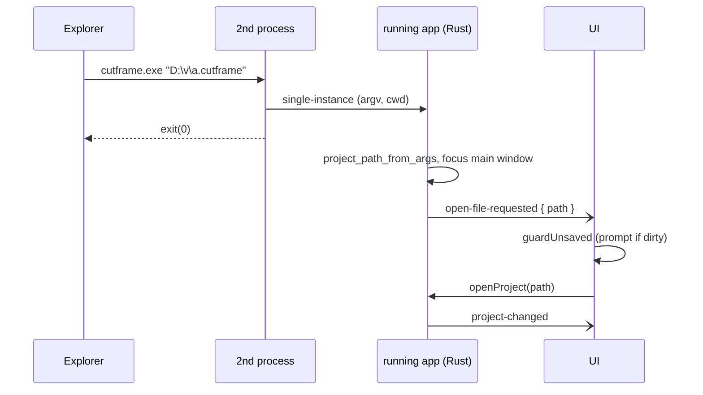

# Design: single instance, file association, GPU fallback

- **Status:** Proposed (task 0160). After implementation this file is a record, not a spec.
- **Features:** F0.13, F0.14, F0.15
- **Builds on:** ADR-0002 amendment §1 (`PROJECT_FILE_EXTENSION`), ADR-0003, ADR-0004, ADR-0005,
  `docs/design/project-lifecycle.md`, `docs/design/autosave-recovery.md`, `docs/design/preferences.md`

## 1. Goal and non-goals

Double-clicking a `.cutframe` file in Explorer opens it; with Cutframe already running, the running
window comes to the front and opens it behind the usual unsaved-changes prompt. The app reports which
GPU it uses and why, and when the GPU fails at runtime the preview recovers on the hardware or on
WARP, with a clear message. Non-goals: hardware decode/encode detection (no FFmpeg yet: placeholder
field only), a GPU-selection preference (the `CUTFRAME_GPU` / `WGPU_FORCE_FALLBACK_ADAPTER` env vars
stay the debugging levers), opening several files at once, deep links, a jump list.

## 2. User flow

- **Cold start from Explorer:** the app starts and opens the file (the fresh project is clean, so no
  prompt). The recovery dialog, if any, still appears afterwards (its Restore is guarded as today).
- **App running:** the window is unminimised and focused, then `guardUnsaved` → open. While another
  file action or prompt is running the request is ignored (existing one-action-at-a-time rule).
- **Errors** (missing file, malformed project…) show in the status bar as for File → Open.
- **GPU:** the status bar shows `adapter · backend` plus *(software)* as today, and a warning icon
  with a tooltip when a fallback happened. After a runtime GPU loss the status bar shows a notice
  (never over the preview): "The GPU stopped responding. The preview was restarted on <adapter>." or
  "…uses software rendering (slower)." Preferences → Performance shows the full report.
- No undo involvement: nothing here changes the model except the open, which clears history as today.

## 3. Model changes (`app-core`)

None.

## 4. Single instance and launch path (`src-tauri/src/launch.rs`, new)

- **Plugin:** `tauri-plugin-single-instance` (MIT OR Apache-2.0), registered as the **first** plugin.
  The second process exits inside plugin init, before `setup`, so it never takes a recovery lock or
  reads preferences. Callback `|app, argv, cwd|`: `project_path_from_args(&argv, &cwd)`; focus the
  main window (`unminimize`, `show`, `set_focus`); if a path was found, emit `OpenFileRequested`.
- **When it is registered:** release builds, unless `--smoke-test` is present (a CI smoke run must
  never be forwarded to a running app and exit 0). Debug builds register it only with
  `CUTFRAME_SINGLE_INSTANCE=1`, because `pnpm dev` uses the same identifier as an installed app and
  would otherwise forward to it and quit.
- **Parsing** (pure, unit-tested): `fn project_path_from_args(args: &[String], cwd: &Path) ->
  Option<PathBuf>` skips `args[0]` and every `--flag`, takes the first remaining argument, joins a
  relative path onto `cwd` (the second instance's cwd, not ours) and returns it. No extension or
  existence check: `open_project` decides by content (ADR-0002 amendment §1) and reports errors.
- **First launch:** `setup` runs the same parser on `std::env::args()` and stores the result in
  `AppState.launch_path: Mutex<Option<PathBuf>>`. The UI pulls it once (no event, so no race with
  listener registration).
- **Recovery lock stays.** Single instance makes two processes rare, but debug builds, a crashed
  instance still shutting down, and a disabled plugin can all produce them; the lock logic in
  `recovery.rs` is unchanged and still correct.

## 5. File association (devops, `src-tauri/tauri.conf.json`)

```json
"bundle": { "fileAssociations": [
  { "ext": ["cutframe"], "name": "Cutframe.Project", "description": "Cutframe Project", "role": "Editor" }
] }
```

Tauri's NSIS `APP_ASSOCIATE` writes `Software\Classes\.<ext>` and `Software\Classes\<name>\shell\open\
command = "<exe>" "%1"` under `SHELL_CONTEXT`, which is HKCU for `installMode: currentUser`: no admin.
The uninstaller (`APP_UNASSOCIATE`) deletes the ProgID key and restores `.<ext>`'s previous default
value (empty on a clean machine), but leaves the `.<ext>` key itself with a `<name>_backup` value
(verified against the template embedded in `@tauri-apps/cli` 2.12.6). The icon is the app exe's. `name` is the ProgID (no spaces).
**One constant check:** the JSON cannot reference `app_core::PROJECT_FILE_EXTENSION`, so a src-tauri
test parses `tauri.conf.json` (`CARGO_MANIFEST_DIR`) and asserts
`bundle.fileAssociations[0].ext == [PROJECT_FILE_EXTENSION]`. Renaming the extension fails this test
until the config follows.

## 6. GPU capability report and runtime fallback (engine + src-tauri)

**Report.** `engine::render::GpuInfo` grows; `GpuInfoView` (types.rs) mirrors it:

```rust
#[derive(Clone, Serialize, Deserialize, specta::Type)] #[serde(rename_all = "camelCase")]
pub struct GpuInfoView {
    pub adapter: String,                 // existing: adapter name (data, not translated)
    pub backend: String,                 // existing: "Dx12"
    pub software: bool,                  // existing: device_type == Cpu (WARP)
    pub device_type: GpuDeviceType,      // new
    pub driver: String,                  // new: AdapterInfo.driver_info, may be empty
    pub presents_to_window: bool,        // new: false = offscreen only (no native preview)
    pub fallback: Option<GpuFallback>,   // new: why this is not the first-choice adapter
    pub video_acceleration: Option<VideoAccelerationView>, // new: always None until FFmpeg lands
}
#[derive(Clone, Copy, Serialize, Deserialize, specta::Type)] #[serde(rename_all = "camelCase")]
pub enum GpuDeviceType { Discrete, Integrated, Virtual, Software, Other }
#[derive(Clone, Copy, Serialize, Deserialize, specta::Type)] #[serde(rename_all = "camelCase")]
pub enum GpuFallback { ForcedByEnv, PreferredCannotPresent, NoHardwareAdapter, DeviceLost }
#[derive(Clone, Serialize, Deserialize, specta::Type)] #[serde(rename_all = "camelCase")]
pub struct VideoAccelerationView { pub decoders: Vec<String>, pub encoders: Vec<String> } // FFmpeg names
```

`with_window` sets `fallback` when it skips an adapter (`PreferredCannotPresent`), ends on WARP
without hardware candidates (`NoHardwareAdapter`) or `force_fallback()` is set (`ForcedByEnv`). The
UI translates the keys (ADR-0003 §5).

**Device lost.** `request_device` registers `device.set_device_lost_callback` that sends
`Message::DeviceLost` to the render loop's own channel (reason `Destroyed` = our own drop, ignored).
The render loop then drops surface and `GpuContext` and recreates them with `GpuContext::with_window`
on the same raw handle (the child window lives on), following a pure policy:

```rust
fn after_device_loss(losses: u32) -> Option<AdapterMode> // 1 → Auto, 2 → SoftwareOnly, ≥3 → None
```

`Auto` lets a TDR-recovered driver come back; `SoftwareOnly` uses WARP; `None` stops drawing and
the preview becomes `unavailable`. Each recreation sets `fallback = Some(DeviceLost)`.
`PreviewHandle.gpu_info` becomes `Arc<ArcSwap<GpuInfo>>` (`arc-swap` is already a dependency) and
`spawn_with_window` takes `on_gpu_changed: Box<dyn Fn(GpuInfo, bool /*available*/) + Send>`; the
engine stays Tauri-free, src-tauri's callback emits `AppInfoChanged`. Export does not exist yet; when
it does it creates its own device and follows the same policy (render-graph parity is unaffected:
WARP runs the same WGSL).

## 7. IPC changes

```rust
/// The project path passed on the command line at startup, once; later calls return None.
#[tauri::command] #[specta::specta]
pub fn take_launch_path(state: State<'_, AppState>) -> Option<String>;

/// A second launch passed a project path; the window was already focused. Open it via guardUnsaved.
#[derive(Clone, Serialize, Deserialize, specta::Type, Event)] #[serde(rename_all = "camelCase")]
pub struct OpenFileRequested { pub path: String }          // event `open-file-requested`, rare

/// The GPU or preview mode changed at runtime (device lost and recovered, or given up).
#[derive(Clone, Serialize, Deserialize, specta::Type, Event)]
pub struct AppInfoChanged(pub AppInfo);                    // event `app-info-changed`, rare
```

`get_app_info` is unchanged in signature; its `gpu` carries the extended `GpuInfoView` and
`preview_mode` is `Unavailable` after the engine gave up. No new `IpcError` kinds.

## 8. UI impact

- `features/project/fileActions.ts`: `openPath(path)` = `replaceGuarded(() => openProject(path))`
  with errors reported like Open. `App.tsx` startup: after the first state, `takeLaunchPath()` →
  `openPath`, then the recovery check; listen to `openFileRequested` → `openPath`.
- `ipc/projectSync.ts` (or `appStore`): `appInfoChanged` replaces the stored `AppInfo`; a payload
  whose `gpu.fallback` is `deviceLost` posts the status-bar notice.
- `StatusBar.tsx` warning icon + tooltip; Preferences → Performance lists every report field
  (video acceleration: "Not detected in this version"). `i18n/en.ts`: fallback and device-type keys.

## 9. Project file

No change.

## 10. Performance budget

Forwarding a launch to the running app: window focused < 500 ms after the double-click. Device-lost
recovery: preview back within 2 s; the main thread never waits on it (all on `preview-render`).

## 11. Test plan

- **src-tauri unit:** `project_path_from_args`: no args, flags only, `--smoke-test` + path, relative
  path joined onto the given cwd, path with spaces and non-ASCII; `take_launch_path` returns once;
  config test for `fileAssociations` vs `PROJECT_FILE_EXTENSION`; `GpuInfoView` serialization keys.
- **engine unit:** `after_device_loss` table; fallback reason from a list of device types (extend the
  `adapter_order` tests); a test-only `Message::SimulateDeviceLost` on an offscreen `PreviewHandle`
  (WARP in CI) runs the recovery path, calls `on_gpu_changed` with `DeviceLost`, and the next
  `render_frame` still returns a frame.
- **Vitest:** launch path opened before the recovery check; `openFileRequested` goes through
  `guardUnsaved` and is ignored during a running action; `appInfoChanged` updates the status bar and
  shows the notice once.
- **devops (CI install test):** after the silent install, `HKCU\Software\Classes\.cutframe` default =
  `Cutframe.Project`, the open command points at the installed exe, no `HKLM\Software\Classes\.cutframe`;
  the installer manifest requests `asInvoker` (the admin runner cannot prove "no UAC" otherwise);
  uninstall deletes the ProgID key and `.cutframe` no longer points at it (the key may remain, §5).
- **Manual (Windows, installed build):** double-click with the app closed / open and clean / open
  and dirty / minimised; file in a folder with spaces; two files selected + Enter (one opens, the
  other is ignored or prompts); `WGPU_FORCE_FALLBACK_ADAPTER=1` shows *software* + forced reason;
  `dxcap -forcetdr` (Windows SDK Graphics Tools) during preview → notice, preview returns; focus may
  only flash the taskbar if Windows' foreground lock refuses `set_focus` (accepted).

## 12. Diagram



## 13. Task breakdown

**backend**
1. `launch.rs` parser + `AppState.launch_path` + `take_launch_path`; single-instance plugin with the
   registration rules; `OpenFileRequested`; tests.
2. Engine: extended `GpuInfo`, fallback reasons, device-lost callback + policy + `on_gpu_changed`,
   `ArcSwap` info; `AppInfoChanged`; tests.
3. Config test for the extension; `pnpm bindings`; tell frontend.

**devops**
4. `bundle.fileAssociations` in `tauri.conf.json`; CI install test registry checks; `cargo deny`.

**frontend** (after 3)
5. `openPath`, startup launch path, event listeners, status-bar notice, Performance tab fields; Vitest.

**Feature catalog:** F0.14, F0.15 → done after the manual checks; F0.13 → partial ("adapter, backend,
WARP and fallback reason reported, runtime device-loss recovery; hardware decode/encode detection
arrives with FFmpeg").
