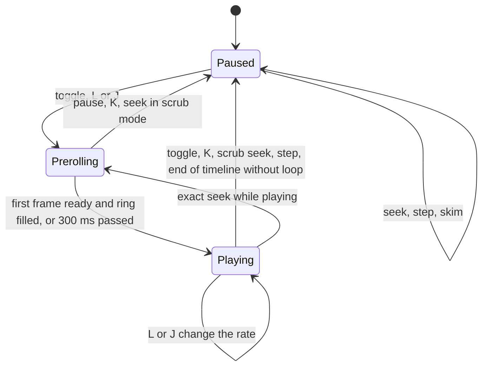
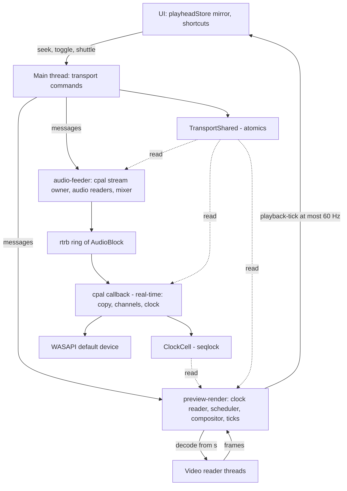
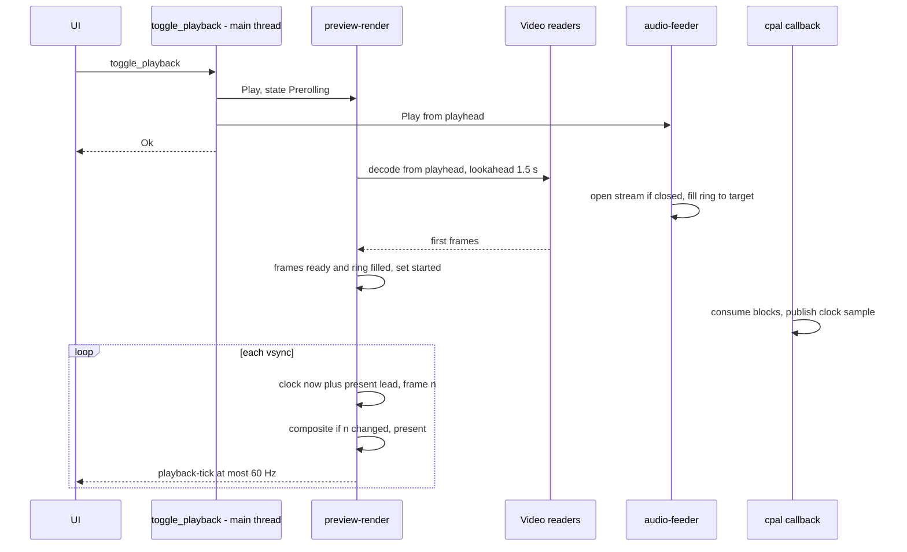
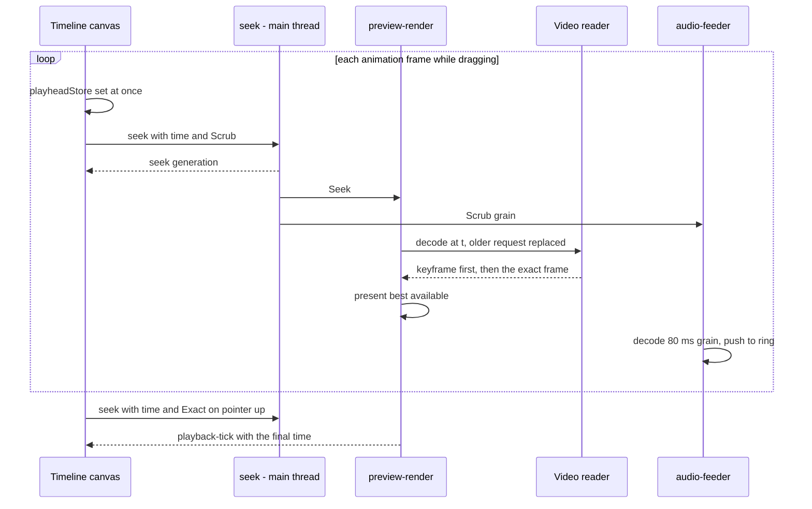

# Design: playback, transport and audio clock

- **Status:** Proposed (task 0310). Implemented by tasks 0330 (transport, audio, A/V sync), 0340
  (skimming, source preview) and 0370 (clip volume, fades and speed in the mixer); 0320 uses the
  `seek` command of §8 before the rest exists. After implementation this file is a record, not a
  spec.
- **Date:** 2026-11-22
- **Features:** prepares F1.31, F1.55, F1.58–F1.60, F1.67–F1.69 and F1.17.
- **Builds on:** `docs/design/render-graph.md` (what one frame looks like, readers, caches),
  ADR-0003 (`playback-tick`, throttling), ADR-0004 (threads, clock; amended on 2026-11-22 by this
  task), ADR-0005 (preview presentation; amended on 2026-11-22), `docs/design/timeline-editing.md`
  §3.6 and §7 (`AudioProps`, mixer rules), `docs/design/media-import.md` §5 and §6.1 (VFR timing,
  `origin`, `pause_background`). Review findings F14, F17.

## Decisions

| Topic | Decision | Rejected (why) |
|---|---|---|
| Who owns the playhead | **Rust**: transport state (paused or playing, rate, loop, playhead, seek generation) lives in the engine. The UI's `playheadStore` becomes a mirror fed by `playback-tick` | UI-owned playhead with Rust following (two clocks, no A/V sync) |
| Master clock | **The audio device**: the cpal callback publishes, per buffer, which timeline time reaches the DAC and when (`Instant`), from cpal's `playback` timestamp. The render thread extrapolates from the latest sample. Without an output device: a wall clock with the same interface | Video or vsync as master with audio resampled to follow it (audible artefacts). A wall clock always (the audio device's crystal drifts against the system clock by tens of ppm, so sound and picture slowly part over a long video) |
| Where audio is mixed | **On the audio feeder thread**, into one `rtrb` ring of fixed-size blocks; the callback only copies, converts channels and publishes the clock | Per-source rings mixed in the callback (lower latency for mute and volume changes, but voice allocation and per-voice alignment in real-time code; ADR-0004's "ring per source" wording is amended) |
| Latency budget | Ring target fill 16 blocks of 256 frames (about 85 ms at 48 kHz); an edit is heard within about 120 ms | Smaller rings (underruns while 4K decode loads the CPU); larger (sluggish mute and volume changes) |
| Video timing | vsync-paced; each vsync shows the project frame that the clock says will be on screen when the frame becomes visible; frames that are late are skipped, never waited for | Waiting for late frames (audio would have to stall). Presenting at the project frame rate with a timer (Windows timer granularity, judder on 60 Hz panels anyway) |
| Shuttle J/K/L | Rates ±1, ±2, ±4, ±8. Audio plays only at +1; other rates are muted, the clock still comes from the device. Above 2x readers decode keyframes only; reverse is a timed scrub | Pitch-corrected shuttle audio (needs the 0370 time-stretcher; can reuse it later). True reverse decoding (GOP-reverse decode of 4K into memory) for a feature a hobby editor rarely uses |
| Prefetch | A scheduler on the render thread looks 1.5 s ahead and assigns readers: a reader continues across contiguous split points, a second reader per media pre-seeks jump cuts | One reader per clip (a seek at every split point, the most common edit). One reader per media (a visible stall at every jump cut) |

## 1. Goal and non-goals

Afterwards the user presses Space and watches the edit with sound, in sync, for as long as the
timeline lasts, including 4K HEVC HDR phone footage on a laptop iGPU. They can shuttle with J/K/L,
step frames with the arrow keys, loop the timeline, scrub with audible snippets, skim the timeline
on hover and preview a media item before adding it. The timeline playhead follows playback and the
timeline auto-scrolls.

**Non-goals:** pitch-corrected shuttle audio; loop or play-through of an in/out range (no in/out
points in tier 1; the loop covers the whole timeline); audio output device selection, ASIO or
exclusive mode (the Windows default device in shared mode); a master volume, meters or a mixer
panel (F3.24); audio effects (0610); a user-tunable A/V offset (see Risks); the speed and
time-stretch features themselves (0370, which plugs into §6.3).

## 2. User flow

| Input | Result |
|---|---|
| Space, Play button | Toggle: play at 1x from the playhead, or pause. At the end of the timeline, play starts again at 0 |
| L | Forward: from pause or reverse 1x, then 2x, 4x, 8x on repeated presses |
| J | Reverse: from pause or forward -1x, then -2x, -4x, -8x |
| K | Pause |
| Left / Right | Step one frame back or forward (pauses first). Shift: 10 frames |
| Home / End | Seek to 0 / to the last frame |
| Loop button | Loop the whole timeline on or off; while on, playback wraps from the end to 0 seamlessly |
| Click or drag on the ruler or tracks | Seek; while dragging, short audio snippets play (F1.69). Dragging during playback pauses it |
| Hover over the timeline (skimming on, 0340) | The preview shows the hovered frame; the playhead does not move. Off while playing |
| Media item, "preview" (0340) | The preview plays that media alone; the timeline playhead is kept and comes back when the user returns to the timeline |

None of this is an edit: nothing is recorded in history and nothing is saved (ADR-0002 §5). Edits
stay possible during playback and are seen and heard on the next frame or block.

## 3. Model changes (`app-core`)

None. The transport is session state in the engine. The mixer evaluates `AudioProps` through
`Animated::at` and `Clip::source_time` like the render graph does (timeline-editing.md §7).

## 4. Transport

### 4.1 State

```rust
// crates/engine/src/playback/transport.rs

pub enum TransportState {
    Paused,
    /// Play was requested: readers prime the first frame and the feeder fills the ring. Shown to
    /// the UI as `playing`.
    Prerolling { rate: Rate },
    Playing { rate: Rate },
}

/// Shuttle rate: one of -8, -4, -2, -1, 1, 2, 4, 8.
pub struct Rate(i8);

/// Shared between the IPC thread (writer, through `Playback`), the render thread, the feeder and
/// the audio callback (readers). Atomics only.
pub struct TransportShared {
    pub state: AtomicU8,
    pub rate: AtomicI8,
    pub looping: AtomicBool,
    /// Incremented by every seek, step, target change and project replacement.
    pub seek_gen: AtomicU32,
    /// Playhead while paused, in flicks. During playback the clock (§5) is the truth.
    pub playhead: AtomicI64,
    pub skim: AtomicI64,       // i64::MIN = none
    pub started: AtomicBool,   // preroll finished: the callback may consume the ring
}
```



### 4.2 Rules

- **Shuttle:** `L`: if the rate is not positive, 1x; else double, at most 8x. `J` mirrors it with
  negative rates. `K` pauses. Space toggles between paused and 1x.
- **Seek** clamps to `0..=duration` and increments `seek_gen`. `Exact` while playing restarts
  preroll at the new time; `Scrub` pauses and plays a snippet (§6.5).
- **Pause** sets the playhead to the **start of the frame on screen** (`t` quantised to the
  project frame grid), so "split at playhead" cuts exactly where the user sees it.
- **End:** without loop, playback pauses on the last frame (`floor((duration - 1) / frame)`).
  With loop, the feeder and the clock wrap from `duration` to 0 (§5.3). Play at the end starts at
  0. Reverse playback pauses at 0.
- **Step** pauses, then moves by whole frames from the current frame, clamped.
- **Project replaced** (new, open, restore): pause, playhead 0, `seek_gen` incremented.
- **Edits during playback** are allowed. The render thread and the feeder read the newest snapshot
  for every frame and block. If an edit makes the timeline shorter than the playhead, playback
  continues to the new end and stops or loops there.
- **Skim** (0340) is honoured only while paused: the render thread renders `skim` instead of the
  playhead; no audio. Playing clears it.

## 5. Clock and A/V sync

### 5.1 Clock samples

```rust
// crates/engine/src/playback/clock.rs

/// Written by the audio callback after every device buffer, read by the render thread. A seqlock
/// (sequence counter + atomics): the writer never waits; a reader retries on a torn read.
pub struct ClockSample {
    pub seek_gen: u32,
    /// Incremented at every loop wrap within one seek generation.
    pub epoch: u32,
    /// Timeline time of the first sample of this buffer.
    pub time: Time,
    /// When that sample reaches the DAC: `Instant::now()` in the callback plus
    /// `info.timestamp().playback - info.timestamp().callback`, stored as nanoseconds since a
    /// process epoch.
    pub at_dac: u64,
    /// Timeline time just after the last real sample written so far (not silence).
    pub valid_until: Time,
    pub rate: i8,
}

pub trait ClockSource: Send + Sync {
    /// Timeline time that is audible now. `None` before the first sample of the current
    /// generation reached the DAC (preroll).
    fn now(&self) -> Option<ClockReading>;
}
```

- `AudioClock` implements it: `t = time + (now - at_dac) x rate`, converted with integer
  arithmetic (`nanos x 705_600_000 / 1_000_000_000` in `i128`), clamped to `valid_until`, so an
  underrun freezes the clock instead of letting video run ahead of silence.
- `WallClock` implements the same trait from `Instant` when there is no output device or the
  stream failed. Everything above the trait is identical.
- `Instant::now()` in the callback reads `QueryPerformanceCounter`: no allocation, no lock, no
  system wait. It is allowed in real-time code.

### 5.2 Which frame is shown

Per vsync, during playback, on the render thread:

1. `t_audible = clock.now()`; ignore readings of an older `seek_gen`.
2. `t_show = t_audible + PRESENT_LEAD x rate`, where `PRESENT_LEAD` = 2 x the measured refresh
   interval (one frame queued in the swap chain plus the DWM compositor frame). It is a single
   constant, tuned once on the reference laptop.
3. Within one `(seek_gen, epoch)` and at a positive rate, `t_show` never moves backwards.
4. `n = floor(t_show / frame_duration)`. If `n` or the plan changed, build the plan for `n` and
   composite (render-graph.md §7); then present.

The target is **|A/V offset| ≤ one project frame** (33 ms at 30 fps), well inside the
ITU-R BT.1359 detectability window (audio up to 45 ms early, 125 ms late).

### 5.3 Preroll, start, loop and end

- **Preroll** (on play or exact seek while playing): the render thread asks the readers for the
  first frame (`FetchPolicy::BestAvailable`, polling) while the feeder fills the ring to its
  target. When both are ready, or after 300 ms, the render thread sets `started`; the callback
  then consumes the ring, and the clock starts when the first sample reaches the DAC. Video shows
  the first frame meanwhile. Time therefore starts moving when sound starts.
- **Loop:** the feeder produces the last block up to `duration` and the next one from 0, with
  `epoch + 1`; readers for the start of the timeline are primed by the lookahead (§7), which wraps
  around the loop.
- **End without loop:** the feeder stops producing at `duration`; when `valid_until` is reached
  the render thread pauses the transport on the last frame and emits a tick.

### 5.4 Dropped frames

- **Skipped:** at 1x, the frame index advanced by more than one between composites (the render
  thread fell behind).
- **Late:** a frame composited with a stale or missing layer (`RenderOutcome`), i.e. a reader
  could not keep up.
- Both count into `dropped_frames` (reset at play start), sent in `playback-tick` and logged with
  the present-rate statistics every 5 s. Audio never waits for video.
- A reader that falls behind catches up (§7). Nothing slows the clock down.

## 6. Audio path

### 6.1 Threads

- **Audio feeder** (`audio-feeder`, one thread): owns the `cpal` stream (created and dropped on
  this thread, since `cpal::Stream` is not `Send`), the audio readers and the mixer. It may
  allocate, lock and do I/O.
- **Audio callback** (cpal's WASAPI thread, real-time): copies blocks from the ring into the device
  buffer and publishes the clock. **No allocation, no lock, no I/O, no logging** (rule 4).

### 6.2 Ring and blocks

```rust
pub const BLOCK_FRAMES: usize = 256;          // 5.3 ms at 48 kHz
pub const RING_BLOCKS: usize = 64;            // about 340 ms capacity
pub const TARGET_FILL_BLOCKS: usize = 16;     // about 85 ms

/// Copy, fixed size: `rtrb::RingBuffer<AudioBlock>` preallocates every slot once.
#[derive(Clone, Copy)]
pub struct AudioBlock {
    pub seek_gen: u32,
    pub epoch: u32,
    pub time: Time,           // timeline time of the first frame
    pub frames: u16,          // <= BLOCK_FRAMES (the last block before the end is short)
    pub grain: bool,          // scrub snippet (§6.5)
    pub samples: [f32; 2 * BLOCK_FRAMES], // stereo, interleaved
}
```

**Callback** (`OutputCallback::process(&mut self, out: &mut [T], info)`, a plain method that tests
call directly):

1. If `started` is false and no grain is pending: write silence and return.
2. Pop blocks (`rtrb::Consumer::pop`, wait-free), dropping blocks whose `seek_gen` differs from
   `TransportShared::seek_gen`. Copy frames into `out`, converting stereo to the device's channel
   count (mono: average; more than two: L, R, then zeros) and to the device sample format.
3. On an empty ring: silence for the rest, `underruns += 1` (atomic).
4. Publish the `ClockSample` for the first real frame of this buffer.

The callback state holds only the consumer, one partially read `AudioBlock`, an
`Arc<TransportShared>`, an `Arc<ClockCell>` and counters. A `Mutex` cannot reach it by type.

**Feeder loop:** handle messages (play, pause, seek, loop, scrub, device error, shutdown); while
playing at 1x, produce blocks until the ring holds `TARGET_FILL_BLOCKS`; at other rates produce
silent blocks with advancing (or, reversed, decreasing) `time` so the clock still runs; then sleep
about 2 ms. On a seek it discards its own queued state; stale blocks in the ring are dropped by the
callback through `seek_gen`.

**Time per sample** is an integer number of flicks for every rate WASAPI uses (48 kHz is 14,700,
44.1 kHz 16,000, 96 kHz 7,350). Block times are computed from the block index, never accumulated
in floating point, so 10 minutes of playback have no drift between the mixer's time and the
timeline. A device rate that does not divide `FLICKS_PER_SECOND` falls back to `i128` rounding of
each block start.

### 6.3 Mixer

```rust
// crates/engine/src/audio/mix.rs: shared by playback (device rate) and export (project rate).

pub fn mix_block(
    project: &Project,
    start: Time,
    frames: usize,
    sample_rate: u32,
    sources: &mut dyn PcmProvider,
    out: &mut [f32],   // stereo interleaved, len = 2 x frames
);
```

- **Voices:** every clip with `audio` props on an unmuted track that overlaps the block, the
  main-track video clips with audio included (timeline-editing.md §3.3, §7). Hidden tracks still
  sound; muted tracks do not.
- **Per voice:** PCM at `source_time` from its reader (decoded with FFmpeg, resampled and
  downmixed to stereo `f32` at `sample_rate` with `swresample`), times the gain
  `volume.at(local) x fade(local)`, where `fade` is the linear fade-in and fade-out of `AudioProps`.
  The gain is evaluated at the block start and end and ramped linearly per sample (no zipper
  noise). Clip boundaries are sample-accurate within the block.
- **Sum, then clamp** to -1..=1. No limiter in tier 1.
- **0370** changes only `Clip::source_time` (speed, reverse) and adds a time-stretch stage per
  voice on the feeder thread; the callback is unaffected.
- **Export parity:** export calls the same `mix_block` at the project sample rate; preview runs it
  at the device rate. Sample-exact equality between the two is not required; the same voices,
  gains and timing are.

### 6.4 Audio readers

One per voice on the feeder thread, with its own `AVFormatContext` for the audio stream (the video
reader of the same file has another; the OS file cache serves both). Seeks are sample-accurate:
seek backwards to a packet before the target, decode, drop samples before the target by their
timestamps (with `origin`, media-import.md §5), flush `swresample` on every seek. Reuse and
prefetch follow the same rules as video readers (§7), so a split point plays without a seek and a
jump cut is pre-seeked.

### 6.5 Audio scrubbing (F1.69)

A `Scrub` seek makes the feeder decode one **grain** of 80 ms at the new position with 5 ms fades,
tagged `grain` and the new `seek_gen`. The callback plays grains while paused; grains do not
publish clock samples. At most one grain per 40 ms; a move of less than one frame makes none. The
stream opens on the first scrub if it is closed.

### 6.6 Device

- The Windows default output device in shared mode, its mix format (usually 48 kHz `f32`), the
  default buffer size.
- The stream opens on play or scrub and closes 10 s after the last pause, so that a new default
  device (headphones plugged in) is picked up on the next play and an idle app holds no audio
  session. Opening takes about 20–50 ms and is part of preroll.
- **Error callback** (device removed or invalidated): it sets an atomic flag; the feeder pauses
  the transport, drops the stream and reopens the default device on the next play. If no device
  exists, playback runs on `WallClock` without sound and logs a warning once.

## 7. Decode-ahead and prefetch

The **scheduler** runs on the render thread once per composited frame during playback and once per
seek while paused. It is cheap (a walk over the clips in a 1.5 s window).

- **Lookahead window:** `[t, t + 1.5 s x |rate|]`, wrapping at the loop end. For each video clip
  on a visible track and each audio voice in the window it computes the source time the clip needs
  first.
- **Reader assignment** (video; audio voices on the feeder follow the same rules):
  1. a reader of the same media that will reach that source time by decoding forward (the
     previous clip ends where this one starts in the source: a split point) continues;
  2. else an idle reader of that media is sent "decode from `s`" now, so it is seeked and primed
     before the clip starts (a jump cut; in practice two readers alternate per media);
  3. else a new reader opens, if under the limits; else the least recently used idle reader is
     reassigned.
- **Limits:** at most 8 video readers, of which at most 4 use hardware decode (decoder pools,
  render-graph.md Risks); readers idle for 5 s close.
- **Queue:** a reader decodes ahead until its queue holds `READER_QUEUE_DEPTH` frames
  (render-graph.md §6). While paused: the exact frame plus 2 frames ahead (for the Right key),
  then it stops.
- **Rates:** at |rate| ≤ 2 every frame is decoded. Above 2x readers decode keyframes only
  (`skip_frame = AVDISCARD_NONKEY`), and sample and hold shows the latest one. Reverse sends a
  "decode at `t`" request per presented frame, coalesced (a timed scrub).
- **Catch-up:** when a reader's newest frame is more than 2 source frames behind the sample time,
  it discards non-reference frames (`AVDISCARD_NONREF`) until it catches up; more than 500 ms
  behind, it seeks to the sample time plus 250 ms.
- **Background jobs** (posters, filmstrips, waveforms) pause while the transport is not paused,
  through the job manager's `pause_background` hook (media-import.md §6.1).

## 8. IPC changes (`src-tauri`)

```rust
#[derive(Clone, Copy, Serialize, Deserialize, specta::Type)]
#[serde(rename_all = "camelCase")]
pub enum SeekMode { Exact, Scrub }

#[derive(Clone, Copy, Serialize, Deserialize, specta::Type)]
#[serde(rename_all = "camelCase")]
pub enum ShuttleKey { Reverse, Pause, Forward } // J, K, L

#[derive(Clone, Copy, Serialize, Deserialize, specta::Type)]
#[serde(rename_all = "camelCase")]
pub enum TransportStateView { Paused, Playing }

#[derive(Clone, Copy, Serialize, Deserialize, specta::Type)]
#[serde(tag = "kind", rename_all = "camelCase")]
pub enum PlaybackTarget { Timeline, Media { media: MediaId } } // Media: task 0340

/// event: playback-tick
#[derive(Clone, Serialize, Deserialize, specta::Type, tauri_specta::Event)]
#[serde(rename_all = "camelCase")]
pub struct PlaybackTick {
    /// Timeline time (media time for a `Media` target) of the frame on screen.
    pub time: Time,
    pub state: TransportStateView,
    /// -8..=8, 0 while paused.
    pub rate: i8,
    pub looping: bool,
    /// The newest seek generation the engine has applied.
    pub seek: u32,
    /// Since the last play start.
    pub dropped_frames: u32,
    pub target: PlaybackTarget,
}

// 0320: seek only (the UI playhead drives the preview until 0330).
#[tauri::command] #[specta::specta]
pub fn seek(state: State<AppState>, time: Time, mode: SeekMode) -> Result<u32, IpcError>;

// 0330
#[tauri::command] #[specta::specta]
pub fn toggle_playback(state: State<AppState>) -> Result<(), IpcError>;
#[tauri::command] #[specta::specta]
pub fn pause_playback(state: State<AppState>) -> Result<(), IpcError>;
#[tauri::command] #[specta::specta]
pub fn shuttle(state: State<AppState>, key: ShuttleKey) -> Result<(), IpcError>;
#[tauri::command] #[specta::specta]
pub fn step_frames(state: State<AppState>, frames: i32) -> Result<u32, IpcError>;
#[tauri::command] #[specta::specta]
pub fn set_loop(state: State<AppState>, on: bool);
#[tauri::command] #[specta::specta]
pub fn get_playback(state: State<AppState>) -> PlaybackTick;

// 0340
#[tauri::command] #[specta::specta]
pub fn set_skim(state: State<AppState>, time: Option<Time>);
#[tauri::command] #[specta::specta]
pub fn set_playback_target(state: State<AppState>, target: PlaybackTarget) -> Result<(), IpcError>;
```

- Handlers are synchronous, run on the main thread and never block: they update
  `TransportShared` atomics and send messages to the render thread and the feeder (ADR-0004).
  `seek` and `step_frames` return the new `seek_gen`.
- **Errors:** `Time` outside ±2^53 → `invalidEdit` (ADR-0003 §3); an unknown `MediaId` →
  `invalidEdit`; no preview engine (the `unavailable` mode, which WARP makes unlikely on Windows)
  → `unavailable`.
- **`playback-tick`** is emitted by the render thread through the engine's event sink (a
  `Box<dyn Fn(TransportStatus) + Send>` that `src-tauri` turns into the event; `emit` does not
  block): at most 60 Hz while playing, and always once after every state change, seek, step, loop
  toggle, target change and end of playback, so the last state always arrives. While the preview
  is hidden during playback the render thread wakes every 16 ms to keep ticks and end detection
  going.
- **UI mirror** (0330): `playheadStore` keeps its API. `seekTo(t, mode)` sets the store at once
  (optimistic), calls `seek` and remembers the returned generation; a tick whose `seek` is older
  is ignored. Between ticks the timeline may extrapolate `time + elapsed x rate` for drawing (view
  math). `startProjectSync` calls `get_playback` once.
- **Shortcuts** (`ui/src/features/editor/shortcuts.ts`): Space, J, K, L, Left, Right, Shift+Left,
  Shift+Right, Home, End. Loop is a button (no default shortcut).
- Constants exported with `Builder::constant`: none needed (rates are in the tick).

## 9. Diagrams

### 9.1 Threads



### 9.2 Play



### 9.3 Scrub



## 10. Failure handling

| Failure | Behaviour |
|---|---|
| No output device at play | `WallClock`, no sound, one warning; play works |
| Device removed during playback | Pause, emit a tick, drop the stream; next play reopens the default device |
| Underrun (feeder late) | Silence for the gap, clock frozen at `valid_until`, `underruns` logged every 5 s; video holds |
| Audio decode error in a voice | The voice is silent until its next clip; logged once per media |
| Video reader late | Catch-up (§7), frames counted as dropped |
| Media offline | Silent voice, placeholder layer, `MediaUnavailable` reported once (render-graph.md §10) |
| A seek arrives during preroll | Preroll restarts at the new time with the new generation |
| Webview reload | `startProjectSync` calls `get_playback`; the transport keeps its state |

## 11. Performance budget

Reference machine as in render-graph.md §13; measured with the 5 s present-rate log extended by
`dropped`, `late`, `av_offset_ms` (shown frame time minus `t_show` at present), `underruns` and
`ring_min_fill`, plus a `--release` simulation test for drift.

| Scenario | Budget |
|---|---|
| 1080p30 project, H.264 1080p main + image overlay + music, Full quality, iGPU | 0 dropped frames over 10 minutes; |A/V offset| ≤ 1 frame throughout, no drift (0330 done-when) |
| 1080p or 4K project, 4K30 HEVC 10-bit HLG iPhone clip on main + one overlay, 1280 x 720 preview, hardware decode, iGPU | 0 dropped frames over 60 s at Full |
| The same with a 4K60 HEVC 10-bit source in a 60 fps project | ≤ 1 % dropped at Full, 0 at Half |
| Jump cuts every 2 s in one 4K HEVC file | no dropped frame at the cuts (A/B readers) |
| Space to motion and sound | ≤ 250 ms |
| Edit or mute heard during playback | ≤ 120 ms |
| Audio callback time | ≤ 10 % of the buffer period; 0 underruns over 10 minutes |
| Main thread per transport command | ≤ 0.1 ms |
| CPU while paused and idle | about 0 % (render thread blocked, stream closed after 10 s) |

## 12. Test plan

- **Transport (pure, engine):** J/K/L sequences give the documented rates; Space at the end starts
  at 0; pause quantises the playhead to the frame start; step clamps; seek generations increase;
  project replacement resets.
- **Clock and scheduling simulation (no device, no GPU):** a fake device consumes blocks with a
  known latency and jitter; a fake vsync at 60, 144 and 165 Hz. For 24, 25, 29.97, 30 and 60 fps
  projects: the frame chosen per vsync matches `floor((t_audible + lead) / frame)`, frame indices
  never go back at positive rates, loop wraps at the right block, end pauses on the last frame,
  preroll starts the clock with the first sample, an underrun freezes it. A 10-minute simulated
  run at 44.1 kHz sources and a 48 kHz device ends with the clock and the mixer within one sample
  of `duration`.
- **Audio callback:** `OutputCallback::process` under a counting global allocator in a test binary
  (`#[global_allocator]` that counts allocations per thread): zero allocations over 10,000 calls,
  including seeks, underruns and grains. Blocks of an old generation are dropped; channel
  conversion for 1, 2 and 6 device channels.
- **Mixer:** a 1 kHz sine fixture at volume 0.5 peaks at 0.5; linear fades; a muted track is
  silent; a hidden track is not; clip boundaries are sample-accurate; two overlapping voices sum.
- **Readers (FFmpeg fixtures):** a split point plays without a seek (counted); a jump cut is
  primed before its start; catch-up triggers when a fake slow decoder is used; sample-accurate
  audio seeks on the VFR fixture.
- **src-tauri:** commands reject times outside ±2^53; `seek` returns increasing generations; ticks
  are throttled to 60 Hz and the last state change is always emitted (fake sink).
- **UI (Vitest):** the tick reducer ignores older seek generations; auto-scroll keeps the playhead
  in view; shortcut registry entries; the loop toggle; the dropped-frame indicator if shown.
- **Manual (0330 done-check):** 10 minutes of a two-track 1080p30 edit in `pnpm dev` with the log
  at debug; an iPhone 4K HDR clip; unplug headphones during playback.

## 13. Task breakdown

**0320 (backend):** `TransportShared` with `playhead` and `seek_gen`, the `seek` command, the
paused scheduler (exact frame plus 2 ahead). **(frontend):** call `seek` from the playhead store.

**0330 (backend), in order:**

1. Transport state machine and the commands of §8; `playback-tick` through the engine event sink.
2. `audio-feeder`, `rtrb` ring, `OutputCallback`, `cpal` stream lifecycle, `AudioClock`,
   `WallClock`; the allocation test.
3. Audio readers and `mix_block` (volume, fades, mute) shared with export.
4. Vsync-paced playback on the render thread: present lead, frame choice, preroll, loop, end,
   dropped-frame counting; the scheduler's lookahead, A/B readers, rate policies and catch-up;
   `pause_background`.
5. Audio scrubbing grains.

**0330 (frontend):** `playheadStore` fed by ticks with seek generations; Space, J/K/L, arrows,
Home/End; Play button state; loop toggle; timeline auto-scroll; optional dropped-frame indicator in
the status bar.

**0340:** `set_skim`, `set_playback_target` (a single-layer plan for a media target, its default
audio stream as the only voice).

**0370:** speed, reverse and time-stretch per voice (§6.3); reverse video uses a GOP-reverse reader
mode, which reverse shuttle may reuse later.

## Risks

- **Bluetooth headphones.** WASAPI's reported latency may not include the Bluetooth codec delay
  (often 150–250 ms), so video would run ahead of sound. If the user meets it, a hidden preference
  for an extra output delay (one integer added to `at_dac`) is the fix; it is not built until
  needed.
- **cpal timestamps.** The design relies on cpal's `playback` timestamp on WASAPI. If it proves
  coarse, the fallback is `IAudioClock::GetPosition` through cpal's host internals, behind the same
  `ClockSource` trait.
- **Feeder sleep granularity.** With an 85 ms target fill, even a 15.6 ms Windows timer tick is
  safe; the simulation test covers a feeder that wakes late.
- **Many voices.** Each audio voice opens its own demuxer. Tier-1 edits have a few voices; if a
  project with dozens of overlapping sound effects underruns, voice readers are pooled.
