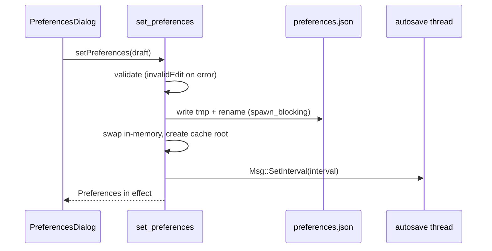

# Design: preferences and persisted layout

- **Status:** Proposed (task 0150). After implementation this file is a record, not a spec.
- **Features:** F0.02, F0.03, F0.32, F0.33, F0.34, F0.35; finishes F0.21 (configurable interval)
- **Builds on:** ADR-0002 (format + migrations, §5 no UI layout in the project), ADR-0003, ADR-0004,
  `docs/design/autosave-recovery.md`

## 1. Goal and non-goals

After a restart the window, the panel layout and the preferences are as the user left them. A
**Preferences** dialog edits: autosave interval (or off), default image and transition durations,
UI language, cache folder with its size and **Clear cache**. Non-goals: shortcut customisation (the
Shortcuts tab only opens the existing shortcut reference; rebinding is not trivial with the action
registry and conflicts, so it stays out), per-project preferences, sync, import/export of settings,
a GPU-selection preference.

## 2. User flow

- **Edit → Preferences…** (`Ctrl+,`) opens a modal dialog with tabs **General** (language, autosave,
  *Reset panel layout*), **Editing** (default image duration, default transition duration, in seconds
  with one decimal), **Performance** (read-only GPU report from `get_app_info`, extended by
  `platform-integration.md`), **Cache** (folder, size, *Change…*, *Clear cache*), **Shortcuts**
  (button *Show keyboard shortcuts* → existing `ShortcutsDialog`).
- **Save** validates in Rust and closes; an error keeps the dialog open with the translated kind on the
  field. **Cancel**/Escape drops the draft. *Clear cache* and *Change…* act at once (not via Save).
- Panels: media bin, inspector and timeline collapse by dragging past their minimum size; **View →
  Media bin / Inspector** toggle the side panels. Sizes and collapsed state persist.
- **Undo:** none. Preferences, layout and window state are not the project model and never enter
  the history. The dialog hides the native preview (`usePreviewOccluder(open)`).

## 3. Model changes (`app-core`)

None. Later tasks read `default_image_duration` / `default_transition_duration` in the IPC handler
and pass the value into the `app-core` command as an argument; commands never read preferences.
Snapping a default to the project frame rate happens at that use site.

*(Amended 2026-11-26 by task 0370, F1.83: `default_image_duration` is the default **still**
duration: `add_clips` passes it to `AddClips` as `image_duration`, and `insert_freeze_frame` uses it
as the freeze-frame length, both snapped to the nearest project frame (at least one). The field
keeps its name, so the preferences file does not change; the Editing tab labels it "Image and
freeze-frame duration". `docs/design/clip-speed-audio.md` §3.4, §4.)*

## 4. Preferences store (`src-tauri/src/preferences.rs`, new; plain functions, no Tauri)

Not the model, so not `app-core`. One struct is both the file format and the IPC type (like ADR-0002
§2: no DTO layer), so any serialized change bumps the version, adds a step and a fixture.

```rust
pub const CURRENT_PREFERENCES_VERSION: u32 = 1;
#[derive(Clone, Debug, PartialEq, Serialize, Deserialize, specta::Type)]
#[serde(rename_all = "camelCase", default)]   // a missing field takes its default
pub struct Preferences {
    pub schema_version: u32,                   // always CURRENT when sent or written
    pub autosave_interval: Option<Time>,       // None = off; default 60 s
    pub default_image_duration: Time,          // default 5 s
    pub default_transition_duration: Time,     // default 0.5 s
    pub language: UiLanguage,                  // default En
    pub cache_dir: Option<String>,             // None = app cache dir; Some = absolute folder
}
#[derive(Clone, Copy, Debug, PartialEq, Eq, Serialize, Deserialize, specta::Type)]
#[serde(rename_all = "camelCase")]
pub enum UiLanguage { En }                     // F3.74 adds Pl
```

**Validation** (`Preferences::validate() -> Result<(), PreferencesError>`, unit-tested):
`autosave_interval` in 15 s ..= 3,600 s and a whole number of seconds; `default_image_duration` in
0.1 s ..= 600 s; `default_transition_duration` in 0.1 s ..= 10 s; every `Time` within ±2^53
(ADR-0003 §3); `cache_dir` absolute when `Some`. Times are flicks, never seconds (rule 6); the UI
converts its seconds field with `Math.round(s * FLICKS_PER_SECOND)`.

**File:** `app_config_dir()/preferences.json` (`%APPDATA%\app.cutframe.editor\`). Load pipeline
(`load(text) -> Result<Loaded, LoadError>`, same shape as `app_core::serialization`): parse →
`schemaVersion` (missing = error) → newer = `TooNew` → `migrate(value, from)` step by step (no steps
at v1; add `if from < 2 { v1_to_v2 }`) → deserialize → `sanitize()` replaces each invalid field with
its default (`warn!` per field; a bad cache folder must not stop the app).
**Startup** (in `setup`, before `start_autosave`): missing file → defaults, nothing written;
`Json`/`MissingVersion` → defaults (`warn!`), overwritten on the next save; `TooNew`/older → loaded or
defaults, and the first save passes `backup_of_version = Some(n)` so the original is kept as
`preferences.json.v<n>.bak` (never overwritten). **Writes** reuse
`project_file::write_project_file(path, &json, backup)` (tmp + `sync_all` + rename with retry).

**Cache folder:** effective root = `<cache_dir or app_cache_dir()>/cutframe-cache/`. The app only
ever deletes inside this subfolder, so a user who picks `D:\Videos` cannot lose videos. Created at
startup and when changed. Changing the folder leaves the old root untouched (caches regenerate).
`cache_info(root) -> io::Result<CacheInfo>` walks it; `clear(root)` deletes the root's entries,
keeping the root. Thumbnails, waveforms and proxies (later tasks) use subfolders of the root.

**Autosave interval:** `AUTOSAVE_INTERVAL` is deleted; `autosave::spawn` takes
`Option<Duration>` from the loaded preferences and the thread gets `Msg::SetInterval(Option<Duration>)`.
The loop keeps `next_tick: Option<Instant>`: `None` → `rx.recv()` (no ticks); a new interval sets
`next_tick = now + interval` (no immediate tick). `SetInterval(None)` also does what `Discard` does
(the user switched recovery off, so no stale snapshot is offered later). Deadline logic is a pure
`fn next_deadline(now, interval) -> Option<Instant>` for tests.

`AppState` gains `preferences: RwLock<Preferences>`, `preferences_path`, `cache_root: RwLock<PathBuf>`
and `prefs_lock: tauri::async_runtime::Mutex<()>` (serializes writes, like `save_lock`).

## 5. IPC changes

```rust
/// The current preferences (in memory; read at startup).
#[tauri::command] #[specta::specta]
pub fn get_preferences(state: State<'_, AppState>) -> Preferences;
/// Validates and replaces all preferences, writes the file, applies them (autosave interval, cache
/// root) and returns what is now in effect. On error nothing changes. Not an undo step.
#[tauri::command] #[specta::specta]
pub async fn set_preferences(state: State<'_, AppState>, preferences: Preferences)
    -> Result<Preferences, IpcError>;
/// Effective cache folder and what it holds.
#[tauri::command] #[specta::specta]
pub async fn get_cache_info(state: State<'_, AppState>) -> Result<CacheInfo, IpcError>;
/// Deletes everything inside the cache root. Returns the (empty) info.
#[tauri::command] #[specta::specta]
pub async fn clear_cache(state: State<'_, AppState>) -> Result<CacheInfo, IpcError>;

#[derive(Serialize, Deserialize, specta::Type)] #[serde(rename_all = "camelCase")]
pub struct CacheInfo { pub path: String, pub size_bytes: String /* ADR-0003 §3 */, pub files: u32 }
```

File work runs in `spawn_blocking`. Errors reuse existing kinds: `invalidEdit` (validation failed or
`schemaVersion` ≠ current; message names the field), `io` (write, create-folder, walk or delete
failed). No new kinds. **No event:** the only writer is the dialog, which takes the return value
into a `preferencesStore` (Zustand); `PreferencesChanged` is added only when a second writer
appears. Cache size/clear are `async` commands, not jobs: the cache is empty until thumbnails land
(< 1 ms). The task that adds thumbnails measures `clear_cache` on a full cache and turns it into a
`JobId` job (ADR-0003 §8) if it exceeds 100 ms.

## 6. Window state and panel layout (no Rust IPC)

- **Window:** `tauri-plugin-window-state` (MIT OR Apache-2.0), Rust side only, registered with
  `StateFlags::SIZE | POSITION | MAXIMIZED` and the default file in `app_config_dir()`. The UI
  does not call its JS API, so no npm package and **no capability permission** is added. The
  plugin restores on window creation and saves on exit; an off-screen position is corrected by the
  plugin (manual check). Restoring triggers the normal resize → `set_preview_rect` path.
- **Panel layout lives in `localStorage`**, not in `preferences.json`: it is UI-only, changes on
  every drag, has no meaning in Rust, and ADR-0002 §5 keeps it out of the project. `EditorLayout` uses
  `react-resizable-panels` `useDefaultLayout({ id, storage })` per group (ids `layout.editor.v1.rows`,
  `layout.editor.v1.columns`) with a storage wrapper whose `getItem`/`setItem` swallow exceptions
  (blocked storage = default layout). Bump `v1` when panels change. *Reset panel layout* removes
  these keys and remounts. WebView2 keeps `localStorage` in the per-user profile across restarts
  and updates; dev (`localhost:5173`) and the installed app have separate layouts (accepted).
- Rejected: layout in `preferences.json` (an IPC write per drag, Rust types for UI shapes); a
  separate Rust UI-state file (same costs, no benefit); window state by hand (the plugin exists).

## 7. Engine impact

None.

## 8. UI impact

`features/preferences/` (new): `PreferencesDialog.tsx`, `preferences.ts` (pure: seconds ↔ flicks,
draft validation hints, mapping error kinds to fields), `preferencesStore.ts` (loaded once at startup
with `getPreferences`). `i18n/index.ts` gains `setLocale(lang)` picking the table (only `en`); the
language select has one option. `actions.ts`: `preferences` (`Ctrl+,`), `toggle-media-bin`,
`toggle-inspector`; `EditorLayout.tsx`: `collapsible` + `panelRef` on media bin, inspector, timeline.
Nothing draws over the preview.

## 9. Project file

No `schemaVersion` change. Preferences have their own version; fixture
`src-tauri/tests/fixtures/preferences-v1.json`, kept forever.

## 10. Performance budget

`set_preferences` < 20 ms; startup load < 5 ms; no work on the main thread beyond the startup read
(a < 1 KB file). Layout writes: debounced by the library (default), no IPC.

## 11. Test plan

- **src-tauri unit:** defaults validate; each range bound (in/out); `Time` beyond 2^53 rejected;
  relative `cache_dir` rejected; `sanitize` replaces only the bad field; load of every
  `tests/fixtures/preferences-v*.json` gives the current struct (the older-schema test: today v1;
  every bump adds the old fixture to this loop); `TooNew`, missing version, broken JSON; the step
  runner with a test-only `v0 → v1` step; first save after an older/newer file writes
  `preferences.json.v<n>.bak` once. Cache: `cache_info` counts nested files; `clear` empties the root
  and never touches a sibling of `cutframe-cache/` (tempdir). Autosave: `next_deadline`;
  `SetInterval(None)` deletes the own file; a shorter interval ticks at the new deadline.
- **Vitest:** seconds ↔ flicks round trip; dialog Save sends flicks and closes, an `invalidEdit`
  keeps it open; Clear cache updates the size; layout storage wrapper survives a throwing storage;
  Reset layout removes the keys; toggle actions collapse/expand.
- **Manual (`pnpm dev`, Windows):** move/resize/maximise, change panels and preferences, restart: all
  restored; autosave Off then kill the app: no recovery entry; window restored on a disconnected
  second monitor appears on the primary one.

## 12. Diagram



## 13. Task breakdown

**backend**
1. `preferences.rs`: struct, validate, sanitize, load/migrate, write, cache root + `cache_info`/`clear`;
   fixture v1; tests.
2. `AppState` fields, startup load, autosave `SetInterval` + `spawn(interval)`; remove `AUTOSAVE_INTERVAL`.
3. Commands + `CacheInfo`; `tauri-plugin-window-state`; `pnpm bindings`; tell frontend.

**frontend** (after 3)
4. `preferencesStore`, `PreferencesDialog` (5 tabs), actions, i18n, `setLocale`.
5. Collapsible panels + `useDefaultLayout` persistence + Reset layout; Vitest.

**devops:** `cargo deny` for the new plugin (no config change expected).

**Feature catalog:** F0.02, F0.03, F0.32 (shortcuts tab read-only), F0.33, F0.35 (English only)
→ done; F0.34 → partial ("folder, size and clear wired; nothing is cached yet"); F0.21 → done.
