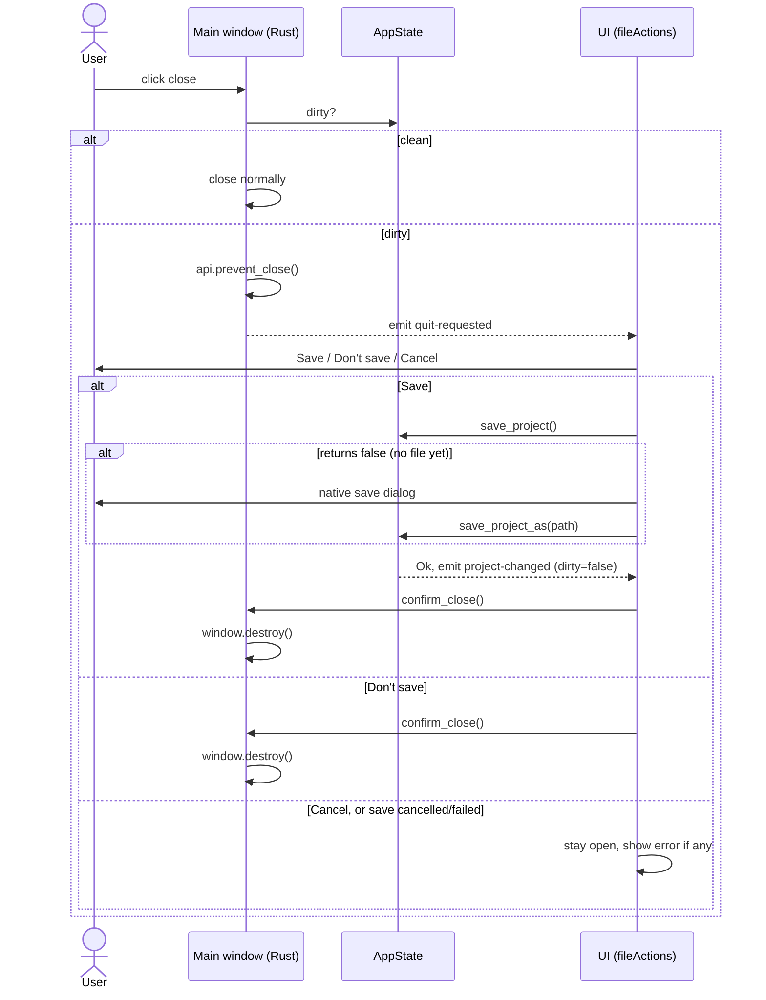

# Design: project lifecycle (new, open, save, settings, close)

- **Status:** Proposed (task 0100). After implementation this file is a record, not a spec.
- **Features:** F0.17, F0.18, F0.19, F0.20 (file part), F0.26
- **Decisions:** ADR-0002 (accepted, amendment 2026-11-22), ADR-0003, ADR-0004, ADR-0006

## 1. Goal and non-goals

The user can create a new project, open a `.cutframe` file, save it (Save / Save As), change canvas
size and frame rate (undoable), and is asked Save / Don't save / Cancel before unsaved work is lost
by New, Open or closing the window.

Out of scope: the recent-projects list (task 0120), the full main menu (task 0130), autosave and
crash recovery, file association (F0.15), media relinking (no media yet), sample-rate UI.

## 2. User flow

| Action | Shortcut | Behaviour | Undo |
|---|---|---|---|
| New | Ctrl+N | unsaved prompt if dirty → empty project with default settings | history cleared |
| Open… | Ctrl+O | unsaved prompt if dirty → native open dialog → load | history cleared |
| Save | Ctrl+S | writes to `filePath`; without one it runs Save As | not an undo step |
| Save As… | Ctrl+Shift+S | native save dialog (default name = project name) → write | not an undo step |
| Project settings… | — | dialog → Apply = one `setProjectSettings` history entry | Ctrl+Z reverts |
| Close window | Alt+F4 / ✕ | if dirty: unsaved prompt; Save may chain into Save As | — |

Unsaved prompt: **Save** (save, or Save As without a path; a cancelled or failed save aborts the
action) / **Don't save** (continue) / **Cancel** (abort). Window title: `*<name> - Cutframe` when
dirty, `<name> - Cutframe` otherwise. File errors are shown with the translated `IpcError.kind`.

## 3. Model changes (`app-core`)

**Constant** (`lib.rs`): `pub const PROJECT_FILE_EXTENSION: &str = "cutframe";` (no dot; the only
place the extension is written, ADR-0002 amendment §1).

**History position** (`document.rs`), for dirty tracking:

```rust
#[derive(Debug, Clone, Copy, PartialEq, Eq)]
pub struct HistoryPosition(u64);

impl Document {
    /// Id of the newest applied history entry; equal positions mean equal committed state.
    pub fn position(&self) -> HistoryPosition;
    pub fn has_gesture(&self) -> bool;
}
```

- `Document` keeps `next_id: u64` (starts at 1) and stores `(u64, Box<dyn Command>)` on both
  stacks. `record` assigns `next_id++`; undo/redo move the entry with its id.
- `position()` = id of the top of the undo stack, or `floor` if the stack is empty. `floor` starts
  at 0 and is set to the id of an entry dropped by the history cap, so "undo everything after the
  cap dropped entries" never looks like the initial state.
- Gesture updates and cancel do not change the position (they record nothing). A gesture commit
  records a new entry and does.

**Validation** (`model.rs` or new `validate.rs`), called by the load pipeline (ADR-0002 §3):

```rust
impl Project { pub fn validate(&self) -> Result<(), ValidationError>; }
impl ProjectSettings { pub fn validate(&self) -> Result<(), ValidationError>; }

#[derive(Debug, thiserror::Error, PartialEq, Eq)]
pub enum ValidationError {
    DuplicateId(Uuid),                                   // project, track and clip ids, one id space
    EmptyName,                                           // project name blank after trim
    ClipNotPositive { clip: ClipId },                    // duration <= 0
    ClipNegativeStart { clip: ClipId },                  // start < 0
    TimeOutOfRange { clip: ClipId },                     // end > MAX_IPC_FLICKS (2^53)
    ClipsOutOfOrder { track: TrackId, clip: ClipId },    // start < previous start
    ClipsOverlap { track: TrackId, first: ClipId, second: ClipId }, // previous.end() > start
    CanvasSize { width: u32, height: u32 },
    FrameRateRange { num: u32, den: u32 },
    SampleRate(u32),
}
```

Settings ranges (one function, used by load, `new_project` and `SetProjectSettings`):
width and height each **even** and in **16..=8192** (yuv420 encoders need even sizes);
frame rate **1..=240 fps** (`den <= num <= 240 * den`; flick alignment is already guaranteed by
`FrameRate`'s deserializer); sample rate **44_100 or 48_000**. Add `time::MAX_IPC_FLICKS: i64 = 1 << 53`.
Clip times are **not** required to lie on the frame grid: a frame-rate change must not make a
project invalid.

**Load API** (`serialization.rs`):

```rust
pub struct Loaded { pub project: Project, pub source_version: u32 }
pub fn load(text: &str) -> Result<Loaded, LoadError>;   // parse → version → migrate → serde → validate
pub fn from_json(text: &str) -> Result<Project, LoadError>; // = load(text).map(|l| l.project)
// LoadError gains:  #[error("invalid project: {0}")] Invalid(#[from] ValidationError)
```

Migration steps set `schemaVersion` to the version they produce, so a loaded `Project` always has
`schema_version == CURRENT_SCHEMA_VERSION`; `to_json` debug-asserts it.

**Command** (`command.rs`): `SetProjectSettings { new: ProjectSettings, old: Option<ProjectSettings> }`.
`apply` validates `new` (`CommandError::InvalidSettings(ValidationError)`, new variant), stores the
old value and replaces `project.settings` only. Clips are never touched: no re-quantization, flicks
stay bit-exact. Aspect ratio is derived (`width:height`), not stored. `revert` restores `old`.
New key `HistoryLabel::SetProjectSettings` (`"setProjectSettings"`, UI text "Change Project
Settings"). One Apply in the dialog = one history entry; no gesture.

No serialized field changes, so `schemaVersion` stays 1.

## 4. IPC changes (`src-tauri`)

```rust
// All return Result<_, IpcError> and emit project-changed on success.
#[tauri::command] #[specta::specta]
pub fn new_project(app: AppHandle, state: State<'_, AppState>,
                   settings: Option<ProjectSettings>) -> Result<(), IpcError>;   // sync, no I/O
#[tauri::command] #[specta::specta]
pub async fn open_project(app: AppHandle, state: State<'_, AppState>, path: String) -> Result<(), IpcError>;
/// `Ok(false)`: the project has no file yet; nothing was written, the UI runs Save As.
#[tauri::command] #[specta::specta]
pub async fn save_project(app: AppHandle, state: State<'_, AppState>) -> Result<bool, IpcError>;
/// Appends `.<PROJECT_FILE_EXTENSION>` when `path` has no extension.
#[tauri::command] #[specta::specta]
pub async fn save_project_as(app: AppHandle, state: State<'_, AppState>, path: String) -> Result<(), IpcError>;
#[tauri::command] #[specta::specta]
pub fn set_project_settings(app: AppHandle, state: State<'_, AppState>,
                            settings: ProjectSettings) -> Result<(), IpcError>;  // unchanged → Ok, no entry
/// Closes the main window without asking again. Called by the UI after the unsaved prompt.
#[tauri::command] #[specta::specta]
pub fn confirm_close(app: AppHandle) -> Result<(), IpcError>;
```

- Exported constant: `.constant("PROJECT_FILE_EXTENSION", app_core::PROJECT_FILE_EXTENSION)` in
  `ipc_builder()`.
- Async commands run on Tauri's async runtime; file reads/writes go through
  `tauri::async_runtime::spawn_blocking`. Open: read + `load` off-lock, then `replace_project`.
  Save: under the lock take `(document.committed(), position, file_path, source_version)`; write
  off-lock; under the lock set `saved_at = position` (the *snapshot's* position, so edits made during
  the write keep the project dirty). A `save_lock: tokio::sync::Mutex<()>` in `AppState` serializes
  saves.
- `set_project_settings` with settings equal to the current ones returns `Ok(())` without recording
  (the `edit` closure returns `Ok(None)`).

**New `IpcError` kinds** (stable, never renamed; `message` = English diagnostics):

| kind | When |
|---|---|
| `fileNotFound` | open: the path does not exist |
| `malformedProject` | open: not JSON, no `schemaVersion`, or wrong shape (`LoadError::Json`/`MissingVersion`) |
| `projectTooNew` | open: `LoadError::TooNew` |
| `invalidProject` | open: `LoadError::Invalid` |
| `io` | any other read/write/rename failure (permission, disk full, locked file) |

Invalid settings keep using `invalidEdit`. Arguments that fail to deserialize (e.g. a non-aligned
frame rate) are Tauri errors, not `IpcError`; the UI only sends presets or validated values.

**`ProjectState` additions** (`types.rs`):

```rust
pub file_path: Option<String>, // absolute path of the open file; None for a new, unsaved project
pub dirty: bool,               // document.position() != saved_at || document.has_gesture()
```

`Session` gains `file_path: Option<PathBuf>`, `saved_at: HistoryPosition`, `source_version: u32`.
`ProjectState::new` takes the session (or these values). Save and Save As bump the revision and emit
`project-changed`, because `dirty`/`filePath` change. Name: the window title uses `project.name`
(model data, renamed with the existing `rename_project`); the file name is not copied into the
model. Save As proposes `<project name>.cutframe` (characters invalid on Windows replaced by `_`).

**Replace semantics** (`new_project`, `open_project`): `Session::replace(project, file_path,
source_version)` creates a fresh `Document` (empty history, no gesture), sets `saved_at =
document.position()` (a new or just-opened project is clean), bumps the session revision and emits.
An open that fails changes nothing.

**Atomic save** (`src-tauri/src/project_file.rs`, plain functions, unit-testable without Tauri):

```rust
pub fn write_project_file(path: &Path, json: &str, backup_of_version: Option<u32>) -> io::Result<()>;
```

1. If `backup_of_version = Some(n)` and `path` exists and `<path>.v<n>.bak` does not: `fs::copy`.
   Passed only when saving over the file that was loaded with `source_version < CURRENT`; after a
   successful save `source_version = CURRENT`.
2. Write `<path>.tmp` in the same directory (`File::create`, `write_all`, `sync_all`, drop).
3. `fs::rename(tmp, path)`: on Windows Rust replaces an existing target (`MoveFileExW` with
   `MOVEFILE_REPLACE_EXISTING` / POSIX rename semantics). Retry up to 3 times, 100 ms apart, on
   `PermissionDenied` (antivirus or sync clients briefly holding the file).
4. On any failure remove the tmp file and return the error; the target is untouched.

**Save during an open gesture:** `committed()` returns the gesture's base (ADR-0006 §3) and
`saved_at` is the base's position, so the project stays dirty while the gesture is open and after
it commits, and becomes clean again if the gesture is cancelled.

**Window close** (`lib.rs`): `.on_window_event` for the `main` window handles
`WindowEvent::CloseRequested { api, .. }`: if `AppState` reports `dirty`, call `api.prevent_close()`
and emit the new event `QuitRequested` (`quit-requested`, unit payload). A clean project closes
without asking the UI. `confirm_close` calls `window.destroy()`, which does not raise
`CloseRequested` again. Chosen over the JS `onCloseRequested` + `destroy()` route because Rust
already knows `dirty`, a clean project closes even if the webview is broken, and no
`core:window:allow-destroy` permission is needed.

**Plugins and capabilities:** add `tauri-plugin-dialog` (MIT/Apache-2.0, fine for `deny.toml`) to
the workspace and `src-tauri` (`.plugin(tauri_plugin_dialog::init())`), and `@tauri-apps/plugin-dialog`
to `ui`. Capabilities (`default.json`): `dialog:allow-open`, `dialog:allow-save`,
`core:window:allow-set-title`. No fs plugin: all file access goes through our commands.

## 5. Engine impact

None beyond what exists: `AppState::publish` already pushes the canvas aspect to the preview on
every change, including replace and settings changes. No render-graph, decode or audio work.

## 6. UI impact

- `ui/src/features/project/` (new): `fileActions.ts` (`newProject`, `openProject`, `save`,
  `saveAs`, `guardUnsaved(action)`), `UnsavedChangesDialog.tsx`, `ProjectSettingsDialog.tsx`,
  `FileMenu.tsx` (radix `DropdownMenu` in `TopBar`: New, Open…, Save, Save As…, Project settings…;
  items show their shortcuts). Task 0130 later moves these items into the main menu unchanged.
- `shortcuts.ts`: add `new-project` (Ctrl+N), `open-project` (Ctrl+O), `save` (Ctrl+S), `save-as`
  (Ctrl+Shift+S) to `SHORTCUTS`, calling `fileActions`. They must also `preventDefault` so WebView2
  does not handle Ctrl+O/S/N.
- Dialogs from `@tauri-apps/plugin-dialog`: `open({ filters: [{ name: t.file.filterName,
  extensions: [PROJECT_FILE_EXTENSION] }] })` and `save({ defaultPath, filters })`.
- `projectSync.ts`: listen to `quitRequested` → `guardUnsaved(() => commands.confirmClose())`.
- Window title: an effect on `state.project.name` + `state.dirty` → `getCurrentWindow().setTitle()`.
- **Preview occlusion:** the DOM cannot draw over the native preview. The open File menu and both
  dialogs hide it: add an occluder count to `appStore` (`usePreviewOccluder(open)` hook) and send
  `setPreviewVisible(mounted && occluders === 0)` from one place instead of `PreviewArea` alone.
- Settings dialog: presets 1920×1080 (16:9), 3840×2160 (16:9 4K), 1080×1920 (9:16 Shorts),
  1080×1080 (1:1), Custom (two number inputs, even, 16-8192, validated before Apply; Rust validates
  again). Frame rates as rationals: 23.976 = 24000/1001, 24/1, 25/1, 29.97 = 30000/1001, 30/1, 50/1,
  60/1. Sample rate is sent unchanged. Aspect shown derived (gcd-reduced).
- `i18n/en.ts`: new error kinds, `setProjectSettings` history label, file menu, prompts, dialog
  strings (the `satisfies Record<…>` checks force this).

## 7. Project file

`schemaVersion` stays 1; no migration. Add fixture `tests/fixtures/project-v1-invalid-overlap.json`
(two overlapping clips) for the validation error path. The existing v1 fixture must pass `validate`.

## 8. Performance budget

Save and open of a 1,000-clip, 20-track project: < 50 ms each on the reference laptop, with the
document lock held < 4 ms (ADR-0003 budget). Measured by a `cargo test --release` timing test in
`src-tauri` (ignored by default) or the ADR-0003 benchmark extended with `to_json`/`load`.

## 9. Test plan

- **app-core unit:** `HistoryPosition`: edit → undo back to the saved point is clean; redo returns
  the same position; a new edit after undo gives a new position; cap with `history_limit = 3`
  never returns the initial position; gesture update/cancel keep it, commit changes it.
  `SetProjectSettings`: apply/undo/redo; each validation range edge; equal settings.
  `validate`: one test per `ValidationError` variant; `load` maps it to `LoadError::Invalid`.
- **app-core proptest:** generated valid projects (random tracks, sorted non-overlapping clips)
  round-trip `to_json → load` to an equal `Project` and pass `validate`; random
  `SetProjectSettings` sequences with undo/redo leave every clip's `start`/`duration` bit-identical.
- **src-tauri:** `write_project_file` in a temp dir: new file, replace existing, no `.tmp` left,
  failure leaves the target unchanged (target is a directory), `.v<N>.bak` created once and never
  overwritten. `Session`: replace bumps the revision above every earlier one and clears history and
  dirty; save marks clean at the snapshot position; edit during save keeps dirty; `IpcError` kind
  serialization test extended with the five new kinds.
- **Vitest:** `guardUnsaved` (clean → runs; Save → saves then runs; Save with no path → Save As,
  cancelled dialog aborts; Don't save → runs; Cancel → nothing), shortcut lookup for the four new
  entries, title formatting, settings-dialog validation and preset → `ProjectSettings` mapping,
  `projectStore` accepts a replaced project's higher revision.
- **Manual (`pnpm dev`):** save → quit → open shows the identical project; close with changes asks.

## 10. Diagram: close with unsaved changes



## 11. Task breakdown

**backend**
1. app-core: `PROJECT_FILE_EXTENSION`, `MAX_IPC_FLICKS`, `ValidationError` + `Project::validate` /
   `ProjectSettings::validate`, `serialization::load` + `LoadError::Invalid`, fixture; tests + proptest.
2. app-core: `HistoryPosition` in `Document`; `SetProjectSettings` + `HistoryLabel`; tests.
3. src-tauri: `project_file::write_project_file` with tests; `Session` fields, `replace` signature,
   `ProjectState.filePath/dirty`; new `IpcError` kinds.
4. src-tauri: the six commands, the `QuitRequested` event, `CloseRequested` handling, dialog plugin
   and capabilities, exported constant; `pnpm bindings`; tell frontend what changed.

**frontend** (after 4)
5. Preview occluder count; File menu; `fileActions` + unsaved dialog; shortcuts; title.
6. Project settings dialog; i18n; Vitest.

**devops:** none (the new crate is covered by the existing `cargo deny` run).

## Risks

- If the UI never answers `quit-requested` (crashed webview), a dirty window cannot be closed with
  ✕. Accepted for now; the clean path needs no UI. Revisit if it happens.
- Changing `PROJECT_FILE_EXTENSION` after release breaks file associations (ADR-0002 amendment).
