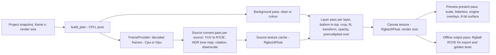
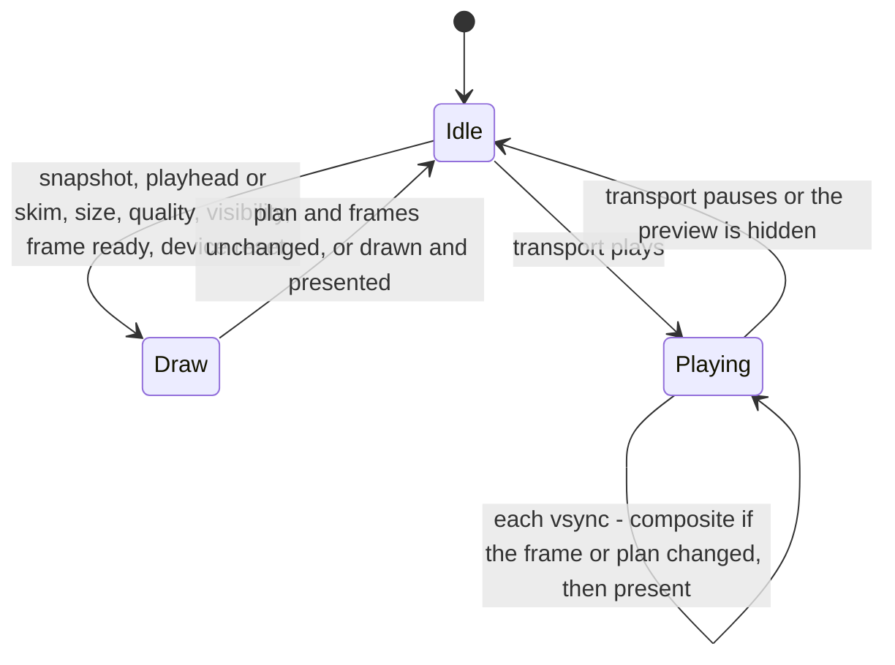
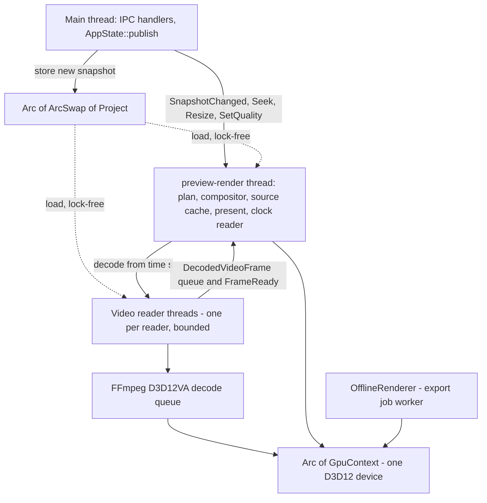

# Design: render graph, frame path and colour baseline

- **Status:** Proposed (task 0310). Implemented by tasks 0320 (graph, decode, HDR), 0340 (preview
  quality, zoom, full screen) and 0350 (clip properties). After implementation this file is a
  record, not a spec. **Spike (0320 step 1, §5.4):** D3D12VA zero-copy on wgpu's device works
  on the RTX 3070 Ti (4K60 HEVC Main 10, 4K30 H.264 and 4K60 AV1 10-bit at 150-350 fps, under 7 %
  of one core, 1/255 against software, no debug-layer errors), and on the Iris Xe after a driver
  update to 32.0.101.7092 (170-350 fps, under 11 % of one core with the GPU convert, 1/255, no
  debug-layer errors). With its 2022 driver the Iris Xe had no D3D12 video interface; such
  drivers decode in software (§5.4 "Spike result").
- **Date:** 2026-11-22
- **Features:** none directly. Unblocks F1.58, F1.61–F1.63, F1.70–F1.76, F1.93, F3.31 and F3.45
  (both Tier 1 since 2026-11-22), and gives the export design (task 0380) its offline entry point.
- **Builds on:** ADR-0001 (one render graph, zero-copy decode), ADR-0004 and ADR-0005 (both
  amended on 2026-11-22 by this task), `docs/design/timeline-editing.md` §3 and §7 (the model that
  is rendered), `docs/design/media-import.md` §3 and §5 (`VideoStreamInfo`, `HdrInfo`, VFR
  sample-and-hold, the `FrameData` shape). Review findings F14, F15, F16, F44 and F48.
- **Companion:** `docs/design/playback.md` (transport, audio clock, A/V sync, prefetch). This doc
  owns what one frame looks like; playback owns *which* frame is shown *when*.

## Decisions

Picked as the de facto standard option for a hobby editor whose common footage is 4K HEVC phone
video, often HDR (HLG, sometimes PQ or Dolby Vision 8.x) and VFR.

| Topic | Decision | Rejected (why) |
|---|---|---|
| Graph shape | A pure CPU step builds a `RenderPlan` from `(snapshot, Time, size)`; one `Compositor` executes it on the GPU into any texture view. Preview, export, `--smoke-test` and golden tests call the same two functions and differ only in the frame fetch policy and the output pass | A node-graph object model (YAGNI: tier 1 has a fixed per-layer pipeline; effects and transitions slot into it later). Separate preview and export renderers (breaks rule 3) |
| Working colour | **`Rgba16Float`, premultiplied alpha, Rec.709 primaries, display-referred R'G'B' (BT.1886 encoding)**. Compositing and blending happen on these non-linear values, like browsers and the default mode of consumer and most pro NLEs | 8-bit `Rgba8Unorm` working textures (banding in blurred backgrounds and fades, and an 8-bit step after the HDR tone map). Linear-light `Rgba16Float` compositing (cross-dissolves and text edges look different from what users know; it is a 0750 option, not a tier-1 need). `Rgba32Float` (twice the bandwidth for no visible gain) |
| HDR | Tone map per source layer inside the source-convert pass: PQ or HLG to display light, **BT.2390 EETF** on max(R,G,B) to SDR white (203 nits, BT.2408), BT.2020 to BT.709 matrix, clip, BT.1886 encode. The rest of the graph is SDR (media-import.md §5) | Hable, Reinhard (no standard, need tuning). BT.2446 method A (more parameters, built for broadcast). Per-scene peak detection (needs compute histograms, makes frames depend on neighbours, breaks export determinism) |
| 10-bit | 10-bit sources are sampled as 16-bit unorm (zero-copy `P010`, CPU `R16Unorm`/`Rg16Unorm` planes) and converted in `f32`; the first quantisation is to `Rgba16Float`. No 8-bit step before the tone map | Uploading 10-bit as 8-bit, or converting with `sws_scale` to RGB48 on the CPU (CPU cost at 4K60) |
| HW frame interop | **D3D12VA on wgpu's own `ID3D12Device`**: FFmpeg decodes into per-frame `ID3D12Resource`s (NV12 or P010) that are wrapped with `create_texture_from_hal` and sampled as `TextureFormat::NV12` / `P010`. The decode thread waits on FFmpeg's fence before handing a frame over. Validated by a spike in 0320 (§5.4) | D3D11VA with shared NT handles (second device, a copy and cross-API sync; kept only as the spike's fallback). Hardware decode with `av_hwframe_transfer_data` download (a 4K P010 frame is 25 MB each way per frame; kept as the automatic per-stream fallback, not the main path). Software decode only (4K60 HEVC does not decode in real time on a laptop CPU) |
| Frame cache | Three small levels: decode-ahead queues per reader, an LRU of converted source textures keyed by (media, frame pts, size), and the last composited canvas. No timeline render cache, no proxies | A disk or RAM render cache of composited frames (F3.47, task 0700). Proxy media (F3.46, task 0700): hardware decode plus preview scaling makes 4K HEVC smooth without them |
| Redraw | Render on change while paused (no presents when nothing changes, review F14). During playback present every vsync, composite only when the project frame or the plan changes | Continuous rendering at the display rate (today: wastes power at 165 Hz). A timer-paced loop (Windows sleep granularity, more code than vsync pacing) |
| Preview size | Composite at `min(canvas, fitted window size × zoom) × quality` (quality = full, half, quarter), then scale to the window in the present pass | Always compositing at canvas resolution (4K canvas into a 1000 px window) |
| Engine overlays | Drawn in the preview's present pass, after the shared graph, so export never contains them | Drawing handles inside the graph (export would need to filter them) |

## 1. Goal and non-goals

Afterwards the preview shows the composed timeline at the playhead: the canvas background, the
main track and the overlay tracks in the right order, every source upright and with the right
shape, SDR and HDR phone clips with natural colour, and 4K HEVC decoded in hardware without a CPU
copy. Export (task 0380) renders the same pixels one frame at a time through the same code.

**Non-goals:** effects, filters and transitions (tasks 0500–0570, they slot in as described in
§4.4); text rendering (0510); keyframe interpolation (0520, `Animated::at` already exists); HDR
output, wide-gamut output or scopes (F3.32, F3.33, F3.28 are `n/a`); colour management settings
(0750); proxies and render cache (0700); the encoder side of export (0380); the legacy Linux
`frames` mode (ADR-0005 amendment).

## 2. User flow

There is no new UI in this design except preview quality, zoom and full screen (task 0340, §8).

- Any edit, undo, redo or gesture update shows its result in the preview within one display
  refresh when no new decode is needed (a slider drag on opacity), and as soon as the frame is
  decoded when it is (a trim that shows a new source frame).
- Seeking shows the nearest decoded frame at once and the exact frame when it is decoded
  (progressive scrub, §5.3).
- Clips whose media is offline show the offline placeholder (§4.3). Nothing here records history.

## 3. Model changes (`app-core`)

None, and no schema change. The graph only reads the model through the pure functions that the
timeline and media designs already define and that preview, export and tests share:
`Clip::source_time`, `Animated::at`, `VideoStreamInfo::display_size`, `Project::media`, and the
track order of timeline-editing.md §3.3. The engine never re-implements them (timeline-editing.md
§7).

## 4. The render graph

### 4.1 Contract

```rust
// crates/engine/src/render/plan.rs: pure, no GPU, unit-tested.

/// Everything needed to draw one frame. Built from a snapshot, compared with the previous plan to
/// skip redundant work (§7), and snapshotted with insta in tests.
#[derive(Debug, Clone, PartialEq)]
pub struct RenderPlan {
    /// The project frame this plan draws: `t` quantised down to the project frame grid.
    pub frame: i64,
    pub time: Time,
    /// Canvas size in project pixels (`ProjectSettings` width x height).
    pub canvas: (u32, u32),
    /// Size of the composited texture in pixels (§8). Same aspect as `canvas`.
    pub render_size: (u32, u32),
    pub background: BackgroundPlan,
    /// Bottom to top.
    pub layers: Vec<LayerPlan>,
}

#[derive(Debug, Clone, PartialEq)]
pub struct LayerPlan {
    pub clip: ClipId,
    pub content: LayerContent,
    /// Canvas-space placement after fit, crop, scale, rotation, position and flip, as a 2x3
    /// affine matrix from the unit quad to canvas pixels (0350 fills crop and transform; 0320
    /// uses fit and identity).
    pub transform: Affine2,
    pub crop: CropInsets,
    pub opacity: f32,
}

#[derive(Debug, Clone, PartialEq)]
pub enum LayerContent {
    Video { media: MediaId, sample_time: Time, convert: ConvertParams },
    Image { media: MediaId, convert: ConvertParams },
    Color(Rgba8),
    /// Media is offline, unreadable, or its decoder failed (§10).
    Placeholder(PlaceholderKind),
}

pub fn build_plan(project: &Project, t: Time, render_size: (u32, u32)) -> RenderPlan;

// crates/engine/src/render/compositor.rs

pub struct Compositor { /* pipelines, texture pool, source cache (§6) */ }

impl Compositor {
    pub fn new(gpu: &GpuContext) -> Self;

    /// Draws `plan` into `canvas` (an `Rgba16Float` texture of `plan.render_size`). The only
    /// drawing code for timeline content: preview, export, --smoke-test and golden tests call it.
    pub fn render(
        &mut self,
        gpu: &GpuContext,
        encoder: &mut wgpu::CommandEncoder,
        plan: &RenderPlan,
        frames: &mut dyn FrameProvider,
        canvas: &wgpu::TextureView,
    ) -> RenderOutcome;
}

pub trait FrameProvider {
    /// The frame for a video layer: the last decoded frame with `pts <= sample_time` (sample and
    /// hold, media-import.md §5). `policy` decides what happens when it is not decoded yet.
    fn video(&mut self, media: MediaId, sample_time: Time, policy: FetchPolicy) -> FrameLookup;
    fn image(&mut self, media: MediaId, policy: FetchPolicy) -> FrameLookup;
}

pub enum FetchPolicy {
    /// Preview: never wait; return the exact frame if ready, else the nearest decoded frame of
    /// that reader (`Stale`), else `Missing`.
    BestAvailable,
    /// Export, golden tests, --smoke-test: block until the exact frame is decoded or the source
    /// fails. Deterministic.
    Exact,
}

pub enum FrameLookup { Exact(FrameRef), Stale(FrameRef), Missing, Failed(PlaceholderKind) }

pub struct RenderOutcome {
    /// Layers drawn with a stale frame, or skipped because their frame was missing. The preview
    /// counts them as late (playback.md §5.4); with `Exact` both are always 0.
    pub stale_layers: u32,
    pub missing_layers: u32,
}
```

- **Time and sampling.** `build_plan` quantises `t` to frame `n = floor(t / frame_duration)` and
  evaluates clip activity and properties at `t_n = n x frame_duration` (a clip is active when
  `start <= t_n < end`). The source frame is sampled at the *centre* of the output frame:
  `sample_time = source_time(t_n) + frame_duration / 2`, and then the media design's
  sample-and-hold rule picks the last frame with `pts <= sample_time`. Sampling at the frame
  start would pick the previous source frame whenever source and project rates differ slightly
  (a 29.97 fps phone clip in a 30 fps project would repeat frames). Images have no time.
- **Determinism.** A plan contains no wall-clock time, no random values and no adapter-dependent
  data. With `FetchPolicy::Exact` the pixels depend only on the snapshot, `n`, `render_size` and
  the adapter. That is the export contract.

### 4.2 Passes per frame



1. **Background pass.** Clears the canvas texture to `CanvasBackground::Color` (an `Rgba8` taken
   as R'G'B' as it is). `Blur` and `Image` backgrounds are added by 0350: `Blur` draws the
   main-track layer's source texture with fill, blurred by a separable Gaussian at a quarter of
   the render size, under all layers; `Image` draws an image layer with fill.
2. **Source convert pass** (one draw per distinct source frame, cached, §6): turns a decoded frame
   into an upright, display-shaped `Rgba16Float` texture in the working space (§5.1, §5.2). It
   applies range, matrix, the HDR tone map, the quarter-turn `rotation` and the `sample_aspect`
   (by its output size, `display_size()`), and downscales to the size the layers need (below).
3. **Layer pass** (one draw per layer): a textured quad with the layer's `transform`, `crop` and
   `opacity`, blended premultiplied-over (`src + dst x (1 - src.a)`). Colour clips are a solid
   quad, placeholders a pattern quad, text clips nothing (0510).
4. **Output.** The preview present pass (§8) or the offline output pass (§4.5).

**Layer order** is timeline-editing.md §7: background, the main track, then overlay tracks from
the bottom of the overlay section to the top (track index `m-1` down to `0`). Hidden tracks are
skipped. At most one clip per track is active at `t_n`, because clips never overlap.

**Convert size.** A source frame is converted to its on-canvas size in render pixels (after fit
and `|scale|`), capped at the source's display size, rounded up to even. When two layers use the
same source frame, the larger size wins. When the downscale ratio is 2 or more, the convert shader
averages `k x k` bilinear taps with `k = min(ceil(ratio), 4)`, so 4K sources do not alias in a
small preview. Export uses the same code at canvas resolution, where the ratio is usually 1.
(As built in 0320: `k` is chosen per axis from the source texels along each output axis after
rotation; taps are averaged on code values and converted once; straight-alpha images average
premultiplied taps and un-premultiply before the colour transform.)

### 4.3 Placeholder

`LayerContent::Placeholder` draws a flat diagonal-stripe pattern in two fixed colours over the
layer's rectangle (no text: Rust sends no user-facing text, and text rendering is 0510).
`Offline` and `DecodeError` use different colours. The media panel's badges explain them.

### 4.4 Where later features slot in

- **Clip effects and filters** (0500–0570): extra passes on the source texture between convert
  and layer pass, each an `effect.json` + `shader.wgsl` (rule 5), listed in `LayerPlan` as data.
- **Transitions** (0550): a pass that combines two layers' outputs; `build_plan` emits a
  transition layer while both clips are active.
- **Blend modes** (0560): a per-layer blend enum; the layer pass picks a pipeline.
- **Text** (0510): a layer content kind drawn by `glyphon` into its own texture.

None of these change the contract of §4.1.

### 4.5 Offline entry point (for export, task 0380)

```rust
// crates/engine/src/render/offline.rs

pub struct OfflineRenderer { /* Compositor, readers with FetchPolicy::Exact, targets reused per size (F48) */ }

impl OfflineRenderer {
    pub fn new(gpu: Arc<GpuContext>, media: MediaPaths, options: OfflineOptions) -> Self;

    /// Renders project frame `n` at `size` (normally the canvas size) and returns it in `format`.
    /// Blocks until every source frame is decoded. Same pixels as the preview at full quality.
    pub fn render_frame(
        &mut self,
        project: &Project,
        n: i64,
        size: (u32, u32),
        format: OutputFormat,
    ) -> Result<RenderedFrame<'_>, RenderError>;
}

/// Reader limits and thread priority; export uses `max_readers: 4, max_hw_readers: 2` and
/// below-normal priority so it does not starve the preview (export.md).
pub struct OfflineOptions {
    pub max_readers: usize,
    pub max_hw_readers: usize,
    pub below_normal_priority: bool,
}

/// Borrows the renderer, so the canvas cannot be overwritten while it is in use.
pub enum RenderedFrame<'a> {
    /// Tight RGBA8 rows, `size.0 * 4` bytes each.
    Rgba8(&'a [u8]),
    /// The canvas; its commands are already submitted. Valid until the next `render_frame`.
    Gpu(&'a wgpu::TextureView),
}

pub enum OutputFormat {
    /// 8-bit R'G'B'A, BT.1886 / Rec.709, read back to the CPU: golden tests, posters, stills.
    Rgba8,
    /// Kept on the GPU for an encoder pass that 0380 adds (for example NV12 Rec.709 limited).
    GpuCanvas,
}
```

- Frames are rendered in order, so the readers decode forward without seeks. Reusing the canvas
  and read-back targets per size fixes review F48.
- `RenderError` is `MediaOffline(MediaId)`, `Decode(MediaId)` or `Gpu`. The preview shows a
  placeholder instead, but export fails or asks (0380 decides; the error carries the media id).
- Export reads the same snapshot type. It takes one `Arc<Project>` at start, so edits during
  export do not change the file being written.

## 5. Colour and the frame path

### 5.1 Working space and precision

| Stage | Format | Values |
|---|---|---|
| Decoded 8-bit frame (H.264, HEVC Main, JPEG) | `NV12` (zero-copy) or `R8Unorm` planes (CPU) | Y'CbCr code values |
| Decoded 10-bit frame (HEVC Main 10, AV1 10-bit) | `P010` (zero-copy) or `R16Unorm`/`Rg16Unorm` planes (CPU) | Y'CbCr code values, never truncated |
| Converted source texture, canvas, all intermediates | `Rgba16Float` | premultiplied R'G'B'A, Rec.709 primaries, BT.1886 encoding, SDR range 0..=1 |
| 8-bit still images (PNG, JPEG after `sws_scale`) | `Rgba8Unorm` source texture | R'G'B'A as stored |
| Preview surface | `Bgra8Unorm` (not an `*Srgb` format) | R'G'B' written as they are |
| Offline output | `Rgba8Unorm` (golden, stills) or the 0380 encoder pass | R'G'B' |

Consequences:

- **An unmodified 8-bit SDR source passes through bit-exactly**: `Rgba16Float` represents every
  8-bit level within 0.13 LSB, and no transfer curve is applied to SDR content. Preview and export
  show the same code values a media player shows.
- **The preview surface stops being an sRGB format.** Today `WindowTarget::new` prefers an
  `*Srgb` surface format; with display-referred working values the surface must not re-encode.
- **No dithering in tier 1.** Tone-mapped 10-bit gradients can band slightly at 8-bit output; an
  ordered dither in the output pass is a 0750 option.
- Device features requested when the adapter has them (`GpuContext`, 0320):
  `TEXTURE_FORMAT_NV12`, `TEXTURE_FORMAT_P010` (zero-copy, DX12) and `TEXTURE_FORMAT_16BIT_NORM`
  (CPU 10-bit planes, available on every D3D12 adapter including WARP). Zero-copy is used only
  when the first two are present.

### 5.2 Source convert (per pixel, `f32`, engine-internal shader `convert.wgsl`, not an effect)

`ConvertParams` is built once per stream from `VideoStreamInfo` and is part of the cache key.

1. **Code values.** `code = sample x scale`, with `scale = 255` (8-bit), `65535 / 64` (P010,
   MSB-aligned) or `65535` (CPU 16-bit containers holding `bit_depth` bits, LSB-aligned).
2. **Range.** Limited: `Y' = (code - 16 x 2^(b-8)) / (219 x 2^(b-8))`, `C = (code - 128 x 2^(b-8))
   / (224 x 2^(b-8))`. Full: `Y' = code / (2^b - 1)`, `C = (code - 2^(b-1)) / (2^b - 1)`.
   Unknown range: limited for YUV formats, full for `yuvj*`, `gray*` and RGB. The bit depth `b`
   and the scale come from the decoded frame's sample container (P010 from hardware,
   `yuv420p10le` from software, 16-bit after `sws_scale`), not from the stream, so
   `ConvertParams` carries no bit depth.
3. **Matrix** (`color.matrix`): BT.601, BT.709 or BT.2020 non-constant luminance
   (`Kr, Kb` = 0.299/0.114, 0.2126/0.0722, 0.2627/0.0593). Unknown: BT.709 when the coded height
   is 720 or more, else BT.601 (the convention of FFmpeg and most players).
4. **SDR** (`hdr == None`): R'G'B' are the working values. Primaries BT.601 and BT.709 are both
   treated as BT.709 (the difference is invisible at hobby scale). SDR BT.2020 primaries (rare)
   are linearised with gamma 2.4, converted with the BT.2020→BT.709 matrix, clipped and
   re-encoded.
5. **HDR** (`hdr == Some`, keyed on `HdrTransfer`):
   - **To display light in nits.** PQ: the ST 2084 EOTF. HLG: the BT.2100 inverse OETF to scene
     light `E`, then the OOTF for a 1000-nit nominal display, `Fd = 1000 x Ys^(1.2 - 1) x E` with
     `Ys = 0.2627 R + 0.6780 G + 0.0593 B`.
   - **Source peak** `Lsrc`: PQ uses `max_cll_nits`, else `mastering_max_nits`, else 1000,
     clamped to 400..=10000. HLG uses 1000. A metadata value of 0 counts as missing (some
     encoders write 0 for "unknown"). With these values HLG reference white (75 % signal, about
     203 nits) lies above the knee for `Lsrc = 1000` and lands at about 0.90 after the EETF: one
     of the inputs to the tone-map taste risk below.
   - **Tone curve:** BT.2390 EETF in the PQ domain, applied to `m = max(R, G, B)`, from
     `[0, Lsrc]` to `[0, 203 nits]` (target peak = SDR white, BT.2408 reference white). With
     `maxLum = PQinv(203) / PQinv(Lsrc)` the knee starts at `KS = 1.5 x maxLum - 0.5`; below it
     the curve is the identity, above it the BT.2390 Hermite spline. RGB is scaled by `m' / m`, so
     hue is kept and no channel exceeds the target.
   - **Normalise and gamut:** divide by 203, apply the BT.2020→BT.709 matrix, clip to 0..=1.
   - **Encode:** `V = L^(1 / 2.4)` (inverse BT.1886 with zero black level).
   - `DolbyVisionOnly` (profile 5) takes the PQ path. Its colours are wrong and the media panel
     badges it (media-import.md §3); no RPU processing.
6. **Orientation and shape:** the pass writes an upright texture of `display_size()` (scaled to
   the convert size): quarter turns are a UV swizzle, the sample aspect only changes the output
   size. Coded padding (a 1088-line HEVC surface for 1080p) is excluded with a UV scale from the
   frame's visible size, and each plane's UV is clamped to the centre of its last valid texel
   (`ceil(visible / subsampling)` for chroma): a UV scale alone lets the last luma row of a
   1080-in-1088 surface blend 25 % of chroma padding row 540. Chroma siting is ignored (centre).
7. **Alpha:** video is opaque; images with alpha are premultiplied here.

The constants and the tone curve also exist as plain Rust functions (`engine::color`), the
reference the shader is tested against (§12) and the source of the CPU lookup table that the
media design's HDR posters use (media-import.md §5).

### 5.3 Decoded frames and readers

```rust
// crates/engine/src/media/frame.rs (shape from media-import.md §5; 0310 defines Gpu)

pub struct DecodedVideoFrame { pub pts: Time, pub data: FrameData }

pub enum FrameData { Cpu(CpuFrame), Gpu(GpuFrame) }

pub struct CpuFrame {
    pub layout: PlaneLayout,       // Planar3 { chroma_w, chroma_h } | SemiPlanar | Packed (RGBA)
    pub depth: SampleDepth,        // U8 | U16 { bits: u8, msb_aligned: bool }
    pub visible: (u32, u32),
    pub planes: [Option<PlaneBuf>; 3], // stride + bytes; buffers come from a per-reader pool
}

/// A hardware-decoded frame on the shared device. `Send`; moved from the decode thread to the
/// render thread.
pub struct GpuFrame {
    /// The decoder's `ID3D12Resource`, wrapped for this frame with `create_texture_from_hal`.
    /// `TextureFormat::NV12` (8-bit) or `P010` (10-bit); planes are sampled through
    /// `TextureAspect::Plane0` / `Plane1` views.
    pub texture: wgpu::Texture,
    pub coded: (u32, u32),
    pub visible: (u32, u32),
    /// Holds the `AVFrame` reference, so FFmpeg does not reuse the surface. Dropped only after
    /// the GPU work that sampled the texture has completed (§5.4).
    hold: HwFrameRef,
}
```

- **Readers.** A reader is one decode worker thread with its own `AVFormatContext` and decoder
  for one video stream (ADR-0004 amendment). It decodes forward from a seek point into a bounded
  queue of `DecodedVideoFrame`s and is steered by "decode from time `s`" requests. Which reader
  serves which clip, how many exist and how far they decode ahead is playback.md §7. This design
  fixes the rules a reader follows:
  - **Seek** to the keyframe at or before the target (`AVSEEK_FLAG_BACKWARD`) and decode forward;
    frames before the target are dropped except the last one (sample and hold needs it).
  - **No seek** when the target lies between the reader's last decoded pts and 1 s past it:
    decoding forward is cheaper than a seek in long-GOP phone footage.
  - **Coalescing:** a newer request replaces an older one that has not started; a running decode
    towards an older target is abandoned at the next packet.
  - **Progressive scrub:** while a seek decodes forward, every decoded frame is published, so
    `BestAvailable` shows the keyframe first and the exact frame when it arrives.
  - **CPU frames** are normalised to the layouts above. Formats the convert shader does not read
    (palettised, packed 4:2:2 such as `yuyv422`, `gray`, RGB24, 16-bit RGB stills) go through
    `sws_scale` on the decode thread to `yuv420p`/`yuv444p` (8 or 16-bit) or `rgba`/`rgba64`.
  - **Images** are decoded once (CPU), downscaled at decode to a long side of at most twice the
    canvas long side (a 48 MP photo is 390 MB as `Rgba16Float`), and kept in the source cache.
    HEIC tile grids are stitched by the shared code from task 0230.

### 5.4 Hardware decode and zero-copy (review F16, F3.45)

**Chosen path: D3D12VA on the shared device.**

1. At startup the `GpuContext` (created on the adapter that presents to the preview window,
   unchanged) is shared as `Arc<GpuContext>` (ADR-0004 amendment). For each hardware reader the
   engine creates an `AVHWDeviceContext` of type `AV_HWDEVICE_TYPE_D3D12VA` whose `device` is
   wgpu's raw `ID3D12Device` (`wgpu::Device::as_hal::<Dx12>`). Decoder and renderer then use one
   device, so on a hybrid laptop decode runs on the same GPU that renders and presents.
2. FFmpeg allocates one `ID3D12Resource` per frame (`DXGI_FORMAT_NV12` or `P010`, both planes as
   subresources) in its frames pool. `AVD3D12VAFramesContext.flags` stays without
   `DENY_SHADER_RESOURCE`. The pool holds the decoder's references plus
   `extra_hw_frames = READER_QUEUE_DEPTH + 2`.
3. **Sync:** each frame carries `AVD3D12VASyncContext { fence, fence_value }`. The decode thread
   waits on it (`SetEventOnCompletion` + `WaitForSingleObject`) before it publishes the frame.
   The render thread therefore only ever sees finished surfaces and needs no cross-queue wait.
4. **Wrap:** the decode thread wraps the resource with `wgpu_hal::dx12::Device::texture_from_raw`
   and `wgpu::Device::create_texture_from_hal`, one wrap per decoded frame (no stale state
   tracking across reuse of a pool surface).
5. **Release:** the render thread keeps each `GpuFrame` it sampled in a list tagged with the
   submission index and drops it after that submission has completed
   (`Queue::on_submitted_work_done`). Only then does the surface return to FFmpeg's pool, so the
   decoder can never overwrite a texture the GPU is still reading.
6. **Fallbacks, per stream, automatic, remembered for the session per media:**
   - the adapter lacks `NV12`/`P010` support, or wrapping fails: hardware decode with
     `av_hwframe_transfer_data` to `FrameData::Cpu` (NV12 or P010 planes);
   - the hardware decoder cannot open the profile (4:2:2 or 12-bit HEVC, AV1 on older iGPUs,
     VP9 profile 2 on some GPUs) or fails mid-stream: software decode from the current position,
     `thread_count = clamp(cores / 2, 2, 8)`;
   - WARP (no hardware video): software decode.
   `CUTFRAME_HWDECODE=off` forces software decode for debugging and for the 0320 "every fixture
   renders without hardware decode" check.

**Spike (first step of 0320), on the hybrid laptop's iGPU and dGPU:** a 4K60 HEVC Main 10 HLG
iPhone clip (Dolby Vision 8.4) and a 4K30 H.264 clip.

- Decodes zero-copy at the source frame rate with the CPU below 15 % of one core per reader.
- A P010 frame converted on the GPU matches the software-decoded frame of the same pts within
  2/255 per channel after the output pass.
- The D3D12 debug layer reports no errors (resource states, cross-queue use); 10 minutes of
  playback do not exhaust the frames pool.
- **If it fails** on either GPU: try D3D11VA (`AV_HWDEVICE_TYPE_D3D11VA` on the same adapter, copy
  into a shared NT-handle texture opened by D3D12, fence sync); if that fails too, hardware decode
  with download becomes the tier-1 path and 4K60 HDR moves to half quality in the budget. The
  outcome is recorded in this doc's status line.

#### Spike result (2026-11-22)

Harness: `engine::media::d3d12` plus the ignored test `media::d3d12::spike::spike_report`
(release build, `WGPU_VALIDATION=1`, debug-layer messages read from `ID3D12InfoQueue`). Clips:
NVENC 4K60 HEVC Main 10 HLG (BT.2020, coded 3840 x 2176), NVENC 4K30 H.264 High, SVT-AV1 4K60
10-bit PQ, and the committed 64 x 64 HEVC HLG and AV1 PQ fixtures. Decode fps is unthrottled;
CPU is process user + kernel time per frame, scaled to % of one core at the clip's own rate. "Max
diff" compares the zero-copy frame converted on the GPU (`Plane0`/`Plane1` views, BT.709/BT.2020
limited range, `Rgba8Unorm`) with the software-decoded frame of the same pts converted on the
CPU. The long loop decodes 6000 frames (looping the clip), converts each on the GPU, keeps 6
frames in flight and drops each after its submission completed.

**RTX 3070 Ti Laptop (driver 32.0.16.1742), D3D12VA on wgpu's device**

| Clip | Path | Decode fps | CPU, % of one core | Max diff | Debug-layer errors | Long loop |
|---|---|---|---|---|---|---|
| HEVC 4K60 Main 10 HLG | zero-copy | 277 (332 with convert) | 1.4 (6.3 with convert) | 1/255 | 0 | 6000 frames, 10 surfaces, every pass complete |
| H.264 4K30 | zero-copy | 152 (147 with convert) | 2.7 (4.8) | 1/255 | 0 | 6000 frames, 37 surfaces, every pass complete |
| AV1 4K60 10-bit PQ | zero-copy | 284 (350 with convert) | 2.5 (4.4) | 1/255 | 0 | 6000 frames, 14 surfaces, every pass complete |
| same three, download | download | 51 / 115 / 48 | 49 / 13 / 51 | 0/255 | FFmpeg's copy-queue barriers (below) | not run |
| same three, software (8 threads) | software | 196 / 230 / 169 | 175 / 71 / 109 | reference | 0 | not run |
| 64 x 64 fixtures | software (below the hardware minimum) | - | - | - | 0 | - |

**Iris Xe (i7-12700H, driver 32.0.101.7092 of 2026-09-03), D3D12VA on wgpu's device** (rerun
on 2026-11-23 after the driver update)

| Clip | Path | Decode fps | CPU, % of one core | Max diff | Debug-layer errors | Long loop |
|---|---|---|---|---|---|---|
| HEVC 4K60 Main 10 HLG | zero-copy | 347 (289 with convert) | 1.9 (10.2 with convert) | 1/255 | 0 | 6000 frames, 10 surfaces, every pass complete |
| H.264 4K30 | zero-copy | 198 (172 with convert) | 1.1 (5.3) | 1/255 | 0 | 6000 frames, 23 surfaces, every pass complete |
| AV1 4K60 10-bit PQ | zero-copy | 257 (210 with convert) | 1.9 (7.7) | 1/255 | 0 | 6000 frames, 14 surfaces, every pass complete |
| same three, download | download | 61 / 121 / 57 | 38 / 12 / 37 | 0/255 | FFmpeg's copy-queue barriers (below) | not run |
| same three, software | software | 160 / 198 / 179 | 205 / 83 / 112 | reference | 0 | not run |

The only other messages are warnings from the harness's own read-back buffer
(`WRITE_COMBINE` page property) and a clear without a clear value; the decode path itself is
clean.

**Iris Xe (i7-12700H, driver 31.0.101.3413 of 2022-08-19)**, first run on 2026-11-22

| Clip | Path | Decode fps | CPU, % of one core | Max diff | Debug-layer errors | Long loop |
|---|---|---|---|---|---|---|
| all | software: the driver's D3D12 device has no `ID3D12VideoDevice` (`E_NOINTERFACE`), so neither zero-copy nor D3D12VA download exists | HEVC 169, H.264 214, AV1 127 | 208 / 79 / 149 | - | 0 | - |
| D3D11VA, FFmpeg CLI, no download | D3D11VA decode only (interop not built) | HEVC 334, H.264 161, AV1 ~390 | 16 / 19 / 12 | - | - | - |
| D3D11VA, FFmpeg CLI, with download | D3D11VA + download | HEVC 64, H.264 63, AV1 38 | 102 / 50 / 133 | - | - | - |

**WARP:** `HwDevice::new` refuses the software adapter; every clip decodes in software, no
debug-layer messages.

**Verdict.** The chosen path works on both GPUs and meets every criterion above: on the dGPU,
and on the iGPU once its driver was updated (the 2022 driver had no D3D12 video). The D3D11VA
shared-texture fallback is therefore not built. An adapter without D3D12 video (old drivers,
WARP) decodes in software; 4K60 HEVC then costs about 2 cores per reader.

**Findings that change the implementation (all in `engine::media::d3d12`):**

- **Surface size.** FFmpeg 7.1's D3D12VA `frame_params` sizes surfaces to the display size. A
  4K HEVC stream with a conformance window (3840 x 2160 shown, 3840 x 2176 coded, as NVENC and
  many cameras write it) gets surfaces 16 lines short and the NVIDIA driver removes the device
  (`DXGI_ERROR_DRIVER_INTERNAL_ERROR`); the FFmpeg CLI fails the same way. The engine creates the
  frames context itself in `get_format` with the coded size aligned like FFmpeg's D3D11VA code
  (128 for HEVC/AV1, 32 for MPEG-2, else 16). `GpuFrame::coded` is that surface size and
  `visible` the picture, so the convert pass needs the UV scale of §5.2 step 6 on every frame.
- **Minimum size.** A hwaccel that fails to initialise for an unsupported extent (the 64 x 64
  fixtures) also removes the device, which takes the preview down with it. Streams below 256
  pixels in either dimension never open in hardware.
- **No in-decoder software fallback.** When D3D12VA cannot be used, `get_format` returns
  `AV_PIX_FMT_NONE` and the decode fails (`hw_active() == false`); the reader reopens the stream
  with the software decoder. FFmpeg's own fallback would run single-threaded, and the native
  `av1` decoder has no software path at all.
- **Release state (adds to step 5).** wgpu leaves a sampled surface in the shader-resource
  state, while FFmpeg's decode queue expects `D3D12_RESOURCE_STATE_COMMON` when it reuses the
  surface as a reference or output. Without a transition back the debug layer reports a state
  mismatch on every decode submission (108 errors in a 60-frame loop). The render thread records
  `GpuFrame::record_release` (a `transition_resources` to `TextureUses::PRESENT`, which wgpu-hal
  dx12 writes as `COMMON`) in the encoder of the frame's last use; with it the zero-copy path is
  error-free.
- **Download path.** FFmpeg 7.1's `av_hwframe_transfer_data` for D3D12 triggers debug-layer
  errors (`COPY_SOURCE` layout on a copy queue, which expects `COMMON`) on every frame, and costs
  about 50 % of a core at 4K60. It stays the per-stream fallback for a failed wrap only.
- **Pool.** The D3D12VA frames pool is dynamic (`initial_pool_size` 0), so it cannot be
  exhausted; the risk is leaking frames instead. With the release rule the number of distinct
  surfaces stays at 10-37 over 6000 frames, so frames are recycled.
- **Debug layer.** Its messages do not reach the log through wgpu-hal's `OutputDebugString`
  handler in a normal run; `d3d12::take_debug_messages` reads them from `ID3D12InfoQueue`.

## 6. Caches

| Level | Lives on | Key | Bound | Purpose |
|---|---|---|---|---|
| Decode-ahead queue | each reader | pts | `READER_QUEUE_DEPTH = 6` frames (GPU); CPU frames also capped at 160 MB per reader | Smooth playback, progressive scrub (playback.md §7) |
| Source textures | render thread | `(media, pts or image, convert size, ConvertParams)` | LRU, 256 MB of GPU memory for the preview, 2 frames per source for export | Paused edits (opacity slider, move, trim) re-composite without decoding or converting; a 24 fps clip in a 60 fps project converts each source frame once; images convert once |
| Last canvas | render thread | the `RenderPlan` and the identities of its frames | 1 | Skip compositing when nothing changed; re-present after resize or zoom |

- Frames held by the cache count against the hardware pool, so a cached `GpuFrame` is converted
  and released at once: the cache stores the converted `Rgba16Float` texture, never the decoder
  surface.
- A changed `ConvertParams` (relink with different colour info) or render size makes new keys;
  old entries age out of the LRU.
- **Explicitly not built:** a composited-frame cache across time (F3.47), a disk cache of frames,
  proxies (F3.46). Task 0700 decides them on measurements.

## 7. Render on change and continuous rendering (review F14)



- **Idle** blocks on the render thread's channel (no timer, no presents, about 0 % CPU). Messages
  that wake it: `SnapshotChanged` (sent by `AppState::publish`), transport changes and seeks,
  `Resize`, `SetVisible`, `SetQuality`/`SetView`, `FrameReady` from a reader (coalesced by an
  `AtomicBool`, sent only when the reader produced a frame the last plan was waiting for) and
  device recreation.
- **Draw** builds the plan, fetches frames with `BestAvailable`, and skips the composite if plan
  and frame identities equal the last ones. A frame with a **missing** layer (not stale) is not
  composited within 250 ms of the request: the previous canvas stays, so cut points and scrubs do
  not flash black. After 250 ms the layer is left out.
- **Playing** is vsync-paced (`AutoVsync`, `desired_maximum_frame_latency = 2`, unchanged): the
  thread acquires the next surface texture, asks the clock which project frame will be on screen
  (playback.md §5), composites only when that frame index or the plan changed, and always
  presents (a cheap scale pass from the last canvas). At 165 Hz with 30 fps content that is one
  composite and five or six presents per frame.
- Hidden preview: no presents. During playback with a hidden preview, audio and the clock keep
  running and ticks keep flowing (playback.md).

## 8. Preview resolution, zoom and full screen (task 0340)

- **Render size.** `fit` = the canvas fitted into the preview rectangle (physical pixels).
  `render_size = min(canvas, fit x zoom) x quality`, rounded to even, with quality `Full` = 1,
  `Half` = 1/2, `Quarter` = 1/4. So `Full` is pixel-accurate for the window, and a 4K project in a
  1280 x 720 preview composites at 1280 x 720 at most. Default `Full`; the choice is a UI
  preference (task 0150 persistence), sent with `set_preview_quality`.
- **Zoom and pan** (F1.62): `Fit` or a percentage of canvas pixels (25–400 %), with a pan offset in
  canvas fractions. The present pass maps the visible canvas region into the window. Outside the
  canvas it draws black.
- **Present pass** (preview only): bilinear scale of the canvas texture into the surface, the
  letterbox, then **engine overlays** in window pixels: selection handles and guides from task
  0360, nothing in 0320. Overlays never enter the canvas texture, so export cannot contain them.
- **Full screen** (F1.63): the main window goes full screen (`WebviewWindow::set_fullscreen`) and
  the UI lays the preview area over the whole webview, hiding the other panels. The child window
  follows the rectangle as always (ADR-0005 §2). Esc leaves full screen, Space plays. No second
  window (ADR-0005 amendment).
- Switching quality or zoom during playback changes the render size on the next frame; source
  textures are re-converted at the new size as frames come in, with no decoder restart.

IPC (task 0340, fire-and-forget per ADR-0003 §10):

```rust
#[derive(Clone, Copy, Serialize, Deserialize, specta::Type)]
#[serde(rename_all = "camelCase")]
pub enum PreviewQuality { Full, Half, Quarter }

#[derive(Clone, Copy, Serialize, Deserialize, specta::Type)]
#[serde(tag = "kind", rename_all = "camelCase")]
pub enum PreviewZoom { Fit, Percent { percent: u16 } }   // 25..=400, clamped

#[derive(Clone, Copy, Serialize, Deserialize, specta::Type)]
#[serde(rename_all = "camelCase")]
pub struct PreviewView { pub zoom: PreviewZoom, pub pan_x: f32, pub pan_y: f32 } // canvas fractions

#[tauri::command] #[specta::specta]
pub fn set_preview_quality(state: State<AppState>, quality: PreviewQuality);

#[tauri::command] #[specta::specta]
pub fn set_preview_view(state: State<AppState>, view: PreviewView);
```

No events and no new `media://` routes. Frames never cross IPC.

## 9. Threads



- `AppState.snapshot` becomes an `Arc<ArcSwap<Project>>` shared with the engine; `engine` gains
  the `arc-swap` workspace dependency. Engine threads never take the document lock (ADR-0004 §2).
- Readers need the shared device for hardware decode, which is why the `GpuContext` moves into an
  `Arc` in 0320 rather than "when export arrives" (ADR-0004 amendment).
- The `OfflineRenderer` runs on a job worker (export, 0380) with its own readers and its own
  `Compositor` state on the same device (ADR-0004 §6).

## 10. Failure handling

| Failure | Behaviour |
|---|---|
| Media file missing or unreadable when a reader opens | Layer shows the `Offline` placeholder; the engine reports `MediaUnavailable(MediaId)` through its event sink once per media, and the shell sets `MediaStatus::Offline` (media-import.md §6.6) |
| Corrupt packet or frame | Skipped, logged at debug; the previous frame is held. Three failures within 1 s: the reader stops, the layer shows the `DecodeError` placeholder, one warning is logged |
| Hardware decoder fails to open or fails mid-stream | Reopen in software at the same position (§5.4), log once, remember for the session |
| Interop wrap fails | Hardware decode with download to CPU frames, log once |
| Device lost (driver reset, `DeviceLost` callback) | Preview, readers and caches are dropped; the preview thread recreates the `GpuContext` for the same window once and restarts the readers. If that fails, the preview reports `unavailable` and logs the error. Export fails with `RenderError::Gpu` |
| Surface lost or outdated | Reconfigure and present the last canvas (existing code) |
| Out of the cache or pool budget | LRU eviction; readers stop decoding ahead when their queue is full. Nothing fails |
| Unknown colour metadata | The defaults in §5.2 |

## 11. Project file

No change. `schemaVersion` stays; no fixture needed. Preview quality and zoom are UI preferences
(task 0150), not project data.

## 12. Test plan, including the golden-frame harness (review F44)

**Pure engine tests (no GPU, no FFmpeg):**

- `build_plan`: layer order with overlays, main and audio sections; hidden tracks skipped; clip
  active at `start`, not at `end`; frame quantisation; centre sampling (a 29.97 fps source in a
  30 fps project selects source frames 0, 1, 2, ... without repeats over 10 s; a 24 fps source in
  60 fps holds each frame 2 or 3 times in the 3:2 pattern); `render_size` for full, half, quarter,
  zoom and odd sizes; placeholder for a missing media id.
- **insta snapshots** (`insta::assert_debug_snapshot!`, new dev-dependency, Apache-2.0) of the plan
  for a canonical project (main track, two overlays, colour clip, image, hidden track) at five
  times. A model or plan change shows up as a reviewed snapshot diff.
- `engine::color`: PQ and HLG reference points (PQ inverse of 203 nits is 0.5806; HLG OETF at
  1/12 is 0.5); EETF identity below the knee, monotonic, `Lsrc` maps to 203 nits; matrices
  round-trip; range expansion for 8 and 10 bits.

**GPU tests on WARP** (forced with the software adapter, so every machine and CI give the same
pixels; WARP ships with Windows, so a missing adapter fails the test instead of skipping it):

- **Shader parity:** a synthetic 10-bit ramp (in-memory `CpuFrame`, P010 and LSB-aligned layouts)
  through `convert.wgsl`, read back as `Rgba16Float`, matches `engine::color` within 1/1023 for
  SDR and within 2/1023 for the HLG and PQ paths. The 10-bit ramp yields more than 256 distinct
  output levels (no 8-bit step).
- **Golden frames** (`crates/engine/tests/golden.rs`, references in `crates/engine/tests/golden/`):

  | Scene | Checks |
  |---|---|
  | Colour background + colour clip | the simplest path, exact colours |
  | SDR H.264 test-pattern fixture at 3 times | BT.709 limited range, frame selection by pts |
  | Portrait HEVC `cw90` VFR fixture | upright, orientation marker in the right corner |
  | Anamorphic MPEG-2 (SAR 4:3) | display shape |
  | PNG with alpha over a colour clip, JPEG with EXIF orientation | premultiplied alpha, rotation |
  | HLG fixture, 10-bit PQ AV1 fixture | the tone map is wired: no grey wash, no clipped mid-tones |
  | Overlay above main, hidden overlay | layer order |
  | `t` at a cut point | the next clip, not the previous one |
  | Offline media | placeholder pattern |
  | The SDR scene at half quality | render size scaling path |

  Media fixtures are the committed ones from task 0220 (`crates/engine/tests/fixtures/media/`).
  References are small PNGs (at most 256 px on the long side, a few KB each).
- **Harness rules:** render with `OfflineRenderer` (`FetchPolicy::Exact`, `OutputFormat::Rgba8`),
  compare with the reference PNG (dev-dependency `png`, MIT/Apache) per channel: pass when the
  maximum difference is at most 2/255 and at most 0.1 % of pixels differ by more than 1/255. On a
  mismatch the test writes `target/golden/<name>.actual.png` and `<name>.diff.png`.
  `CUTFRAME_UPDATE_GOLDEN=1 cargo test -p engine --test golden` rewrites the references; the PR
  diff shows the PNGs for review (the same workflow as insta's `INSTA_UPDATE`).
- **Hardware tests** (`#[ignore]`, run locally with `--ignored` on the Windows machine): the
  zero-copy path against the software path for the HEVC fixtures, within 2/255; forced software
  decode (`CUTFRAME_HWDECODE=off`) renders every golden scene.
- `--smoke-test` presents the compositor's output for the startup project (background colour)
  instead of the test pattern; CI still checks `mode=Native`, `backend=Dx12`, 30 presents.

**src-tauri:** `SnapshotChanged` reaches the render thread after `publish` (fake engine sink);
`set_preview_quality` and `set_preview_view` clamp their inputs.

**UI (Vitest, 0340):** quality menu and zoom state, full-screen toggle and Esc, skim toggle.

**Manual (0320 done-check):** scrub an iPhone HDR clip and a 4K HEVC clip in `pnpm dev` on the
iGPU, the dGPU and WARP (`WGPU_FORCE_FALLBACK_ADAPTER=1`).

**devops:** no CI change; golden tests run inside `cargo test --workspace` on WARP. `deny.toml`
must accept `insta` and `png` (both permissive).

## 13. Performance budget

Reference machine: the hybrid laptop of ADR-0005 (Iris Xe and RTX 3070 Ti), measured on the iGPU
(`CUTFRAME_GPU=integrated`) unless noted. Measurement: `tracing` spans around plan, convert,
composite and present, logged every 5 s with the existing present-rate log.

| What | Budget |
|---|---|
| `build_plan` for the ADR-0003 benchmark project (1,000 clips, 20 tracks) | ≤ 0.2 ms |
| Paused edit that needs no decode (opacity slider gesture) | new frame presented ≤ 1 refresh after `project-changed` |
| Composite + present, 1080p canvas, 1280 x 720 preview, 4 layers | ≤ 4 ms GPU |
| Convert of one 4K P010 frame to 1280 x 720 with tone map | ≤ 2 ms GPU |
| Scrub on 4K HEVC (GOP ≤ 1 s): first frame / exact frame after the pointer stops | ≤ 50 ms / ≤ 150 ms |
| Idle, paused, nothing changing | 0 presents, render thread blocked |
| GPU memory, preview, 3 active 4K HEVC readers | ≤ 1.5 GB including decoder pools |
| Export render of one 1080p frame, offline (excluding encode) | ≤ 8 ms on the iGPU |

Playback budgets (frame drops, A/V sync) are in playback.md §11.

## 14. Task breakdown

**0320 (backend), in order:**

1. Spike: D3D12VA zero-copy on the shared device (§5.4), result recorded in the status line.
2. `GpuContext` in an `Arc`, optional features (`NV12`, `P010`, `16BIT_NORM`), non-sRGB surface;
   `AppState` shares `Arc<ArcSwap<Project>>` and sends `SnapshotChanged` on publish.
3. `engine::color` reference functions and tests; `build_plan` with insta snapshots.
4. Readers: software decode, seek rules, progressive scrub, CPU frame layouts, images; then
   hardware decode, interop, release rule and fallbacks.
5. `Compositor`: background colour, convert pass (SDR and HDR), layer pass with fit, colour and
   placeholder layers; source cache; render-on-change loop; offline placeholder and
   `MediaUnavailable` reporting.
6. `OfflineRenderer` with reused targets (F48); golden harness and scenes; `--smoke-test` on the
   compositor; the test pattern is deleted.
7. A temporary `seek(time, mode)` command so that the UI playhead drives the preview before 0330
   (playback.md §8 defines it; 0330 adds the rest of the transport).

**0320 (frontend):** call `seek` when the UI playhead changes (scrub mode while dragging).

**0340:** render size from quality and zoom, present-pass zoom and pan, full screen, skimming and
source preview (playback.md §8).

**0350:** `LayerPlan.transform`, `crop`, `opacity`, flip; `Blur` and `Image` backgrounds; golden
frames per property.

**0360:** the present-pass overlay for handles and guides.

**0390 (backend):** the NV12 pass of `docs/design/export.md` §4.3 after `OutputFormat::GpuCanvas`,
and export error handling for `RenderError` (designed in export.md, task 0380).

## Risks

- **D3D12VA maturity.** Younger in FFmpeg and drivers than D3D11VA. The spike gates 0320, and the
  download path keeps hardware decode working if zero-copy fails.
- **wgpu-hal interop is unsafe and version-coupled.** `as_hal` and `texture_from_raw` signatures
  change between wgpu releases. All of it lives in one module (`engine::media::d3d12`) with the
  spike's tests, so a wgpu update touches one place.
- **Decoder pool memory.** HEVC can keep 16 references; at 4K P010 a pool is several hundred MB.
  The reader limit in playback.md §7 bounds it, and idle readers close.
- **Tone-map taste.** One fixed operator may look slightly dim or flat on some phone footage.
  Task 0750 may tune the target peak or add saturation handling; the golden frames make any change
  visible.
- **Non-linear blending.** Display-referred compositing is the familiar look, but blurs and
  scaling are not physically correct. A switch to linear light later changes golden frames, not
  the contract.
