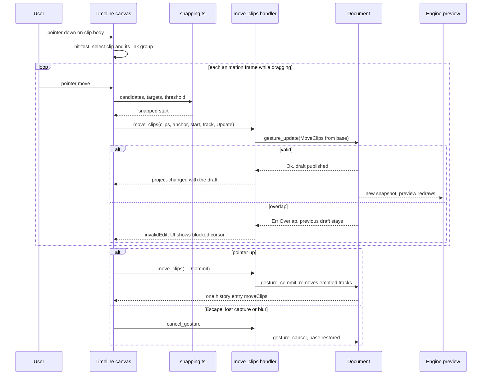
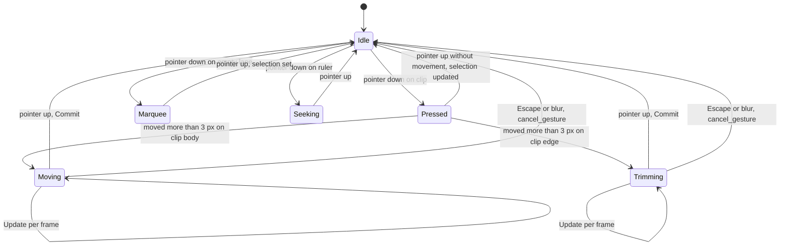
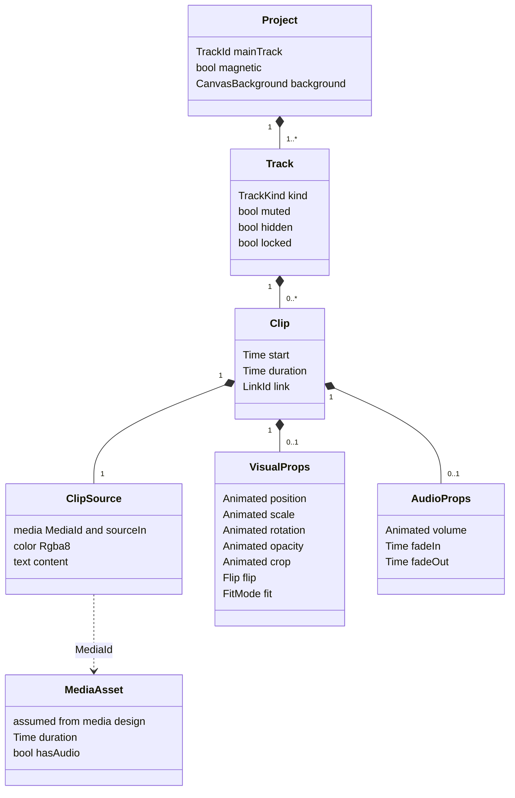

# Design: clip model and timeline edit operations

- **Status:** Proposed (task 0250). After implementation this file is a record, not a spec.
- **Unblocks:** tasks 0260, 0270, 0280, 0290, 0300, 0350, 0360, 0370 (and the render-graph design,
  task 0310).
- **Features:** none directly. Prepares F1.24–F1.28, F1.36–F1.53, F1.70–F1.85 and the model side of
  F2.53–F2.59 (keyframes).
- **Decisions:** ADR-0002 (project file), ADR-0003 (IPC), ADR-0004 (threading), ADR-0006 (edit
  transactions). No new ADR: nothing here changes a `CLAUDE.md` rule.
- **Depends on:** the media design (task 0210), which is not on `main` yet. §3.1 lists what this
  design assumes from it.

## 1. Goal and non-goals

Afterwards the user can assemble a YouTube video or Short on the timeline. They put media on a
magnetic main track, add overlays (picture-in-picture, B-roll, images, colour cards) and music on
other tracks, then select, move, trim, split, delete, ripple-delete, copy and paste clips. Video
and its detached audio stay in sync, tracks can be muted, hidden and locked, and every clip has
transform, opacity, crop and volume properties. Those properties are stored in a shape that later
takes keyframes without a migration.

This doc fixes the model, the edit commands and their invariants, the IPC shape, the project-file
migration and the split of the work. The feature tasks implement it.

**Non-goals** (hobby scope, `CLAUDE.md`):

- NLE trim modes (roll, slip, slide), three-point editing, source monitor in/out, sync locks,
  track targeting. Ripple trim is a tier-2 row (F2.99, task 0630) and is not designed here.
- Nested timelines, compound clips and groups (task 0640). Links (§3.5) are the only clip grouping
  in tier 1.
- A system-clipboard format and pasting between app instances or projects (§6.3).
- Text styling and text rendering (task 0510). This doc only reserves the text clip variant.
- Speed, reverse and freeze frame. Task 0370 adds them; §3.4 says where they go.
- Keyframe editing commands and UI (task 0520). This doc only fixes the stored shape (§3.6).
- Markers (task 0630). They become extra snap targets later (§6.2).

## 2. User flow

| Action | Input | Result | History |
|---|---|---|---|
| Add media | drag from media panel, `+` on a media item | appended to the main track (audio-only media: first audio track) | one entry per drop (`addClips`) |
| Insert at playhead | drag onto the main track, or `+` with Alt | inserted at the main-track clip boundary nearest the drop time | one entry |
| Drop on overlay / empty space | drag above the main track or into the space between/below tracks | placed on that track, or on a new track created at that spot | one entry (new track included) |
| Select | click; Ctrl+click toggles; Shift+click adds; marquee drag on empty lane; Ctrl+A; Esc clears | UI only, never in history | — |
| Move | drag a clip body | moves selection (and linked clips) in time and, on one track, vertically | one entry per drag |
| Trim | drag a clip edge | changes start or end, clamped to source length and neighbours | one entry per drag |
| Split | Ctrl+B | selection, or every clip under the playhead on unlocked tracks | one entry |
| Delete | Delete / Backspace | removes the selection; leaves a gap except on the magnetic main track | one entry |
| Ripple delete | Shift+Delete | removes and closes the gap on each affected track | one entry |
| Delete gap | click a gap, Delete | gap closes on that track | one entry |
| Trim to playhead | Q (delete left), W (delete right) | selection, or the main-track clip under the playhead | one entry |
| Copy / cut / paste / duplicate | Ctrl+C / Ctrl+X / Ctrl+V / Ctrl+D | §6.3 | cut, paste and duplicate: one entry each; copy: none |
| Link / unlink | context menu, toolbar | §3.5 | one entry |
| Detach audio | context menu | audio moves to its own linked clip on an audio track | one entry |
| Replace media | context menu → media picker | §5, `replace_clip_media` | one entry |
| Track mute / hide / lock | track header buttons | — | one entry each |
| Reorder tracks | drag a track header | within its section only (§3.3) | one entry |
| Magnetic main track | toolbar toggle | turning it on closes all gaps on the main track | one entry |
| Snapping | toolbar toggle (S) | UI preference, not in the project | — |

Escape during a drag cancels the gesture (ADR-0006). Escape otherwise clears the selection. Undo
during a drag cancels the drag and does nothing else. Shortcuts go into the single registry in
`ui/src/features/editor/shortcuts.ts` and are inactive while a text field has focus.

## 3. Model changes (`app-core`)

### 3.1 Assumed media interface (to be confirmed by the media design, task 0210)

> **Assumption, to be confirmed by `docs/design/` for media (task 0210).** The timeline needs only
> what is listed here. If the media design names or places these differently, the implementation
> follows the media design and this section is updated. Nothing here adds to what the media design
> owns.

```rust
// Owned by the media design. Listed only as what the timeline reads.
pub struct MediaId(pub Uuid);           // id_type!, UUID v7, same id space as tracks and clips

pub struct MediaAsset {                 // stored in the project, e.g. `Project::media: Vec<MediaAsset>`
    pub id: MediaId,
    pub name: String,                   // default clip name
    pub duration: Option<Time>,         // None for still images; Some for video and audio
    pub video: Option<VideoInfo>,       // None for audio-only media
    pub has_audio: bool,
    // path, fingerprint, codec, offline state, ...: not read by the timeline
}

pub struct VideoInfo {
    pub width: u32, pub height: u32,    // display-oriented (rotation already applied by the
                                        // media rotation helper) and display aspect (PAR applied)
    pub frame_rate: Option<FrameRate>,  // nominal rate, informational only
}

impl Project { pub fn media(&self, id: MediaId) -> Option<&MediaAsset>; }
```

The timeline relies on these media decisions, which the coordinator passed on from the media design:

- **Probe data is in the project.** Validation and clamping work while media is offline.
- **Source positions are seeked by timestamp.** The timeline never assumes a constant source
  frame rate. `source_in` is stored in flicks and is not a frame index (VFR-safe). The nominal
  frame rate is never used to compute source positions.
- **Clips see display-oriented size.** Fit, fill, stretch and crop work on `VideoInfo.width/height`
  after rotation. Rotation metadata never appears in clip properties.
- **One import is one undo step, and duplicate imports are skipped.** Dropping files from Explorer
  onto the timeline (F1.03) is therefore two history entries: the import job's entry and then the
  `addClips` entry, applied when the job finishes. A skipped duplicate resolves to the existing
  `MediaId`.
- **Removing used media** asks the user. The media design's remove command is a `Batch` that
  contains this design's `RemoveClipsOfMedia` (§4.9) followed by the media removal, so the whole
  thing is one undo step.

### 3.2 Types

```rust
id_type!(/// Shared by the clips of one link group (§3.5).
         LinkId);

pub struct Project {
    pub schema_version: u32,
    pub id: ProjectId,
    pub name: String,
    pub settings: ProjectSettings,
    // pub media: Vec<MediaAsset>,      // media design
    pub background: CanvasBackground,   // NEW (F1.76)
    pub main_track: TrackId,            // NEW: always a video track (§3.3)
    pub magnetic: bool,                 // NEW: main track has no gaps (§3.3). New projects: true
    /// Top to bottom: overlay tracks, then the main track, then audio tracks (§3.3).
    pub tracks: Vec<Track>,
}

pub struct Track {
    pub id: TrackId,
    pub kind: TrackKind,                // Video | Audio | Text (unchanged)
    pub name: String,
    pub muted: bool,
    pub hidden: bool,
    pub locked: bool,                   // NEW (F1.52)
    /// Sorted by `start`, never overlapping.
    pub clips: Vec<Clip>,
}

pub struct Clip {
    pub id: ClipId,
    pub name: String,
    /// Timeline position and length. `end() = start + duration`.
    pub start: Time,
    pub duration: Time,
    pub source: ClipSource,             // NEW
    pub link: Option<LinkId>,           // NEW (§3.5)
    /// Present on clips that draw: everything on video and text tracks.
    pub visual: Option<VisualProps>,    // NEW (§3.6)
    /// Present on clips that make sound: audio-track clips, and video-track media clips whose
    /// media has audio and whose audio was not detached.
    pub audio: Option<AudioProps>,      // NEW (§3.6)
}

#[serde(tag = "kind", rename_all = "camelCase")]
pub enum ClipSource {
    /// A video, audio or image file.
    Media { media: MediaId, source_in: Time },
    /// A solid colour card.
    Color { color: Rgba8 },
    /// A title. Task 0510 adds the style fields (with a migration) and the rendering.
    Text { content: String },
}

pub struct Rgba8 { pub r: u8, pub g: u8, pub b: u8, pub a: u8 }

#[serde(tag = "kind", rename_all = "camelCase")]
pub enum CanvasBackground {
    Color { color: Rgba8 },             // default: opaque black
    /// The frame of the main-track clip itself, blurred, behind it (letterbox fill for Shorts).
    Blur { amount: f32 },               // 0..=1
    Image { media: MediaId },           // an image MediaAsset
}
```

All new enums are camelCase strings and all new fields are camelCase (ADR-0002 §6). `Rgba8` is
serialized as `"#rrggbbaa"` (lowercase hex) to keep files readable, through a `serde` `try_from` /
`into` string, the same way `FrameRate` uses a repr. Its TS type is `string`.

**Source mapping.** It lives in one place, `Clip::source_time(t: Time) -> Option<Time>`. For a
media clip it is `source_in + (t - start)` for `t` in `start..end()`. The source range used is
`source_in .. source_in + duration`. Task 0370 adds speed (and reverse) by changing this one
function and `Clip::source_end()`, plus a migration that adds the field with its default. No
trim, split or render code computes source times by itself.

**Image clips** have `source_in = 0` and no source length limit. New ones get
`DEFAULT_IMAGE_DURATION` (5 s, an `app-core` constant; F1.83 later takes it from preferences).
Animated images count as video if the media design gives them a duration.

### 3.3 Tracks: main, overlays, audio

The track list has three sections in a fixed order. Higher tracks composite over lower ones,
which is unchanged.

```
tracks[0 .. m)      overlay section: Video and Text tracks, any order
tracks[m]           main track: kind Video, id == project.main_track
tracks[m+1 ..]      audio section: Audio tracks only
```

- **The main track always exists.** It cannot be removed (`CommandError::MainTrack`) or moved.
  It holds media clips (video, image) and colour clips.
- **Overlay tracks** hold the same clip kinds as the main track (video tracks) or text clips (text
  tracks). They never ripple because of edits on other tracks. Overlays stay where they are when
  the main track closes a gap, as in the reference product. This is an open question for the user,
  §14.
- **Audio tracks** hold media clips that have `audio` props and no `visual` props: audio-only
  media, or the detached audio of a video.
- **Clip/track compatibility:**

  | Clip source | Video track (main or overlay) | Text track | Audio track |
  |---|---|---|---|
  | Media with video or image | yes (`visual` Some, `audio` per media) | no | audio part only, through detach |
  | Media, audio only | no | no | yes |
  | Color | yes | no | no |
  | Text | no | yes | no |

- **Magnetic main track** (`project.magnetic`, F1.44). While it is on, the main track's clips are
  contiguous from time 0: `clips[0].start == 0` and `clips[i].start == clips[i-1].end()`. Every
  command that changes the main track ends with `repack_main()`, which recomputes the starts in
  list order. Moves on the main track therefore reorder clips, and deletes and trims ripple the
  following main-track clips. Linked clips of a shifted clip shift with it (§3.5). Turning
  magnetic on is a command that repacks. Turning it off changes nothing else.
- **Lock** (F1.52). A command that would change a clip on a locked track fails with
  `CommandError::TrackLocked(TrackId)`. That includes a linked member on a locked track and a main
  clip that a repack would shift. Commands that act on "every track" (split with nothing selected)
  skip locked tracks. A locked track is never a drop or paste target, so paste falls back to a new
  track. Lock, mute and hide do not stop the track itself from being reordered, renamed or
  toggled.
- **Muted and hidden** only affect rendering: hidden means no visuals, muted means no audio. They
  never affect editing.
- **Empty tracks** (F1.28): a command that moves or removes clips also removes the overlay and
  audio tracks it left empty. It does this only on `Commit`, so the track layout does not jump
  under the pointer during a drag. The IPC handler passes `remove_emptied_tracks: phase ==
  Commit`. Tracks that were empty before the command are kept, so a track the user just added is
  never removed. The main track is never removed.

### 3.4 Invariants (`Project::validate`, extended)

In addition to the existing checks (unique ids, positive durations, sorted and non-overlapping
clips, times within `0..=MAX_IPC_FLICKS`):

1. `main_track` names an existing track of kind `Video`. Tracks are in section order (§3.3).
2. Every clip's source is allowed on its track (table in §3.3). `visual` is `Some` exactly on video
   and text tracks. On audio tracks `audio` is `Some` and `visual` is `None`.
3. Media clips reference an existing `MediaAsset` of a matching type. `audio.is_some()` requires
   `has_audio`. A video or audio source satisfies `0 <= source_in` and
   `source_in + duration <= media.duration`. An image source has `source_in == 0`.
4. `magnetic` implies the main track is contiguous from 0.
5. Every `LinkId` is used by at least two clips, on pairwise different tracks.
6. Property ranges hold (§3.6), and every `f32` is finite.
7. A `CanvasBackground::Image` references an image media asset.

The commands keep these invariants by construction, and proptest checks them (§9). Clip times do
**not** have to lie on the project frame grid, which is unchanged: a frame-rate change must never
make a project invalid. Commands that create or shorten clips keep a minimum duration of one
project frame (`MIN_CLIP_FRAMES = 1`). Validation still requires only a duration greater than 0.

### 3.5 Links (F1.49, F1.50)

A link is a set of clips, at most one per track, that **move, trim, split and delete together**.
Tier 1 creates links in two ways:

- **Detach audio** (`detach_audio`). For a video-track media clip with `audio` props, a new audio
  clip is created with the same media, `source_in`, `start` and `duration`. The `audio` props move
  to it and the video clip's `audio` becomes `None`. The two clips are linked. The new clip goes on
  the first unlocked audio track where the range is free, or on a new audio track at the top of the
  audio section.
- **Link** (`link_clips`) on two or more selected clips on different tracks. **Unlink**
  (`unlink_clips`) clears the link of the selected clips. This is the "link on/off toggle". A
  group left with fewer than two clips has its last link cleared too (`normalize_links()`, run at
  the end of every command that removes or unlinks clips).

Rules for linked edits:

- **Rust expands** a clip id to its link group in every edit command. The UI does not have to send
  the whole group, although it does select the whole group on click.
- **Move:** every member moves by the same time delta and stays on its own track. Only the clip
  being dragged changes track.
- **Trim:** the same edge moves by the same delta on every member whose edge was at the same time
  as the dragged clip's edge. The delta is clamped to the tightest member, so the group stays in
  sync.
- **Ripple on the main track:** a linked member of a shifted main clip shifts by the same amount.
- **Overlap:** if a member would then overlap a clip on its own track, the command fails with
  `CommandError::Overlap`. During a drag the last valid state stays visible (ADR-0006), and the UI
  shows a toast with the translated error kind. KISS: there is no automatic track creation for
  pushed members.

### 3.6 Keyframe-ready clip properties (F1.70–F1.78, F2.53–F2.59)

Every property that keyframes may animate later is stored as `Animated<T>` **from schema v2
onwards**. Task 0520 then adds commands, evaluation of keyframes and UI, but **no migration**,
because the stored shape already holds keyframes.

```rust
/// A property value that may be animated. Tier 1 only ever writes `keyframes: []`.
#[serde(rename_all = "camelCase")]
pub struct Animated<T> {
    /// The value when there are no keyframes.
    pub value: T,
    /// Sorted by `time`, unique times, each within `0..=clip.duration`. Omitted from JSON when
    /// empty (`#[serde(default, skip_serializing_if = "Vec::is_empty")]`); part of the v2 format.
    pub keyframes: Vec<Keyframe<T>>,
}

#[serde(rename_all = "camelCase")]
pub struct Keyframe<T> {
    /// Offset from the clip's start, in flicks.
    pub time: Time,
    pub value: T,
    /// Interpolation from this keyframe to the next one.
    pub easing: Easing,
}

#[serde(rename_all = "camelCase")]
pub enum Easing { Linear, EaseIn, EaseOut, EaseInOut, Hold }  // F2.59; F2.60 adds a Bézier variant

impl<T: Lerp + Copy> Animated<T> {
    /// The value at `local` (offset from clip start). Pure; used by preview, export and tests.
    pub fn at(&self, local: Time) -> T;   // tier 1: returns `value`
}

pub struct Vec2 { pub x: f32, pub y: f32 }

pub struct VisualProps {
    /// Offset of the clip's centre from the canvas centre, in canvas widths (x) and canvas heights
    /// (y, down). (0, 0) is centred. Normalised, so a 16:9 to 9:16 switch keeps the layout.
    pub position: Animated<Vec2>,
    /// Multiplier of the fitted size; (1, 1) = as placed by `fit`. Non-zero, |s| <= 100.
    /// Non-uniform scale is allowed (F1.71); the aspect lock is a UI toggle.
    pub scale: Animated<Vec2>,
    /// Degrees, clockwise. Unbounded (keyframed spins); the rotate-90 button adds 90 (F1.73).
    pub rotation: Animated<f32>,
    /// 0..=1.
    pub opacity: Animated<f32>,
    /// Insets as fractions of the display-oriented source: left + right < 1, top + bottom < 1,
    /// each >= 0. Ignored for colour and text clips.
    pub crop: Animated<CropInsets>,
    pub flip: Flip,                     // { horizontal: bool, vertical: bool }; not animatable
    pub fit: FitMode,                   // fit (contain, default) | fill (cover) | stretch
}

pub struct AudioProps {
    /// Linear gain, 0..=4 (+12 dB); 1 = unchanged. The UI shows percent or dB (F1.77).
    pub volume: Animated<f32>,
    /// Lengths of the linear fades, each >= 0, sum <= clip duration (F1.78). Not animatable:
    /// keyframes on volume are the tool for custom fades.
    pub fade_in: Time,
    pub fade_out: Time,
}
```

- **Defaults.** `VisualProps::default()` is centred, scale 1, rotation 0, opacity 1, no crop, no
  flip, `fit`. `AudioProps::default()` is volume 1 and no fades. Reset (F1.84) restores these.
- **Keyframe times** are offsets from the clip start, so a move never touches them. A trim of the
  start edge by `d` shifts every keyframe by `-d` and drops the ones that end up outside the clip.
  A split gives each half the keyframes in its range, with offsets rebased. Both happen in one
  helper, `retime_keyframes(clip, new_start, new_duration)`. In tier 1 it is a no-op on empty
  lists, and task 0520 adds the interpolated boundary keyframes.
- **Generic `Animated<T>` over IPC.** Specta exports generics. If the generated TS is awkward,
  the backend may use concrete aliases (`AnimatedF32`, `AnimatedVec2`, `AnimatedCrop`) with the
  same serde shape. The file format is the same either way.
- **What stays out.** Effects and filters (task 0500) get their own list on the clip, referenced
  by effect id and version (ADR-0002 §6). Effect parameters use the same `Animated<T>`. Speed is
  added by task 0370 (§3.2). Text style is added by task 0510.

## 4. Edit commands (`app-core`)

All commands are in `crates/app-core/src/command/` (the backend may split `command.rs` into a
module). Each command takes **absolute** values, records what it needs for an exact `revert`, and
never leaves an invariant from §3.4 broken. Compound edits build on shared helpers
(`place_clip`, `remove_clip`, `repack_main`, `normalize_links`, `retime_keyframes`,
`remove_emptied_tracks`). Each user action is **one** command or one `Batch`, so one history entry.

`G` = runs as an ADR-0006 gesture (`EditPhase`). All others are one-shot `execute`.

| # | Command (`HistoryLabel`) | G | Parameters | Behaviour and invariants |
|---|---|---|---|---|
| 4.1 | `AddClips` (`addClips`) | | `sources: Vec<NewClipSource>`, `placement: Placement` | Places the clips one after another. `NewClipSource` is `Media(MediaId) \| Color(Rgba8)`. Placement: `Append` (end of the main track; audio-only media at the end of the first unlocked audio track, which is created if missing), `Insert { at }` (main track, at the clip boundary nearest `at`, ripples), `Drop { track: TrackTarget, start }`. On a non-magnetic track an overlapping drop fails with `Overlap`. Media clips get the full source range, images `DEFAULT_IMAGE_DURATION`, colour clips 5 s. Returns the new `ClipId`s. |
| 4.2 | `MoveClips` (`moveClips`) | G | `clips`, `anchor: ClipId`, `start: Time`, `track: TrackTarget` | The anchor goes to `start` on `track`, and the others keep their time offset from the anchor. A vertical move is allowed only when every selected clip is on one track, otherwise the move is time-only. Linked members follow in time (§3.5). On a magnetic main track `start` becomes an insertion index (the number of remaining clips whose midpoint is before `start`), followed by a repack. Elsewhere: `start >= 0` and no overlap, else `Overlap`. Moving a clip off the main track repacks the main track. |
| 4.3 | `TrimClip` (`trimClip`) | G | `clip`, `edge: Edge` (`start` / `end`), `time: Time` | Moves one edge to `time`, **clamped** (not rejected) to: source bounds (`source_in >= 0`, source end `<= media.duration`; none for images, colour and text), at least one frame, the neighbours on a non-magnetic track, and the linked members (§3.5). A start trim changes `source_in` by the same delta. On the magnetic main track the clip keeps its position and the following clips ripple. Keyframes are retimed. |
| 4.4 | `SplitClips` (`splitClips`) | | `clips` (empty means every clip under `at` on unlocked tracks), `at: Time` | Splits each clip whose interior contains `at`, with both halves at least one frame long, otherwise the clip is skipped. The right half gets a new id, `source_in += at - start`, partitioned keyframes and the same props. Linked members split too, and the right halves share one new `LinkId`. Returns the right halves' ids. Fails with `NothingToSplit` if no clip was split. |
| 4.5 | `DeleteClips` (`deleteClips`, `rippleDeleteClips`) | | `clips`, `ripple: bool` | Removes the clips and their linked members. The main track repacks when magnetic, so Delete is always ripple there. With `ripple`, each affected track closes the deleted spans: later clips shift left by the deleted length before them, and linked members of shifted clips shift too. Normalises links and removes emptied tracks. |
| 4.6 | `DeleteGap` (`deleteGap`) | | `track`, `at: Time` | Finds the gap that contains `at` (between two clips, or before the first clip) and shifts the following clips on that track, and their linked members, left by its length. Fails with `NoGap` otherwise. |
| 4.7 | `TrimToPlayhead` (`trimToPlayhead`) | | `clips` (empty means the main-track clip under `at`), `at`, `side: Side` (`left` = Q, `right` = W) | `left`: the start edge moves to `at`. `right`: the end edge moves to `at`. Same clamping and ripple rules as `TrimClip`. Clips that `at` does not cross are skipped. |
| 4.8 | `PasteClips` (`pasteClips`, `duplicateClips`) | | `items: ClipboardContent`, `at: Time` | §6.3. New ids for every clip, and a new `LinkId` per copied group. Returns the new ids. |
| 4.9 | `RemoveClipsOfMedia` (in the media design's batch) | | `media: MediaId` | Removes every clip whose source is `media` and clears a `CanvasBackground::Image` that uses it (back to black). Repacks the main track and normalises links. **No IPC command of its own**: the media design's remove-media `Batch` uses it (§3.1). It succeeds when nothing references the media. |
| 4.10 | `SetClipProperty` (`setClipProperty`) | G | `clips`, `value: PropertyValue` | Sets one property on every listed clip that has it (visual or audio), and fails with `PropertyNotApplicable` if none has it. Range-checked, `InvalidValue` otherwise. Tier 1 sets `Animated.value`. With keyframes present, task 0520 defines "set at playhead". |
| 4.11 | `ResetClipProperties` (`resetClipProperties`) | | `clips`, `properties: Option<Vec<PropertyKey>>` (None = all) | Restores defaults (F1.84). |
| 4.12 | `LinkClips` / `UnlinkClips` (`linkClips`, `unlinkClips`) | | `clips` | Link: at least two clips on pairwise different tracks, else `InvalidLink`. Existing links of these clips are replaced. |
| 4.13 | `DetachAudio` (`detachAudio`) | | `clips` | §3.5. Skips clips without `audio`. Returns the new audio clip ids. |
| 4.14 | `ReplaceClipMedia` (`replaceClipMedia`) | | `clip`, `media: MediaId` | Keeps start, duration, link and props. Keeps `source_in` if the new media is long enough from there, else uses 0. Fails with `MediaTooShort` if the media is shorter than the clip, and with `TrackKindMismatch` if the media cannot live on that track. `audio` becomes `None` if the new media has no audio. It stays `None` if the audio was detached. Otherwise it becomes `Some(previous or default)`. |
| 4.15 | `SetTrackFlag` (`setTrackMuted`, `setTrackHidden`, `setTrackLocked`) | | `track`, `flag: TrackFlag`, `value: bool` | Changing a flag to the value it already has records nothing (the handler returns `Ok(None)`). |
| 4.16 | `MoveTrack` (`moveTrack`) | | `track`, `index: u32` | Within the track's own section only. The main track does not move (`MainTrack`). |
| 4.17 | `SetMagnetic` (`setMagnetic`) | | `on: bool` | `on` repacks the main track, `off` only clears the flag. It fails with `TrackLocked` if the repack would move a locked clip. |
| 4.18 | `RemoveTrack` (existing) | | | Now fails with `MainTrack` for the main track. |

```rust
pub enum TrackTarget { Existing(TrackId), New { index: u32 } }  // New: created at `index`, in a
                                                                // section that fits the clip kind
pub enum Placement { Append, Insert { at: Time }, Drop { track: TrackTarget, start: Time } }
pub enum Edge { Start, End }
pub enum Side { Left, Right }
pub enum TrackFlag { Muted, Hidden, Locked }
#[serde(tag = "property", content = "value", rename_all = "camelCase")]
pub enum PropertyValue {
    Position(Vec2), Scale(Vec2), Rotation(f32), Opacity(f32), Crop(CropInsets),
    Flip(Flip), Fit(FitMode), Volume(f32), FadeIn(Time), FadeOut(Time),
}
pub enum PropertyKey { Position, Scale, Rotation, Opacity, Crop, Flip, Fit, Volume, FadeIn, FadeOut }

// New CommandError variants (the IPC layer maps them to IpcError::InvalidEdit; the kind stays
// stable and the message is for logs):
ClipNotFound(ClipId), MediaNotFound(MediaId), TrackLocked(TrackId), MainTrack, Overlap,
TrackKindMismatch, MediaTooShort, NothingToSplit, NoGap, InvalidLink, PropertyNotApplicable,
InvalidValue
```

**Why trim clamps but move rejects.** During a drag a failed update keeps the previous state
(ADR-0006). A trim that runs into a limit should stop exactly at the limit, so clamping gives the
right feel. A move into an occupied spot has no single "nearest valid" answer, so the clip stays at
its last valid position. KISS.

**Gesture commands and `remove_emptied_tracks`.** `MoveClips` and `TrimClip` carry a
`remove_emptied_tracks` flag that the IPC handler sets to `phase == Commit` (§3.3). Updates and
the commit all use the same `HistoryLabel`, as ADR-0006 requires.

## 5. IPC changes (`src-tauri`)

Every command is a thin handler (ADR-0003 §1): it validates that `Time` values are within ±2^53,
builds the `app-core` command and calls `AppState::edit`. Errors are `IpcError::InvalidEdit`. If the UI
needs to branch on a specific error (for example `overlap` or `trackLocked`), the backend adds an
`IpcError` kind for it in task 0270. That is additive (ADR-0003 §4).

```rust
// Adding (task 0260)
fn add_clips(sources: Vec<NewClipSource>, placement: Placement) -> Result<Vec<ClipId>, IpcError>;

// Move, trim (task 0270): gestures, ADR-0006
fn move_clips(clips: Vec<ClipId>, anchor: ClipId, start: Time, track: TrackTarget, phase: EditPhase) -> Result<(), IpcError>;
fn trim_clip(clip: ClipId, edge: Edge, time: Time, phase: EditPhase) -> Result<(), IpcError>;

// Cut and clipboard (task 0280)
fn split_clips(clips: Vec<ClipId>, at: Time) -> Result<Vec<ClipId>, IpcError>;
fn delete_clips(clips: Vec<ClipId>, ripple: bool) -> Result<(), IpcError>;
fn delete_gap(track: TrackId, at: Time) -> Result<(), IpcError>;
fn trim_to_playhead(clips: Vec<ClipId>, at: Time, side: Side) -> Result<(), IpcError>;
fn set_magnetic(on: bool) -> Result<(), IpcError>;
fn copy_clips(clips: Vec<ClipId>) -> Result<(), IpcError>;          // no model change, no event
fn cut_clips(clips: Vec<ClipId>) -> Result<(), IpcError>;           // copy + DeleteClips (ripple per main rule)
fn paste_clips(at: Time) -> Result<Vec<ClipId>, IpcError>;          // fails with invalidEdit if the clipboard is empty
fn duplicate_clips(clips: Vec<ClipId>) -> Result<Vec<ClipId>, IpcError>;

// Links, media, tracks (task 0290)
fn link_clips(clips: Vec<ClipId>) -> Result<(), IpcError>;
fn unlink_clips(clips: Vec<ClipId>) -> Result<(), IpcError>;
fn detach_audio(clips: Vec<ClipId>) -> Result<Vec<ClipId>, IpcError>;
fn replace_clip_media(clip: ClipId, media: MediaId) -> Result<(), IpcError>;
fn set_track_flag(track: TrackId, flag: TrackFlag, value: bool) -> Result<(), IpcError>;
fn move_track(track: TrackId, index: u32) -> Result<(), IpcError>;

// Properties (task 0350): gestures for sliders, Commit for typed values and buttons
fn set_clip_property(clips: Vec<ClipId>, value: PropertyValue, phase: EditPhase) -> Result<(), IpcError>;
fn reset_clip_properties(clips: Vec<ClipId>, properties: Option<Vec<PropertyKey>>) -> Result<(), IpcError>;
```

- **`add_track`** keeps its signature. `index` is clamped into the section that matches `kind`
  (video and text: overlay section, audio: audio section). Audio still lands below the main track
  even with `index: 0`.
- **No new events.** Every change goes out as `project-changed` (ADR-0003 §6). The clipboard is
  not model state and does not emit anything. The `HistoryLabel` enum gains the keys in §4, and the
  UI adds their translations to `ui/src/i18n/en.ts`.
- **View types** (`ipc/types.rs`):
  - `ProjectView` gains `mainTrack`, `magnetic` and `background`.
  - `TrackView` gains `locked`.
  - `ClipView` gains `source` (the `ClipSource` shape, with `sourceIn`), `link`, `visual` and
    `audio`, so that the inspector can show the props, plus `sourceDuration: Option<Time>` copied
    from the media, so that the UI can draw trim limits without looking up media.
  - Value types (`Animated`, `Vec2`, `CropInsets`, `Flip`, `FitMode`, `Easing`, `Rgba8`,
    `CanvasBackground`, `ClipSource`, `LinkId`, the enums in §4) derive `specta::Type` in `app-core`
    behind the `specta` feature (ADR-0003 §2).
  - Payload check: about 400 bytes of props per clip, about 0.4 MB at 1,000 clips, within the
    1 MB budget. The ADR-0003 benchmark gets a variant with full props.
- **Clipboard state** lives in `AppState` next to the `Document` (`Mutex<Option<ClipboardContent>>`
  or a field of the session). It is cleared when a project is opened or created (§6.3).

## 6. Selection, snapping and clipboard

### 6.1 Selection lives in the UI

Selection is **view state**. It lives in a vanilla Zustand store, `ui/src/stores/selectionStore.ts`,
like `playheadStore`, so the canvas redraws without React renders. It is not in the model, not in
history and not saved. It holds `clips: ClipId[]` and an optional `gap: { track, at }`.

- Every command takes the clip ids explicitly. Rust checks they exist (`ClipNotFound`) and expands
  links (§3.5).
- After every `project-changed` the store drops ids that no longer exist, so undo never leaves
  ghost selections.
- Commands that create clips (`add_clips`, `split_clips`, `paste_clips`, `duplicate_clips`,
  `detach_audio`) return the new ids. The UI selects them: pasted and duplicated clips, and the
  right halves after a split.
- Clicking a linked clip selects the whole group (the UI reads `ClipView.link`).
- The playhead stays UI state for now (ADR-0004 §5 moves it into the Rust transport later).
  Commands take `at: Time` explicitly, so this design does not depend on who owns the playhead.

### 6.2 Snapping is computed in the UI

Snapping is a pixel-threshold view concern: it depends on the zoom, and Rust never sees pixels. It
is a pure function in `ui/src/features/timeline/snapping.ts`:

```ts
/** Snap the first candidate within `thresholdFlicks` of a target; returns the delta to apply. */
function snap(candidates: number[], targets: number[], thresholdFlicks: number): { delta: number; target: number | null };
```

- **Targets:** time 0, the playhead, and the start and end of every clip on every track, except
  the clips being dragged and their linked members. Markers are added as targets later (task
  0630).
- **Candidates:** for a move, the dragged group's earliest start and latest end. For a trim, the
  edge being dragged.
- **Threshold:** 8 CSS px × `flicksPerPixel`. Holding Alt during a drag disables snapping. The
  on/off toggle is a UI preference (task 0150 persistence), not project data.
- **Frame grid:** pointer times are rounded to the project frame grid
  (`Time::from_frames(t.to_frames(rate), rate)`) before snapping, so edits land on frames. Rust
  does not quantise. It accepts any flick value, and the snapped absolute value is what goes into
  the gesture update.
- The UI draws a snap indicator line on the timeline canvas, which is DOM and not the preview.

### 6.3 Clipboard is Rust-side and internal

Copied clips are model data: full `Clip` structs with media references and props. Building them in
TypeScript would put model logic in the UI and send large payloads, so the clipboard is kept in
Rust (`AppState`), and paste is a normal command.

```rust
pub struct ClipboardContent { pub items: Vec<ClipboardItem> }  // app-core, not serialized to disk
pub struct ClipboardItem {
    pub clip: Clip,            // a deep copy, keeping the original id only for regrouping
    pub track: TrackId,        // the track it was copied from
    pub on_main: bool,
    pub offset: Time,          // clip.start - earliest copied start
}
```

- **Copy** stores deep copies of the selected clips and their linked members. It is not a history
  entry and emits nothing.
- **Paste** at `at`. Each item goes to `at + offset` on its original track if that track still
  exists, is unlocked and the range is free. Items from the main track go onto the main track,
  inserted at the boundary nearest `at` with a ripple when it is magnetic. Otherwise an item goes
  onto a new track of the same kind, created above the main track for visual clips and below it
  for audio. Every pasted clip gets a new id, and each copied link group gets one new `LinkId`.
- **Cut** is copy followed by `DeleteClips` (ripple on the magnetic main track): one history entry.
- **Duplicate** (Ctrl+D) builds a `ClipboardContent` from the selection without touching the
  clipboard and pastes it at the selection's latest end: one history entry (`duplicateClips`).
- **Scope:** one clipboard per app session, cleared on new or open project, because media ids
  belong to a project. There is no OS clipboard format (non-goal).

## 7. Engine impact

The render-graph design (task 0310) builds on these rules. They are listed here so that preview
and export agree:

- **Layer order** at time `t`: the canvas background first, then the main track, then the overlay
  tracks from the bottom of the overlay section to the top (list index `m-1` down to `0`). Hidden
  tracks are skipped. Per clip: `source_time(t)` → decoded frame (seek by timestamp) →
  crop → fit into the canvas → transform (scale, rotation, position, flip) → opacity.
- **Audio:** clips with `audio` props on unmuted tracks, at `source_time(t)`, with
  `volume.at(local)` × the fade envelope. The mixer must evaluate this without allocating, using
  precomputed per-block values on the feeder side (rule 4).
- **One evaluation path.** `Animated::at`, `Clip::source_time` and the fade envelope are pure
  `app-core` functions that preview, export and tests share (rule 3). The engine never
  re-implements them.
- **`CanvasBackground::Blur`** needs a blur pass over the main-track frame, and `Image` needs a
  decoded still. Both are render-graph work in task 0350.
- **Colour clips** are a solid fill. Text clips render nothing until task 0510.

## 8. UI impact

- `ui/src/features/timeline/`:
  - `geometry.ts` gains hit-testing (clip body, start and end edge handles of about 6 px, gap,
    track header, insertion boundary on the main track) as pure functions.
  - `snapping.ts` is new (§6.2).
  - `renderer.ts` draws the main track distinctly, lock, mute and hide state, link markers,
    selection, the snap line, drop previews and trim limits (`sourceDuration`).
  - `Timeline.tsx` hosts the drag controller: Pressed → Move or Trim → `Update` per animation frame
    → `Commit` on pointer-up, and `cancel_gesture` on Escape, lost capture and blur (ADR-0006).
- `ui/src/stores/selectionStore.ts` is new (§6.1).
- `ui/src/features/editor/shortcuts.ts` gets Ctrl+B, Delete, Shift+Delete, Q, W, Ctrl+C, Ctrl+X,
  Ctrl+V, Ctrl+D, Ctrl+A, Escape and S (snapping).
- `ui/src/features/inspector/`: a clip section with property sliders and numeric entry, sending
  `set_clip_property` with `Update`/`Commit` (task 0350).
- **Nothing draws over the preview.** Drop previews and snap lines are on the timeline canvas.
  Preview handles (task 0360) need their own decision, already scoped there.

## 9. Project file

- **`CURRENT_SCHEMA_VERSION` is bumped by one.** If the media design's migration lands first
  (it adds `media`), this design's migration is the next step after it. The step number is
  whatever is current when task 0260 lands. Below, v1 → v2 stands for "the version before → this
  one".
- **Migration** (`serde_json::Value`, in `serialization.rs`):
  1. Tracks get `locked: false`.
  2. **Main track:** the last `video` track in the list. If there is none, a new empty video track
     named "Video 1" (the next free name) is inserted with a fresh UUID v7.
  3. **Reorder:** video and text tracks (other than the main track) keep their relative order
     above the main track, and audio tracks keep their relative order below it.
  4. **Clips:** no released build could create clips (there is no add-clip command before this
     design), so v1 clips exist only in hand-written fixtures. Clips on video tracks become
     `color` clips (`#808080ff`) with default visual props. Clips on text tracks become `text`
     clips with `content = name`. A v1 clip on an audio track has no valid v2 form, and loading
     fails with `LoadError::Migration { from, reason }` (a new variant; the UI shows the generic
     "cannot open" message). `link: null`.
  5. Project gains `mainTrack`, `background: { kind: "color", color: "#000000ff" }` and `magnetic`.
     `magnetic` is `true` if the main track is empty or already contiguous from 0, else `false`,
     so the migrated file always validates.
- **Fixtures:** the existing `project-v1.json` is kept forever and loads through the chain. It
  becomes a colour clip on the main track. Add `project-v2.json` (or whatever the new version is)
  written by the new code: overlay, main and audio sections, a media clip with a link pair,
  non-default props, one locked track, `magnetic: true`. Add `project-v1-audio-clip.json`, which
  must fail with `Migration`. The canonical snapshot test (insta, review F44) covers the new shape.

Example v2 clip, with media fields as assumed in §3.1:

```json
{
  "id": "019a…", "name": "IMG_0042", "start": 0, "duration": 4233600000,
  "source": { "kind": "media", "media": "019a…", "sourceIn": 705600000 },
  "link": "019a…",
  "visual": {
    "position": { "value": { "x": 0.0, "y": 0.0 } },
    "scale": { "value": { "x": 1.0, "y": 1.0 } },
    "rotation": { "value": 0.0 },
    "opacity": { "value": 1.0 },
    "crop": { "value": { "left": 0.0, "top": 0.0, "right": 0.0, "bottom": 0.0 } },
    "flip": { "horizontal": false, "vertical": false },
    "fit": "fit"
  },
  "audio": null
}
```

## 10. Performance budget

- **Edit cost:** every command in §4 on the ADR-0003 benchmark project (1,000 clips, 20 tracks,
  full props): `execute` + `ProjectState` + JSON ≤ 4 ms, payload ≤ 1 MB. A gesture update on the
  same project costs the same. Measured by the `ProjectChanged` benchmark, extended with a
  `MoveClips` update and a `SplitClips` across all tracks.
- **Drag:** at most one `Update` per animation frame (ADR-0006). The timeline stays at 60 fps on
  the 200-clip project from task 0300 while dragging, measured with the browser performance
  panel in a release build on the iGPU reference laptop.
- **Repack:** `repack_main` is O(n) in main-track clips. Linked-member lookups use a per-command
  `HashMap<LinkId, Vec<(track, index)>>` built once, not a scan per clip.

## 11. Test plan

- **`app-core` unit tests (per command):** `assert_reversible` (apply → revert gives the original
  → re-apply gives the same result) for every command, plus the cases in §4. Covered cases:
  overlap rejected, trim clamped at source end and at a neighbour, split skipped at edges, ripple
  shifting linked members, `TrackLocked`, `MainTrack`, paste falling back to new tracks, paste
  link regrouping, `RemoveClipsOfMedia` inside a `Batch` with a stand-in media removal.
- **`app-core` proptest:** generate valid projects and random command sequences (add, move, trim,
  split, delete, ripple, paste, link, detach, flags, magnetic on/off). After each step
  `validate()` holds: no overlap, a contiguous main track when magnetic, link rules, ranges. Undo
  of everything gives the start state, and redo of everything gives the end state. This is the
  "no operation leaves overlaps or gaps" gate of task 0280.
- **Gesture tests (`Document`):** a `MoveClips` drag of 100 updates plus a commit is one history
  entry. An update into an overlap keeps the previous state. Cancel restores the base. Emptied
  tracks are removed only on commit.
- **Serialization:** v1 fixture → current, the audio-clip v1 fixture fails with `Migration`, the
  new fixture round-trips, `Animated` with empty keyframes omits `keyframes`, and a hand-written
  file with keyframes loads (shape is ready for task 0520). Also an insta snapshot of the canonical
  project.
- **`Animated::at`:** tier 1 returns `value`. Task 0520 adds easing tests.
- **UI (Vitest):** hit-testing, `snap()` (threshold at several zooms, Alt bypass, excluding the
  dragged group), frame-grid rounding, selection pruning on `project-changed`, the drag controller
  state machine (Update throttling, Commit, cancel on Escape and blur), shortcut registry entries.
- **Engine (with task 0320/0350):** golden frames for fit, fill, stretch, crop, transform and
  opacity, rendered by the shared path.
- **devops:** none. No new dependency, so `deny.toml` is unchanged.

## 12. Diagrams

### 12.1 Moving a clip (gesture)



### 12.2 Pointer interaction modes on the timeline



### 12.3 Model



## 13. Task breakdown

Order: backend first in every task (commands, regenerated `bindings.ts`, then tell frontend),
then frontend.

1. **0260 (backend):** the model of §3 (types, `Project::validate`, migration, fixtures, view
   types, specta), helpers, `AddClips`, `add_track` section clamping, `RemoveTrack` main-track
   guard, `RemoveClipsOfMedia` wired into the media design's remove-media batch. **(frontend):**
   drag from the media panel and Explorer, `+`, drop preview, main-track styling.
2. **0270 (backend):** `MoveClips`, `TrimClip` as gestures with `remove_emptied_tracks` on commit,
   link expansion. **(frontend):** `selectionStore`, hit-testing, drag controller, `snapping.ts`,
   clip labels.
3. **0280 (backend):** `SplitClips`, `DeleteClips` (ripple), `DeleteGap`, `TrimToPlayhead`,
   `SetMagnetic`, the clipboard and `PasteClips` (paste, duplicate, cut), and the proptest
   sequence gate. **(frontend):** shortcuts, toolbar, magnetic toggle.
4. **0290 (backend):** `LinkClips`, `UnlinkClips`, `DetachAudio`, `ReplaceClipMedia`,
   `SetTrackFlag`, `MoveTrack`. **(frontend):** track headers, reorder by drag, context menus.
5. **0300 (frontend):** filmstrips and waveforms use `source.sourceIn` and the clip duration to
   pick the source range.
6. **0350 (backend):** `SetClipProperty`, `ResetClipProperties` and the render-graph use of
   `VisualProps` and `CanvasBackground`. **(frontend):** clip inspector.
7. **0360:** preview manipulation sends `set_clip_property` (`position`, `scale`, `rotation`)
   gestures.
8. **0370:** volume and fades are already in `AudioProps`, so it only adds mixer use and the
   inspector. Speed and reverse add a field and a migration and change `Clip::source_time`.

## 14. Open questions for the user

1. **Should overlays and music follow ripple edits on the main track?** The design keeps them
   where they are (like the reference product), and only linked clips follow. The alternative,
   shifting every clip that starts after the edit point, keeps B-roll in sync with speech, but it
   needs collision rules on every track.
2. **Is Delete on the main track always a ripple while magnetic is on?** That is what this design
   assumes, as in the reference product.
3. **Default for new projects: magnetic on?** This design says yes.

## Risks

- **The media design may differ from §3.1.** The changes would be mechanical (names, where
  `duration` lives), but `validate` and the trim clamp depend on media duration being in the
  project.
- **Schema step collision with the media migration.** Both bump the version. Whichever lands
  second takes the next number and its fixture (§9).
- **Clone cost** grows with props per clip. The ADR-0003 benchmark decides. The fallback is
  ADR-0006's structural sharing, with no API change.
